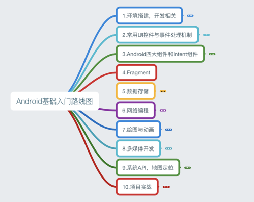

# 1.0 Android基础入门教程

> 来源: https://www.runoob.com/w3cnote/android-tutorial-intro.html

本教程于2015年7月开始撰写，耗时半年，总共148节，涵盖了Android基础入门的大部分知识，由于当时能力局限，虽已竭尽全力，但对于一些问题的分析难免有所纰漏，敬请读者海涵！IT技术更新换代很快，想想2015年还是Android 5.1横行，如今到了2018年都已经Android 8.0了，开发工具Android Studio也更新到了Android Studio 3.0.1。本系列的教程可能有些地方已经过时了，比如6.0以后的动态权限申请。一个人的力量是有限的，而且也有自己的工作忙，不可能去另外整一个大更新，今天写的，可能过几个月就过时了，这是IT界的常态，所以还是得自己学会主动去获取知识的能力，提供几个常备的知识获取站点吧，平时闲着没事可以自己上去获取知识：

-

**Android官网**：
[https://developer.android.google.cn/index.html](https://developer.android.google.cn/index.html)

-

**Android官网**：
[https://developer.android.com/index.html](https://developer.android.com/index.html)

当然除此之外还有很多，更多可见：
[https://github.com/coder-pig/Android-Storage-Box](https://github.com/coder-pig/Android-Storage-Box)但是切记一点，你是**按需学习**，而不是一个收破烂的，收藏一堆链接，收藏了你就会了，其实收集得越多，你会越浮躁！

附本系列教程的思维导图：

[完整思维导图 PDF](//www.runoob.com/wp-content/uploads/2015/06/androidmap.pdf)

> 假如本系列的教程为你学习Android开发带来一定的便利，不妨小额打赏下小猪，让小猪有动力写出更多更好的教程~

> **非常感谢站长FK大佬**提供的平台以及一直以来的支持！

>  

> 路漫漫其修远兮，吾将上下而求索，自学之路不易，与君共勉，加油~

> **-- CoderPig**

> 

### 图片清单

1. 图1 -> images/image_1c58e950q14da167k1nqpu2hn5e9.png （原图：https://www.runoob.com/wp-content/uploads/2015/06/image_1c58e950q14da167k1nqpu2hn5e9.png）
2. 图2 -> images/image_1c58ei5gous913nv14vr19cv1j87m.png （原图：https://www.runoob.com/wp-content/uploads/2015/06/image_1c58ei5gous913nv14vr19cv1j87m.png）
3. 图3 -> images/image_1c58ekcj618fmg0r6h911a03p01g.png （原图：https://www.runoob.com/wp-content/uploads/2015/06/image_1c58ekcj618fmg0r6h911a03p01g.png）
4. 图4 -> images/image_1c58eo46nj961rem1ipd1n631b0t1t-1.png （原图：https://www.runoob.com/wp-content/uploads/2015/06/image_1c58eo46nj961rem1ipd1n631b0t1t-1.png）
