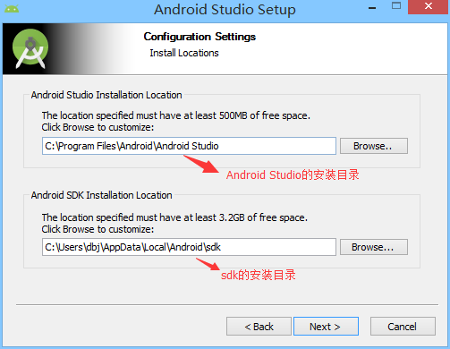
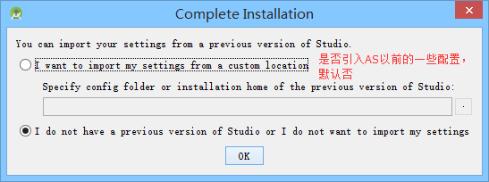
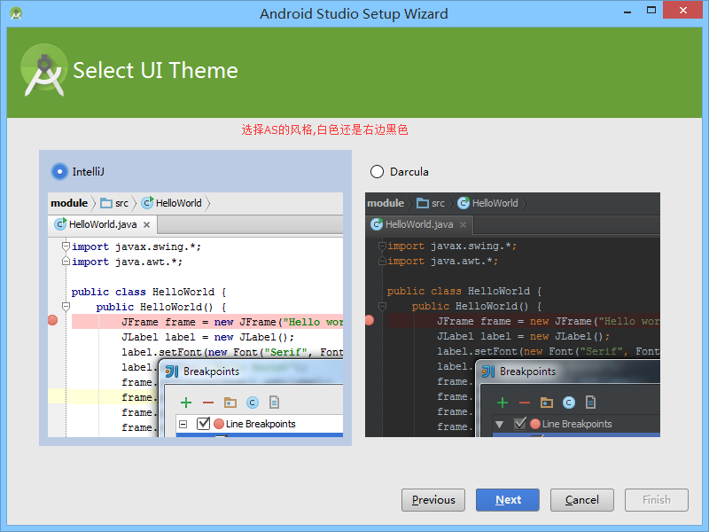
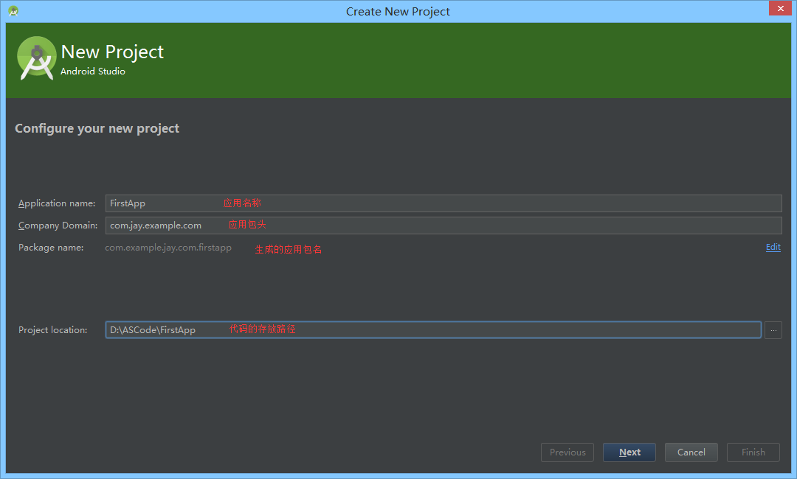
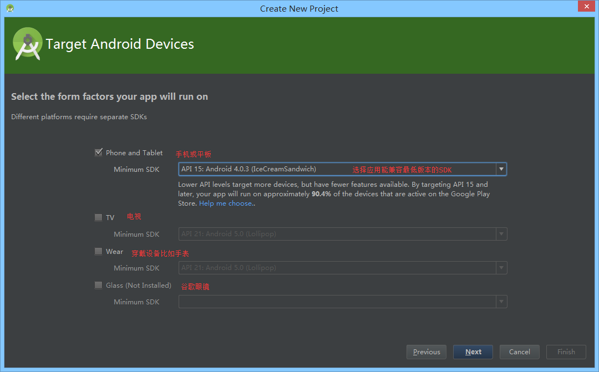
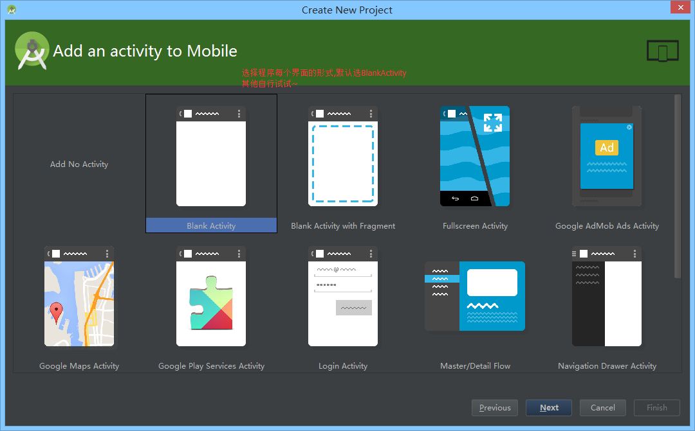
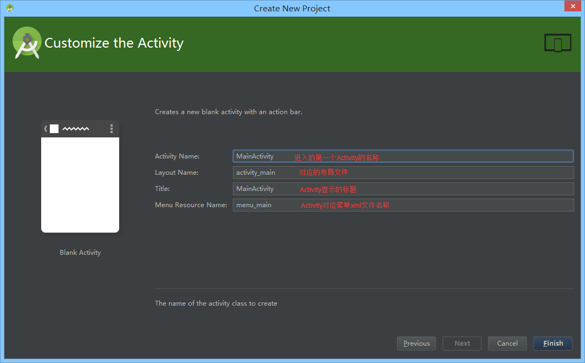
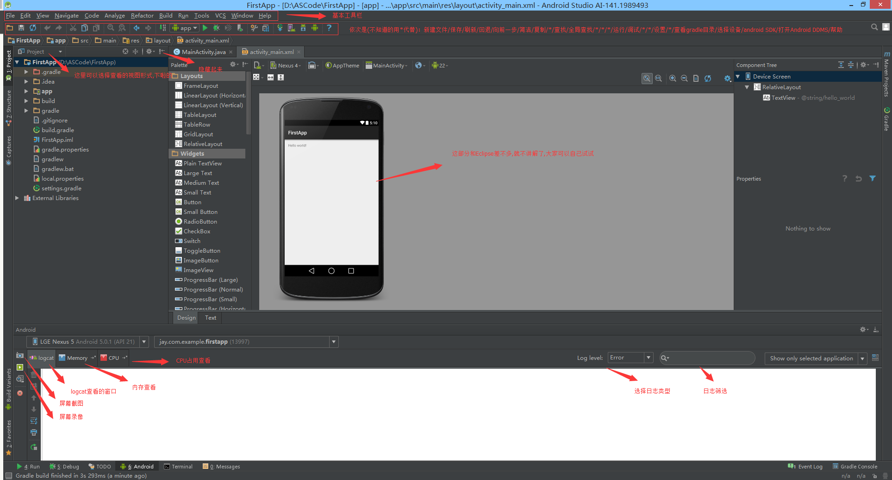
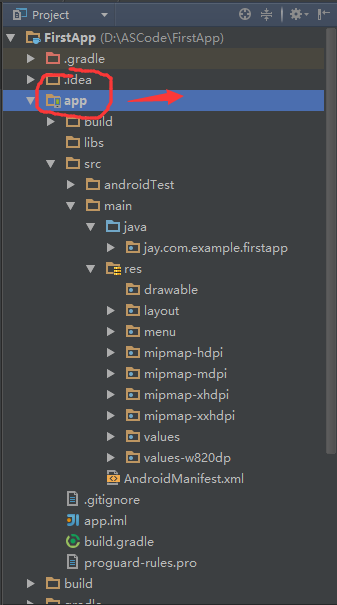
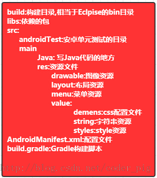

# 1.2.2 使用Android Studio开发Android APP

> 来源: https://www.runoob.com/w3cnote/android-tutorial-android-studio.html

## 写在前面

> 本节将介绍如何使用Android Studio开发Android APP，和前面Eclipse + ADT + SDK搭建Android开发环境一样，本节也只是介绍一些基本东西，深入的，比如快捷键，小技巧等会再另一篇文章中详细地介绍！

## 1.下载Android Studio

---

> **官网下载：**[Android Studio for Window ...](https://developer.android.com/sdk/installing/studio.html)
> **百度云下载：**[android-studio-bundle-141.1903250-windows.exe](http://pan.baidu.com/s/1eRhG7i6)

---

## 2.安装Android Studio

傻瓜式的下一步而已，只列出需要注意的页面：

---

## 3.新建工程

安装完毕后，打开我们的Android Studio，第一次启动需要下载SDK等一些东西，时间比较长，笔者等了大概40分钟才下载完毕

选择第一项,新建一个Android项目

选择开发程序将运行在哪个平台上：

选择Activity的风格：

设置进入程序一个页面后的Activity的一些信息

Finish然后是漫长的等待~

---

## 4.IDE的界面分析

先看下整个界面吧：

接着看下我们的项目结构，而我们一般关心的只是app这个目录：

---

## 5.运行下程序试试

点击菜单栏的X，即可运行程序：

---

## 6.本节小结

Android Studio的用法还是比较简单的，当然笔者也是刚用Android Studio，后续还会写一篇更深入一点的文章，这里大家琢磨琢磨，暂时能跑起程序，知道在哪里写代码，怎么看Logcat就可以了！

### 图片清单

1. 图1 -> images/37629412.jpg （原图：https://www.runoob.com/wp-content/uploads/2015/06/37629412.jpg）
2. 图2 -> images/80955491.jpg （原图：https://www.runoob.com/wp-content/uploads/2015/06/80955491.jpg）
3. 图3 -> images/32258046.jpg （原图：https://www.runoob.com/wp-content/uploads/2015/06/32258046.jpg）
4. 图4 -> images/53702708.jpg （原图：https://www.runoob.com/wp-content/uploads/2015/06/53702708.jpg）
5. 图5 -> images/68055206.jpg （原图：https://www.runoob.com/wp-content/uploads/2015/06/68055206.jpg）
6. 图6 -> images/15488374.jpg （原图：https://www.runoob.com/wp-content/uploads/2015/06/15488374.jpg）
7. 图7 -> images/40394803.jpg （原图：https://www.runoob.com/wp-content/uploads/2015/06/40394803.jpg）
8. 图8 -> images/25153924.jpg （原图：https://www.runoob.com/wp-content/uploads/2015/06/25153924.jpg）
9. 图9 -> images/45530458.jpg （原图：https://www.runoob.com/wp-content/uploads/2015/06/45530458.jpg）
10. 图10 -> images/23057310.jpg （原图：https://www.runoob.com/wp-content/uploads/2015/06/23057310.jpg）
11. 图11 -> images/18951197.jpg （原图：https://www.runoob.com/wp-content/uploads/2015/06/18951197.jpg）
12. 图12 -> images/8577140.jpg （原图：https://www.runoob.com/wp-content/uploads/2015/06/8577140.jpg）
