# 开发环境与工程基础

> 本章归并自 15 页教程代码块，来源见各节。

## 1.0 Android基础入门教程

> 来源: https://www.runoob.com/w3cnote/android-tutorial-intro.html

本教程于2015年7月开始撰写，耗时半年，总共148节，涵盖了Android基础入门的大部分知识，由于当时能力局限，虽已竭尽全力，但对于一些问题的分析难免有所纰漏，敬请读者海涵！IT技术更新换代很快，想想2015年还是Android 5.1横行，如今到了2018年都已经Android 8.0了，开发工具Android Studio也更新到了Android Studio 3.0.1。本系列的教程可能有些地方已经过时了，比如6.0以后的动态权限申请。一个人的力量是有限的，而且也有自己的工作忙，不可能去另外整一个大更新，今天写的，可能过几个月就过时了，这是IT界的常态，所以还是得自己学会主动去获取知识的能力，提供几个常备的知识获取站点吧，平时闲着没事可以自己上去获取知识：

-

**Android官网**：
[https://developer.android.google.cn/index.html](https://developer.android.google.cn/index.html)

-

**Android官网**：
[https://developer.android.com/index.html](https://developer.android.com/index.html)

当然除此之外还有很多，更多可见：
[https://github.com/coder-pig/Android-Storage-Box](https://github.com/coder-pig/Android-Storage-Box)但是切记一点，你是**按需学习**，而不是一个收破烂的，收藏一堆链接，收藏了你就会了，其实收集得越多，你会越浮躁！

附本系列教程的思维导图：


[完整思维导图 PDF](//www.runoob.com/wp-content/uploads/2015/06/androidmap.pdf)

> 假如本系列的教程为你学习Android开发带来一定的便利，不妨小额打赏下小猪，让小猪有动力写出更多更好的教程~

> **非常感谢站长FK大佬**提供的平台以及一直以来的支持！

>  

> 路漫漫其修远兮，吾将上下而求索，自学之路不易，与君共勉，加油~

> **-- CoderPig**

> 

### 图片清单

1. 图1 -> images/image_1c58e950q14da167k1nqpu2hn5e9.png （原图：https://www.runoob.com/wp-content/uploads/2015/06/image_1c58e950q14da167k1nqpu2hn5e9.png）
2. 图2 -> images/image_1c58ei5gous913nv14vr19cv1j87m.png （原图：https://www.runoob.com/wp-content/uploads/2015/06/image_1c58ei5gous913nv14vr19cv1j87m.png）
3. 图3 -> images/image_1c58ekcj618fmg0r6h911a03p01g.png （原图：https://www.runoob.com/wp-content/uploads/2015/06/image_1c58ekcj618fmg0r6h911a03p01g.png）
4. 图4 -> images/image_1c58eo46nj961rem1ipd1n631b0t1t-1.png （原图：https://www.runoob.com/wp-content/uploads/2015/06/image_1c58eo46nj961rem1ipd1n631b0t1t-1.png）

## 1.1 背景相关与系统架构分析

> 来源: https://www.runoob.com/w3cnote/android-tutorial-system-architecture-analysis.html

## 1.Android背景与当前的状况

Android系统是由Andy Rubin创建的，后来被Google收购了；最早的版本是:Android 1.1版本
而现在最新的版本是今年5.28，Google I/O大会上推出的Android M，有趣的是Android系统的命名都是以点心来命名的，下述表是15个Android版本名称，对应API号以及发布时间！

| 系统版本名称 
 | API版本号 
 | 发布时间

| Android 1.5：Cupcake：纸杯蛋糕 
 | 3 
 | 2009.4.30

| Android 1.6：Donut：甜甜圈 
 | 4 
 | 2009.9.15

| Android 2.0/2.0.1/2.1：Eclair：松饼 
 | 5/6/7 
 | 2009.10.26

| Android 2.2/2.2.1：Froyo：冻酸奶 
 | 8 
 | 2010.5.20

| Android 2.3：Gingerbread：姜饼 
 | 9 
 | 2010.12.7

| Android 3.0：Honeycomb：蜂巢 
 | 11 
 | 2011.2.2

| Android 3.1：Honeycomb：蜂巢 
 | 12 
 | 2011.5.11

| Android 3.2：Honeycomb：蜂巢 
 | 13 
 | 2011.7.13

| Android 4.0：Ice Cream Sandwich：冰激凌三文治 
 | 14 
 | 2011.10.19

| Android 4.1：Jelly Bean：果冻豆 
 | 16 
 | 2012.6.28

| Android 4.2：Jelly Bean：果冻豆 
 | 17 
 | 2012.10.30

| Android 4.3：Jelly Bean：果冻豆 
 | 18 
 | 2013.7.25

| Android 4.4：KitKat：奇巧巧克力 
 | 19 
 | 2013.11.01

| Android 5.0：Lollipop：棒棒糖 
 | 21 
 | 2014.10.16

| Android M：预览版 
 | 22 
 | 2015.5.28

好了，除了上面这些公共版本外，当然还有一些其他的版本，截止2015.1，各个版本的市场份额如下：

## 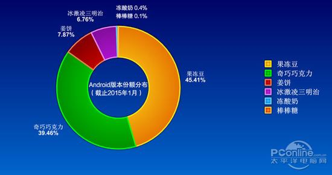

看完上面的信息，我们可能有这样的一个疑问：
那么多的系统版本，我们开发的时候要针对哪个版本进行开发？
这就是作为一个Android必须面对的Android的"碎片化"问题了，而这个问题又分为两个：
①系统碎片化：我们开发App时可能需要做到低版本兼容，比如，最低兼容至2.3版本；由于各种Rom定制的盛行，国人都喜欢对原生系统做一些更改，这导致了在原生系统上可行，而在定制Rom上不可行的问题，比如相机调用~
②屏幕碎片化：市面上各种各样屏幕尺寸的手机，4.3寸，4.5寸，4.7寸，5.0寸，5.3寸...等等，除了手机外，还有Android平板，所以开发时我们可能要处理这个屏幕适配的问题，当然，刚学我们并不需要去考虑这些复杂的东西，后续实际开发我们再来深究！

## 2.Android系统特性与平台架构

### 系统特性：

> - 应用程序框架支持**组件的重用与替换**（app发布时遵守了框架的约定，其他app也可以使用该模块）

> - **Dalvik**虚拟机:专门为移动设备优化
> -集成的浏览器:开源的**WebKit**引擎

> - **SQLite**结构化的数据存储

> - 优化的图形库,多媒体支持,GSM电话技术,蓝牙等

> - 采用**软件叠层**方式构建

### 平台架构图：

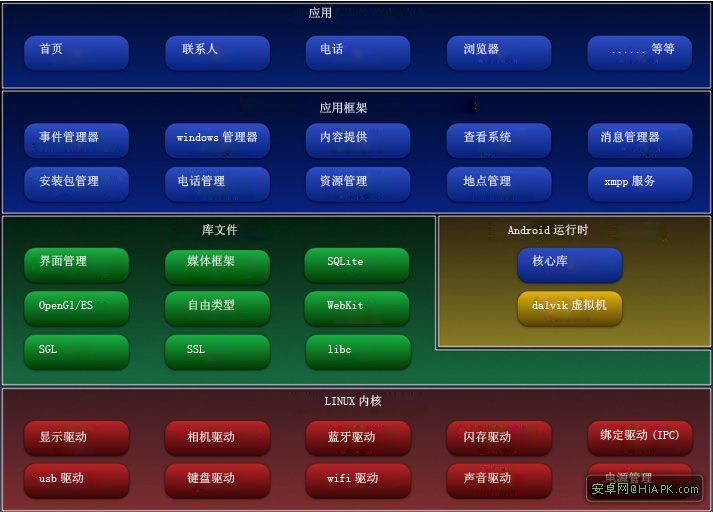

### 架构的简单理解：

> - **Application(应用程序层)**
> 我们一般说的应用层的开发就是在这个层次上进行的，当然包括了系统内置的一组应用程序，使用的是Java语言

> - **Application Framework(应用程序框架层)**
> 无论系统内置或者我们自己编写的App，都需要使用到这层，比如我们想弄来电黑名单，自动挂断电话，我们就需要用到电话管理(TelephonyManager)
> 通过该层我们就可以很轻松的实现挂断操作，而不需要关心底层实现

> - **Libraries(库) + Android Runtime(Android运行时)**
> Android给我们提供了一组C/C++库，为平台的不同组件所使用，比如媒体框架；而Android Runtime则由Android核心库集 + Dalvik虚拟机构成，Dalvik虚拟机是针对移动设备的虚拟机，它的特点:不需要很快的CPU计算速度和大量的内存空间;而每个App都单独地运行在单独的Dalvik虚拟机内每个app对于一条Dalvik进程）而他的简单运行流程如：
> 

> - **Linux内核**
> 这里就是涉及底层驱动的东西了，一些系统服务，比如安全性，内存管理以及进程管理等

## 3.本节小结：

本节对Android的历史背景以及现状进行了了解，然后简单分析了Android的系统特性以及系统架构，这些概念性的东西，我们了解了解即可，而下一节我们将开始Android环境的搭建！

### 图片清单

1. 图1 -> images/81149929.jpg （原图：https://www.runoob.com/wp-content/uploads/2015/06/81149929.jpg）
2. 图2 -> images/16510882.jpg （原图：https://www.runoob.com/wp-content/uploads/2015/06/16510882.jpg）
3. 图3 -> images/12352621.jpg （原图：https://www.runoob.com/wp-content/uploads/2015/06/12352621.jpg）

## 1.0.1 2015年最新Android基础入门教程目录

> 来源: https://www.runoob.com/w3cnote/android-tutorial-contents.html

## 前言：

关于《2015年最新Android基础入门教程目录》终于在今天落下了帷幕，全套教程
共148节已编写完毕，附上目录，关于教程的由来，笔者的情况和自学心得，资源分享
以及一些疑问等可戳：[《2015最新Android基础入门教程》完结散花~](http://blog.csdn.net/coder_pig/article/details/50000795)
下面是本系列教程的完整目录：

- [1.0 Android基础入门教程](//www.runoob.com/w3cnote/android-tutorial-intro.html)

- [1.1 背景相关与系统架构分析](//www.runoob.com/w3cnote/android-tutorial-system-architecture-analysis.html)

- [1.2 开发环境搭建](//www.runoob.com/w3cnote/android-tutorial-development-environment-build.html)

- [1.2.1 使用Eclipse + ADT + SDK开发Android APP](//www.runoob.com/w3cnote/android-tutorial-eclipse-adt-sdk-app.html)

- [1.2.2 使用Android Studio开发Android APP](//www.runoob.com/w3cnote/android-tutorial-android-studio.html)

- [1.3 SDK更新不了问题解决](//www.runoob.com/w3cnote/android-tutorial-sdk-problem-solve.html)

- [1.4 Genymotion模拟器安装](//www.runoob.com/w3cnote/android-tutorial-genymotion-install.html)

- [1.5.1 Git使用教程之本地仓库的基本操作](//www.runoob.com/w3cnote/android-tutorial-git-repo-operate.html)

- [1.5.2 Git之使用GitHub搭建远程仓库](//www.runoob.com/w3cnote/android-tutorial-git-repo-create.html)

- [1.6 .9(九妹)图片怎么玩](//www.runoob.com/w3cnote/android-tutorial-9-image.html)

- [1.7 界面原型设计](//www.runoob.com/w3cnote/android-tutorial-interface-design.html)

- [1.8 工程相关解析(各种文件，资源访问)](//www.runoob.com/w3cnote/android-tutorial-project-src-analysis.html)

- [1.9 Android程序签名打包](//www.runoob.com/w3cnote/android-tutorial-sign-package.html)

- [1.11 反编译APK获取代码&资源](//www.runoob.com/w3cnote/android-tutorial-decompile-apk-get-code-resources.html)

- [2.1 View与ViewGroup的概念](//www.runoob.com/w3cnote/android-tutorial-view-viewgroup-intro.html)

- [2.2.1 LinearLayout(线性布局)](//www.runoob.com/w3cnote/android-tutorial-linearlayout.html)

- [2.2.2 RelativeLayout(相对布局)](//www.runoob.com/w3cnote/android-tutorial-relativelayout.html)

- [2.2.3 TableLayout(表格布局)](//www.runoob.com/w3cnote/android-tutorial-tablelayout.html)

- [2.2.4 FrameLayout(帧布局)](//www.runoob.com/w3cnote/android-tutorial-framelayout.html)

- [2.2.5 GridLayout(网格布局)](//www.runoob.com/w3cnote/android-tutorial-gridlayout.html)

- [2.2.6 AbsoluteLayout(绝对布局)](//www.runoob.com/w3cnote/android-tutorial-absolutelayout.html)

- [2.3.1 TextView(文本框)详解](//www.runoob.com/w3cnote/android-tutorial-textview.html)

- [2.3.2 EditText(输入框)详解](//www.runoob.com/w3cnote/android-tutorial-edittext.html)

- [2.3.3 Button(按钮)与ImageButton(图像按钮)](//www.runoob.com/w3cnote/android-tutorial-button-imagebutton.html)

- [2.3.4 ImageView(图像视图)](//www.runoob.com/w3cnote/android-tutorial-imageview.html)

- [2.3.5.RadioButton(单选按钮)&Checkbox(复选框)](//www.runoob.com/w3cnote/android-tutorial-radiobutton-checkbox.html)

- [2.3.6 开关按钮ToggleButton和开关Switch](//www.runoob.com/w3cnote/android-tutorial-togglebutton-switch.html)

- [2.3.7 ProgressBar(进度条)](//www.runoob.com/w3cnote/android-tutorial-progressbar.html)

- [2.3.8 SeekBar(拖动条)](//www.runoob.com/w3cnote/android-tutorial-seekbar.html)

- [2.3.9 RatingBar(星级评分条)](//www.runoob.com/w3cnote/android-tutorial-ratingbar.html)

- [2.4.1 ScrollView(滚动条)](//www.runoob.com/w3cnote/android-tutorial-scrollview.html)

- [2.4.2 Date & Time组件(上)](//www.runoob.com/w3cnote/android-tutorial-date-time-1.html)

- [2.4.3 Date & Time组件(下)](//www.runoob.com/w3cnote/android-tutorial-date-time-2.html)

- [2.4.4 Adapter基础讲解](//www.runoob.com/w3cnote/android-tutorial-adapter.html)

- [2.4.5 ListView简单实用](//www.runoob.com/w3cnote/android-tutorial-listview.html)

- [2.4.6 BaseAdapter优化](//www.runoob.com/w3cnote/android-tutorial-baseadapter.html)

- [2.4.7ListView的焦点问题](//www.runoob.com/w3cnote/android-tutorial-listview-focus.html)

- [2.4.8 ListView之checkbox错位问题解决](//www.runoob.com/w3cnote/android-tutorial-listview-checkbox.html)

- [2.4.9 ListView的数据更新问题](//www.runoob.com/w3cnote/android-tutorial-listview-update.html)

- [2.5.0 构建一个可复用的自定义BaseAdapter](//www.runoob.com/w3cnote/android-tutorial-customer-baseadapter.html)

- [2.5.1 ListView Item多布局的实现](//www.runoob.com/w3cnote/android-tutorial-listview-item.html)

- [2.5.2 GridView(网格视图)的基本使用](//www.runoob.com/w3cnote/android-tutorial-gridview.html)

- [2.5.3 Spinner(列表选项框)的基本使用](//www.runoob.com/w3cnote/android-tutorial-spinner.html)

- [2.5.4 AutoCompleteTextView(自动完成文本框)的基本使用](//www.runoob.com/w3cnote/android-tutorial-autocompletetextview.html)

- [2.5.5 ExpandableListView(可折叠列表)的基本使用](//www.runoob.com/w3cnote/android-tutorial-expandablelistview.html)

- [2.5.6 ViewFlipper(翻转视图)的基本使用](//www.runoob.com/w3cnote/android-tutorial-viewflipper.html)

- [2.5.7 Toast(吐司)的基本使用](//www.runoob.com/w3cnote/android-tutorial-toast.html)

- [2.5.8 Notification(状态栏通知)详解](//www.runoob.com/w3cnote/android-tutorial-notification.html)

- [2.5.9 AlertDialog(对话框)详解](//www.runoob.com/w3cnote/android-tutorial-alertdialog.html)

- [2.6.0 其他几种常用对话框基本使用](//www.runoob.com/w3cnote/android-tutorial-dialog.html)

- [2.6.1 PopupWindow(悬浮框)的基本使用](//www.runoob.com/w3cnote/android-tutorial-popupwindow.html)

- [2.6.2 菜单(Menu)](//www.runoob.com/w3cnote/android-tutorial-menu.html)

- [2.6.3 ViewPager的简单使用](//www.runoob.com/w3cnote/android-tutorial-viewpager.html)

- [2.6.4 DrawerLayout(官方侧滑菜单)的简单使用](//www.runoob.com/w3cnote/android-tutorial-drawerlayout.html)

- [3.1.1 基于监听的事件处理机制](//www.runoob.com/w3cnote/android-tutorial-listen-event-handle.html)

- [3.2 基于回调的事件处理机制](//www.runoob.com/w3cnote/android-tutorial-callback-event-handle.html)

- [3.3 Handler消息传递机制浅析](//www.runoob.com/w3cnote/android-tutorial-handler-message.html)

- [3.4 TouchListener PK OnTouchEvent + 多点触碰](//www.runoob.com/w3cnote/android-tutorial-touchlistener-ontouchevent.html)

- [3.5 监听EditText的内容变化](//www.runoob.com/w3cnote/android-tutorial-listener-edittext-change.html)

- [3.6 响应系统设置的事件(Configuration类)](//www.runoob.com/w3cnote/android-tutorial-configuration.html)

- [3.7 AnsyncTask异步任务](//www.runoob.com/w3cnote/android-tutorial-ansynctask.html)

- [3.8 Gestures(手势)](//www.runoob.com/w3cnote/android-tutorial-gestures.html)

- [4.1.1 Activity初学乍练](//www.runoob.com/w3cnote/android-tutorial-activity.html)

- [4.1.2 Activity初窥门径](//www.runoob.com/w3cnote/android-tutorial-activity-start.html)

- [4.1.3 Activity登堂入室](//www.runoob.com/w3cnote/android-tutorial-activity-intro.html)

- [4.2.1 Service初涉](//www.runoob.com/w3cnote/android-tutorial-service-1.html)

- [4.2.2 Service进阶](//www.runoob.com/w3cnote/android-tutorial-service-2.html)

- [4.2.3 Service精通](//www.runoob.com/w3cnote/android-tutorial-service-3.html)

- [4.3.1 BroadcastReceiver牛刀小试](//www.runoob.com/w3cnote/android-tutorial-broadcastreceiver.html)

- [4.3.2 BroadcastReceiver庖丁解牛](//www.runoob.com/w3cnote/android-tutorial-broadcastreceiver-2.html)

- [4.4.1 ContentProvider初探](//www.runoob.com/w3cnote/android-tutorial-contentprovider.html)

- [4.4.2 ContentProvider再探——Document Provider](//www.runoob.com/w3cnote/android-tutorial-contentprovider-2.html)

- [4.5.1 Intent的基本使用](//www.runoob.com/w3cnote/android-tutorial-intent-base.html)

- [4.5.2 Intent之复杂数据的传递](//www.runoob.com/w3cnote/android-tutorial-intent-pass-data.html)

- [5.1 Fragment基本概述](//www.runoob.com/w3cnote/android-tutorial-fragment-base.html)

- [5.2.1 Fragment实例精讲——底部导航栏的实现(方法1)](//www.runoob.com/w3cnote/android-tutorial-fragment-demo1.html)

- [5.2.2 Fragment实例精讲——底部导航栏的实现(方法2)](//www.runoob.com/w3cnote/android-tutorial-fragment-demo2.html)

- [5.2.3 Fragment实例精讲——底部导航栏的实现(方法3)](//www.runoob.com/w3cnote/android-tutorial-fragment-demo3.html)

- [5.2.4 Fragment实例精讲——底部导航栏+ViewPager滑动切换页面](//www.runoob.com/w3cnote/android-tutorial-fragment-demo4.html)

- [5.2.5 Fragment实例精讲——新闻(购物)类App列表Fragment的简单实现](//www.runoob.com/w3cnote/android-tutorial-fragment-demo5.html)

- [6.1 数据存储与访问之——文件存储读写](//www.runoob.com/w3cnote/android-tutorial-file.html)

- [6.2 数据存储与访问之——SharedPreferences保存用户偏好参数](//www.runoob.com/w3cnote/android-tutorial-sharedpreferences.html)

- [6.3.1 数据存储与访问之——初见SQLite数据库](//www.runoob.com/w3cnote/android-tutorial-sqlite-intro.html)

- [6.3.2 数据存储与访问之——又见SQLite数据库](//www.runoob.com/w3cnote/android-tutorial-sqlite-2.html)

- [7.1.1 Android网络编程要学的东西与Http协议学习](//www.runoob.com/w3cnote/android-tutorial-http.html)

- [7.1.2 Android Http请求头与响应头的学习](//www.runoob.com/w3cnote/android-tutorial-http-response-header.html)

- [7.1.3 Android HTTP请求方式:HttpURLConnection](//www.runoob.com/w3cnote/android-tutorial-httpurlconnection.html)

- [7.1.4 Android HTTP请求方式:HttpClient](//www.runoob.com/w3cnote/android-tutorial-httpclient.html)

- [7.2.1 Android XML数据解析](//www.runoob.com/w3cnote/android-tutorial-xml.html)

- [7.2.2 Android JSON数据解析](//www.runoob.com/w3cnote/android-tutorial-json.html)

- [7.3.1 Android 文件上传](//www.runoob.com/w3cnote/android-tutorial-upload-file.html)

- [7.3.2 Android 文件下载（1）](//www.runoob.com/w3cnote/android-tutorial-download1.html)

- [7.3.3 Android 文件下载（2）](//www.runoob.com/w3cnote/android-tutorial-download2.html)

- [7.4 Android 调用 WebService](//www.runoob.com/w3cnote/android-tutorial-webservice.html)

- [7.5.1 WebView(网页视图)基本用法](//www.runoob.com/w3cnote/android-tutorial-webview.html)

- [7.5.2 WebView和JavaScrip交互基础](//www.runoob.com/w3cnote/android-tutorial-webview-javascrip.html)

- [7.5.3 Android 4.4后WebView的一些注意事项](//www.runoob.com/w3cnote/android-tutorial-webview-attention.html)

- [7.5.4 WebView文件下载](//www.runoob.com/w3cnote/android-tutorial-webview-download-file.html)

- [7.5.5 WebView缓存问题](//www.runoob.com/w3cnote/android-tutorial-webview-cache.html)

- [7.5.6 WebView处理网页返回的错误码信息](//www.runoob.com/w3cnote/android-tutorial-webview-error-code.html)

- [7.6.1 Socket学习网络基础准备](//www.runoob.com/w3cnote/android-tutorial-socket-intro.html)

- [7.6.2 基于TCP协议的Socket通信(1)](//www.runoob.com/w3cnote/android-tutorial-socket1.html)

- [7.6.3 基于TCP协议的Socket通信(2)](//www.runoob.com/w3cnote/android-tutorial-socket2.html)

- [7.6.4 基于UDP协议的Socket通信](//www.runoob.com/w3cnote/android-tutorial-udp-socket.html)

- [8.1.1 Android中的13种Drawable小结 Part 1](//www.runoob.com/w3cnote/android-tutorial-drawable1.html)

- [8.1.2 Android中的13种Drawable小结 Part 2](//www.runoob.com/w3cnote/android-tutorial-drawable2.html)

- [8.1.3 Android中的13种Drawable小结 Part 3](//www.runoob.com/w3cnote/android-tutorial-drawable3.html)

- [8.2.1 Bitmap(位图)全解析 Part 1](//www.runoob.com/w3cnote/android-tutorial-bitmap1.html)

- [8.2.2 Bitmap引起的OOM问题](//www.runoob.com/w3cnote/android-tutorial-bitmap2.html)

- [8.3.1 三个绘图工具类详解](//www.runoob.com/w3cnote/android-tutorial-drawable-tool.html)

- [8.3.2 绘图类实战示例](//www.runoob.com/w3cnote/android-tutorial-bitmap-demo.html)

- [8.3.3 Paint API之—— MaskFilter(面具)](//www.runoob.com/w3cnote/android-tutorial-maskfilter.html)

- [8.3.4 Paint API之—— Xfermode与PorterDuff详解(一)](//www.runoob.com/w3cnote/android-tutorial-xfermode-porterduff.html)

- [8.3.5 Paint API之—— Xfermode与PorterDuff详解(二)](//www.runoob.com/w3cnote/android-tutorial-xfermode-porterduff2.html)

- [8.3.6 Paint API之—— Xfermode与PorterDuff详解(三)](//www.runoob.com/w3cnote/android-tutorial-xfermode-porterduff3.html)

- [8.3.7 Paint API之—— Xfermode与PorterDuff详解(四)](//www.runoob.com/w3cnote/android-tutorial-xfermode-porterduff4.html)

- [8.3.8 Paint API之—— Xfermode与PorterDuff详解(五)](//www.runoob.com/w3cnote/android-tutorial-xfermode-porterduff5.html)

- [8.3.9 Paint API之—— ColorFilter(颜色过滤器)(1/3)](//www.runoob.com/w3cnote/android-tutorial-colorfilter1.html)

- [8.3.10 Paint API之—— ColorFilter(颜色过滤器)(2-3)](//www.runoob.com/w3cnote/android-tutorial-colorfilterl2.html)

- [8.3.11 Paint API之—— ColorFilter(颜色过滤器)(3-3)](//www.runoob.com/w3cnote/android-tutorial-colorfilter3.html)

- [8.3.12 Paint API之—— PathEffect(路径效果)](//www.runoob.com/w3cnote/android-tutorial-patheffect.html)

- [8.3.13 Paint API之—— Shader(图像渲染)](//www.runoob.com/w3cnote/android-tutorial-shader.html)

- [8.3.14 Paint几个枚举/常量值以及ShadowLayer阴影效果](//www.runoob.com/w3cnote/android-tutorial-shadowlayer.html)

- [8.3.15 Paint API之——Typeface(字型)](//www.runoob.com/w3cnote/android-tutorial-typeface.html)

- [8.3.16 Canvas API详解(Part 1)](//www.runoob.com/w3cnote/android-tutorial-canvas-api1.html)

- [8.3.17 Canvas API详解(Part 2)剪切方法合集](//www.runoob.com/w3cnote/android-tutorial-canvas-api2.html)

- [8.3.18 Canvas API详解(Part 3)Matrix和drawBitmapMash](//www.runoob.com/w3cnote/android-tutorial-canvas-api3.html)

- [8.4.1 Android动画合集之帧动画](//www.runoob.com/w3cnote/android-tutorial-animation.html)

- [8.4.2 Android动画合集之补间动画](//www.runoob.com/w3cnote/android-tutorial-alphaanimation.html)

- [8.4.3 Android动画合集之属性动画-初见](//www.runoob.com/w3cnote/android-tutorial-valueanimator.html)

- [8.4.4 Android动画合集之属性动画-又见](//www.runoob.com/w3cnote/android-tutorial-valueanimator2.html)

- [9.1 使用SoundPool播放音效(Duang~)](//www.runoob.com/w3cnote/android-tutorial-soundpool.html)

- [9.2 MediaPlayer播放音频与视频](//www.runoob.com/w3cnote/android-tutorial-mediaplayer.html)

- [9.3 使用Camera拍照](//www.runoob.com/w3cnote/android-tutorial-camera.html)

- [9.4 使用MediaRecord录音](//www.runoob.com/w3cnote/android-tutorial-mediarecord.html)

- [10.1 TelephonyManager(电话管理器)](//www.runoob.com/w3cnote/android-tutorial-telephonymanager.html)

- [10.2 SmsManager(短信管理器)](//www.runoob.com/w3cnote/android-tutorial-smsmanager.html)

- [10.3 AudioManager(音频管理器)](//www.runoob.com/w3cnote/android-tutorial-audiomanager.html)

- [10.4 Vibrator(振动器)](//www.runoob.com/w3cnote/android-tutorial-vibrator.html)

- [10.5 AlarmManager(闹钟服务)](//www.runoob.com/w3cnote/android-tutorial-alarmmanager.html)

- [10.6 PowerManager(电源服务)](//www.runoob.com/w3cnote/android-tutorial-powermanager.html)

- [10.7 WindowManager(窗口管理服务)](//www.runoob.com/w3cnote/android-tutorial-windowmanager.html)

- [10.8 LayoutInflater(布局服务)](//www.runoob.com/w3cnote/android-tutorial-layoutinflater.html)

- [10.9 WallpaperManager(壁纸管理器)](//www.runoob.com/w3cnote/android-tutorial-wallpapermanager.html)

- [10.10 传感器专题(1)——相关介绍](//www.runoob.com/w3cnote/android-tutorial-sensor1.html)

- [10.11 传感器专题(2)——方向传感器](//www.runoob.com/w3cnote/android-tutorial-sensor2.html)

- [10.12 传感器专题(3)——加速度/陀螺仪传感器](//www.runoob.com/w3cnote/android-tutorial-sensor3.html)

- [10.12 传感器专题(4)——其他传感器了解](//www.runoob.com/w3cnote/android-tutorial-sensor4.html)

- [10.14 Android GPS初涉](//www.runoob.com/w3cnote/android-tutorial-gps.html)

- 
 [11.《2015最新Android基础入门教程》完结散花~ ](//www.runoob.com/w3cnote/android-tutorial-contents.html)

## 后记：

> 以上就是关于《2015年安卓基础入门教程》的全部内容~
> 假如本系列的教程为你学习Android开发带来一定的便利，不妨小额打赏下小猪，
> 
> 当然，不打赏也没什么，帮忙点个赞，留下你的评论，就是对小猪的支持了，
> 好了，就说这么多，谢谢~有问题请到小猪群反馈：[小猪Android开发交流群](http://jq.qq.com/?_wv=1027&k=eywmYi)

### 图片清单

1. 图1 -> images/82345843.jpg （原图：https://www.runoob.com/wp-content/uploads/2015/11/82345843.jpg）

## 1.2 开发环境搭建

> 来源: https://www.runoob.com/w3cnote/android-tutorial-development-environment-build.html

> 现在主流的Android开发环境有:
> ①Eclipse + ADT + SDK
> ②Android Studio + SDK
> ③IntelliJ IDEA + SDK
> 现在国内大部分开发人员还是使用的Eclipse，而谷歌宣布不再更新ADT后，并且官网也去掉了集成Android开发环境的Eclipse下载链接，各种现象都表示开发者最后都终将过渡到Android Studio，当然这段过渡时间会很长，但如果你是刚学Android的话建议直接冲Android Studio着手；而且很多优秀的开源项目都是基于Android Studio！当然，在本教程中对两种开发环境都会进行一个介绍，用哪个取决与你自己~
> 还有一个IntelliJ，和Android Studio差不多的，并不对此进行讲解！

## 1.JDK安装与配置

> -

> **Step 1:下载JDK**
> 可以到官网进行下载：[Jdk官方下载](http://www.oracle.com/technetwork/java/javase/downloads/index-jsp-138363.html)
> 也可到笔者网盘下载：[笔者网盘](http://pan.baidu.com/s/1o6LxZHC)
> PS:这个随便下一个都可以，关系不大，32位的只能下32位哦！

> -

> **Step 2:JDK安装**
> 傻瓜式的下一步即可！

> -

> **Step 3:环境变量的配置**
> 配置环境变量是为了方便我们一些命令行的操作，后续会用到！
> **右键我的电脑——>高级——>环境变量**
> 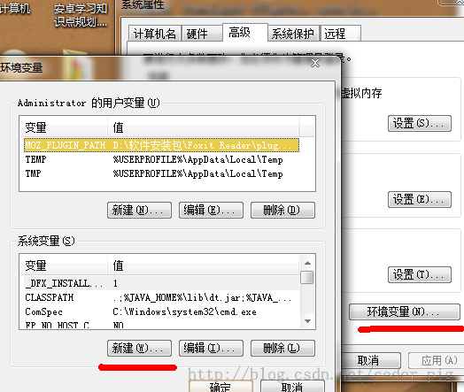
> **新建JAVA_HOME**
> 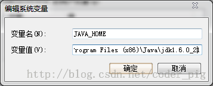
> **修改PATH变量，别把原本的东西删掉！！！！**
> 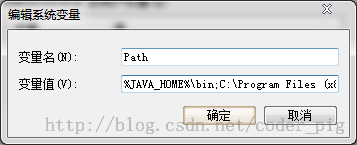
> **新建CLASSPATH**
> 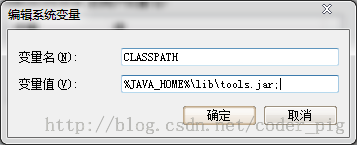
> **验证环境是否配置完成**
> 打开电脑的cmd(命令行)，win键 + R输入cmd，然后在命令行依次javac和java，出现如图效果表示配置完成：
> 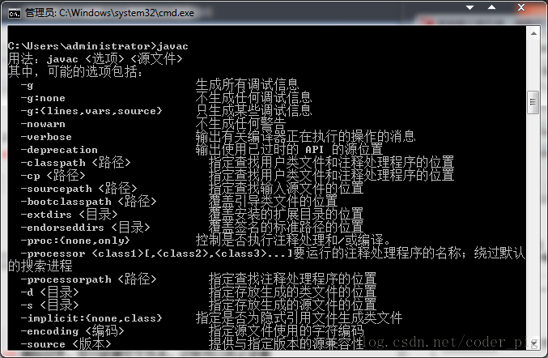

## 2.开发工具二选一

> 一开始也说了开发环境IDE的现状，另外前面忘记说一点:Android Studio是比较吃配置的，如果电脑不怎么好，建议还是先使用Eclipse进行Android开发，下面先说下我们熟悉IDE开发APP的流程，按照下述流程来熟悉IDE的使用：

> 

> 然后下面两个选一个，开始我们的Android开发之路吧！

> **Eclipse + ADT + SDK：**
> **Android Studio + SDK：**

## 3.相关术语的解析

> - **Dalvik：** Android特有的虚拟机,和JVM不同,Dalvik虚拟机非常适合在移动终端上使用!

> - **AVD：** (android virtual machine):安卓虚拟设备,就是安卓的模拟器

> - **ADT：** (android development tools)安卓开发工具

> - **SDK：**(software development kit)软件开发工具包,就是安卓系统,平台架构等的工具集合,如adb.exe

> - **DDMS：**(dalvik debug monitor service)安卓调试工具

> - **adb：**安卓调试桥,在sdk的platform-tools目录下,功能很多,命令行必备

> - **DX工具：**将.class转换成.dex文件

> - **AAPT：**(android asset packing tool),安卓资源打包工具

> - **R.java文件：**由aapt工具根据App中的资源文件自动生成,可以理解为资源字典

> - **AndroidManifest.xml：**app包名 + 组件声明 + 程序兼容的最低版本 + 所需权限等程序的配置文件

后续内容对于初学者的你可能有点难度，但后面回头，你会发现这些东西很有用~
看不懂的话，可以先跳过

## 4.ADB命令行的一些指令

> 执行ADB指令之前我们还需要为我们的SDK配置一下环境变量
> **Step 1:**新建一个ANDROID_HOME的环境变量，把sdk根目录地址贴上去：
> 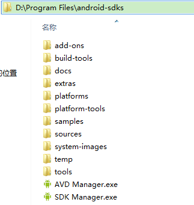
> **Step 2:**更新Path环境变量，在Paht开头加上：**%ANDROID_HOME%\tools;** 即可
> 配置完了，接下来就来学习指令了：
> 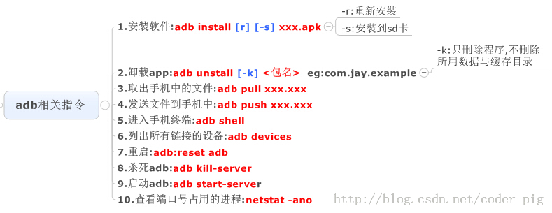

## 5.APP程序打包与安装的流程：

> 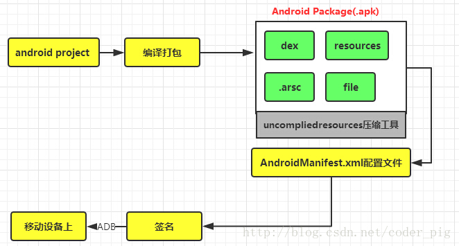

## 6.APP的安装过程：

> 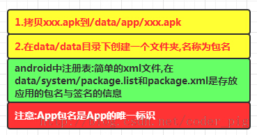

## 7.本节小结

> 本节我们对Android开发IDE的现状进行了分析，建议初学者硬件条件允许的话，使用Android Studio来进行Android APP的开发，讲述了JDK的安装与配置，以及熟悉IDE的流程，一些关键名称的解析，ADB命令行的常用指令，最后还有程序的打包安装和安装过程的解析！经过这章相信大家对Android开发有了个简单了解，了解开发一个程序的流程，以及对应的项目目录结构！相信大家会抱怨模拟器AVD跑得很慢，下节会给大家介绍一个比真机还快的Android模拟器——Genymotion的安装使用！

### 图片清单

1. 图1 -> images/39936377.jpg （原图：https://www.runoob.com/wp-content/uploads/2015/06/39936377.jpg）
2. 图2 -> images/12299725.jpg （原图：https://www.runoob.com/wp-content/uploads/2015/06/12299725.jpg）
3. 图3 -> images/80572641.jpg （原图：https://www.runoob.com/wp-content/uploads/2015/06/80572641.jpg）
4. 图4 -> images/87557685.jpg （原图：https://www.runoob.com/wp-content/uploads/2015/06/87557685.jpg）
5. 图5 -> images/40813475.jpg （原图：https://www.runoob.com/wp-content/uploads/2015/06/40813475.jpg）
6. 图6 -> images/62458334.jpg （原图：https://www.runoob.com/wp-content/uploads/2015/06/62458334.jpg）
7. 图7 -> images/4497768.jpg （原图：https://www.runoob.com/wp-content/uploads/2015/06/4497768.jpg）
8. 图8 -> images/95349283.jpg （原图：https://www.runoob.com/wp-content/uploads/2015/06/95349283.jpg）
9. 图9 -> images/5918079.jpg （原图：https://www.runoob.com/wp-content/uploads/2015/06/5918079.jpg）
10. 图10 -> images/30239720.jpg （原图：https://www.runoob.com/wp-content/uploads/2015/06/30239720.jpg）

## 1.2.1 使用Eclipse + ADT + SDK开发Android APP

> 来源: https://www.runoob.com/w3cnote/android-tutorial-eclipse-adt-sdk-app.html

## 1.前言

这里我们有两条路可以选，直接使用封装好的用于开发Android的ADT Bundle，或者自己进行配置
 因为谷歌已经放弃了ADT的更新，官网上也取消的下载链接，这里提供谷歌放弃更新前最新版本的
ADT Bundle供大家下载！

## 2.直接使用打包好的Eclipse

**32位版：**[adt-bundle-windows-x86-20140702.zip（百度网盘）](http://pan.baidu.com/s/1bnKMfIf)
**64位版：**[adt-bundle-windows-x86_64-20140702.zip(Google 地址)](https://dl.google.com/android/adt/adt-bundle-windows-x86_64-20140702.zip)
下载解压，然后直接跳到4.来创建一个Helloworld工程！

## 3.自己配置Eclipse + ADT + SDK

Eclipse可自行到Eclipse官网下载：[Eclipse官方下载](http://www.eclipse.org/downloads/)
而SDK和ADT可以到AndroidDevTools处下载：[AndroidDevTools官网](http://www.androiddevtools.cn/)
这里给我们提供了很多Android开发相关的工具，而且不用科学上网，必备开发网站！务必Mark！
不同版本配置间可能会有一些问题！笔者用的是旧版本的(很旧)，又需要的也可以下载：
Eclipse：[eclipse-jee-helios-win32.zip](http://pan.baidu.com/s/1dDIiDWH)
ADT：[ADT-15.0.0.zip](http://pan.baidu.com/s/1gd5Tsht)
SDK：[android-sdk-windows.rar](http://pan.baidu.com/s/1kTokluR)
搭建流程：
**1.解压Eclipse：**到解压的文件夹中找到eclipse.exe运行，运行后设置工程代码的存放位置(工作空间)
**2.ADT配置：**依次点击菜单栏：**help** -> **Install new software** -> **Add** -> **Local...** ->**选中下载加压后的ADT的文件夹** ->**accept** -> **重启Eclipse** ->**看菜单栏是否出现Android小图标**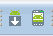如果出现表示安装完成
**PS**:期间可能出现一个waring,直接忽视~
**3.SDK解压配置：**依次点击菜单栏：**windows** -> **Rreferences** -> **Android** ->**选中解压的SDK包** -> **OK** ->**打开重新验证**
**4.创建AVD(安卓模拟器)：**依次点击菜单栏：**手机小图标** -> **New** -> **选定系统版本** -> **Skin屏幕分辨率** ->**设置下SD卡大小** -> **完成** -> **start即可**！
**PS:**第一次启动AVD的话可能很慢，需要等等~

## 4.第一个程序HelloWorld工程创建与运行

**1.New -> Android App Project**
如果找不到,可以去Other -> android找到，也是一样的：
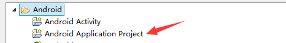
**2.然后依次输入工程信息：**
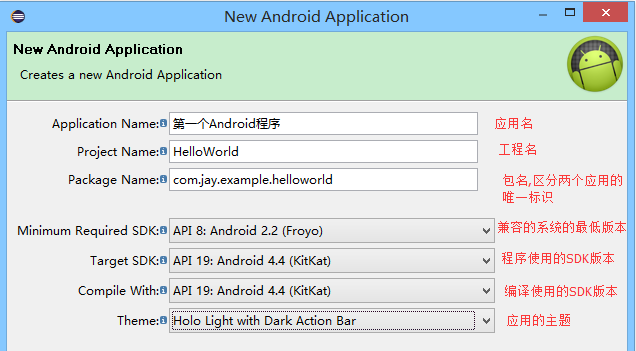
**3.运行创建好的程序**
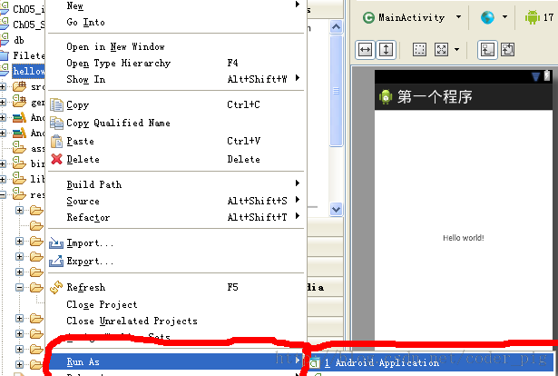
**4.从模拟器上看到运行效果：**
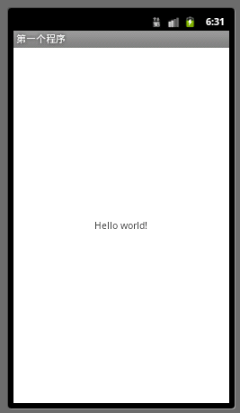

## 5.项目的目录结构分析

先来看下我们的工程目录图：
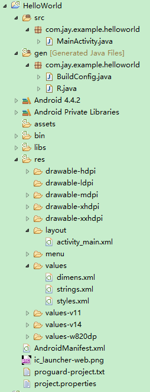
接下来我们需要知道的部分：

- **src目录：**包含App所需的全部程序代码文件，我们大多数时候都是在这里编写我们的Java代码的

- **gen目录：**只关注R.java文件，它是由ADT自动产生的，里面定义了一个R类，可以看作一个id(资源编号)的字典，包含了用户界面，图形，字符串等资源的id，而我们平时使用资源也是通过R文件来调用的，同时编译器也会看这个资源列表，没有用到的资源不会被编译进去，可以为App节省空间

- **assets目录：**存放资源，而且不会再R.java文件下生成资源id，需要使用AssetsManager类进行访问

- **libs目录：**存放一些jar包，比如v4,v7的兼容包，又或者是第三方的一些包

- **res资源目录：**存放资源的，drawable：存放图片资源；layout：存放界面的布局文件，都是XML文件；
values：包含使用XML格式的参数的描述文件，如string.xml字符串，color.xml颜色，style.xml风格样式等

- **AndroidManifest.xml配置文件：**系统的控制文件，用于告诉Android系统App所包含的一些基本信息，比如组件，资源，以及需要的权限，以及兼容的最低版本的SDK等

## 6.几个常用的视图

点击菜单栏上的:Windows -> show view打开对应的视图即可：

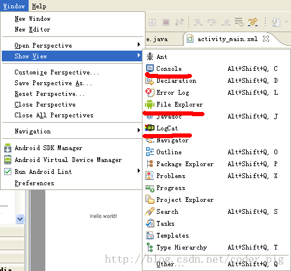

点击other,下述是Android中一些常用的视图:

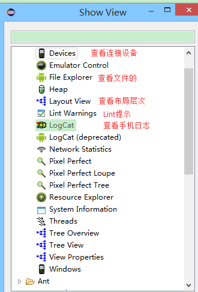

其实主要的还是Logcat的使用，因为和Java不同，我们的App运行在虚拟机上，而我们的控制台却并不会显示相关信息，只有安装状态而已，所以我们会在Logcat上查看程序运行的日志信息：

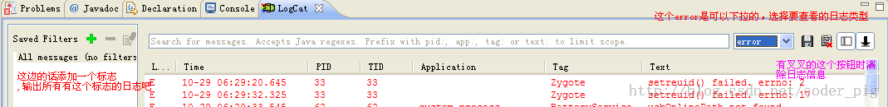

## 7.本节小结

本节我们学习了使用Eclipse搭建我们的Android开发环境，懒人版和动手搭建版，两者都可以；
接着我们又介绍了下Eclipse开发Android项目的目录结构的一些信息，在下一节中我们将深入HelloWorld工程，了解其中的代码！

### 图片清单

1. 图1 -> images/15021579.jpg （原图：https://www.runoob.com/wp-content/uploads/2015/06/15021579.jpg）
2. 图2 -> images/39928669.jpg （原图：https://www.runoob.com/wp-content/uploads/2015/06/39928669.jpg）
3. 图3 -> images/45631126.jpg （原图：https://www.runoob.com/wp-content/uploads/2015/06/45631126.jpg）
4. 图4 -> images/72205839.jpg （原图：https://www.runoob.com/wp-content/uploads/2015/06/72205839.jpg）
5. 图5 -> images/14429115.jpg （原图：https://www.runoob.com/wp-content/uploads/2015/06/14429115.jpg）
6. 图6 -> images/36216159.jpg （原图：https://www.runoob.com/wp-content/uploads/2015/06/36216159.jpg）
7. 图7 -> images/50710152.jpg （原图：https://www.runoob.com/wp-content/uploads/2015/06/50710152.jpg）
8. 图8 -> images/12983057.jpg （原图：https://www.runoob.com/wp-content/uploads/2015/06/12983057.jpg）
9. 图9 -> images/14933971.jpg （原图：https://www.runoob.com/wp-content/uploads/2015/06/14933971.jpg）

## 1.2.2 使用Android Studio开发Android APP

> 来源: https://www.runoob.com/w3cnote/android-tutorial-android-studio.html

## 写在前面

> 本节将介绍如何使用Android Studio开发Android APP，和前面Eclipse + ADT + SDK搭建Android开发环境一样，本节也只是介绍一些基本东西，深入的，比如快捷键，小技巧等会再另一篇文章中详细地介绍！

## 1.下载Android Studio

---

> **官网下载：**[Android Studio for Window ...](https://developer.android.com/sdk/installing/studio.html)
> **百度云下载：**[android-studio-bundle-141.1903250-windows.exe](http://pan.baidu.com/s/1eRhG7i6)

---

## 2.安装Android Studio

傻瓜式的下一步而已，只列出需要注意的页面：


---

## 3.新建工程

安装完毕后，打开我们的Android Studio，第一次启动需要下载SDK等一些东西，时间比较长，笔者等了大概40分钟才下载完毕


选择第一项,新建一个Android项目


选择开发程序将运行在哪个平台上：


选择Activity的风格：


设置进入程序一个页面后的Activity的一些信息


Finish然后是漫长的等待~

---

## 4.IDE的界面分析

先看下整个界面吧：


接着看下我们的项目结构，而我们一般关心的只是app这个目录：


---

## 5.运行下程序试试

点击菜单栏的X，即可运行程序：


---

## 6.本节小结

Android Studio的用法还是比较简单的，当然笔者也是刚用Android Studio，后续还会写一篇更深入一点的文章，这里大家琢磨琢磨，暂时能跑起程序，知道在哪里写代码，怎么看Logcat就可以了！

### 图片清单

1. 图1 -> images/37629412.jpg （原图：https://www.runoob.com/wp-content/uploads/2015/06/37629412.jpg）
2. 图2 -> images/80955491.jpg （原图：https://www.runoob.com/wp-content/uploads/2015/06/80955491.jpg）
3. 图3 -> images/32258046.jpg （原图：https://www.runoob.com/wp-content/uploads/2015/06/32258046.jpg）
4. 图4 -> images/53702708.jpg （原图：https://www.runoob.com/wp-content/uploads/2015/06/53702708.jpg）
5. 图5 -> images/68055206.jpg （原图：https://www.runoob.com/wp-content/uploads/2015/06/68055206.jpg）
6. 图6 -> images/15488374.jpg （原图：https://www.runoob.com/wp-content/uploads/2015/06/15488374.jpg）
7. 图7 -> images/40394803.jpg （原图：https://www.runoob.com/wp-content/uploads/2015/06/40394803.jpg）
8. 图8 -> images/25153924.jpg （原图：https://www.runoob.com/wp-content/uploads/2015/06/25153924.jpg）
9. 图9 -> images/45530458.jpg （原图：https://www.runoob.com/wp-content/uploads/2015/06/45530458.jpg）
10. 图10 -> images/23057310.jpg （原图：https://www.runoob.com/wp-content/uploads/2015/06/23057310.jpg）
11. 图11 -> images/18951197.jpg （原图：https://www.runoob.com/wp-content/uploads/2015/06/18951197.jpg）
12. 图12 -> images/8577140.jpg （原图：https://www.runoob.com/wp-content/uploads/2015/06/8577140.jpg）

## 1.3 SDK更新不了问题解决

> 来源: https://www.runoob.com/w3cnote/android-tutorial-sdk-problem-solve.html

## 问题阐述

> 相信大家在更新SDK的时候都会遇到更新不了的问题，而且打不开Google搜索，这是因为天朝墙了Google，所以要么只能通过科学上网或者改HOSTS才能访问，更新SDK！本节来介绍两种更新SDK的方法！

---

## 1.修改hosts文件

直接百度"Google hosts 2015"就有一堆了，而笔者常用的是：
[google hosts 2015,持续更新-360知识库](http://www.360kb.com/kb/2_150.html)
进去后**复制分割线下所有的内容：**

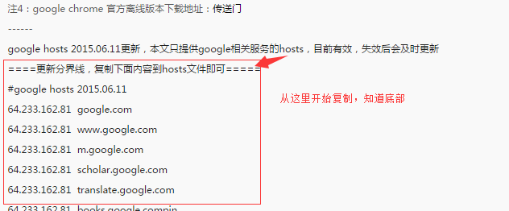

**然后打开电脑上的这个路径：**

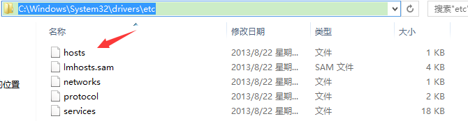

**用记事本打开，把复制的内容粘贴即可！**

接着输入：[https://www.google.com.hk/](https://www.google.com.hk/)

出现：表明修改Hosts成功

**接着打开sdk设置下：**

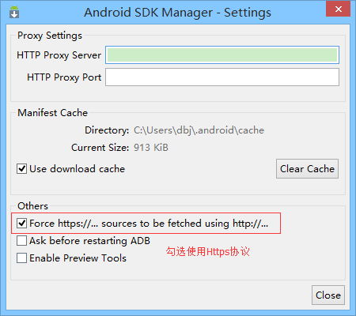

然后你会神奇的发现SDK可以更新了，而且你也能访问Google了，但是有点慢是吧，我们再介绍一个更新SDK的方法，速度快很多的！

---

## 2.使用国内镜像服务器更新

还记得前面给大家介绍一个Android开发必备的[AndroidDevTools](http://www.androiddevtools.cn/)吗？打开这个网站，我们可以看到

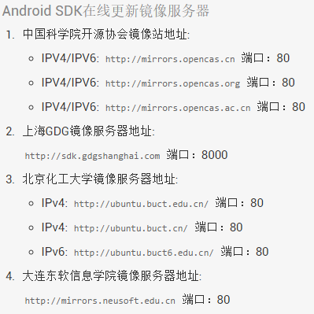

接下来我们只要选择上面随意一个，然后打开我们的Android SDK Manager，然后做如下设置：
**Tools -> Option**，填入镜像源的地址和端号，**勾选Force https:**//使用Https协议

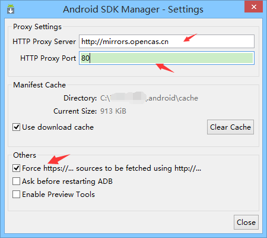

然后close，会到主界面，依次选择Packages -> Reload，就可以看到，刷刷刷进度条动了，
我们也可以选择对应版本的sdk进行下载了，而且速度还很快~

## 3.本节小结

本节给大家介绍了两种解决sdk更新不了的问题，改hosts的话是比较麻烦的，每隔几天就可能需要进行更新，如果仅仅是想更新sdk的话，建议使用国内镜像进行更新！

### 图片清单

1. 图1 -> images/2364813.jpg （原图：https://www.runoob.com/wp-content/uploads/2015/06/2364813.jpg）
2. 图2 -> images/78293221.jpg （原图：https://www.runoob.com/wp-content/uploads/2015/06/78293221.jpg）
3. 图3 -> images/92930810.jpg （原图：https://www.runoob.com/wp-content/uploads/2015/06/92930810.jpg）
4. 图4 -> images/56516963.jpg （原图：https://www.runoob.com/wp-content/uploads/2015/06/56516963.jpg）
5. 图5 -> images/48167563.jpg （原图：https://www.runoob.com/wp-content/uploads/2015/06/48167563.jpg）
6. 图6 -> images/9263079.jpg （原图：https://www.runoob.com/wp-content/uploads/2015/06/9263079.jpg）

## 1.4 Genymotion模拟器安装

> 来源: https://www.runoob.com/w3cnote/android-tutorial-genymotion-install.html

## 1.本节引言

> 如果你符合下述三种情况的话，你可以考虑安装一个Genymotion Android模拟器:

> - 没有真机调试，只能用模拟器

> - 嫌SDK内置的AVD启动速度，运行速度慢

> - 电脑配置还可以，最好4G内存以上

> 如果你满足上述三种情况的话，那么装个比真机还快的Genymotion吧！
> 官方给出的介绍：
> 

## 2.去哪里下Genymotion

> 百度"Genymotion"第一个就是了：[Genymotion中文官网](http://www.genymotion.net/)

## 3.下载Genymotion

> 点开上述链接后：点击注册
> 
> **来到下述界面，如果已有账号，直接输入后sign in 如果没有的话，**
> 
> **点击Create account创建一个新的账户**
> 
> **然后我们会收到一个激活邮件：**
> 
> **打开邮箱，点击激活账号，然后过一会儿会收到另一封创建成功的邮件**
> 
> 
> **登陆账号后，点击Get Genymotion:**
> 
> **选择Free版的下载,然后选择带virtual box虚拟机的下载**
> 
> 

## 4.安装Genymotion

> 都是傻瓜式的下一步
> 选择安装目录：
> 
> 安装完后会弹出Oracle VM virtualBox的安装,这里可以选择路径,笔者直接默认安装了
> 
> 安装过程中会时不时弹出安装一些设备的窗口,这是虚拟机在安装东西,不用理,都按安装:
> 
> 好了,安装完成后,确认,将我们的Genymotion运行起来
> 

## 5.创建Android模拟器

> ①运行软件后会来到一个界面,因为是第一次使用,所以需要我们新建一个avd:
> 
> 点击yes后会来到选择avd版本的界面,因为这上面什么设备都没有,我们需要连接到官网
> 获取各种版本的系统与硬件设备等,点击下方的connect,输入我们已经激活的账号密码:
> 邮箱与密码(笔者可能是网络问题,连续连了几次才成功的)
> 
> 登录成功后就可以对对应的系统以及硬件设备进行选择了:
> 
> 这里显示设备的相关信息,可以自定义模拟器的名称
> 
> 设置完名称后,点击next,就会下载虚拟设备的相关程序以及对应官方的sdk
> 
> 好了,avd已经创建完毕,接着把他运行起来,开机也只是十几秒的事,很赞！操作起来超流畅啊,有木有？


## 6.怎么在模拟器上运行程序

> 其实这个问题是白问的,我们只要在Eclpise上的Device就可以看到当前正在运行的模拟器;
> 感觉其实和真机是差不多的,我们只要运行程序时选择在哪个设备上运行即可！

## 7.可能遇到的问题

**①不喜欢原生的系统,想用标准sdk中的系统版本**

答:在下载设备驱动时其实已经下载好对应的sdk了,但是如果你不喜欢的话可以
打开setting--ADB-->选择Eclpise的sdk路径


**②老登录不了?或者获取不了手机列表:**
答:这个大部分的原因都是给墙了,所以只能科学上网了;不过貌似白天是可以的,
虽然有点慢,晚上的话笔者试了N次都是下载不了其他版本的设备!另外登录
不了要看下自己账号密码是否有错误哦！

**③觉得模拟器占屏幕太大了**
答:先把模拟器关了,点击扳手的图标


**④运行程序，直接拖拉APK到模拟器上出现下述问题：**


下载下面这个zip包,下载完毕后将它拖拽到模拟器窗口上,弹出对话框点击确定,接着重启下模拟器即可！
[Genymotion-ARM-Translation.zip](http://static.runoob.com/download/Genymotion-ARM-Translation.zip)

**⑤因程序需要，要查看模拟器的sdk目录：**
之前的话我们在Eclipse上是通过mmt/sdcard找到sd卡目录的;
但是genymotion却不是在这个路径下:而是在下面这个路径下:
/mnt/shell/emulated/0/
可以根据后面的Info慢慢找出来

## 8.本节小结

本节介绍了比真机还快的安卓模拟器——Genymotion的安装与使用，相信各位读者会爱上这个模拟器的，
谢谢~

### 图片清单

1. 图1 -> images/4501605.jpg （原图：https://www.runoob.com/wp-content/uploads/2015/06/4501605.jpg）
2. 图2 -> images/74132588.jpg （原图：https://www.runoob.com/wp-content/uploads/2015/06/74132588.jpg）
3. 图3 -> images/96085749.jpg （原图：https://www.runoob.com/wp-content/uploads/2015/06/96085749.jpg）
4. 图4 -> images/62150589.jpg （原图：https://www.runoob.com/wp-content/uploads/2015/06/62150589.jpg）
5. 图5 -> images/67862595.jpg （原图：https://www.runoob.com/wp-content/uploads/2015/06/67862595.jpg）
6. 图6 -> images/95533945.jpg （原图：https://www.runoob.com/wp-content/uploads/2015/06/95533945.jpg）
7. 图7 -> images/52660968.jpg （原图：https://www.runoob.com/wp-content/uploads/2015/06/52660968.jpg）
8. 图8 -> images/86049535.jpg （原图：https://www.runoob.com/wp-content/uploads/2015/06/86049535.jpg）
9. 图9 -> images/92903322.jpg （原图：https://www.runoob.com/wp-content/uploads/2015/06/92903322.jpg）
10. 图10 -> images/43036878.jpg （原图：https://www.runoob.com/wp-content/uploads/2015/06/43036878.jpg）
11. 图11 -> images/59280213.jpg （原图：https://www.runoob.com/wp-content/uploads/2015/06/59280213.jpg）
12. 图12 -> images/59557238.jpg （原图：https://www.runoob.com/wp-content/uploads/2015/06/59557238.jpg）
13. 图13 -> images/79369624.jpg （原图：https://www.runoob.com/wp-content/uploads/2015/06/79369624.jpg）
14. 图14 -> images/52574558.jpg （原图：https://www.runoob.com/wp-content/uploads/2015/06/52574558.jpg）
15. 图15 -> images/24507011.jpg （原图：https://www.runoob.com/wp-content/uploads/2015/06/24507011.jpg）
16. 图16 -> images/66339251.jpg （原图：https://www.runoob.com/wp-content/uploads/2015/06/66339251.jpg）
17. 图17 -> images/95827722.jpg （原图：https://www.runoob.com/wp-content/uploads/2015/06/95827722.jpg）
18. 图18 -> images/74837066.jpg （原图：https://www.runoob.com/wp-content/uploads/2015/06/74837066.jpg）
19. 图19 -> images/86654272.jpg （原图：https://www.runoob.com/wp-content/uploads/2015/06/86654272.jpg）
20. 图20 -> images/66068643.jpg （原图：https://www.runoob.com/wp-content/uploads/2015/06/66068643.jpg）
21. 图21 -> images/6502569.jpg （原图：https://www.runoob.com/wp-content/uploads/2015/06/6502569.jpg）
22. 图22 -> images/24140839.jpg （原图：https://www.runoob.com/wp-content/uploads/2015/06/24140839.jpg）
23. 图23 -> images/5145061.jpg （原图：https://www.runoob.com/wp-content/uploads/2015/06/5145061.jpg）
24. 图24 -> images/62505309.jpg （原图：https://www.runoob.com/wp-content/uploads/2015/06/62505309.jpg）
25. 图25 -> images/20712326.jpg （原图：https://www.runoob.com/wp-content/uploads/2015/06/20712326.jpg）
26. 图26 -> images/91922845.jpg （原图：https://www.runoob.com/wp-content/uploads/2015/06/91922845.jpg）
27. 图27 -> images/41780870.jpg （原图：https://www.runoob.com/wp-content/uploads/2015/06/41780870.jpg）
28. 图28 -> images/10252102.jpg （原图：https://www.runoob.com/wp-content/uploads/2015/06/10252102.jpg）

## 1.5.1 Git使用教程之本地仓库的基本操作

> 来源: https://www.runoob.com/w3cnote/android-tutorial-git-repo-operate.html

```java
sudo apt-get install git
```

```java
git config --global user.name "coder-pig"
git config --global user.email "[email protected]"
```

```java
git init
```

```java
 git add readme.txt
 git commit -m "Wrote a readme file"
```

```java
git log
```

```java
commit defd8af52be5183dfceb3e5cf23f78ea47d013b0
Author: coder-pig <[email protected]>
Date:   Fri Jun 19 17:00:36 2015 +0800
MainActivity Delete Menu
```

```java
git checkout src/com/jay/example/testforgit/MainActivity.java
```

```java
git reset HEAD src/com/jay/example/testforgit/MainActivity.java
git checkout src/com/jay/example/testforgit/MainActivity.java
```

```java
 git reset --hard HEAD
 git reset --hard HEAD^
 git log
```

```java
git reset --hard ad2080c
```

```java
git reflog
```

```java
git reset --hard ad2080c
```

## 1.5.2 Git之使用GitHub搭建远程仓库

> 来源: https://www.runoob.com/w3cnote/android-tutorial-git-repo-create.html

```java
git clone https://github.com/ZPJay/Garbage.git
```

```java
git branch v1.0.3 或 git checkout -b v1.0.4
```

```java
git branch -a
```

```java
git checkout v1.0.3
```

```java
git branch -D v1.0.4
```

```java
 git merge v1.0.3
```

```java
git push origin master 或者直接 git push
```

```java
git pull
```

## 1.6 9(九妹)图片怎么玩

> 来源: https://www.runoob.com/w3cnote/android-tutorial-9-image.html

## 1.本节引言：

> **可能有的一些疑问：**

> **1.什么是.9图片？** 
>  答：图片后缀名前有.9的图片,如pic1.9.png这样的图片

> **2. .9图片能干嘛？**
>  答： 在图片拉伸的时候特定的区域不会发生图片失真，而不失真的区域可以由我们自己绘制
>  **3. .9图片用什么做？**
>  答：工欲善其事，必先利其器，做.9图片的工具有：

> ①**Android SDK自带：draw9patch.bat**，不过这玩意出了好久，谷歌竟然没更新过...

> 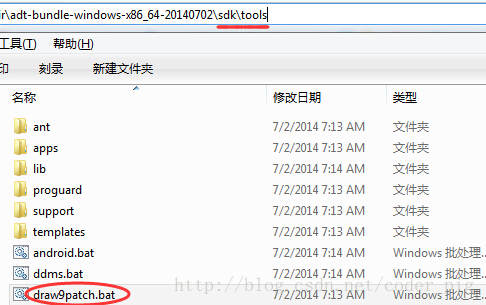

> ②**NinePatchEditor**，相比起自带的，做了一些优化，支持批量操作，而且界面看起来美观一点：
> 有兴趣的可以下载下，笔者平时用的这个，下载链接：[NinePatchEditor.zip](http://static.runoob.com/download/NinePatchEditor.zip)

> 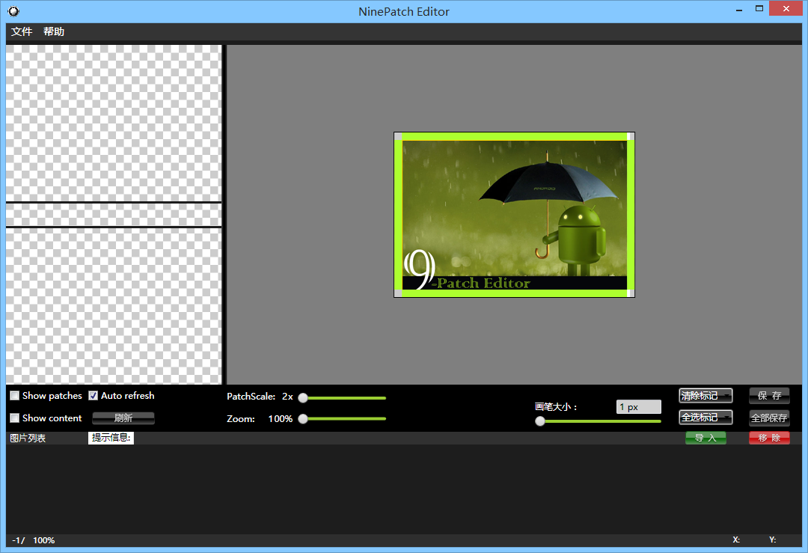
> ③**NinePng九图神器**，手机版的.9处理工具，做得还是比较赞的，但是要连wifi互传图片，实际操作起来有点麻烦，功能还是比较强大的，有兴趣到相关应用市场搜索下载：

> 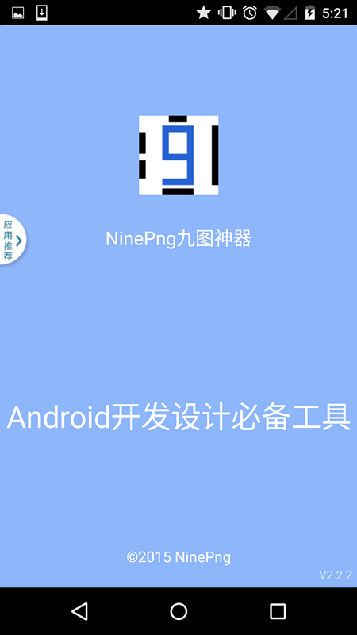

> ④**PhotoShop**，这就显得比较夸张了，一般用这个做.9图的都是美工，有兴趣的可搜下相关教程！

## 2. .9图片怎么做？

**！！核心要点：左上拉伸，右下内容！！！！！！**
其实核心就上面的内容！先来找个图片试试手！

### 1. draw9patch.bat制作.9图实例：

有这样的图片：，我们通过TextView的android:blackground可以设置为TextView的一个背景，内容少的时候还正常，一多起来就可能出现下面这种情况：
会发现图片被拉伸变形了,很明显,这不合我们的需求,于是乎我们需要对这个图片来进行一些处理,让圆角部分的不随长度拉伸,中间部分才拉伸

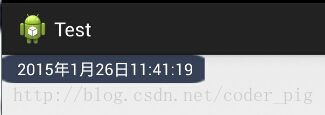

打开我们的draw9patch.bat，点击左上角File，来到对应目录打开我们要处理的图片素材，
接下来就可以看到我们工具的主界面了:

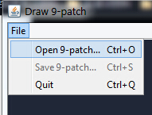

右面的预览区域分别是：纵向拉伸，横向拉伸，横纵都拉伸的预览

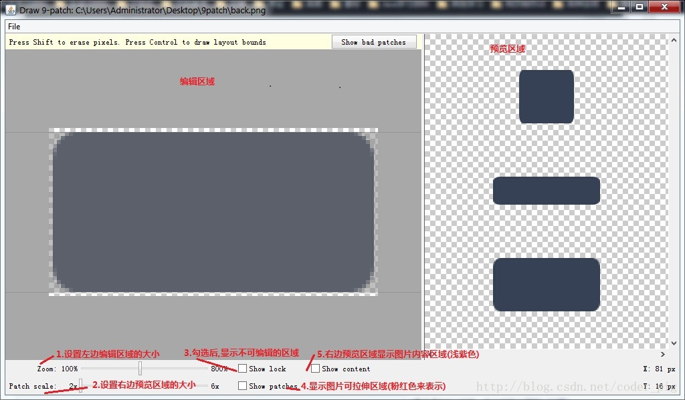

好的，接下来开始处理图片了：

> **Step 1.**调Zoom和Patch scale:设置自己适合的缩放比例,勾选show patch
> 可以让Zoom足够大,因为后面我们需要处理"斑马线"

> 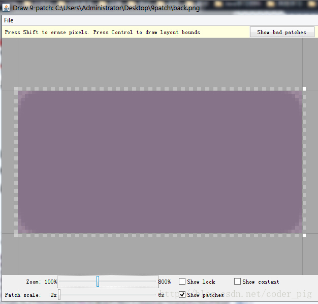

> **Step 2.**接下来我们只需要在"斑马线"上进行操作就可以了:
> PS:黑色那条线是一条条点出来的,如果想消除点的话:按住shift点即可！

> 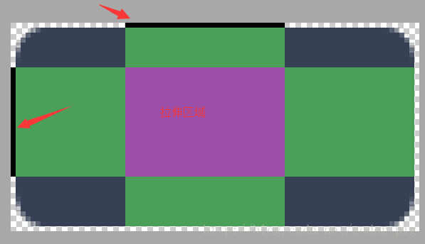

> **Step 3.**保存图片,以.9.png结尾
> 比如这里保存的文件名是back.9.png；
> 嘿嘿，然后把他加入我们的工程，设置为TextView的背景：

> 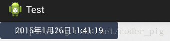

> 效果杠杠滴，接下来无论我们的显示的字符多长，都是图中这个结果，新技能get~

### 2.看下别人如何做.9图：

根据不同的情况我们可能需要做不同的.9图，下面欣赏下几个别人弄好的稍微复杂点的.9图的例子！
例子：

1.原文链接：[http://www.miued.com/2074/](http://www.miued.com/2074/)好吧，这素材我喜欢，可以没有QAQ！
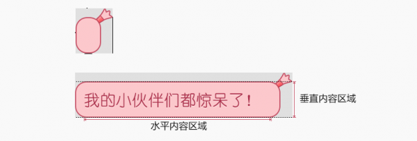

2.原文链接：[http://blog.csdn.net/lizzy115/article/details/7950959](http://blog.csdn.net/lizzy115/article/details/7950959)

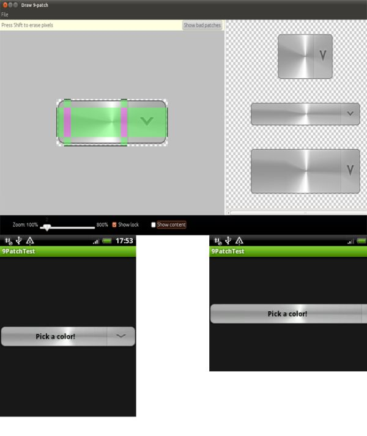

3.原文链接：[http://www.cnblogs.com/vanezkw/archive/2012/07/19/2599092.html](http://www.cnblogs.com/vanezkw/archive/2012/07/19/2599092.html)

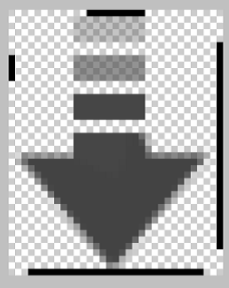

## 3.本节小结：

好的，本节关于.9制作可拉伸图片的教程就到这里，还是比较简单的，记住我们的口诀：左上拉伸，右下内容！
做几个.9图后相信你就深有体会了，再见~

### 图片清单

1. 图1 -> images/60745563.jpg （原图：https://www.runoob.com/wp-content/uploads/2015/06/60745563.jpg）
2. 图2 -> images/68008025.jpg （原图：https://www.runoob.com/wp-content/uploads/2015/06/68008025.jpg）
3. 图3 -> images/6375764.jpg （原图：https://www.runoob.com/wp-content/uploads/2015/06/6375764.jpg）
4. 图4 -> images/73532937.jpg （原图：https://www.runoob.com/wp-content/uploads/2015/06/73532937.jpg）
5. 图5 -> images/34605214.jpg （原图：https://www.runoob.com/wp-content/uploads/2015/06/34605214.jpg）
6. 图6 -> images/64705084.jpg （原图：https://www.runoob.com/wp-content/uploads/2015/06/64705084.jpg）
7. 图7 -> images/85496981.jpg （原图：https://www.runoob.com/wp-content/uploads/2015/06/85496981.jpg）
8. 图8 -> images/87506682.jpg （原图：https://www.runoob.com/wp-content/uploads/2015/06/87506682.jpg）
9. 图9 -> images/48109631.jpg （原图：https://www.runoob.com/wp-content/uploads/2015/06/48109631.jpg）
10. 图10 -> images/20602156.jpg （原图：https://www.runoob.com/wp-content/uploads/2015/06/20602156.jpg）
11. 图11 -> images/88228319.jpg （原图：https://www.runoob.com/wp-content/uploads/2015/06/88228319.jpg）
12. 图12 -> images/60326242.jpg （原图：https://www.runoob.com/wp-content/uploads/2015/06/60326242.jpg）
13. 图13 -> images/25283512.jpg （原图：https://www.runoob.com/wp-content/uploads/2015/06/25283512.jpg）
14. 图14 -> images/70139170.jpg （原图：https://www.runoob.com/wp-content/uploads/2015/06/70139170.jpg）

## 1.7 界面原型设计

> 来源: https://www.runoob.com/w3cnote/android-tutorial-interface-design.html

## 本节引言：

引用锤子科技视觉设计总监——罗子雄在重庆TEDx活动上说的一小段话：

> 每当我们看到一些美妙的设计的时候，很多人心里面会有一种冲动，这种冲动会让你们想去创造一些
> 新的东西，创造一些美妙的事物。

我们常说用户体验用户体验，用户使用你的软件，第一个会接触的是什么？没错，图形化界面(GUI)，简称UI，对于用户而言，最直观，给用户留下第一印像的是往往是程序的界面，而非功能！人，总喜欢美的东西，对吧？
假如一样的功能，决定用户取向的，往往是UI！精美的UI！当然还有一些贴心的人性化操作等！
下图两个计算机的App界面：

 

我们先不说功能，从UI上讲，你喜欢哪个？
由此，一个产品的UI是非常重要的，而产品的界面原型设计一般是由公司的产品经理+美工来完成的，需求分析 ->界面原型设计 ->我们来写代码！可能你觉得界面原型对我们而言并不没什么作用，但假如你以后想自己开发App呢？又或者你升做产品经理呢？嘿嘿！世事无绝对，以后的事，谁知道呢？公司的话，大部分使用的都是Axure Rp，但是这个东西比较难用！除了这个以外还有其他很多的原型设计工具：

> - Pencil

> - Framer

> - Shireframe

> - UIDesigner

> - Balsamiq Mockups

> - Mockup Builder

> - Mockup

> - FrameBox

> - iPhone Mockup

> - GOOFLOW

> - WireframeSketcher

> - FluidIA

> - Indigo Studio

> - Origami

> - Quartz Composer

> - Justproto

> - Avocado

> - PaintCode

> - Mockplus(摩客)

> - 墨刀等....

笔者使用过的是两个国产的界面原型设计工具，他们分别是：Mockplus(摩客)和墨刀
本文会简要的介绍下Mockplus的用法！

## Mockplus原型工具的使用：

有网页版以及客户端版供你选择：[Mockplus官网](https://www.mockplus.cn/)

**Step 1：**注册一个你自己的账号，然后新建文件进入编辑界面！(时间关系，这里笔者直接试用)
然后弹出一个原型风格的对话框给我们选择：素描跟线条！

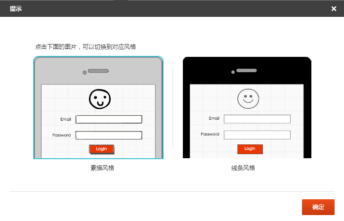

笔者选择线条：

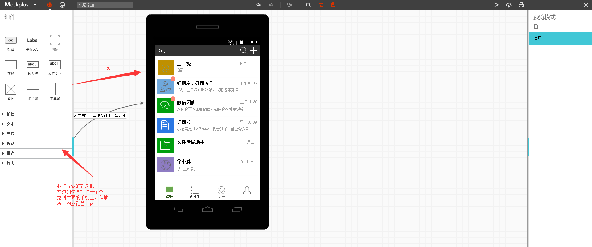

我们要做的就是从左边的组件栏中啦控件到手机界面上，当然，我们可以双击某个控件，自定义我们
的样式，比如颜色，背景图片等！

**Step 2：**交互实现：
界面原型除了界面外，肯定是少不了交互的，这里我们做一个简单的新闻应用的交互例子给大家体验下：
我们在其中一个新闻类别中添加跳转链接，

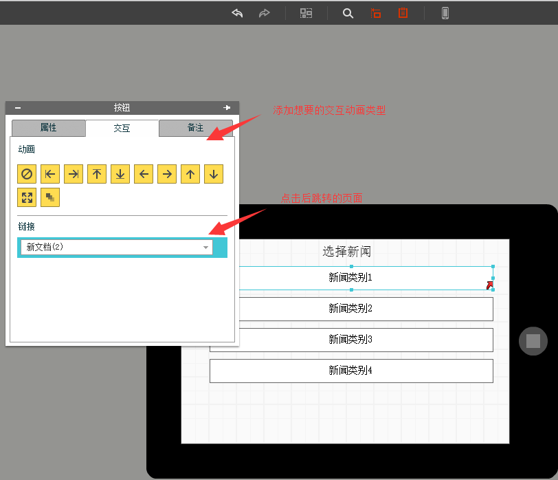

接着我们可以点击右上角的播放按钮：

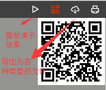

接下来我们就可以看具体的交互了，PS:这里可能是网页版的问题，有些图片显示不出来！
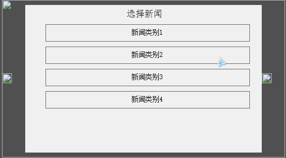

好了，大概的用法就这些，大家可以自己摸索摸索，另外，如果生成文档是要升级为付费用户的哦！一个月6元不贵，就一个早餐钱，当然如果是自己玩玩而已就没必要开了！

## Android自带DroidDraw工具设计Android界面：

其实Android也给我们提供了一个"老掉牙"的界面设计工具，跟上面这些高大上的界面原型工具相比，差几十条街，可以理解成一个分离的ADT，比ADT高级一点的功能就是自动生成代码...对于很少接触原型设计的朋友来说，花1，2分钟就可以掌握这个工具，还是比较值得！

**工具界面：**


图示已经写明相关的操作了,很简单,实践是检验真理的唯一标准,自己下来试试吧!!

软件下载：[droiddrawr.jar](http://static.runoob.com/download/droiddrawr.jar)

## 本节小结：

本节给大家介绍了下界面原型设计的概念，轻量级Mockplus(摩客)的简单实用，以及Android自带的DroidDraw工具，内容比较简单，还需大家自行实践理解！

### 图片清单

1. 图1 -> images/17704443.jpg （原图：https://www.runoob.com/wp-content/uploads/2015/06/17704443.jpg）
2. 图2 -> images/84478682.jpg （原图：https://www.runoob.com/wp-content/uploads/2015/06/84478682.jpg）
3. 图3 -> images/36713336.jpg （原图：https://www.runoob.com/wp-content/uploads/2015/06/36713336.jpg）
4. 图4 -> images/62803739.jpg （原图：https://www.runoob.com/wp-content/uploads/2015/06/62803739.jpg）
5. 图5 -> images/38623507.jpg （原图：https://www.runoob.com/wp-content/uploads/2015/06/38623507.jpg）
6. 图6 -> images/34768236.jpg （原图：https://www.runoob.com/wp-content/uploads/2015/06/34768236.jpg）
7. 图7 -> images/17783757.jpg （原图：https://www.runoob.com/wp-content/uploads/2015/06/17783757.jpg）
8. 图8 -> images/41882987.jpg （原图：https://www.runoob.com/wp-content/uploads/2015/06/41882987.jpg）

## 1.8 工程相关解析(各种文件，资源访问)

> 来源: https://www.runoob.com/w3cnote/android-tutorial-project-src-analysis.html

```java
txtName.setText(getResources().getText(R.string.name));
```

```java
imgIcon.setBackgroundDrawableResource(R.drawable.icon);
```

```java
txtName.setTextColor(getResouces().getColor(R.color.red));
```

```java
setContentView(R.layout.main);
```

```java
txtName = (TextView)findViewById(R.id.txt_name);
```

```xml
<TextView android:text="@string/hello_world" android:layout_width="wrap_content" android:layout_height="wrap_content" android:background = "@drawable/img_back"/>
```

```java
package jay.com.example.firstapp;

import android.support.v7.app.AppCompatActivity;
import android.os.Bundle;

public class MainActivity extends AppCompatActivity {
    @Override
    protected void onCreate(Bundle savedInstanceState) {
        super.onCreate(savedInstanceState);
        setContentView(R.layout.activity_main);
    }
}
```

```xml
<RelativeLayout xmlns:android="http://schemas.android.com/apk/res/android"
    xmlns:tools="http://schemas.android.com/tools"
    android:layout_width="match_parent"
    android:layout_height="match_parent"
    tools:context=".MainActivity">

    <TextView
        android:layout_width="wrap_content"
        android:layout_height="wrap_content"
        android:text="@string/hello_world" />

</RelativeLayout>
```

```xml
<?xml version="1.0" encoding="utf-8"?>
<manifest xmlns:android="http://schemas.android.com/apk/res/android"
    package="jay.com.example.firstapp" >

    <application
        android:allowBackup="true"
        android:icon="@mipmap/ic_launcher"
        android:label="@string/app_name"
        android:theme="@style/AppTheme" >
        <activity
            android:name=".MainActivity"
            android:label="@string/app_name" >
            <intent-filter>
                <action android:name="android.intent.action.MAIN" />

                <category android:name="android.intent.category.LAUNCHER" />
            </intent-filter>
        </activity>
    </application>

</manifest>
```

## 1.9 Android程序签名打包

> 来源: https://www.runoob.com/w3cnote/android-tutorial-sign-package.html

## 本节引言：

第一章的倒数第二节，本节给大家介绍的是如何将我们的程序打包成Apk文件，并且为我们的Apk签名！
上一节中已经说了，我们后续的教程使用的IDE是Android Studio，所以本节讲解的也是AS(后面都这样
简称吧)下对项目进行打包签名！

## 1.什么是签名，有什么用：

> Android APP都需要我们用一个证书对应用进行数字签名，不然的话是无法安装到Android手机上的，平时我们调试运行时到手机上时，是AS会自动用默认的密钥和证书来进行签名；但是我们实际发布编译时，则不会自动签名，这个时候我们就需要进行手动签名了！
> 为我们的APK签名有以下好处：

> - **1.应用程序升级：**如果你希望用户无缝升级到新的版本，那么你必须用同一个证书进行签名。这是由于只有以同一个证书签名，系统才会允许安装升级的应用程序。如果你采用了不同的证书，那么系统会要求你的应用程序采用不同的包名称，在这种情况下相当于安装了一个全新的应用程序。如果想升级应用程序，签名证书要相同，包名称要相同！

> - **2.应用程序模块化：** Android系统可以允许同一个证书签名的多个应用程序在一个进程里运行，系统实际把他们作为一个单个的应用程序，此时就可以把我们的应用程序以模块的方式进行部署，而用户可以独立的升级其中的一个模块。

> - **3.代码或者数据共享：** Android提供了基于签名的权限机制，那么一个应用程序就可以为另一个以相同证书签名的应用程序公开自己的功能。以同一个证书对多个应用程序进行签名，利用基于签名的权限检查，你就可以在应用程序间以安全的方式共享代码和数据了。
> 不同的应用程序之间，想共享数据，或者共享代码，那么要让他们运行在同一个进程中，而且要让他们用相同的证书签名。
> ————上述内容摘自:[android 为什么需要签名](http://blog.csdn.net/fyh2003/article/details/6911967)

## 2.Android Studio如何打包签名：

好的，因为学习本课程的都是初学者，多渠道打包的内容以后再进行讲解！本节只讲最简单的打包签名
对了，1中说的调试时默认生成的apk在：app/build/outputs/apk目录下！
和Eclipse并不相同，Eclipse是在bin目录下生成的！

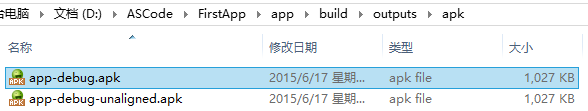

好的，打开我们的AS上的Hello World项目，点击菜单：

①**Build** -> **Generate Signed APK...**

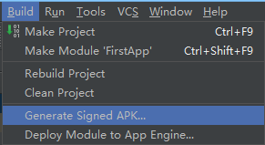

②弹出窗口，如果没有key，就创建一个，有的话就选择存在的Key

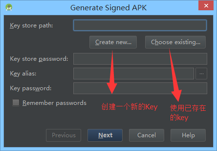

③没有，我们新建一个，可根据自己需要填写相关项：

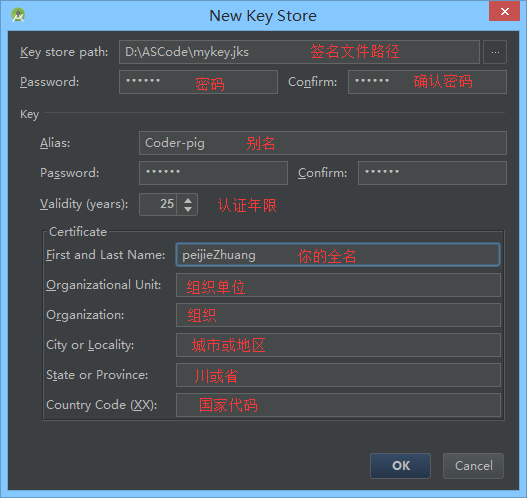

④好的，点击OK后，可以看到我们密码的信息，可能需要我们填入密码了，填写下：

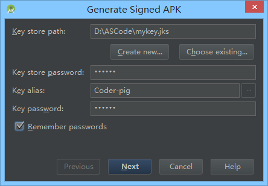

⑤点击Next：

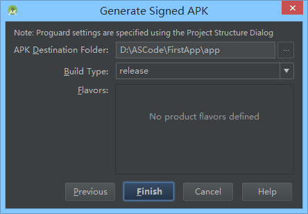

⑥点击Finish稍等一会儿会出现下述提示，说明应用已经打包签名成功了：

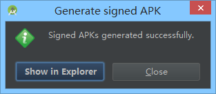

⑦可以看到打包后的APK已经安详地躺在我们的app目录下了：

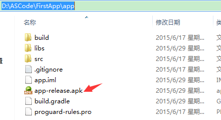

⑧到第七步就已经打包签名完成了，如果你要验证是否签名，只需要输入下述cmd指令


## 本节小结

打包Android APK的方法还有很多，命令行，或者Gradle，ANT，MAVEN等等，方法有很多，本节讲解最简单的通过图形化界面打包签名的方式！好了，本节就到这里，最简单的打包签名方法get了没？

### 图片清单

1. 图1 -> images/15954518.jpg （原图：https://www.runoob.com/wp-content/uploads/2015/06/15954518.jpg）
2. 图2 -> images/44688629.jpg （原图：https://www.runoob.com/wp-content/uploads/2015/06/44688629.jpg）
3. 图3 -> images/9913458.jpg （原图：https://www.runoob.com/wp-content/uploads/2015/06/9913458.jpg）
4. 图4 -> images/35032297.jpg （原图：https://www.runoob.com/wp-content/uploads/2015/06/35032297.jpg）
5. 图5 -> images/81567048.jpg （原图：https://www.runoob.com/wp-content/uploads/2015/06/81567048.jpg）
6. 图6 -> images/63930920.jpg （原图：https://www.runoob.com/wp-content/uploads/2015/06/63930920.jpg）
7. 图7 -> images/94626100.jpg （原图：https://www.runoob.com/wp-content/uploads/2015/06/94626100.jpg）
8. 图8 -> images/3560488.jpg （原图：https://www.runoob.com/wp-content/uploads/2015/06/3560488.jpg）
9. 图9 -> images/2027030.jpg （原图：https://www.runoob.com/wp-content/uploads/2015/06/2027030.jpg）
10. 图10 -> images/45897066.jpg （原图：https://www.runoob.com/wp-content/uploads/2015/06/45897066.jpg）

## 1.11 反编译APK获取代码&#038;资源

> 来源: https://www.runoob.com/w3cnote/android-tutorial-decompile-apk-get-code-resources.html

## 本节引言

> "反编译Apk"，看上去好像好像很高端的样子，其实不然，就是通过某些反编译软件，对我们的APK进行反编译，从而获取程序的源代码，图片，XML资源等文件；不知道你有没有这样做过，看到一个别人的一个APP界面做得很精美，或者你看上别人的图片素材，简单点的，我们可以下载别人的APK，然后改下后缀名，改成xxx.zip，然后解压：
> 笔者随便解压了一个APK：


> 我们可以打开res目录，获取里面的图片素材


> 但是，这种方法，获得的只会是一些.png，或者.jpg这样的位图文件资源，如果是xml类的资源，打开我们会发现是乱码，并且假如我们想看APK程序的Java代码，也是行不通的，因为他们都打被打包到classes.dex文件中！
> 但是反编译可以解决你的需要~另外，切勿拿反编译来做违法的事，比如把人家的APK重新打包后使用自己的签名然后发布到相关市场...另外，我们是参考别人的代码，而不是完全拷贝！！！切记！！

## 1.要准备的三个工具

> - **apktool：**获取资源文件，提取图片文件，布局文件，还有一些XML的资源文件

> - **dex2jar：**将APK反编译成Java源码(将classes.dex转化为jar文件)

> - **jd-gui：**查看2中转换后的jar文件，即查看Java文件
> 为了方便各位读者，这里将三个打包到一起放到云盘中，又需要的可以进行下载：
> [反编译相关的三个工具.zip](http://static.runoob.com/download/反编译相关的三个工具.zip)

## 2.使用apktool反编译APK获得图片与XML资源：

> 把下载好的apktool解压后，我们可以看到下述文件(忽略那两个csdn，一个是反编译的apk，一个是反编译后文件)：

> 
> 接下来，双击cmd.exe，来到命令行，键入：
> **apktool.bat d csdn.apk** 即可，Enter回车：

> 

> 然后就可以看到生成的csdn文件夹，里面就有我们想要资源
> 
> 好的，就是XML资源到手了是吧！图片素材也到手了！

## 3.使用dex2jar将classes.dex转换成jar文件：

> 把下载好的dex2jar文件夹解压，apk解压后中的classes.dex复制到dex2jar.bat所在的目录下：

> 

> 打开cmd，来到这个目录下：键入：**d2j-dex2jar.bat classes.dex**

> 

> 接着我们可以看到，生成了一个jar包：

> 
> 好的，转换完成！

## 4.使用jd-gui查看jar包中的Java代码：

> 好的，打开jd-gui的文件夹

> 

> 打开后，打开我们3中转换后的jar包，我们可以看见里面的代码：

> 
> csdn的客户端竟然不混淆代码...可能是本着开源的精神吧，给我们学习代码吧！一般的话，apk发布都会
> 进行混淆，然后进行一些加密，或者使用第三方的加密平台，用的比较多的"爱加密"，有兴趣的也自行百度查看更加详细的介绍！

## 本节小结

> 好的，关于APK的反编译就介绍到这里，相信你已经摩拳擦掌想要试试了，那就试试吧，最后提醒一句，别做坏事！尊重别人的劳动成果！另外，关于第一大章环境搭建相关以及一些常用开发技巧就到这里，下一节开始我们就来进行本系列教程的第二章——Android中的常用UI控件的学习了！因相关的基本控件较多，估计有几十个，如果一直学控件可能没什么意思，可能并行写教程，每天学一个控件 + 一点其他的知识点这样，笔者要构思构思，敬请期待~谢谢~

### 图片清单

1. 图1 -> images/50927495.jpg （原图：https://www.runoob.com/wp-content/uploads/2015/07/50927495.jpg）
2. 图2 -> images/70379411.jpg （原图：https://www.runoob.com/wp-content/uploads/2015/07/70379411.jpg）
3. 图3 -> images/45168853.jpg （原图：https://www.runoob.com/wp-content/uploads/2015/07/45168853.jpg）
4. 图4 -> images/22945935.jpg （原图：https://www.runoob.com/wp-content/uploads/2015/07/22945935.jpg）
5. 图5 -> images/61966420.jpg （原图：https://www.runoob.com/wp-content/uploads/2015/07/61966420.jpg）
6. 图6 -> images/13758702.jpg （原图：https://www.runoob.com/wp-content/uploads/2015/07/13758702.jpg）
7. 图7 -> images/12241119.jpg （原图：https://www.runoob.com/wp-content/uploads/2015/07/12241119.jpg）
8. 图8 -> images/86604146.jpg （原图：https://www.runoob.com/wp-content/uploads/2015/07/86604146.jpg）
9. 图9 -> images/46063652.jpg （原图：https://www.runoob.com/wp-content/uploads/2015/07/46063652.jpg）
10. 图10 -> images/45467744.jpg （原图：https://www.runoob.com/wp-content/uploads/2015/07/45467744.jpg）
11. 图11 -> images/96919556.jpg （原图：https://www.runoob.com/wp-content/uploads/2015/07/96919556.jpg）
12. 图12 -> images/28605151.jpg （原图：https://www.runoob.com/wp-content/uploads/2015/07/28605151.jpg）
