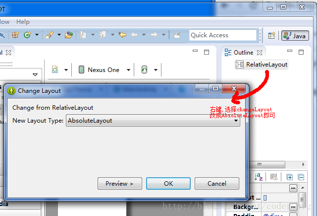
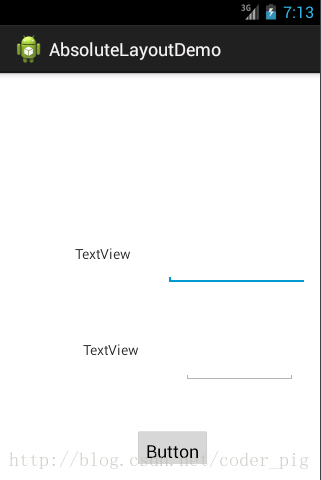
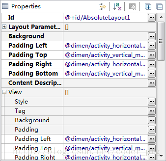
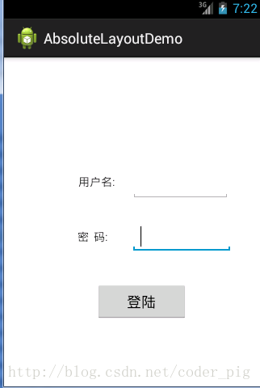
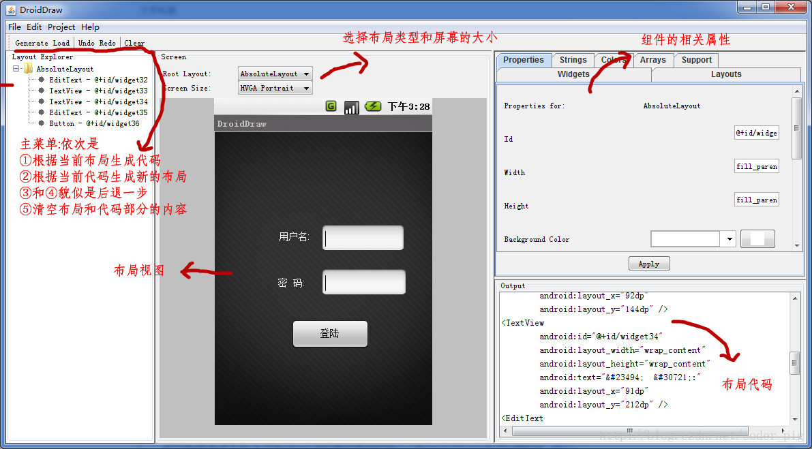

# 布局与 View 体系

> 本章归并自 7 页教程代码块，来源见各节。

## 2.1 View与ViewGroup的概念

> 来源: https://www.runoob.com/w3cnote/android-tutorial-view-viewgroup-intro.html

```xml
<?xml version="1.0" encoding="utf-8"?>
<LinearLayout xmlns:android="http://schemas.android.com/apk/res/android"
              android:layout_width="fill_parent"
              android:layout_height="fill_parent"
              android:orientation="vertical" >
    <TextView android:id="@+id/text"
              android:layout_width="wrap_content"
              android:layout_height="wrap_content"
              android:text="I am a TextView" />
    <Button android:id="@+id/button"
            android:layout_width="wrap_content"
            android:layout_height="wrap_content"
            android:text="I am a Button" />
</LinearLayout>
```

## 2.2.1 LinearLayout(线性布局)

> 来源: https://www.runoob.com/w3cnote/android-tutorial-linearlayout.html

```xml
<LinearLayout xmlns:android="http://schemas.android.com/apk/res/android"
    xmlns:tools="http://schemas.android.com/tools"
    android:id="@+id/LinearLayout1"
    android:layout_width="match_parent"
    android:layout_height="match_parent"
    android:orientation="horizontal">

    <LinearLayout
        android:layout_width="0dp"
        android:layout_height="fill_parent"
        android:background="#ADFF2F"
        android:layout_weight="1"/>


    <LinearLayout
        android:layout_width="0dp"
        android:layout_height="fill_parent"
        android:background="#DA70D6"
        android:layout_weight="2"/>

</LinearLayout>
```

```xml
<LinearLayout xmlns:android="http://schemas.android.com/apk/res/android"
    xmlns:tools="http://schemas.android.com/tools"
    android:id="@+id/LinearLayout1"
    android:layout_width="match_parent"
    android:layout_height="match_parent"
    android:orientation="horizontal" >

    <TextView
        android:layout_weight="1"
        android:layout_width="wrap_content"
        android:layout_height="fill_parent"
        android:text="one"
        android:background="#98FB98"
     />
     <TextView
        android:layout_weight="2"
        android:layout_width="wrap_content"
        android:layout_height="fill_parent"
        android:text="two"
        android:background="#FFFF00"
     />
     <TextView
        android:layout_weight="3"
        android:layout_width="wrap_content"
        android:layout_height="fill_parent"
        android:text="three"
        android:background="#FF00FF"
     />

</LinearLayout>
```

```xml
<LinearLayout xmlns:android="http://schemas.android.com/apk/res/android"
    xmlns:tools="http://schemas.android.com/tools"
    android:id="@+id/LinearLayout1"
    android:layout_width="match_parent"
    android:layout_height="match_parent" >

    <TextView
        android:layout_weight="1"
        android:layout_width="fill_parent"
        android:layout_height="fill_parent"
        android:text="one"
        android:background="#98FB98"
     />
     <TextView
        android:layout_weight="2"
        android:layout_width="fill_parent"
        android:layout_height="fill_parent"
        android:text="two"
        android:background="#FFFF00"
     />
     <TextView
        android:layout_weight="3"
        android:layout_width="fill_parent"
        android:layout_height="fill_parent"
        android:text="three"
        android:background="#FF00FF"
     />

</LinearLayout>
```

```java
setLayoutParams(new LayoutParams(LayoutParams.FILL_PARENT,
        LayoutParams.WRAP_CONTENT, 1));
```

```xml
<View
    android:layout_width="match_parent"
    android:layout_height="1px"
    android:background="#000000" />
```

```xml
<LinearLayout xmlns:android="http://schemas.android.com/apk/res/android"
    xmlns:tools="http://schemas.android.com/tools"
    android:id="@+id/LinearLayout1"
    android:layout_width="match_parent"
    android:layout_height="match_parent"
    android:divider="@drawable/ktv_line_div"
    android:orientation="vertical"
    android:showDividers="middle"
    android:dividerPadding="10dp"
    tools:context="com.jay.example.linearlayoutdemo.MainActivity" >

    <Button
        android:layout_width="wrap_content"
        android:layout_height="wrap_content"
        android:text="按钮1" />

    <Button
        android:layout_width="wrap_content"
        android:layout_height="wrap_content"
        android:text="按钮2" />

    <Button
        android:layout_width="wrap_content"
        android:layout_height="wrap_content"
        android:text="按钮3" />

</LinearLayout>
```

```xml
<LinearLayout xmlns:android="http://schemas.android.com/apk/res/android"
    xmlns:tools="http://schemas.android.com/tools"
    android:id="@+id/LinearLayout1"
    android:layout_width="fill_parent"
    android:layout_height="fill_parent"
    android:orientation="vertical"
    tools:context=".MainActivity" >

    <TextView
        android:layout_width="wrap_content"
        android:layout_height="wrap_content"
        android:text="请输入要保存的电话号码"/>
    <EditText
        android:layout_width="fill_parent"
        android:layout_height="wrap_content"/>
    <LinearLayout
        android:layout_width="fill_parent"
        android:layout_height="wrap_content"
        android:orientation="horizontal"
        android:gravity="right">
        <Button
            android:layout_width="wrap_content"
            android:layout_height="wrap_content"
            android:text="保存"/>
        <Button
            android:layout_width="wrap_content"
            android:layout_height="wrap_content"
            android:text="清空"/>
    </LinearLayout>
</LinearLayout>
```

```xml
<LinearLayout xmlns:android="http://schemas.android.com/apk/res/android"
    xmlns:tools="http://schemas.android.com/tools"
    android:layout_width="match_parent"
    android:layout_height="match_parent"
    android:orientation="horizontal"
    tools:context="com.jay.example.getscreendemo.MainActivity" >

    <TextView
        android:layout_width="wrap_content"
        android:layout_height="200dp"
        android:layout_gravity="left"
        android:background="#FF7878"
        android:gravity="center"
        android:text="O(∩_∩)O哈哈~" />

    <TextView
        android:layout_width="wrap_content"
        android:layout_height="200dp"
        android:layout_gravity="right"
        android:background="#FF7428"
        android:gravity="center"
        android:text="(*^__^*) 嘻嘻……" />

</LinearLayout>
```

```xml
<LinearLayout xmlns:android="http://schemas.android.com/apk/res/android"
    xmlns:tools="http://schemas.android.com/tools"
    android:layout_width="match_parent"
    android:layout_height="match_parent"
    android:orientation="horizontal"
    android:gravity="left"
    tools:context="com.jay.example.getscreendemo.MainActivity" >

    <TextView
        android:layout_width="wrap_content"
        android:layout_height="200dp"
        android:background="#FF7878"
        android:gravity="center"
        android:text="O(∩_∩)O哈哈~" />

    <TextView
        android:layout_width="wrap_content"
        android:layout_height="200dp"
        android:layout_gravity="right"
        android:background="#FF7428"
        android:gravity="center"
        android:text="(*^__^*) 嘻嘻……" />

</LinearLayout>
```

## 2.2.2 RelativeLayout(相对布局)

> 来源: https://www.runoob.com/w3cnote/android-tutorial-relativelayout.html

```xml
<RelativeLayout xmlns:android="http://schemas.android.com/apk/res/android"
    xmlns:tools="http://schemas.android.com/tools"
    android:id="@+id/RelativeLayout1"
    android:layout_width="match_parent"
    android:layout_height="match_parent" >

    <!-- 这个是在容器中央的 -->

    <ImageView
        android:id="@+id/img1"
        android:layout_width="80dp"
        android:layout_height="80dp"
        android:layout_centerInParent="true"
        android:src="@drawable/pic1"/>

    <!-- 在中间图片的左边 -->
    <ImageView
        android:id="@+id/img2"
        android:layout_width="80dp"
        android:layout_height="80dp"
        android:layout_toLeftOf="@id/img1"
        android:layout_centerVertical="true"
        android:src="@drawable/pic2"/>

    <!-- 在中间图片的右边 -->
    <ImageView
        android:id="@+id/img3"
        android:layout_width="80dp"
        android:layout_height="80dp"
        android:layout_toRightOf="@id/img1"
        android:layout_centerVertical="true"
        android:src="@drawable/pic3"/>

    <!-- 在中间图片的上面-->
    <ImageView
        android:id="@+id/img4"
        android:layout_width="80dp"
        android:layout_height="80dp"
        android:layout_above="@id/img1"
        android:layout_centerHorizontal="true"
        android:src="@drawable/pic4"/>

    <!-- 在中间图片的下面 -->
    <ImageView
        android:id="@+id/img5"
        android:layout_width="80dp"
        android:layout_height="80dp"
        android:layout_below="@id/img1"
        android:layout_centerHorizontal="true"
        android:src="@drawable/pic5"/>

</RelativeLayout>
```

```xml
<RelativeLayout xmlns:android="http://schemas.android.com/apk/res/android"
    xmlns:tools="http://schemas.android.com/tools"
    android:layout_width="match_parent"
    android:layout_height="match_parent"
    android:paddingBottom="@dimen/activity_vertical_margin"
    android:paddingLeft="@dimen/activity_horizontal_margin"
    android:paddingRight="@dimen/activity_horizontal_margin"
    android:paddingTop="@dimen/activity_vertical_margin"
    tools:context=".MainActivity" >

    <Button
        android:id="@+id/btn1"
        android:layout_height="wrap_content"
        android:layout_width="wrap_content"
        android:text="Button"/>
    <Button
        android:paddingLeft="100dp"
        android:layout_height="wrap_content"
        android:layout_width="wrap_content"
        android:text="Button"
        android:layout_toRightOf="@id/btn1"/>

    <Button
        android:id="@+id/btn2"
        android:layout_height="wrap_content"
        android:layout_width="wrap_content"
        android:text="Button"
        android:layout_alignParentBottom="true"/>
    <Button
        android:layout_marginLeft="100dp"
        android:layout_height="wrap_content"
        android:layout_width="wrap_content"
        android:text="Button"
        android:layout_toRightOf="@id/btn2"
        android:layout_alignParentBottom="true"/>

</RelativeLayout>
```

```xml
<RelativeLayout xmlns:android="http://schemas.android.com/apk/res/android"
    xmlns:tools="http://schemas.android.com/tools"
    android:layout_width="match_parent"
    android:layout_height="match_parent"
    tools:context="com.jay.example.relativelayoutdemo.MainActivity"
    android:background="#00CCCCFF">

    <ImageView
        android:id="@+id/imgBack"
        android:layout_width="200dp"
        android:layout_height="200dp"
        android:layout_centerInParent="true"
        android:background="@drawable/myicon" />

    <ImageView
        android:id="@+id/imgCancle"
        android:layout_width="28dp"
        android:layout_height="28dp"
        android:layout_alignRight="@id/imgBack"
        android:layout_alignTop="@id/imgBack"
        android:background="@drawable/cancel"
        android:layout_marginTop="-15dp"
        android:layout_marginRight="-10dp" />

</RelativeLayout>
```

## 2.2.3 TableLayout(表格布局)

> 来源: https://www.runoob.com/w3cnote/android-tutorial-tablelayout.html

```xml
<TableLayout
    android:id="@+id/TableLayout2"
    android:layout_width="fill_parent"
    android:layout_height="wrap_content"
    android:collapseColumns="0,2" >

    <TableRow>

        <Button
            android:layout_width="wrap_content"
            android:layout_height="wrap_content"
            android:text="one" />

        <Button
            android:layout_width="wrap_content"
            android:layout_height="wrap_content"
            android:text="two" />

        <Button
            android:layout_width="wrap_content"
            android:layout_height="wrap_content"
            android:text="three" />

        <Button
            android:layout_width="wrap_content"
            android:layout_height="wrap_content"
            android:text="four" />

        <Button
            android:layout_width="wrap_content"
            android:layout_height="wrap_content"
            android:text="five" />
    </TableRow>
</TableLayout>
```

```xml
<TableLayout
    android:id="@+id/TableLayout2"
    android:layout_width="fill_parent"
    android:layout_height="wrap_content"
    android:stretchColumns="1" >

    <TableRow>

        <Button
            android:layout_width="wrap_content"
            android:layout_height="wrap_content"
            android:text="one" />

        <Button
            android:layout_width="wrap_content"
            android:layout_height="wrap_content"
            android:text="two" />

        <Button
            android:layout_width="wrap_content"
            android:layout_height="wrap_content"
            android:text="three" />

        <Button
            android:layout_width="wrap_content"
            android:layout_height="wrap_content"
            android:text="four" />
    </TableRow>
</TableLayout>
```

```xml
<TableLayout
    android:id="@+id/TableLayout2"
    android:layout_width="fill_parent"
    android:layout_height="wrap_content"
    android:shrinkColumns="1" >

    <TableRow>

        <Button
            android:layout_width="wrap_content"
            android:layout_height="wrap_content"
            android:text="one" />

        <Button
            android:layout_width="wrap_content"
            android:layout_height="wrap_content"
            android:text="two" />

        <Button
            android:layout_width="wrap_content"
            android:layout_height="wrap_content"
            android:text="three" />

        <Button
            android:layout_width="wrap_content"
            android:layout_height="wrap_content"
            android:text="four" />

        <Button
            android:layout_width="wrap_content"
            android:layout_height="wrap_content"
            android:text="five" />

        <TextView
            android:layout_width="wrap_content"
            android:layout_height="wrap_content"
            android:text="文本XX" />
    </TableRow>
</TableLayout>
```

```xml
<TableLayout xmlns:android="http://schemas.android.com/apk/res/android"
    xmlns:tools="http://schemas.android.com/tools"
    android:id="@+id/TableLayout1"
    android:layout_width="match_parent"
    android:layout_height="match_parent"
    tools:context=".MainActivity"
    android:stretchColumns="0,3"
    android:gravity="center_vertical"
    android:background="#66FF66"
    >

    <TableRow>
        <TextView />
        <TextView
            android:layout_width="wrap_content"
            android:layout_height="wrap_content"
            android:text="用户名:"/>
        <EditText
            android:layout_width="wrap_content"
            android:layout_height="wrap_content"
            android:minWidth="150dp"/>
        <TextView />
    </TableRow>

    <TableRow>
        <TextView />
        <TextView
            android:layout_width="wrap_content"
            android:layout_height="wrap_content"
            android:text="密  码:"
        />
        <EditText
            android:layout_width="wrap_content"
            android:layout_height="wrap_content"
            android:minWidth="150dp"
        />
        <TextView />
    </TableRow>

    <TableRow>
        <TextView />
        <Button
            android:layout_width="wrap_content"
            android:layout_height="wrap_content"
            android:text="登陆"/>
        <Button
            android:layout_width="wrap_content"
            android:layout_height="wrap_content"
            android:text="退出"/>
        <TextView />
    </TableRow>

</TableLayout>
```

## 2.2.4 FrameLayout(帧布局)

> 来源: https://www.runoob.com/w3cnote/android-tutorial-framelayout.html

```xml
<FrameLayout xmlns:android="http://schemas.android.com/apk/res/android"
    xmlns:tools="http://schemas.android.com/tools"
    android:id="@+id/FrameLayout1"
    android:layout_width="match_parent"
    android:layout_height="match_parent"
    tools:context=".MainActivity"
    android:foreground="@drawable/logo"
    android:foregroundGravity="right|bottom">

    <TextView
        android:layout_width="200dp"
        android:layout_height="200dp"
        android:background="#FF6143" />
    <TextView
        android:layout_width="150dp"
        android:layout_height="150dp"
        android:background="#7BFE00" />
     <TextView
        android:layout_width="100dp"
        android:layout_height="100dp"
        android:background="#FFFF00" />

</FrameLayout>
```

```xml
<FrameLayout xmlns:android="http://schemas.android.com/apk/res/android"
    xmlns:tools="http://schemas.android.com/tools"
    android:id="@+id/mylayout"
    android:layout_width="match_parent"
    android:layout_height="match_parent"
    tools:context=".MainActivity"
    android:background="@drawable/back" >
</FrameLayout>
```

```java
package com.jay.example.framelayoutdemo2;

import android.content.Context;
import android.graphics.Bitmap;
import android.graphics.BitmapFactory;
import android.graphics.Canvas;
import android.graphics.Paint;
import android.view.View;

public class MeziView extends View {
    //定义相关变量,依次是妹子显示位置的X,Y坐标
    public float bitmapX;
    public float bitmapY;
    public MeziView(Context context) {
        super(context);
        //设置妹子的起始坐标
        bitmapX = 0;
        bitmapY = 200;
    }

    //重写View类的onDraw()方法
    @Override
    protected void onDraw(Canvas canvas) {
        super.onDraw(canvas);
        //创建,并且实例化Paint的对象
        Paint paint = new Paint();
        //根据图片生成位图对象
        Bitmap bitmap = BitmapFactory.decodeResource(this.getResources(), R.drawable.s_jump);
        //绘制萌妹子
        canvas.drawBitmap(bitmap, bitmapX, bitmapY,paint);
        //判断图片是否回收,木有回收的话强制收回图片
        if(bitmap.isRecycled())
        {
            bitmap.recycle();
        }
    }
}
```

```java
package com.jay.example.framelayoutdemo2;

import android.os.Bundle;
import android.view.MotionEvent;
import android.view.View;
import android.view.View.OnTouchListener;
import android.widget.FrameLayout;
import android.app.Activity;


public class MainActivity extends Activity {

    @Override
    protected void onCreate(Bundle savedInstanceState) {
        super.onCreate(savedInstanceState);
        setContentView(R.layout.activity_main);
        FrameLayout frame = (FrameLayout) findViewById(R.id.mylayout);
        final MeziView mezi = new MeziView(MainActivity.this);
        //为我们的萌妹子添加触摸事件监听器
        mezi.setOnTouchListener(new OnTouchListener() {
            @Override
            public boolean onTouch(View view, MotionEvent event) {
                //设置妹子显示的位置
                mezi.bitmapX = event.getX() - 150;
                mezi.bitmapY = event.getY() - 150;
                //调用重绘方法
                mezi.invalidate();
                return true;
            }
        });
        frame.addView(mezi);
    }
}
```

```xml
<FrameLayout xmlns:android="http://schemas.android.com/apk/res/android"
    xmlns:tools="http://schemas.android.com/tools"
    android:id="@+id/myframe"
    android:layout_width="wrap_content"
    android:layout_height="wrap_content"
    android:foregroundGravity="center">
</FrameLayout>
```

```java
package com.jay.example.framelayoutdemo3;

import java.util.Timer;
import java.util.TimerTask;
import android.os.Bundle;
import android.os.Handler;
import android.os.Message;
import android.view.View;
import android.view.View.OnClickListener;
import android.widget.FrameLayout;
import android.app.Activity;
import android.graphics.drawable.Drawable;

public class MainActivity extends Activity {
    //初始化变量,帧布局
    FrameLayout frame = null;
    //自定义一个用于定时更新UI界面的handler类对象
        Handler handler = new Handler()
        {
            int i = 0;
            @Override
            public void handleMessage(Message msg) {
            //判断信息是否为本应用发出的
                if(msg.what == 0x123)
                {
                    i++;
                    move(i % 8 );
                }
                super.handleMessage(msg);
             }
        };

    //定义走路时切换图片的方法
    void move(int i)
    {
        Drawable a = getResources().getDrawable(R.drawable.s_1);
        Drawable b = getResources().getDrawable(R.drawable.s_2);
        Drawable c = getResources().getDrawable(R.drawable.s_3);
        Drawable d = getResources().getDrawable(R.drawable.s_4);
        Drawable e = getResources().getDrawable(R.drawable.s_5);
        Drawable f = getResources().getDrawable(R.drawable.s_6);
        Drawable g = getResources().getDrawable(R.drawable.s_7);
        Drawable h = getResources().getDrawable(R.drawable.s_8);
        //通过setForeground来设置前景图像
        switch(i)
        {
            case 0:
                frame.setForeground(a);
                break;
            case 1:
                frame.setForeground(b);
                break;
            case 2:
                frame.setForeground(c);
                break;
            case 3:
                frame.setForeground(d);
                break;
            case 4:
                frame.setForeground(e);
                break;
            case 5:
                frame.setForeground(f);
                break;
            case 6:
                frame.setForeground(g);
                break;
            case 7:
                frame.setForeground(h);
                break;
        }
    }

    @Override
    protected void onCreate(Bundle savedInstanceState) {
        super.onCreate(savedInstanceState);
        setContentView(R.layout.activity_main);

        frame = (FrameLayout) findViewById(R.id.myframe);
        //定义一个定时器对象,定时发送信息给handler
        new Timer().schedule(new TimerTask() {

            @Override
            public void run() {
                //发送一条空信息来通知系统改变前景图片
                handler.sendEmptyMessage(0x123);
            }
        }, 0,170);
    }
}
```

## 2.2.5 GridLayout(网格布局)

> 来源: https://www.runoob.com/w3cnote/android-tutorial-gridlayout.html

```xml
<GridLayout xmlns:android="http://schemas.android.com/apk/res/android"
    xmlns:tools="http://schemas.android.com/tools"
    android:id="@+id/GridLayout1"
    android:layout_width="wrap_content"
    android:layout_height="wrap_content"
    android:columnCount="4"
    android:orientation="horizontal"
    android:rowCount="6" >

    <TextView
        android:layout_columnSpan="4"
        android:layout_gravity="fill"
        android:layout_marginLeft="5dp"
        android:layout_marginRight="5dp"
        android:background="#FFCCCC"
        android:text="0"
        android:textSize="50sp" />

    <Button
        android:layout_columnSpan="2"
        android:layout_gravity="fill"
        android:text="回退" />

    <Button
        android:layout_columnSpan="2"
        android:layout_gravity="fill"
        android:text="清空" />

    <Button android:text="+" />

    <Button android:text="1" />

    <Button android:text="2" />

    <Button android:text="3" />

    <Button android:text="-" />

    <Button android:text="4" />

    <Button android:text="5" />

    <Button android:text="6" />

    <Button android:text="*" />

    <Button android:text="7" />

    <Button android:text="8" />

    <Button android:text="9" />

    <Button android:text="/" />

    <Button
        android:layout_width="wrap_content"
        android:text="." />

    <Button android:text="0" />

    <Button android:text="=" />

</GridLayout>
```

```xml
<android.support.v7.widget.GridLayout>`
```

## 2.2.6 AbsoluteLayout(绝对布局)

> 来源: https://www.runoob.com/w3cnote/android-tutorial-absolutelayout.html

## 本节引言

> 前面已经介绍了,Android中的五大布局,在本节中会讲解第六个布局AbsoluteLayout(绝对布局),
> 之所以把这个放到最后,是因为绝对布局,我们基本上都是不会使用的,当然你也可以直接跳过这一
> 篇博文,不过作为一个喜欢增长姿势的程序员,我们还是可以了解这个AbsoluteLayout布局的,
> 相信大部分学过Java的都知道,我们在Java swing(不是spring哦)都用过这个绝对布局,但是Android
> 中我们用这个少的原因,就是因为我们开发的应用需要在很多的机型上面进行一个适配,如果你
> 使用了这个绝对布局的话,可能你在4寸的手机上是显示正常的,而换成5寸的手机,就可能出现偏移
> 和变形,所以的话,这个还是不建议使用了,当然,如果你不会写代码的话,又想玩玩android,那么写
> 布局的时候就可以通过ADT把需要的组件,拖拉到界面上!这个AbsoluteLayout是直接通过X,Y坐标来
> 控制组件在Activity中的位置的！另外这个但单位是dp!

## 1.四大控制属性(单位都是dp):

**①控制大小:**
**android:layout_width:**组件宽度 **android:layout_height:**组件高度
**②控制位置:**
**android:layout_x:**设置组件的X坐标 **android:layout_y:**设置组件的Y坐标

## 2.使用示例:

一个简单的登录界面,都是直接在ADT上拖拉出来的界面,代码就不贴了:

①先设置成AbsoluteLayout绝对布局:



②从左边拖拉两个TextView和EditText以及一个按钮到界面上,拖来拖去,知道看上去好看点为止



拖拉拖去,最后还是这个挫样,估计是ADT的问题,接下来你可以:
①进代码修改坐标,知道看上去好看点
②当然,你也可以直接在右边设置坐标:



修改完后:



当然,或许以上两种方法都不喜欢,你想拖拉后就直接生成正确的代码~！
ok,没问题,推荐你使用前面界面原型那里给大家介绍的一个工具：DroidDraw


## 本节小结

好的，Android中的六大布局都给大家介绍完了，还是建议使用：LinearLayout的weight权重属性+
RelativeLayout来构建我们的界面~嗯，就到这里，谢谢~

### 图片清单

1. 图1 -> images/81679254.jpg （原图：https://www.runoob.com/wp-content/uploads/2015/07/81679254.jpg）
2. 图2 -> images/67737651.jpg （原图：https://www.runoob.com/wp-content/uploads/2015/07/67737651.jpg）
3. 图3 -> images/65182885.jpg （原图：https://www.runoob.com/wp-content/uploads/2015/07/65182885.jpg）
4. 图4 -> images/76117364.jpg （原图：https://www.runoob.com/wp-content/uploads/2015/07/76117364.jpg）
5. 图5 -> images/32234887.jpg （原图：https://www.runoob.com/wp-content/uploads/2015/07/32234887.jpg）
