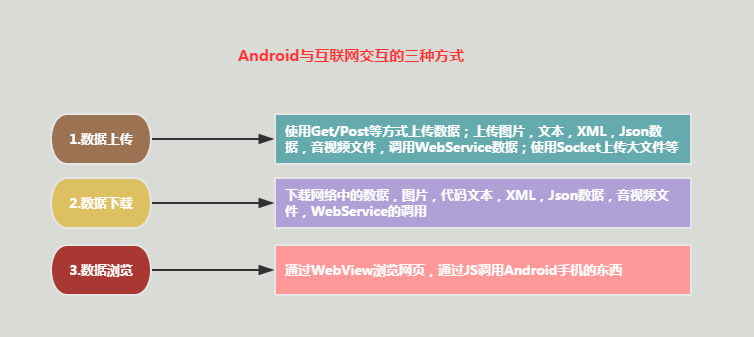
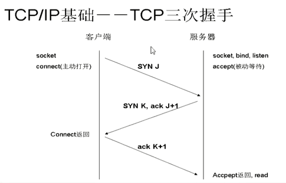
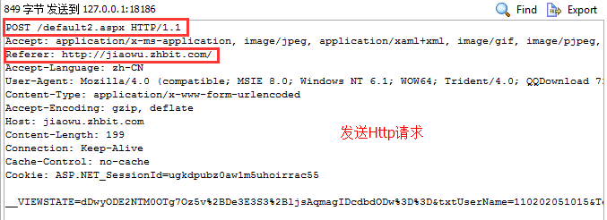
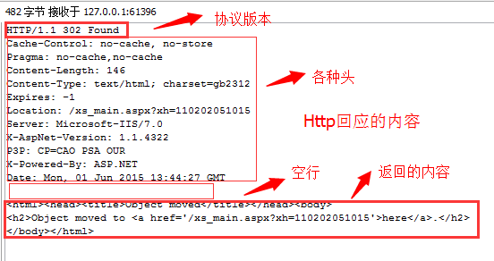
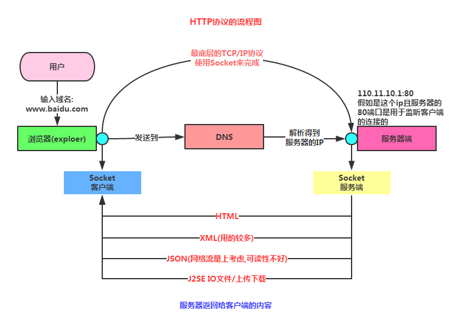

# 网络编程（HTTP/解析/上传下载/WebView/Socket）

> 本章归并自 20 页教程代码块，来源见各节。

## 7.1.1 Android网络编程要学的东西与Http协议学习

> 来源: https://www.runoob.com/w3cnote/android-tutorial-http.html

## 本节引言：

> 不知不觉终于来到Android网络编程这一章节，前面我们玩的都是单机，肯定是不过瘾是吧，
> 本节开始我们来学习Android网络编程相关的一些东西：Android端网络编程要干嘛？Http协议
> 的学习，使用自带扣脚Json解析类解析Json，XML解析的几种常用方式，HttpUrlConnection和
> HttpClient的使用，文件的上传，下载；WebService的使用，WebView，Socket通信的使用等！

> 另外我们是客户端，服务端的内容不在我们的范畴，而且小猪也不擅长，我们的最低要求是：
> **能够掌握获取与解析服务器反馈的数据的能力！**
> 好的，话不多说，开始本节内容！

## 1.Android与互联网交互的三种方式



## 2.初识Http协议

> 实际开发中我们和服务端打交道一般用得都是基于Http协议的通信，所以学好Http协议是非常
> 重要的，当然，我们不用过于考究一些细节的东西，有个大体的了解即可！都是一些概念性的东西！

### 1）什么是Http协议？

> 答：hypertext transfer protocol（超文本传输协议），TCP/IP协议的一个应用层协议，用于
> 定义WEB浏览器与WEB服务器之间交换数据的过程。客户端连上web服务器后，若想获得web服务器
> 中的某个web资源，需遵守一定的通讯格式，HTTP协议用于定义客户端与web服务器通迅的格式。

### 2）Http 1.0 与 Http 1.1的区别

> 答：1.0协议，客户端与web服务器建立连接后，只能获得一个web资源！
> 而1.1协议，允许客户端与web服务器建立连接后，在一个连接上获取多个web资源！

### 3）Http协议的底层工作流程：

> 答：我们先要知道两个名词：

> - **SYN**(synchronous):TCP/IP建立连接时使用的握手信号

> - **ACK**(Acknowledgement):确认字符，确认发来的数据已经接受无误

> 接着就到**TCP/IP三次握手**的概念：

> - 客户端发送syn包(syn = j)到服务器，进入SYN_SEND状态，然后等待服务器确认

> - 服务器收到syn包,确认客户的syn(ack = j + 1),同时在自己也发送一个SYN包(syn=k)，
> 即SYN + ACK包，服务器进入SYN_RECV状态

> - 客户端收到SYN + ACK包，向服务器发送确认包ACK(ack = k +1),发送完毕后，客户端与服务端
> 进入ESTABLISHED状态，完成三次握手，然后两者开始传送数据

> 如果还不是很清晰，我们再来看三次握手的示意图：

> 

> 了解了是吧，然后我们就来看看Http操作的一个流程了：

> - 用户点击浏览器上的url(超链接)，Web浏览器与Web服务器建立连接

> - 建立连接后，客户端发送请求给服务器，请求的格式为:
> 统一资源标识符(URL)+协议版本号(一般是1.1)+MIME信息(多个消息头)+一个空行

> - 服务端收到请求后，给予相应的返回信息，返回格式为:
> 协议版本号 + 状态行(处理结果) + 多个信息头 + 空行 + 实体内容(比如返回的HTML)

> - 客户端接收服务端返回信息，通过浏览器显示出来，然后与服务端断开连接；当然如果中途
> 某步发生错误的话，错误信息会返回到客户端，并显示，比如：经典的404错误！

> 对于上面的流程如果还不清晰，我们可以使用HttpWatch或者firefox抓下包：
> PS:测试网站是小猪的学校的教务系统，输入账号密码后请求登陆，我们可以看到下述信息：

> **HTTP请求包含的内容:**

> 

> **HTTP响应包括的内容:**

> 

> 这就一目了然了是吧！

### 4）Http协议的业务流程



### 5）Http的几种请求方式

> 实际开发中我们用得较多的方式是Get和Post，但是实际开发可能还会用到其他请求方式，比如PUT，
> 小猪的实际项目中就用到了，下面为了方便大家，就把所有的请求方式列出来吧：

> - **Get**：请求获取Request-URI所标识的资源

> - **POST**：在Request-URI所标识的资源后附加新的数据

> - **HEAD** 请求获取由Request-URI所标识的资源的响应信息报头

> - **PUT**：请求服务器存储一个资源，并用Request-URI作为其标识

> - **DELETE**：请求服务器删除Request-URI所标识的资源

> - **TRACE**：请求服务器回送收到的请求信息，主要用于测试或诊断

> - **CONNECT**：保留将来使用

> - **OPTIONS**：请求查询服务器的性能，或者查询与资源相关的选项

### 6）Get和Post的对比

> 用得最多的两个，当然要做下对比啦！

> - **GET**：在请求的URL地址后以?的形式带上交给服务器的数据，多个数据之间以&进行分隔，
> 但数据容量通常不能超过2K，比如:http://xxx?username=…&pawd=…这种就是GET

> - **POST**: 这个则可以在请求的实体内容中向服务器发送数据，传输没有数量限制

> - 另外要说一点，这两个玩意都是发送数据的，只是发送机制不一样，不要相信网上说的
> "GET获得服务器数据，POST向服务器发送数据"!!另外GET安全性非常低，Post安全性较高，
> 但是执行效率却比Post方法好，一般查询的时候我们用GET，数据增删改的时候用POST！！

### 7）Http状态码合集

> 当然，这些状态码只是要给参考，实际上**决定权在服务器端(后台的)**手上，一种方案是请求后，
> 服务器返回给我们的是状态，或者另一种，在应用不用弄多语言版本的时候最好用，直接返回
> 一串结果信息的Json给我们，我们直接显示就好，这样可以偷懒不少！下面列下状态码合集，参考
> 下就好：

> - 100~199 : 成功接受请求，客户端需提交下一次请求才能完成整个处理过程

> - 200: OK，客户端请求成功

> - 300~399：请求资源已移到新的地址(302,307,304)

> - 401：请求未授权，改状态代码需与WWW-Authenticate报头域一起使用

> - 403：Forbidden，服务器收到请求，但是拒绝提供服务

> - 404：Not Found，请求资源不存在，这个就不用说啦

> - 500：Internal Server Error，服务器发生不可预期的错误

> - 503：Server Unavailable，服务器当前不能处理客户端请求，一段时间后可能恢复正常

### 8）Http协议的特点

> 概念性的东西，知道就好，别去背，百度百科的东西，直接复制粘贴：

> **1.** **支持客户/服务器模式**。

> **2.** **简单快速**：客户向服务器请求服务时，只需传送请求方法和路径。请求方法常用的有GET、
> HEAD、POST。每种方法规定了客户与服务器联系的类型不同。 由于HTTP协议简单，使得HTTP服务器的程序规模小，因而通信速度很快。

> **3.** **灵活**：HTTP允许传输任意类型的数据对象。正在传输的类型由Content-Type加以标记。

> **4.** **无连接**：无连接的含义是限制每次连接只处理一个请求。服务器处理完客户的请求，
> 并收到客户的应答后，即断开连接。采用这种方式可以节省传输时间。

> **5.** **无状态**：HTTP协议是无状态协议。无状态是指协议对于事务处理没有记忆能力。
> 缺少状态意味着如果后续处理需要前面的信息，则它必须重传，这样可能导致每 次连接传送的数据量增大。另一方面，在服务器不需要先前信息时它的应答就较快。

PS:关于OSI七层协议以及TCP四层模型就不在基础系列讲解了~有兴趣可以自行了解下！

## 本节小结：

> 本节讲解了我们在Android开发中涉及到网络方面的要完成的工具，以及讲解了Http协议的
> 相关概念，相信大家对Android移动端与服务器交互已经有了个模糊的映像，下节我们来研究
> Http协议的请求头与响应头！本节就到这里，谢谢~

### 图片清单

1. 图1 -> images/49076488.jpg （原图：https://www.runoob.com/wp-content/uploads/2015/09/49076488.jpg）
2. 图2 -> images/65969107.jpg （原图：https://www.runoob.com/wp-content/uploads/2015/09/65969107.jpg）
3. 图3 -> images/63675724.jpg （原图：https://www.runoob.com/wp-content/uploads/2015/09/63675724.jpg）
4. 图4 -> images/71640548.jpg （原图：https://www.runoob.com/wp-content/uploads/2015/09/71640548.jpg）
5. 图5 -> images/76789394.jpg （原图：https://www.runoob.com/wp-content/uploads/2015/09/76789394.jpg）

## 7.1.2 Android Http请求头与响应头的学习

> 来源: https://www.runoob.com/w3cnote/android-tutorial-http-response-header.html

```xml
<servlet>
    <servlet-name>FirstServlet</servlet-name>
    <servlet-class>com.jay.server.FirstServlet</servlet-class>
</servlet>
<servlet-mapping>
    <servlet-name>FirstServlet</servlet-name>
    <url-pattern>/FirstServlet</url-pattern>
</servlet-mapping>
```

```java
package com.jay.http.test;

import java.io.IOException;
import javax.servlet.ServletException;
import javax.servlet.http.HttpServlet;
import javax.servlet.http.HttpServletRequest;
import javax.servlet.http.HttpServletResponse;

public class ServletOne extends HttpServlet {
    @Override
    protected void doGet(HttpServletRequest req, HttpServletResponse resp)
            throws ServletException, IOException {
        //告诉浏览器响应码，以及重定向页面
        resp.setStatus(302);
        resp.setHeader("Location", "http://www.baidu.com");
    }
    @Override
    protected void doPost(HttpServletRequest req, HttpServletResponse resp)
            throws ServletException, IOException {
        this.doGet(req, resp);
    }
}
```

```java
package com.jay.http.test;

import java.io.ByteArrayOutputStream;
import java.io.IOException;
import java.util.zip.GZIPOutputStream;
import javax.servlet.ServletException;
import javax.servlet.http.HttpServlet;
import javax.servlet.http.HttpServletRequest;
import javax.servlet.http.HttpServletResponse;

public class ServletTwo extends HttpServlet {
    @Override
    protected void doGet(HttpServletRequest req, HttpServletResponse resp)
            throws ServletException, IOException {
        String data = "Fresh air and sunshine can have an amazing effect on our feelings. "
                + "Sometimes when we are feeling down, all that we need to do is simply to go "
                + "outside and breathe. Movement and exercise is also a fantastic way to feel better. "
                + "Positive emotions can be generated by motion. So if we start to feel down,"
                + " take some deep breathes, go outside, feel the fresh air, "
                + "let the sun hit our face, go for a hike, a walk, a bike ride, "
                + "a swim, a run, whatever. We will feel better if we do this.";
        System.out.println("原始数据长度:" + data.getBytes().length);
        // 对数据进行压缩:
        ByteArrayOutputStream bout = new ByteArrayOutputStream();
        GZIPOutputStream gout = new GZIPOutputStream(bout);
        gout.write(data.getBytes());
        gout.close();
        // 得到压缩后的数据
        byte gdata[] = bout.toByteArray();
        resp.setHeader("Content-Encoding", "gzip");
        resp.setHeader("Content-Length", gdata.length + "");
        resp.getOutputStream().write(gdata);

    }
    protected void doPost(HttpServletRequest req, HttpServletResponse resp)
            throws ServletException, IOException {
        doGet(req, resp);
    };
}
```

```java
package com.jay.http.test;

import java.io.IOException;
import java.io.InputStream;
import java.io.OutputStream;

import javax.servlet.ServletException;
import javax.servlet.http.HttpServlet;
import javax.servlet.http.HttpServletRequest;
import javax.servlet.http.HttpServletResponse;

public class ServletThree extends HttpServlet {
    @Override
    protected void doGet(HttpServletRequest req, HttpServletResponse resp)
            throws ServletException, IOException {
        resp.setHeader("content-type", "application/pdf");
        InputStream in = this.getServletContext().getResourceAsStream("/file/android编码规范.pdf");
        byte buffer[] = new byte[1024];
        int len = 0;
        OutputStream out = resp.getOutputStream();
        while((len = in.read(buffer)) > 0)
        {
            out.write(buffer,0,len);
        }
    }

    protected void doPost(HttpServletRequest req, HttpServletResponse resp) throws
       ServletException ,IOException
    {
        doGet(req, resp);
    };
}
```

```java
package com.jay.http.test;

import java.io.IOException;

import javax.servlet.ServletException;
import javax.servlet.http.HttpServlet;
import javax.servlet.http.HttpServletRequest;
import javax.servlet.http.HttpServletResponse;

public class ServletFour extends HttpServlet {
    public int second = 0;
    @Override
    protected void doGet(HttpServletRequest req, HttpServletResponse resp)
            throws ServletException, IOException {
        //1.浏览器每隔2秒定时刷新页面
//        resp.setHeader("refresh", "2");
//        resp.getWriter().write(++second + "");
//        System.out.println("doGet方法被调用~");

        //2.进入页面5s后，然页跳到百度~
        resp.setHeader("refresh", "5;url='http://www.baidu.com'");
        resp.getWriter().write("HE HE DA~");
    }

    protected void doPost(HttpServletRequest req, HttpServletResponse resp) throws ServletException ,IOException
    {
        doGet(req, resp);
    };
}
```

```java
package com.jay.http.test;

import java.io.IOException;
import java.io.InputStream;
import java.io.OutputStream;

import javax.servlet.ServletException;
import javax.servlet.http.HttpServlet;
import javax.servlet.http.HttpServletRequest;
import javax.servlet.http.HttpServletResponse;

public class ServletFive extends HttpServlet {

    @Override
    protected void doGet(HttpServletRequest req, HttpServletResponse resp)
            throws ServletException, IOException {
        resp.setHeader("content-disposition", "attachment;filename=Android.pdf");
        InputStream in = this.getServletContext().getResourceAsStream("/file/android编码规范.pdf");
        byte buffer[] = new byte[1024];
        int len = 0;
        OutputStream out = resp.getOutputStream();
        while((len = in.read(buffer)) > 0)
        {
            out.write(buffer,0,len);
        }
    }

    @Override
    protected void doPost(HttpServletRequest req, HttpServletResponse resp)
            throws ServletException, IOException {
        doGet(req, resp);
    }
}
```

## 7.1.3 Android HTTP请求方式:HttpURLConnection

> 来源: https://www.runoob.com/w3cnote/android-tutorial-httpurlconnection.html

```java
/**
 * Created by Jay on 2015/9/7 0007.
 */
public class StreamTool {
    //从流中读取数据
    public static byte[] read(InputStream inStream) throws Exception{
        ByteArrayOutputStream outStream = new ByteArrayOutputStream();
        byte[] buffer = new byte[1024];
        int len = 0;
        while((len = inStream.read(buffer)) != -1)
        {
            outStream.write(buffer,0,len);
        }
        inStream.close();
        return outStream.toByteArray();
    }
}
```

```xml
<LinearLayout xmlns:android="http://schemas.android.com/apk/res/android"
    android:layout_width="match_parent"
    android:layout_height="match_parent"
    android:orientation="vertical">

    <TextView
        android:id="@+id/txtMenu"
        android:layout_width="match_parent"
        android:layout_height="48dp"
        android:background="#4EA9E9"
        android:clickable="true"
        android:gravity="center"
        android:text="长按我，加载菜单"
        android:textSize="20sp" />

    <ImageView
        android:id="@+id/imgPic"
        android:layout_width="match_parent"
        android:layout_height="match_parent"
        android:visibility="gone" />

    <ScrollView
        android:id="@+id/scroll"
        android:layout_width="match_parent"
        android:layout_height="match_parent"
        android:visibility="gone">

        <TextView
            android:id="@+id/txtshow"
            android:layout_width="wrap_content"
            android:layout_height="wrap_content" />
    </ScrollView>

    <WebView
        android:id="@+id/webView"
        android:layout_width="match_parent"
        android:layout_height="match_parent" />

</LinearLayout>
```

```java
/**
 * Created by Jay on 2015/9/7 0007.
 */
public class GetData {
    // 定义一个获取网络图片数据的方法:
    public static byte[] getImage(String path) throws Exception {
        URL url = new URL(path);
        HttpURLConnection conn = (HttpURLConnection) url.openConnection();
        // 设置连接超时为5秒
        conn.setConnectTimeout(5000);
        // 设置请求类型为Get类型
        conn.setRequestMethod("GET");
        // 判断请求Url是否成功
        if (conn.getResponseCode() != 200) {
            throw new RuntimeException("请求url失败");
        }
        InputStream inStream = conn.getInputStream();
        byte[] bt = StreamTool.read(inStream);
        inStream.close();
        return bt;
    }

    // 获取网页的html源代码
    public static String getHtml(String path) throws Exception {
        URL url = new URL(path);
        HttpURLConnection conn = (HttpURLConnection) url.openConnection();
        conn.setConnectTimeout(5000);
        conn.setRequestMethod("GET");
        if (conn.getResponseCode() == 200) {
            InputStream in = conn.getInputStream();
            byte[] data = StreamTool.read(in);
            String html = new String(data, "UTF-8");
            return html;
        }
        return null;
    }
}
```

```java
public class MainActivity extends AppCompatActivity {

    private TextView txtMenu, txtshow;
    private ImageView imgPic;
    private WebView webView;
    private ScrollView scroll;
    private Bitmap bitmap;
    private String detail = "";
    private boolean flag = false;
    private final static String PIC_URL = "https://ww2.sinaimg.cn/large/7a8aed7bgw1evshgr5z3oj20hs0qo0vq.jpg";
    private final static String HTML_URL = "https://www.baidu.com";

    // 用于刷新界面
    private Handler handler = new Handler() {
        public void handleMessage(android.os.Message msg) {
            switch (msg.what) {
                case 0x001:
                    hideAllWidget();
                    imgPic.setVisibility(View.VISIBLE);
                    imgPic.setImageBitmap(bitmap);
                    Toast.makeText(MainActivity.this, "图片加载完毕", Toast.LENGTH_SHORT).show();
                    break;
                case 0x002:
                    hideAllWidget();
                    scroll.setVisibility(View.VISIBLE);
                    txtshow.setText(detail);
                    Toast.makeText(MainActivity.this, "HTML代码加载完毕", Toast.LENGTH_SHORT).show();
                    break;
                case 0x003:
                    hideAllWidget();
                    webView.setVisibility(View.VISIBLE);
                    webView.loadDataWithBaseURL("", detail, "text/html", "UTF-8", "");
                    Toast.makeText(MainActivity.this, "网页加载完毕", Toast.LENGTH_SHORT).show();
                    break;
                default:
                    break;
            }
        }

        ;
    };


    @Override
    protected void onCreate(Bundle savedInstanceState) {
        super.onCreate(savedInstanceState);
        setContentView(R.layout.activity_main);
        setViews();
    }

    private void setViews() {
        txtMenu = (TextView) findViewById(R.id.txtMenu);
        txtshow = (TextView) findViewById(R.id.txtshow);
        imgPic = (ImageView) findViewById(R.id.imgPic);
        webView = (WebView) findViewById(R.id.webView);
        scroll = (ScrollView) findViewById(R.id.scroll);
        registerForContextMenu(txtMenu);
    }

    // 定义一个隐藏所有控件的方法:
    private void hideAllWidget() {
        imgPic.setVisibility(View.GONE);
        scroll.setVisibility(View.GONE);
        webView.setVisibility(View.GONE);
    }

    @Override
    // 重写上下文菜单的创建方法
    public void onCreateContextMenu(ContextMenu menu, View v, ContextMenu.ContextMenuInfo menuInfo) {
        MenuInflater inflator = new MenuInflater(this);
        inflator.inflate(R.menu.menus, menu);
        super.onCreateContextMenu(menu, v, menuInfo);
    }

    // 上下文菜单被点击是触发该方法
    @Override
    public boolean onContextItemSelected(MenuItem item) {
        switch (item.getItemId()) {
            case R.id.one:
                new Thread() {
                    public void run() {
                        try {
                            byte[] data = GetData.getImage(PIC_URL);
                            bitmap = BitmapFactory.decodeByteArray(data, 0, data.length);
                        } catch (Exception e) {
                            e.printStackTrace();
                        }
                        handler.sendEmptyMessage(0x001);
                    }

                    ;
                }.start();
                break;
            case R.id.two:
                new Thread() {
                    public void run() {
                        try {
                            detail = GetData.getHtml(HTML_URL);
                        } catch (Exception e) {
                            e.printStackTrace();
                        }
                        handler.sendEmptyMessage(0x002);
                    };
                }.start();
                break;
            case R.id.three:
                if (detail.equals("")) {
                    Toast.makeText(MainActivity.this, "先请求HTML先嘛~", Toast.LENGTH_SHORT).show();
                } else {
                    handler.sendEmptyMessage(0x003);
                }
                break;
        }
        return true;
    }
}
```

```xml
<uses-permission android:name="android.permission.INTERNET" />
```

```java
public class PostUtils {
    public static String LOGIN_URL = "http://172.16.2.54:8080/HttpTest/ServletForPost";
    public static String LoginByPost(String number,String passwd)
    {
        String msg = "";
        try{
            HttpURLConnection conn = (HttpURLConnection) new URL(LOGIN_URL).openConnection();
            //设置请求方式,请求超时信息
            conn.setRequestMethod("POST");
            conn.setReadTimeout(5000);
            conn.setConnectTimeout(5000);
            //设置运行输入,输出:
            conn.setDoOutput(true);
            conn.setDoInput(true);
            //Post方式不能缓存,需手动设置为false
            conn.setUseCaches(false);
            //我们请求的数据:
            String data = "passwd="+ URLEncoder.encode(passwd, "UTF-8")+
                    "&number="+ URLEncoder.encode(number, "UTF-8");
            //这里可以写一些请求头的东东...
            //获取输出流
            OutputStream out = conn.getOutputStream();
            out.write(data.getBytes());
            out.flush();
             if (conn.getResponseCode() == 200) {
                    // 获取响应的输入流对象
                    InputStream is = conn.getInputStream();
                    // 创建字节输出流对象
                    ByteArrayOutputStream message = new ByteArrayOutputStream();
                    // 定义读取的长度
                    int len = 0;
                    // 定义缓冲区
                    byte buffer[] = new byte[1024];
                    // 按照缓冲区的大小，循环读取
                    while ((len = is.read(buffer)) != -1) {
                        // 根据读取的长度写入到os对象中
                        message.write(buffer, 0, len);
                    }
                    // 释放资源
                    is.close();
                    message.close();
                    // 返回字符串
                    msg = new String(message.toByteArray());
                    return msg;
             }
        }catch(Exception e){e.printStackTrace();}
        return msg;
    }
}
```

```java
public static String LoginByPut(Context mContext, String mobile, String password, int from,
          String devid,String version_name, int remember_me) {
    String resp = "";
    try {
        HttpURLConnection conn = (HttpURLConnection) new URL(LOGIN_URL).openConnection();
        conn.setRequestMethod("PUT");
        conn.setReadTimeout(5000);
        conn.setConnectTimeout(5000);
        conn.setDoOutput(true);
        conn.setDoInput(true);
        conn.setUseCaches(false);

        String data = "mobile=" + mobile + "&password=" + password + "&from=" + from + "&devid=" + "devid"
                + "&version_name=" + "version_name" + "&remember_me=" + remember_me;
        ;
        // 获取输出流:
        OutputStreamWriter writer = new OutputStreamWriter(conn.getOutputStream());
        writer.write(data);
        writer.flush();
        writer.close();

        // 获取相应流对象:
        InputStream in = conn.getInputStream();
        BufferedReader reader = new BufferedReader(new InputStreamReader(in));
        StringBuilder response = new StringBuilder();
        String line;
        while ((line = reader.readLine()) != null)
            response.append(line);
        SPUtils.put(mContext, "session", conn.getHeaderField("Set-Cookie"));
        // 资源释放:
        in.close();
        // 返回字符串
        Log.e("HEHE", response.toString());
        return response.toString();
    } catch (Exception e) {
        e.printStackTrace();
    }
    return "";
}
```

## 7.1.4 Android HTTP请求方式:HttpClient

> 来源: https://www.runoob.com/w3cnote/android-tutorial-httpclient.html

```java
public class MainActivity extends Activity implements OnClickListener {

    private Button btnGet;
    private WebView wView;
    public static final int SHOW_DATA = 0X123;
    private String detail = "";

    private Handler handler = new Handler() {
        public void handleMessage(Message msg) {
            if(msg.what == SHOW_DATA)
            {
                wView.loadDataWithBaseURL("",detail, "text/html","UTF-8","");
            }
        };
    };
    @Override
    protected void onCreate(Bundle savedInstanceState) {
        super.onCreate(savedInstanceState);
        setContentView(R.layout.activity_main);
        initView();
        setView();
    }

    private void initView() {
        btnGet = (Button) findViewById(R.id.btnGet);
        wView = (WebView) findViewById(R.id.wView);
    }

    private void setView() {
        btnGet.setOnClickListener(this);
        wView.getSettings().setDomStorageEnabled(true);
    }
    @Override
    public void onClick(View v) {
        if (v.getId() == R.id.btnGet) {
            GetByHttpClient();
        }
    }
    private void GetByHttpClient() {
        new Thread()
        {
            public void run()
            {
                    try {
                        HttpClient httpClient = new DefaultHttpClient();
                        HttpGet httpGet = new HttpGet("http://www.w3cschool.cc/python/python-tutorial.html");
                        HttpResponse httpResponse = httpClient.execute(httpGet);
                        if (httpResponse.getStatusLine().getStatusCode() == 200) {
                            HttpEntity entity = httpResponse.getEntity();
                            detail = EntityUtils.toString(entity, "utf-8");
                            handler.sendEmptyMessage(SHOW_DATA);
                        }
                    } catch (Exception e) {
                        e.printStackTrace();
                    }
            };
        }.start();
    }

}
```

```java
List<BasicNameValuePair> params = new LinkedList<BasicNameValuePair>();
params.add(new BasicNameValuePair("user", "猪小弟"));
params.add(new BasicNameValuePair("pawd", "123"));
String param = URLEncodedUtils.format(params, "UTF-8");
HttpGet httpGet = new HttpGet("http://www.baidu.com"+"?"+param);
```

```java
private void PostByHttpClient(final String url)
{
    new Thread()
    {
        public void run()
        {
            try{
                HttpClient httpClient = new DefaultHttpClient();
                HttpPost httpPost = new HttpPost(url);
                List<NameValuePair> params = new ArrayList<NameValuePair>();
                params.add(new BasicNameValuePair("user", "猪大哥"));
                params.add(new BasicNameValuePair("pawd", "123"));
                UrlEncodedFormEntity entity = new UrlEncodedFormEntity(params,"UTF-8");
                httpPost.setEntity(entity);
                HttpResponse httpResponse =  httpClient.execute(httpPost);
                if (httpResponse.getStatusLine().getStatusCode() == 200) {
                    HttpEntity entity2 = httpResponse.getEntity();
                    detail = EntityUtils.toString(entity2, "utf-8");
                    handler.sendEmptyMessage(SHOW_DATA);
                }
            }catch(Exception e){e.printStackTrace();}
        };
    }.start();
}
```

```java
//获得链接,模拟登录的实现:
public int getConnect(String user, String key) throws Exception {
    // 先发送get请求 获取cookie值和__ViewState值
    HttpGet getLogin = new HttpGet(true_url);
    // 第一步:主要的HTML:
    String loginhtml = "";
    HttpResponse loginResponse = new DefaultHttpClient().execute(getLogin);
    if (loginResponse.getStatusLine().getStatusCode() == 200) {
        HttpEntity entity = loginResponse.getEntity();
        loginhtml = EntityUtils.toString(entity);
        // 获取响应的cookie值
        cookie = loginResponse.getFirstHeader("Set-Cookie").getValue();
        System.out.println("cookie= " + cookie);
    }

    // 第二步:模拟登录
    // 发送Post请求,禁止重定向
    HttpPost httpPost = new HttpPost(true_url);
    httpPost.getParams().setParameter(ClientPNames.HANDLE_REDIRECTS, false);

    // 设置Post提交的头信息的参数
    httpPost.setHeader("User-Agent",
            "Mozilla/5.0 (Windows NT 6.3; WOW64; Trident/7.0; rv:11.0) like Gecko");
    httpPost.setHeader("Referer", true_url);
    httpPost.setHeader("Cookie", cookie);

    // 设置请求数据
    List<NameValuePair> params = new ArrayList<NameValuePair>();

    params.add(new BasicNameValuePair("__VIEWSTATE",
            getViewState(loginhtml)));// __VIEWSTATE参数，如果变化可以动态抓取获取
    params.add(new BasicNameValuePair("Button1", ""));
    params.add(new BasicNameValuePair("hidPdrs", ""));
    params.add(new BasicNameValuePair("hidsc", ""));
    params.add(new BasicNameValuePair("lbLanguage", ""));
    params.add(new BasicNameValuePair("RadioButtonList1", "%D1%A7%C9%FA"));
    params.add(new BasicNameValuePair("txtUserName", user));
    params.add(new BasicNameValuePair("TextBox2", key));
    params.add(new BasicNameValuePair("txtSecretCode", "")); // ( ╯□╰ )逗比正方,竟然不需要验证码

    // 设置编码方式,响应请求,获取响应状态码:
    httpPost.setEntity(new UrlEncodedFormEntity(params, "gb2312"));
    HttpResponse response = new DefaultHttpClient().execute(httpPost);
    int Status = response.getStatusLine().getStatusCode();
    if(Status == 200)return Status;
    System.out.println("Status= " + Status);

    // 重定向状态码为302
    if (Status == 302 || Status == 301) {
        // 获取头部信息中Location的值
        location = response.getFirstHeader("Location").getValue();
        System.out.println(location);
        // 第三步:获取管理信息的主页面
        // Get请求
        HttpGet httpGet = new HttpGet(ip_url + location);// 带上location地址访问
        httpGet.setHeader("Referer", true_url);
        httpGet.setHeader("Cookie", cookie);

        // 主页的html
        mainhtml = "";
        HttpResponse httpResponseget = new DefaultHttpClient()
                .execute(httpGet);
        if (httpResponseget.getStatusLine().getStatusCode() == 200) {
            HttpEntity entity = httpResponseget.getEntity();
            mainhtml = EntityUtils.toString(entity);
        }

    }
    return Status;
}
```

```java
public static int PutActCode(String actCode, String licPlate, Context mContext) {
    int resp = 0;
    String cookie = (String) SPUtils.get(mContext, "session", "");
    HttpPut httpPut = new HttpPut(PUTACKCODE_URL);
    httpPut.setHeader("Cookie", cookie);
    try {

        List<NameValuePair> params = new ArrayList<NameValuePair>();
        params.add(new BasicNameValuePair("activation_code", actCode));
        params.add(new BasicNameValuePair("license_plate", licPlate));
        httpPut.setEntity(new UrlEncodedFormEntity(params, "UTF-8"));
        HttpResponse course_response = new DefaultHttpClient().execute(httpPut);
        if (course_response.getStatusLine().getStatusCode() == 200) {
            HttpEntity entity2 = course_response.getEntity();
            JSONObject jObject = new JSONObject(EntityUtils.toString(entity2));
            resp = Integer.parseInt(jObject.getString("status_code"));
            return resp;
        }
    } catch (Exception e) {
        e.printStackTrace();
    }
    return resp;
}
```

## 7.2.1 Android XML数据解析

> 来源: https://www.runoob.com/w3cnote/android-tutorial-xml.html

```java
/**
 * Created by Jay on 2015/9/8 0008.
 */
public class SaxHelper extends DefaultHandler {
    private Person person;
    private ArrayList<Person> persons;
    //当前解析的元素标签
    private String tagName = null;

    /**
     * 当读取到文档开始标志是触发，通常在这里完成一些初始化操作
     */
    @Override
    public void startDocument() throws SAXException {
        this.persons = new ArrayList<Person>();
        Log.i("SAX", "读取到文档头,开始解析xml");
    }


    /**
     * 读到一个开始标签时调用,第二个参数为标签名,最后一个参数为属性数组
     */
    @Override
    public void startElement(String uri, String localName, String qName,
                             Attributes attributes) throws SAXException {
        if (localName.equals("person")) {
            person = new Person();
            person.setId(Integer.parseInt(attributes.getValue("id")));
            Log.i("SAX", "开始处理person元素~");
        }
        this.tagName = localName;
    }


    /**
     * 读到到内容,第一个参数为字符串内容,后面依次为起始位置与长度
     */

    @Override
    public void characters(char[] ch, int start, int length)
            throws SAXException {
        //判断当前标签是否有效
        if (this.tagName != null) {
            String data = new String(ch, start, length);
            //读取标签中的内容
            if (this.tagName.equals("name")) {
                this.person.setName(data);
                Log.i("SAX", "处理name元素内容");
            } else if (this.tagName.equals("age")) {
                this.person.setAge(Integer.parseInt(data));
                Log.i("SAX", "处理age元素内容");
            }

        }

    }

    /**
     * 处理元素结束时触发,这里将对象添加到结合中
     */
    @Override
    public void endElement(String uri, String localName, String qName)
            throws SAXException {
        if (localName.equals("person")) {
            this.persons.add(person);
            person = null;
            Log.i("SAX", "处理person元素结束~");
        }
        this.tagName = null;
    }

    /**
     * 读取到文档结尾时触发，
     */
    @Override
    public void endDocument() throws SAXException {
        super.endDocument();
        Log.i("SAX", "读取到文档尾,xml解析结束");
    }

    //获取persons集合
    public ArrayList<Person> getPersons() {
        return persons;
    }

}
```

```java
private ArrayList<Person> readxmlForSAX() throws Exception {
    //获取文件资源建立输入流对象
    InputStream is = getAssets().open("person1.xml");
    //①创建XML解析处理器
    SaxHelper ss = new SaxHelper();
    //②得到SAX解析工厂
    SAXParserFactory factory = SAXParserFactory.newInstance();
    //③创建SAX解析器
    SAXParser parser = factory.newSAXParser();
    //④将xml解析处理器分配给解析器,对文档进行解析,将事件发送给处理器
    parser.parse(is, ss);
    is.close();
    return ss.getPersons();
}
```

```xml
<?xml version="1.0" encoding="UTF-8"?>
<persons>
    <person id = "11">
        <name>SAX解析</name>
        <age>18</age>
    </person>
    <person id = "13">
        <name>XML1</name>
        <age>43</age>
    </person>
</persons>
```

```java
/**
 * Created by Jay on 2015/9/8 0008.
 */
public class DomHelper {
    public static ArrayList<Person> queryXML(Context context)
    {
        ArrayList<Person> Persons = new ArrayList<Person>();
        try {
            //①获得DOM解析器的工厂示例:
            DocumentBuilderFactory dbFactory = DocumentBuilderFactory.newInstance();
            //②从Dom工厂中获得dom解析器
            DocumentBuilder dbBuilder = dbFactory.newDocumentBuilder();
            //③把要解析的xml文件读入Dom解析器
            Document doc = dbBuilder.parse(context.getAssets().open("person2.xml"));
            System.out.println("处理该文档的DomImplemention对象=" + doc.getImplementation());
            //④得到文档中名称为person的元素的结点列表
            NodeList nList = doc.getElementsByTagName("person");
            //⑤遍历该集合,显示集合中的元素以及子元素的名字
            for(int i = 0;i < nList.getLength();i++)
            {
                //先从Person元素开始解析
                Element personElement = (Element) nList.item(i);
                Person p = new Person();
                p.setId(Integer.valueOf(personElement.getAttribute("id")));

                //获取person下的name和age的Note集合
                NodeList childNoList = personElement.getChildNodes();
                for(int j = 0;j < childNoList.getLength();j++)
                {
                    Node childNode = childNoList.item(j);
                    //判断子note类型是否为元素Note
                    if(childNode.getNodeType() == Node.ELEMENT_NODE)
                    {
                        Element childElement = (Element) childNode;
                        if("name".equals(childElement.getNodeName()))
                            p.setName(childElement.getFirstChild().getNodeValue());
                        else if("age".equals(childElement.getNodeName()))
                            p.setAge(Integer.valueOf(childElement.getFirstChild().getNodeValue()));
                    }
                }
                Persons.add(p);
            }
        } catch (Exception e) {e.printStackTrace();}
        return Persons;
    }
}
```

```java
public static ArrayList<Person> getPersons(InputStream xml)throws Exception
{
    //XmlPullParserFactory pullPaser = XmlPullParserFactory.newInstance();
    ArrayList<Person> persons = null;
    Person person = null;
    // 创建一个xml解析的工厂
    XmlPullParserFactory factory = XmlPullParserFactory.newInstance();
    // 获得xml解析类的引用
    XmlPullParser parser = factory.newPullParser();
    parser.setInput(xml, "UTF-8");
    // 获得事件的类型
    int eventType = parser.getEventType();
    while (eventType != XmlPullParser.END_DOCUMENT) {
        switch (eventType) {
        case XmlPullParser.START_DOCUMENT:
            persons = new ArrayList<Person>();
            break;
        case XmlPullParser.START_TAG:
            if ("person".equals(parser.getName())) {
                person = new Person();
                // 取出属性值
                int id = Integer.parseInt(parser.getAttributeValue(0));
                person.setId(id);
            } else if ("name".equals(parser.getName())) {
                String name = parser.nextText();// 获取该节点的内容
                person.setName(name);
            } else if ("age".equals(parser.getName())) {
                int age = Integer.parseInt(parser.nextText());
                person.setAge(age);
            }
            break;
        case XmlPullParser.END_TAG:
            if ("person".equals(parser.getName())) {
                persons.add(person);
                person = null;
            }
            break;
        }
        eventType = parser.next();
    }
    return persons;
}
```

```java
public static void save(List<Person> persons, OutputStream out) throws Exception {
    XmlSerializer serializer = Xml.newSerializer();
    serializer.setOutput(out, "UTF-8");
    serializer.startDocument("UTF-8", true);
    serializer.startTag(null, "persons");
    for (Person p : persons) {
        serializer.startTag(null, "person");
        serializer.attribute(null, "id", p.getId() + "");
        serializer.startTag(null, "name");
        serializer.text(p.getName());
        serializer.endTag(null, "name");
        serializer.startTag(null, "age");
        serializer.text(p.getAge() + "");
        serializer.endTag(null, "age");
        serializer.endTag(null, "person");
    }

    serializer.endTag(null, "persons");
    serializer.endDocument();
    out.flush();
    out.close();
}
```

## 7.2.2 Android JSON数据解析

> 来源: https://www.runoob.com/w3cnote/android-tutorial-json.html

```java
[
    { "id":"1","name":"基神","age":"18" },
    { "id":"2","name":"B神","age":"18"  },
    { "id":"3","name":"曹神","age":"18" }
]
```

```java
/**
 * Created by Jay on 2015/9/8 0008.
 */
public class Person {
    private String id;
    private String name;
    private String age;
    public void setId(String id){
        this.id = id;
    }
    public String getId(){
        return this.id;
    }
    public void setName(String name){
        this.name = name;
    }
    public String getName(){
        return this.name;
    }
    public void setAge(String age){
        this.age = age;
    }
    public String getAge(){
        return this.age;
    }
    @Override
    public String toString() {
        return this.name + "~年方：" + this.age;
    }
}
```

```java
private void parseEasyJson(String json){
    persons = new ArrayList<Person>();
    try{
        JSONArray jsonArray = new JSONArray(json);
        for(int i = 0;i < jsonArray.length();i++){
            JSONObject jsonObject = (JSONObject) jsonArray.get(i);
            Person person = new Person();
            person.setId(i+"");
            person.setName(jsonObject.getString("name"));
            person.setAge(jsonObject.getString("age"));
            persons.add(person);
        }
    }catch (Exception e){e.printStackTrace();}
}
```

```java
private void parseDiffJson(String json) {
    try {
        JSONObject jsonObject1 = new JSONObject(json);
        Log.e("Json", json);
        JSONArray jsonArray = jsonObject1.getJSONArray("ch");
        for (int i = 0; i < jsonArray.length(); i++) {
            JSONObject jsonObject = (JSONObject) jsonArray.get(i);
            //取出name
            String sname = jsonObject.getString("names");
            JSONArray jarray1 = jsonObject.getJSONArray("data");
            JSONArray jarray2 = jsonObject.getJSONArray("times");
            Log.e("Json", sname);
            Log.e("Json", jarray1.toString());
            Log.e("Json", jarray2.toString());
        }
    } catch (Exception e) {
        e.printStackTrace();
    }

}
```

## 7.3.1 Android 文件上传

> 来源: https://www.runoob.com/w3cnote/android-tutorial-upload-file.html

```java
private void sendImage(Bitmap bm)
{
    ByteArrayOutputStream stream = new ByteArrayOutputStream();
    bm.compress(Bitmap.CompressFormat.PNG, 60, stream);
    byte[] bytes = stream.toByteArray();
    String img = new String(Base64.encodeToString(bytes, Base64.DEFAULT));
    AsyncHttpClient client = new AsyncHttpClient();
    RequestParams params = new RequestParams();
    params.add("img", img);
    client.post("http:xxx/postIcon", params, new AsyncHttpResponseHandler() {
        @Override
        public void onSuccess(int i, Header[] headers, byte[] bytes) {
            Toast.makeText(MainActivity.this, "Upload Success!", Toast.LENGTH_LONG).show();

        }
        @Override
        public void onFailure(int i, Header[] headers, byte[] bytes, Throwable throwable) {
            Toast.makeText(MainActivity.this, "Upload Fail!", Toast.LENGTH_LONG).show();
        }
    });
}
```

```java
public class SocketHttpRequester
{
    /**
     * 发送xml数据
     * @param path 请求地址
     * @param xml xml数据
     * @param encoding 编码
     * @return
     * @throws Exception
     */
    public static byte[] postXml(String path, String xml, String encoding) throws Exception{
        byte[] data = xml.getBytes(encoding);
        URL url = new URL(path);
        HttpURLConnection conn = (HttpURLConnection)url.openConnection();
        conn.setRequestMethod("POST");
        conn.setDoOutput(true);
        conn.setRequestProperty("Content-Type", "text/xml; charset="+ encoding);
        conn.setRequestProperty("Content-Length", String.valueOf(data.length));
        conn.setConnectTimeout(5 * 1000);
        OutputStream outStream = conn.getOutputStream();
        outStream.write(data);
        outStream.flush();
        outStream.close();
        if(conn.getResponseCode()==200){
            return readStream(conn.getInputStream());
        }
        return null;
    }

    /**
     * 直接通过HTTP协议提交数据到服务器,实现如下面表单提交功能:
     *   <FORM METHOD=POST ACTION="http://192.168.0.200:8080/ssi/fileload/test.do" enctype="multipart/form-data">
            <INPUT TYPE="text" NAME="name">
            <INPUT TYPE="text" NAME="id">
            <input type="file" name="imagefile"/>
            <input type="file" name="zip"/>
         </FORM>
     * @param path 上传路径(注：避免使用localhost或127.0.0.1这样的路径测试，
     *                  因为它会指向手机模拟器，你可以使用http://www.baidu.com或http://192.168.1.10:8080这样的路径测试)
     * @param params 请求参数 key为参数名,value为参数值
     * @param file 上传文件
     */
    public static boolean post(String path, Map<String, String> params, FormFile[] files) throws Exception
    {
        //数据分隔线
        final String BOUNDARY = "---------------------------7da2137580612";
        //数据结束标志"---------------------------7da2137580612--"
        final String endline = "--" + BOUNDARY + "--/r/n";

        //下面两个for循环都是为了得到数据长度参数，依据表单的类型而定
        //首先得到文件类型数据的总长度(包括文件分割线)
        int fileDataLength = 0;
        for(FormFile uploadFile : files)
        {
            StringBuilder fileExplain = new StringBuilder();
            fileExplain.append("--");
            fileExplain.append(BOUNDARY);
            fileExplain.append("/r/n");
            fileExplain.append("Content-Disposition: form-data;name=/""+ uploadFile.getParameterName()+"/";filename=/""+ uploadFile.getFilname() + "/"/r/n");
            fileExplain.append("Content-Type: "+ uploadFile.getContentType()+"/r/n/r/n");
            fileExplain.append("/r/n");
            fileDataLength += fileExplain.length();
            if(uploadFile.getInStream()!=null){
                fileDataLength += uploadFile.getFile().length();
            }else{
                fileDataLength += uploadFile.getData().length;
            }
        }
        //再构造文本类型参数的实体数据
        StringBuilder textEntity = new StringBuilder();
        for (Map.Entry<String, String> entry : params.entrySet())
        {
            textEntity.append("--");
            textEntity.append(BOUNDARY);
            textEntity.append("/r/n");
            textEntity.append("Content-Disposition: form-data; name=/""+ entry.getKey() + "/"/r/n/r/n");
            textEntity.append(entry.getValue());
            textEntity.append("/r/n");
        }

        //计算传输给服务器的实体数据总长度(文本总长度+数据总长度+分隔符)
        int dataLength = textEntity.toString().getBytes().length + fileDataLength +  endline.getBytes().length;

        URL url = new URL(path);
        //默认端口号其实可以不写
        int port = url.getPort()==-1 ? 80 : url.getPort();
        //建立一个Socket链接
        Socket socket = new Socket(InetAddress.getByName(url.getHost()), port);
        //获得一个输出流（从Android流到web）
        OutputStream outStream = socket.getOutputStream();
        //下面完成HTTP请求头的发送
        String requestmethod = "POST "+ url.getPath()+" HTTP/1.1/r/n";
        outStream.write(requestmethod.getBytes());
        //构建accept
        String accept = "Accept: image/gif, image/jpeg, image/pjpeg, image/pjpeg, application/x-shockwave-flash, application/xaml+xml, application/vnd.ms-xpsdocument, application/x-ms-xbap, application/x-ms-application, application/vnd.ms-excel, application/vnd.ms-powerpoint, application/msword, */*/r/n";
        outStream.write(accept.getBytes());
        //构建language
        String language = "Accept-Language: zh-CN/r/n";
        outStream.write(language.getBytes());
        //构建contenttype
        String contenttype = "Content-Type: multipart/form-data; boundary="+ BOUNDARY+ "/r/n";
        outStream.write(contenttype.getBytes());
        //构建contentlength
        String contentlength = "Content-Length: "+ dataLength + "/r/n";
        outStream.write(contentlength.getBytes());
        //构建alive
        String alive = "Connection: Keep-Alive/r/n";
        outStream.write(alive.getBytes());
        //构建host
        String host = "Host: "+ url.getHost() +":"+ port +"/r/n";
        outStream.write(host.getBytes());
        //写完HTTP请求头后根据HTTP协议再写一个回车换行
        outStream.write("/r/n".getBytes());
        //把所有文本类型的实体数据发送出来
        outStream.write(textEntity.toString().getBytes());

        //把所有文件类型的实体数据发送出来
        for(FormFile uploadFile : files)
        {
            StringBuilder fileEntity = new StringBuilder();
            fileEntity.append("--");
            fileEntity.append(BOUNDARY);
            fileEntity.append("/r/n");
            fileEntity.append("Content-Disposition: form-data;name=/""+ uploadFile.getParameterName()+"/";filename=/""+ uploadFile.getFilname() + "/"/r/n");
            fileEntity.append("Content-Type: "+ uploadFile.getContentType()+"/r/n/r/n");
            outStream.write(fileEntity.toString().getBytes());
            //边读边写
            if(uploadFile.getInStream()!=null)
            {
                byte[] buffer = new byte[1024];
                int len = 0;
                while((len = uploadFile.getInStream().read(buffer, 0, 1024))!=-1)
                {
                    outStream.write(buffer, 0, len);
                }
                uploadFile.getInStream().close();
            }
            else
            {
                outStream.write(uploadFile.getData(), 0, uploadFile.getData().length);
            }
            outStream.write("/r/n".getBytes());
        }
        //下面发送数据结束标志，表示数据已经结束
        outStream.write(endline.getBytes());
        BufferedReader reader = new BufferedReader(new InputStreamReader(socket.getInputStream()));
        //读取web服务器返回的数据，判断请求码是否为200，如果不是200，代表请求失败
        if(reader.readLine().indexOf("200")==-1)
        {
            return false;
        }
        outStream.flush();
        outStream.close();
        reader.close();
        socket.close();
        return true;
    }

    /**
     * 提交数据到服务器
     * @param path 上传路径(注：避免使用localhost或127.0.0.1这样的路径测试，因为它会指向手机模拟器，你可以使用http://www.baidu.com或http://192.168.1.10:8080这样的路径测试)
     * @param params 请求参数 key为参数名,value为参数值
     * @param file 上传文件
     */
    public static boolean post(String path, Map<String, String> params, FormFile file) throws Exception
    {
       return post(path, params, new FormFile[]{file});
    }
    /**
     * 提交数据到服务器
     * @param path 上传路径(注：避免使用localhost或127.0.0.1这样的路径测试，因为它会指向手机模拟器，你可以使用http://www.baidu.com或http://192.168.1.10:8080这样的路径测试)
     * @param params 请求参数 key为参数名,value为参数值
     * @param encode 编码
     */
    public static byte[] postFromHttpClient(String path, Map<String, String> params, String encode) throws Exception
    {
        //用于存放请求参数
        List<NameValuePair> formparams = new ArrayList<NameValuePair>();
        for(Map.Entry<String, String> entry : params.entrySet())
        {
            formparams.add(new BasicNameValuePair(entry.getKey(), entry.getValue()));
        }
        UrlEncodedFormEntity entity = new UrlEncodedFormEntity(formparams, encode);
        HttpPost httppost = new HttpPost(path);
        httppost.setEntity(entity);
        //看作是浏览器
        HttpClient httpclient = new DefaultHttpClient();
        //发送post请求
        HttpResponse response = httpclient.execute(httppost);
        return readStream(response.getEntity().getContent());
    }
    /**
     * 发送请求
     * @param path 请求路径
     * @param params 请求参数 key为参数名称 value为参数值
     * @param encode 请求参数的编码
     */
    public static byte[] post(String path, Map<String, String> params, String encode) throws Exception
    {
        //String params = "method=save&name="+ URLEncoder.encode("老毕", "UTF-8")+ "&age=28&";//需要发送的参数
        StringBuilder parambuilder = new StringBuilder("");
        if(params!=null && !params.isEmpty())
        {
            for(Map.Entry<String, String> entry : params.entrySet())
            {
                parambuilder.append(entry.getKey()).append("=")
                    .append(URLEncoder.encode(entry.getValue(), encode)).append("&");
            }
            parambuilder.deleteCharAt(parambuilder.length()-1);
        }
        byte[] data = parambuilder.toString().getBytes();
        URL url = new URL(path);
        HttpURLConnection conn = (HttpURLConnection)url.openConnection();
        //设置允许对外发送请求参数
        conn.setDoOutput(true);
        //设置不进行缓存
        conn.setUseCaches(false);
        conn.setConnectTimeout(5 * 1000);
        conn.setRequestMethod("POST");
        //下面设置http请求头
        conn.setRequestProperty("Accept", "image/gif, image/jpeg, image/pjpeg, image/pjpeg, application/x-shockwave-flash, application/xaml+xml, application/vnd.ms-xpsdocument, application/x-ms-xbap, application/x-ms-application, application/vnd.ms-excel, application/vnd.ms-powerpoint, application/msword, */*");
        conn.setRequestProperty("Accept-Language", "zh-CN");
        conn.setRequestProperty("User-Agent", "Mozilla/4.0 (compatible; MSIE 8.0; Windows NT 5.2; Trident/4.0; .NET CLR 1.1.4322; .NET CLR 2.0.50727; .NET CLR 3.0.04506.30; .NET CLR 3.0.4506.2152; .NET CLR 3.5.30729)");
        conn.setRequestProperty("Content-Type", "application/x-www-form-urlencoded");
        conn.setRequestProperty("Content-Length", String.valueOf(data.length));
        conn.setRequestProperty("Connection", "Keep-Alive");

        //发送参数
        DataOutputStream outStream = new DataOutputStream(conn.getOutputStream());
        outStream.write(data);//把参数发送出去
        outStream.flush();
        outStream.close();
        if(conn.getResponseCode()==200)
        {
            return readStream(conn.getInputStream());
        }
        return null;
    }

    /**
     * 读取流
     * @param inStream
     * @return 字节数组
     * @throws Exception
     */
    public static byte[] readStream(InputStream inStream) throws Exception
    {
        ByteArrayOutputStream outSteam = new ByteArrayOutputStream();
        byte[] buffer = new byte[1024];
        int len = -1;
        while( (len=inStream.read(buffer)) != -1)
        {
            outSteam.write(buffer, 0, len);
        }
        outSteam.close();
        inStream.close();
        return outSteam.toByteArray();
    }
}
```

## 7.3.2 Android 文件下载（1）

> 来源: https://www.runoob.com/w3cnote/android-tutorial-download1.html

```java
public static void downLoad(String path,Context context)throws Exception
{
  URL url = new URL(path);
  InputStream is = url.openStream();
  //截取最后的文件名
  String end = path.substring(path.lastIndexOf("."));
  //打开手机对应的输出流,输出到文件中
  OutputStream os = context.openFileOutput("Cache_"+System.currentTimeMillis()+end, Context.MODE_PRIVATE);
  byte[] buffer = new byte[1024];
  int len = 0;
  //从输入六中读取数据,读到缓冲区中
  while((len = is.read(buffer)) > 0)
  {
    os.write(buffer,0,len);
  }
  //关闭输入输出流
  is.close();
  os.close();
}
```

```java
public class Downloader {
  //添加@Test标记是表示该方法是Junit测试的方法,就可以直接运行该方法了
    @Test
    public void download() throws Exception
    {
      //设置URL的地址和下载后的文件名
      String filename = "meitu.exe";
      String path = "http://10.13.20.32:8080/Test/XiuXiu_Green.exe";
      URL url = new URL(path);
      HttpURLConnection conn = (HttpURLConnection) url.openConnection();
      conn.setConnectTimeout(5000);
      conn.setRequestMethod("GET");
      //获得需要下载的文件的长度(大小)
      int filelength = conn.getContentLength();
      System.out.println("要下载的文件长度"+filelength);
      //生成一个大小相同的本地文件
      RandomAccessFile file = new RandomAccessFile(filename, "rwd");
      file.setLength(filelength);
      file.close();
      conn.disconnect();
      //设置有多少条线程下载
      int threadsize = 3;
      //计算每个线程下载的量
      int threadlength = filelength % 3 == 0 ? filelength/3:filelength+1;
      for(int i = 0;i < threadsize;i++)
      {
        //设置每条线程从哪个位置开始下载
        int startposition = i * threadlength;
        //从文件的什么位置开始写入数据
        RandomAccessFile threadfile = new RandomAccessFile(filename, "rwd");
        threadfile.seek(startposition);
        //启动三条线程分别从startposition位置开始下载文件
        new DownLoadThread(i,startposition,threadfile,threadlength,path).start();
      }
      int quit = System.in.read();
      while('q' != quit)
      {
        Thread.sleep(2000);
      }
    }


  private class DownLoadThread extends Thread {
    private int threadid;
    private int startposition;
    private RandomAccessFile threadfile;
    private int threadlength;
    private String path;
    public DownLoadThread(int threadid, int startposition,
        RandomAccessFile threadfile, int threadlength, String path) {
      this.threadid = threadid;
      this.startposition = startposition;
      this.threadfile = threadfile;
      this.threadlength = threadlength;
      this.path = path;
    }
    public DownLoadThread() {}
    @Override
    public void run() {
      try
      {
        URL url = new URL(path);
        HttpURLConnection conn = (HttpURLConnection) url.openConnection();
        conn.setConnectTimeout(5000);
        conn.setRequestMethod("GET");
        //指定从什么位置开始下载
        conn.setRequestProperty("Range", "bytes="+startposition+"-");
        //System.out.println(conn.getResponseCode());
        if(conn.getResponseCode() == 206)
        {
          InputStream is = conn.getInputStream();
          byte[] buffer = new byte[1024];
          int len = -1;
          int length = 0;
          while(length < threadlength && (len = is.read(buffer)) != -1)
          {
            threadfile.write(buffer,0,len);
            //计算累计下载的长度
            length += len;
          }
          threadfile.close();
          is.close();
          System.out.println("线程"+(threadid+1) + "已下载完成");
        }
      }catch(Exception ex){System.out.println("线程"+(threadid+1) + "下载出错"+ ex);}
    }

  }
}
```

```java
import android.app.DownloadManager;
import android.content.BroadcastReceiver;
import android.content.Context;
import android.content.Intent;
import android.content.pm.ApplicationInfo;
import android.content.pm.PackageManager;
import android.database.Cursor;
import android.net.Uri;
import android.os.Bundle;
import android.os.Environment;
import android.support.v7.app.AppCompatActivity;

/**
 * Created by Jay on 2015/9/9 0009.
 */
public class UpdateAct extends AppCompatActivity {
    //这个更新的APK的版本部分，我们是这样命名的:xxx_v1.0.0_xxxxxxxxx.apk
    //这里我们用的是git提交版本的前九位作为表示
    private static final String FILE_NAME = "ABCDEFGHI";

    @Override
    public void onCreate(Bundle savedInstanceState) {
        super.onCreate(savedInstanceState);
        String endpoint = "";
        try {
            //这部分是获取AndroidManifest.xml里的配置信息的，包名，以及Meta_data里保存的东西
            ApplicationInfo info = getPackageManager().getApplicationInfo(
                    getPackageName(), PackageManager.GET_META_DATA);
            //我们在meta_data保存了xxx.xxx这样一个数据，是https开头的一个链接，这里替换成http
            endpoint = info.metaData.getString("xxxx.xxxx").replace("https",
                    "http");
        } catch (PackageManager.NameNotFoundException e) {
            e.printStackTrace();
        }
        //下面的都是拼接apk更新下载url的，path是保存的文件夹路径
        final String _Path = this.getIntent().getStringExtra("path");
        final String _Url = endpoint + _Path;
        final DownloadManager _DownloadManager = (DownloadManager) getSystemService(DOWNLOAD_SERVICE);
        DownloadManager.Request _Request = new DownloadManager.Request(
                Uri.parse(_Url));
        _Request.setDestinationInExternalPublicDir(
                Environment.DIRECTORY_DOWNLOADS, FILE_NAME + ".apk");
        _Request.setTitle(this.getString(R.string.app_name));
        //是否显示下载对话框
        _Request.setShowRunningNotification(true);
        _Request.setMimeType("application/com.trinea.download.file");
        //将下载请求放入队列
        _DownloadManager.enqueue(_Request);
        this.finish();
    }


    //注册一个广播接收器，当下载完毕后会收到一个android.intent.action.DOWNLOAD_COMPLETE
    //的广播,在这里取出队列里下载任务，进行安装
    public static class Receiver extends BroadcastReceiver {
        public void onReceive(Context context, Intent intent) {
            final DownloadManager _DownloadManager = (DownloadManager) context
                    .getSystemService(Context.DOWNLOAD_SERVICE);
            final long _DownloadId = intent.getLongExtra(
                    DownloadManager.EXTRA_DOWNLOAD_ID, 0);
            final DownloadManager.Query _Query = new DownloadManager.Query();
            _Query.setFilterById(_DownloadId);
            final Cursor _Cursor = _DownloadManager.query(_Query);
            if (_Cursor.moveToFirst()) {
                final int _Status = _Cursor.getInt(_Cursor
                        .getColumnIndexOrThrow(DownloadManager.COLUMN_STATUS));
                final String _Name = _Cursor.getString(_Cursor
                        .getColumnIndexOrThrow("local_filename"));
                if (_Status == DownloadManager.STATUS_SUCCESSFUL
                        && _Name.indexOf(FILE_NAME) != 0) {

                    Intent _Intent = new Intent(Intent.ACTION_VIEW);
                    _Intent.setDataAndType(
                            Uri.parse(_Cursor.getString(_Cursor
                                    .getColumnIndexOrThrow(DownloadManager.COLUMN_LOCAL_URI))),
                            "application/vnd.android.package-archive");
                    _Intent.addFlags(Intent.FLAG_ACTIVITY_NEW_TASK);
                    context.startActivity(_Intent);
                }
            }
            _Cursor.close();
        }
    }
}
```

## 7.3.3 Android 文件下载（2）

> 来源: https://www.runoob.com/w3cnote/android-tutorial-download2.html

```java
package com.jay.example.db;
import android.content.Context;
import android.database.sqlite.SQLiteDatabase;
import android.database.sqlite.SQLiteDatabase.CursorFactory;
import android.database.sqlite.SQLiteOpenHelper;

public class DBOpenHelper extends SQLiteOpenHelper {
  public DBOpenHelper(Context context) {
    super(context, "downs.db", null, 1);
  }
  @Override
  public void onCreate(SQLiteDatabase db) {
    //数据库的结构为:表名:filedownlog 字段:id,downpath:当前下载的资源,
    //threadid:下载的线程id，downlength:线程下载的最后位置
    db.execSQL("CREATE TABLE IF NOT EXISTS filedownlog " +
        "(id integer primary key autoincrement," +
        " downpath varchar(100)," +
        " threadid INTEGER, downlength INTEGER)");
  }
  @Override
  public void onUpgrade(SQLiteDatabase db, int oldVersion, int newVersion) {
    //当版本号发生改变时调用该方法,这里删除数据表,在实际业务中一般是要进行数据备份的
    db.execSQL("DROP TABLE IF EXISTS filedownlog");
    onCreate(db);
  }

}
```

```java
package com.jay.example.db;

import java.util.HashMap;
import java.util.Map;
import android.content.Context;
import android.database.Cursor;
import android.database.sqlite.SQLiteDatabase;

/*
 * 该类是一个业务bean类,完成数据库的相关操作
 * */

public class FileService {
  //声明数据库管理器
  private DBOpenHelper openHelper;

  //在构造方法中根据上下文对象实例化数据库管理器
  public FileService(Context context) {
    openHelper = new DBOpenHelper(context);
  }

  /**
   * 获得指定URI的每条线程已经下载的文件长度
   * @param path
   * @return
   * */
  public Map<Integer, Integer> getData(String path)
  {
    //获得可读数据库句柄,通常内部实现返回的其实都是可写的数据库句柄
    SQLiteDatabase db = openHelper.getReadableDatabase();
    //根据下载的路径查询所有现场的下载数据,返回的Cursor指向第一条记录之前
    Cursor cursor = db.rawQuery("select threadid, downlength from filedownlog where downpath=?",
        new String[]{path});
    //建立一个哈希表用于存放每条线程已下载的文件长度
    Map<Integer,Integer> data = new HashMap<Integer, Integer>();
    //从第一条记录开始遍历Cursor对象
    cursor.moveToFirst();
    while(cursor.moveToNext())
    {
      //把线程id与该线程已下载的长度存放到data哈希表中
      data.put(cursor.getInt(0), cursor.getInt(1));
      data.put(cursor.getInt(cursor.getColumnIndexOrThrow("threadid")),
          cursor.getInt(cursor.getColumnIndexOrThrow("downlength")));
    }
    cursor.close();//关闭cursor,释放资源;
    db.close();
    return data;
  }

  /**
   * 保存每条线程已经下载的文件长度
   * @param path 下载的路径
   * @param map 现在的di和已经下载的长度的集合
  */
  public void save(String path,Map<Integer,Integer> map)
  {
    SQLiteDatabase db = openHelper.getWritableDatabase();
    //开启事务,因为此处需要插入多条数据
    db.beginTransaction();
    try{
      //使用增强for循环遍历数据集合
      for(Map.Entry<Integer, Integer> entry : map.entrySet())
      {
        //插入特定下载路径特定线程ID已经下载的数据
        db.execSQL("insert into filedownlog(downpath, threadid, downlength) values(?,?,?)",
            new Object[]{path, entry.getKey(), entry.getValue()});
      }
      //设置一个事务成功的标志,如果成功就提交事务,如果没调用该方法的话那么事务回滚
      //就是上面的数据库操作撤销
      db.setTransactionSuccessful();
    }finally{
      //结束一个事务
      db.endTransaction();
    }
    db.close();
  }

  /**
   * 实时更新每条线程已经下载的文件长度
   * @param path
   * @param map
   */
  public void update(String path,int threadId,int pos)
  {
    SQLiteDatabase db = openHelper.getWritableDatabase();
    //更新特定下载路径下特定线程已下载的文件长度
    db.execSQL("update filedownlog set downlength=? where downpath=? and threadid=?",
        new Object[]{pos, path, threadId});
    db.close();
  }


  /**
   *当文件下载完成后，删除对应的下载记录
   *@param path
   */
  public void delete(String path)
  {
    SQLiteDatabase db = openHelper.getWritableDatabase();
    db.execSQL("delete from filedownlog where downpath=?", new Object[]{path});
    db.close();
  }

}
```

```java
package com.jay.example.service;

import java.io.File;
import java.io.RandomAccessFile;
import java.net.HttpURLConnection;
import java.net.URL;
import java.util.LinkedHashMap;
import java.util.Map;
import java.util.UUID;
import java.util.concurrent.ConcurrentHashMap;
import java.util.regex.Matcher;
import java.util.regex.Pattern;

import android.content.Context;
import android.util.Log;


import com.jay.example.db.FileService;

public class FileDownloadered {

  private static final String TAG = "文件下载类";  //设置一个查log时的一个标志
  private static final int RESPONSEOK = 200;    //设置响应码为200,代表访问成功
  private FileService fileService;        //获取本地数据库的业务Bean
  private boolean exited;             //停止下载的标志
  private Context context;            //程序的上下文对象
  private int downloadedSize = 0;               //已下载的文件长度
  private int fileSize = 0;           //开始的文件长度
  private DownloadThread[] threads;        //根据线程数设置下载的线程池
  private File saveFile;              //数据保存到本地的文件中
  private Map<Integer, Integer> data = new ConcurrentHashMap<Integer, Integer>();  //缓存个条线程的下载的长度
  private int block;                            //每条线程下载的长度
  private String downloadUrl;                   //下载的路径


  /**
   * 获取线程数
   */
  public int getThreadSize()
  {
    //return threads.length;
    return 0;
  }

  /**
   * 退出下载
   * */
  public void exit()
  {
    this.exited = true;    //将退出的标志设置为true;
  }
  public boolean getExited()
  {
    return this.exited;
  }

  /**
   * 获取文件的大小
   * */
  public int getFileSize()
  {
    return fileSize;
  }

  /**
   * 累计已下载的大小
   * 使用同步锁来解决并发的访问问题
   * */
  protected synchronized void append(int size)
  {
    //把实时下载的长度加入到总的下载长度中
    downloadedSize += size;
  }

  /**
   * 更新指定线程最后下载的位置
   * @param threadId 线程id
   * @param pos 最后下载的位置
   * */
  protected synchronized void update(int threadId,int pos)
  {
    //把指定线程id的线程赋予最新的下载长度,以前的值会被覆盖掉
    this.data.put(threadId, pos);
    //更新数据库中制定线程的下载长度
    this.fileService.update(this.downloadUrl, threadId, pos);
  }


  /**
   * 构建文件下载器
   * @param downloadUrl 下载路径
   * @param fileSaveDir 文件的保存目录
   * @param threadNum  下载线程数
   * @return
   */
  public FileDownloadered(Context context,String downloadUrl,File fileSaveDir,int threadNum)
  {
    try {
      this.context = context;     //获取上下文对象,赋值
      this.downloadUrl = downloadUrl;  //为下载路径赋值
      fileService = new FileService(this.context);   //实例化数据库操作的业务Bean类,需要传一个context值
      URL url = new URL(this.downloadUrl);     //根据下载路径实例化URL
      if(!fileSaveDir.exists()) fileSaveDir.mkdir();  //如果文件不存在的话指定目录,这里可创建多层目录
      this.threads = new DownloadThread[threadNum];   //根据下载的线程数量创建下载的线程池


      HttpURLConnection conn = (HttpURLConnection) url.openConnection();   //创建远程连接句柄,这里并未真正连接
      conn.setConnectTimeout(5000);      //设置连接超时事件为5秒
      conn.setRequestMethod("GET");      //设置请求方式为GET
      //设置用户端可以接收的媒体类型
      conn.setRequestProperty("Accept", "image/gif, image/jpeg, image/pjpeg, " +
          "image/pjpeg, application/x-shockwave-flash, application/xaml+xml, " +
          "application/vnd.ms-xpsdocument, application/x-ms-xbap," +
          " application/x-ms-application, application/vnd.ms-excel," +
          " application/vnd.ms-powerpoint, application/msword, */*");

      conn.setRequestProperty("Accept-Language", "zh-CN");  //设置用户语言
      conn.setRequestProperty("Referer", downloadUrl);    //设置请求的来源页面,便于服务端进行来源统计
      conn.setRequestProperty("Charset", "UTF-8");    //设置客户端编码
      //设置用户代理
      conn.setRequestProperty("User-Agent", "Mozilla/4.0 (compatible; MSIE 8.0; " +
          "Windows NT 5.2; Trident/4.0; .NET CLR 1.1.4322; .NET CLR 2.0.50727;" +
          " .NET CLR 3.0.04506.30; .NET CLR 3.0.4506.2152; .NET CLR 3.5.30729)");

      conn.setRequestProperty("Connection", "Keep-Alive");  //设置connection的方式
      conn.connect();      //和远程资源建立正在的链接,但尚无返回的数据流
      printResponseHeader(conn);   //打印返回的Http的头字段集合
      //对返回的状态码进行判断,用于检查是否请求成功,返回200时执行下面的代码
      if(conn.getResponseCode() == RESPONSEOK)
      {
        this.fileSize = conn.getContentLength();  //根据响应获得文件大小
        if(this.fileSize <= 0)throw new RuntimeException("不知道文件大小");  //文件长度小于等于0时抛出运行时异常
        String filename = getFileName(conn);      //获取文件名称
        this.saveFile = new File(fileSaveDir,filename);  //根据文件保存目录和文件名保存文件
        Map<Integer,Integer> logdata = fileService.getData(downloadUrl);    //获取下载记录
        //如果存在下载记录
        if(logdata.size() > 0)
        {
          //遍历集合中的数据,把每条线程已下载的数据长度放入data中
          for(Map.Entry<Integer, Integer> entry : logdata.entrySet())
          {
            data.put(entry.getKey(), entry.getValue());
          }
        }
        //如果已下载的数据的线程数和现在设置的线程数相同时则计算所有现场已经下载的数据总长度
        if(this.data.size() == this.threads.length)
        {
          //遍历每条线程已下载的数据
          for(int i = 0;i < this.threads.length;i++)
          {
            this.downloadedSize += this.data.get(i+1);
          }
          print("已下载的长度" + this.downloadedSize + "个字节");
        }
        //使用条件运算符求出每个线程需要下载的数据长度
        this.block = (this.fileSize % this.threads.length) == 0?
            this.fileSize / this.threads.length:
              this.fileSize / this.threads.length + 1;
      }else{
        //打印错误信息
        print("服务器响应错误:" + conn.getResponseCode() + conn.getResponseMessage());
        throw new RuntimeException("服务器反馈出错");
      }


    }catch (Exception e)
    {
      print(e.toString());   //打印错误
      throw new RuntimeException("无法连接URL");
    }
  }


  /**
   * 获取文件名
   * */
  private String getFileName(HttpURLConnection conn)
  {
    //从下载的路径的字符串中获取文件的名称
    String filename = this.downloadUrl.substring(this.downloadUrl.lastIndexOf('/') + 1);
    if(filename == null || "".equals(filename.trim())){     //如果获取不到文件名称
    for(int i = 0;;i++)  //使用无限循环遍历
    {
      String mine = conn.getHeaderField(i);     //从返回的流中获取特定索引的头字段的值
      if (mine == null) break;          //如果遍历到了返回头末尾则退出循环
      //获取content-disposition返回字段,里面可能包含文件名
      if("content-disposition".equals(conn.getHeaderFieldKey(i).toLowerCase())){
        //使用正则表达式查询文件名
        Matcher m = Pattern.compile(".*filename=(.*)").matcher(mine.toLowerCase());
        if(m.find()) return m.group(1);    //如果有符合正则表达式规则的字符串,返回
      }
    }
    filename = UUID.randomUUID()+ ".tmp";//如果都没找到的话,默认取一个文件名
    //由网卡标识数字(每个网卡都有唯一的标识号)以及CPU时间的唯一数字生成的一个16字节的二进制作为文件名
    }
      return filename;
  }

  /**
   *  开始下载文件
   * @param listener 监听下载数量的变化,如果不需要了解实时下载的数量,可以设置为null
   * @return 已下载文件大小
   * @throws Exception
   */
  //进行下载,如果有异常的话,抛出异常给调用者
  public int download(DownloadProgressListener listener) throws Exception{
    try {
      RandomAccessFile randOut = new RandomAccessFile(this.saveFile, "rwd");
      //设置文件大小
      if(this.fileSize>0) randOut.setLength(this.fileSize);
      randOut.close();    //关闭该文件,使设置生效
      URL url = new URL(this.downloadUrl);
      if(this.data.size() != this.threads.length){
      //如果原先未曾下载或者原先的下载线程数与现在的线程数不一致
        this.data.clear();
        //遍历线程池
        for (int i = 0; i < this.threads.length; i++) {
          this.data.put(i+1, 0);//初始化每条线程已经下载的数据长度为0
        }
        this.downloadedSize = 0;   //设置已经下载的长度为0
      }

      for (int i = 0; i < this.threads.length; i++) {//开启线程进行下载
        int downLength = this.data.get(i+1);
        //通过特定的线程id获取该线程已经下载的数据长度
        //判断线程是否已经完成下载,否则继续下载
        if(downLength < this.block && this.downloadedSize<this.fileSize){
          //初始化特定id的线程
          this.threads[i] = new DownloadThread(this, url, this.saveFile, this.block, this.data.get(i+1), i+1);
          //设置线程优先级,Thread.NORM_PRIORITY = 5;
          //Thread.MIN_PRIORITY = 1;Thread.MAX_PRIORITY = 10,数值越大优先级越高
          this.threads[i].setPriority(7);
          this.threads[i].start();    //启动线程
        }else{
          this.threads[i] = null;   //表明线程已完成下载任务
        }
      }

      fileService.delete(this.downloadUrl);
      //如果存在下载记录，删除它们，然后重新添加
      fileService.save(this.downloadUrl, this.data);
      //把下载的实时数据写入数据库中
      boolean notFinish = true;
      //下载未完成
      while (notFinish) {
      // 循环判断所有线程是否完成下载
        Thread.sleep(900);
        notFinish = false;
        //假定全部线程下载完成
        for (int i = 0; i < this.threads.length; i++){
          if (this.threads[i] != null && !this.threads[i].isFinish()) {
          //如果发现线程未完成下载
            notFinish = true;
            //设置标志为下载没有完成
            if(this.threads[i].getDownLength() == -1){
            //如果下载失败,再重新在已下载的数据长度的基础上下载
            //重新开辟下载线程,设置线程的优先级
              this.threads[i] = new DownloadThread(this, url, this.saveFile, this.block, this.data.get(i+1), i+1);
              this.threads[i].setPriority(7);
              this.threads[i].start();
            }
          }
        }
        if(listener!=null) listener.onDownloadSize(this.downloadedSize);
        //通知目前已经下载完成的数据长度
      }
      if(downloadedSize == this.fileSize) fileService.delete(this.downloadUrl);
      //下载完成删除记录
    } catch (Exception e) {
      print(e.toString());
      throw new Exception("文件下载异常");
    }
    return this.downloadedSize;
  }


  /**
   * 获取Http响应头字段
   * @param http
   * @return
   */
  public static Map<String, String> getHttpResponseHeader(HttpURLConnection http) {
    //使用LinkedHashMap保证写入和便利的时候的顺序相同,而且允许空值
    Map<String, String> header = new LinkedHashMap<String, String>();
    //此处使用无线循环,因为不知道头字段的数量
    for (int i = 0;; i++) {
      String mine = http.getHeaderField(i);  //获取第i个头字段的值
      if (mine == null) break;      //没值说明头字段已经循环完毕了,使用break跳出循环
      header.put(http.getHeaderFieldKey(i), mine); //获得第i个头字段的键
    }
    return header;
  }
  /**
   * 打印Http头字段
   * @param http
   */
  public static void printResponseHeader(HttpURLConnection http){
    //获取http响应的头字段
    Map<String, String> header = getHttpResponseHeader(http);
    //使用增强for循环遍历取得头字段的值,此时遍历的循环顺序与输入树勋相同
    for(Map.Entry<String, String> entry : header.entrySet()){
      //当有键的时候则获取值,如果没有则为空字符串
      String key = entry.getKey()!=null ? entry.getKey()+ ":" : "";
      print(key+ entry.getValue());      //打印键和值得组合
    }
  }

  /**
   * 打印信息
   * @param msg 信息字符串
   * */
  private static void print(String msg) {
    Log.i(TAG, msg);
  }
}
```

```java
package com.jay.example.service;

import java.io.File;
import java.io.InputStream;
import java.io.RandomAccessFile;
import java.net.HttpURLConnection;
import java.net.URL;

import android.util.Log;

public class DownloadThread extends Thread {
  private static final String TAG = "下载线程类";    //定义TAG,在打印log时进行标记
  private File saveFile;              //下载的数据保存到的文件
  private URL downUrl;              //下载的URL
  private int block;                //每条线程下载的大小
  private int threadId = -1;            //初始化线程id设置
  private int downLength;             //该线程已下载的数据长度
  private boolean finish = false;         //该线程是否完成下载的标志
  private FileDownloadered downloader;      //文件下载器

  public DownloadThread(FileDownloadered downloader, URL downUrl, File saveFile, int block, int downLength, int threadId) {
    this.downUrl = downUrl;
    this.saveFile = saveFile;
    this.block = block;
    this.downloader = downloader;
    this.threadId = threadId;
    this.downLength = downLength;
  }

  @Override
  public void run() {
    if(downLength < block){//未下载完成
      try {
        HttpURLConnection http = (HttpURLConnection) downUrl.openConnection();
        http.setConnectTimeout(5 * 1000);
        http.setRequestMethod("GET");
        http.setRequestProperty("Accept", "image/gif, image/jpeg, image/pjpeg, image/pjpeg, application/x-shockwave-flash, application/xaml+xml, application/vnd.ms-xpsdocument, application/x-ms-xbap, application/x-ms-application, application/vnd.ms-excel, application/vnd.ms-powerpoint, application/msword, */*");
        http.setRequestProperty("Accept-Language", "zh-CN");
        http.setRequestProperty("Referer", downUrl.toString());
        http.setRequestProperty("Charset", "UTF-8");
        int startPos = block * (threadId - 1) + downLength;//开始位置
        int endPos = block * threadId -1;//结束位置
        http.setRequestProperty("Range", "bytes=" + startPos + "-"+ endPos);//设置获取实体数据的范围
        http.setRequestProperty("User-Agent", "Mozilla/4.0 (compatible; MSIE 8.0; Windows NT 5.2; Trident/4.0; .NET CLR 1.1.4322; .NET CLR 2.0.50727; .NET CLR 3.0.04506.30; .NET CLR 3.0.4506.2152; .NET CLR 3.5.30729)");
        http.setRequestProperty("Connection", "Keep-Alive");

        InputStream inStream = http.getInputStream();     //获得远程连接的输入流
        byte[] buffer = new byte[1024];           //设置本地数据的缓存大小为1MB
        int offset = 0;                   //每次读取的数据量
        print("Thread " + this.threadId + " start download from position "+ startPos);  //打印该线程开始下载的位置

        RandomAccessFile threadfile = new RandomAccessFile(this.saveFile, "rwd");
        threadfile.seek(startPos);
        //用户没有要求停止下载,同时没有达到请求数据的末尾时会一直循环读取数据
        while (!downloader.getExited() && (offset = inStream.read(buffer, 0, 1024)) != -1) {
          threadfile.write(buffer, 0, offset);          //直接把数据写入到文件中
          downLength += offset;             //把新线程已经写到文件中的数据加入到下载长度中
          downloader.update(this.threadId, downLength); //把该线程已经下载的数据长度更新到数据库和内存哈希表中
          downloader.append(offset);            //把新下载的数据长度加入到已经下载的数据总长度中
        }
        threadfile.close();
        inStream.close();
        print("Thread " + this.threadId + " download finish");
        this.finish = true;                               //设置完成标记为true,无论下载完成还是用户主动中断下载
      } catch (Exception e) {
        this.downLength = -1;               //设置该线程已经下载的长度为-1
        print("Thread "+ this.threadId+ ":"+ e);
      }
    }
  }
  private static void print(String msg){
    Log.i(TAG, msg);
  }
  /**
   * 下载是否完成
   * @return
   */
  public boolean isFinish() {
    return finish;
  }
  /**
   * 已经下载的内容大小
   * @return 如果返回值为-1,代表下载失败
   */
  public long getDownLength() {
    return downLength;
  }
}
```

```java
package com.jay.example.service;
public interface DownloadProgressListener {
  public void onDownloadSize(int downloadedSize);
}
```

```xml
<LinearLayout xmlns:android="http://schemas.android.com/apk/res/android"
    xmlns:tools="http://schemas.android.com/tools"
    android:id="@+id/LinearLayout1"
    android:layout_width="match_parent"
    android:layout_height="match_parent"
    android:orientation="vertical"
    tools:context="com.jay.example.multhreadcontinuabledemo.MainActivity" >

    <TextView
        android:layout_width="wrap_content"
        android:layout_height="wrap_content"
        android:text="请输入要下载的文件地址" />
  <EditText
      android:id="@+id/editpath"
    android:layout_width="match_parent"
    android:layout_height="wrap_content"
    android:text="http://10.13.20.32:8080/Test/twelve.mp3"
  />
  <Button
    android:layout_width="wrap_content"
    android:layout_height="wrap_content"
    android:id="@+id/btndown"
    android:text="下载"
  />
  <Button
    android:layout_width="wrap_content"
    android:layout_height="wrap_content"
    android:id="@+id/btnstop"
    android:text="停止"
    android:enabled="false"
  />

  <ProgressBar
     android:layout_width="fill_parent"
     android:layout_height="18dp"
     style="?android:attr/progressBarStyleHorizontal"
     android:id="@+id/progressBar"
    />

   <TextView
    android:layout_width="fill_parent"
    android:layout_height="wrap_content"
    android:gravity="center"
    android:id="@+id/textresult"
    android:text="显示实时下载的百分比"
    />

</LinearLayout>
```

```java
package com.jay.example.multhreadcontinuabledemo;


import java.io.File;

import com.jay.example.service.FileDownloadered;


import android.app.Activity;
import android.os.Bundle;
import android.os.Environment;
import android.os.Handler;
import android.os.Message;
import android.view.View;
import android.widget.Button;
import android.widget.EditText;
import android.widget.ProgressBar;
import android.widget.TextView;
import android.widget.Toast;


public class MainActivity extends Activity {

  private EditText editpath;
  private Button btndown;
  private Button btnstop;
  private TextView textresult;
  private ProgressBar progressbar;
  private static final int PROCESSING = 1;   //正在下载实时数据传输Message标志
  private static final int FAILURE = -1;     //下载失败时的Message标志


  private Handler handler = new UIHander();

    private final class UIHander extends Handler{
    public void handleMessage(Message msg) {
      switch (msg.what) {
      //下载时
      case PROCESSING:
        int size = msg.getData().getInt("size");     //从消息中获取已经下载的数据长度
        progressbar.setProgress(size);         //设置进度条的进度
        //计算已经下载的百分比,此处需要转换为浮点数计算
        float num = (float)progressbar.getProgress() / (float)progressbar.getMax();
        int result = (int)(num * 100);     //把获取的浮点数计算结果转换为整数
        textresult.setText(result+ "%");   //把下载的百分比显示到界面控件上
        if(progressbar.getProgress() == progressbar.getMax()){ //下载完成时提示
          Toast.makeText(getApplicationContext(), "文件下载成功", 1).show();
        }
        break;

      case FAILURE:    //下载失败时提示
        Toast.makeText(getApplicationContext(), "文件下载失败", 1).show();
        break;
      }
    }
    }


  @Override
  protected void onCreate(Bundle savedInstanceState) {
    super.onCreate(savedInstanceState);
    setContentView(R.layout.activity_main);

    editpath = (EditText) findViewById(R.id.editpath);
    btndown = (Button) findViewById(R.id.btndown);
    btnstop = (Button) findViewById(R.id.btnstop);
    textresult = (TextView) findViewById(R.id.textresult);
    progressbar = (ProgressBar) findViewById(R.id.progressBar);
    ButtonClickListener listener = new ButtonClickListener();
    btndown.setOnClickListener(listener);
    btnstop.setOnClickListener(listener);


  }


  private final class ButtonClickListener implements View.OnClickListener{
    public void onClick(View v) {
      switch (v.getId()) {
      case R.id.btndown:
        String path = editpath.getText().toString();
        if(Environment.getExternalStorageState().equals(Environment.MEDIA_MOUNTED)){
          File saveDir = Environment.getExternalStorageDirectory();
          download(path, saveDir);
        }else{
          Toast.makeText(getApplicationContext(), "sd卡读取失败", 1).show();
        }
        btndown.setEnabled(false);
        btnstop.setEnabled(true);
        break;

      case R.id.btnstop:
        exit();
        btndown.setEnabled(true);
        btnstop.setEnabled(false);
        break;
      }
    }
    /*
    由于用户的输入事件(点击button, 触摸屏幕....)是由主线程负责处理的，如果主线程处于工作状态，
    此时用户产生的输入事件如果没能在5秒内得到处理，系统就会报“应用无响应”错误。
    所以在主线程里不能执行一件比较耗时的工作，否则会因主线程阻塞而无法处理用户的输入事件，
    导致“应用无响应”错误的出现。耗时的工作应该在子线程里执行。
     */
    private DownloadTask task;
    /**
     * 退出下载
     */
    public void exit(){
      if(task!=null) task.exit();
    }
    private void download(String path, File saveDir) {//运行在主线程
      task = new DownloadTask(path, saveDir);
      new Thread(task).start();
    }


    /*
     * UI控件画面的重绘(更新)是由主线程负责处理的，如果在子线程中更新UI控件的值，更新后的值不会重绘到屏幕上
     * 一定要在主线程里更新UI控件的值，这样才能在屏幕上显示出来，不能在子线程中更新UI控件的值
     */
    private final class DownloadTask implements Runnable{
      private String path;
      private File saveDir;
      private FileDownloadered loader;
      public DownloadTask(String path, File saveDir) {
        this.path = path;
        this.saveDir = saveDir;
      }
      /**
       * 退出下载
       */
      public void exit(){
        if(loader!=null) loader.exit();
      }

      public void run() {
        try {
          loader = new FileDownloadered(getApplicationContext(), path, saveDir, 3);
          progressbar.setMax(loader.getFileSize());//设置进度条的最大刻度
          loader.download(new com.jay.example.service.DownloadProgressListener() {
            public void onDownloadSize(int size) {
              Message msg = new Message();
              msg.what = 1;
              msg.getData().putInt("size", size);
              handler.sendMessage(msg);
            }
          });
        } catch (Exception e) {
          e.printStackTrace();
          handler.sendMessage(handler.obtainMessage(-1));
        }
      }
    }
    }
}
```

```xml
<!-- 访问internet权限 -->
<uses-permission android:name="android.permission.INTERNET"/>
<!-- 在SDCard中创建与删除文件权限 -->
<uses-permission android:name="android.permission.MOUNT_UNMOUNT_FILESYSTEMS"/>
<!-- 往SDCard写入数据权限 -->
<uses-permission android:name="android.permission.WRITE_EXTERNAL_STORAGE"/>
```

## 7.4 Android 调用 WebService

> 来源: https://www.runoob.com/w3cnote/android-tutorial-webservice.html

```java
public class MainActivity extends AppCompatActivity implements View.OnClickListener {

    private EditText edit_param;
    private Button btn_attribution;
    private Button btn_weather;
    private TextView txt_result;

    private String city;
    private String number;
    private String result;


    //定义获取手机信息的SoapAction与命名空间,作为常量
    private static final String AddressnameSpace = "http://WebXml.com.cn/";
    //天气查询相关参数
    private static final String Weatherurl = "http://webservice.webxml.com.cn/WebServices/WeatherWS.asmx";
    private static final String Weathermethod = "getWeather";
    private static final String WeathersoapAction = "http://WebXml.com.cn/getWeather";
    //归属地查询相关参数
    private static final String Addressurl = "http://webservice.webxml.com.cn/WebServices/MobileCodeWS.asmx";
    private static final String Addressmethod = "getMobileCodeInfo";
    private static final String AddresssoapAction = "http://WebXml.com.cn/getMobileCodeInfo";


    //定义一个Handler用来更新页面：
    private Handler handler = new Handler() {
        public void handleMessage(Message msg) {
            switch (msg.what) {
                case 0x001:
                    txt_result.setText("结果显示：\n" + result);
                    Toast.makeText(MainActivity.this, "获取天气信息成功", Toast.LENGTH_SHORT).show();
                    break;
                case 0x002:
                    txt_result.setText("结果显示：\n" + result);
                    Toast.makeText(MainActivity.this, "号码归属地查询成功", Toast.LENGTH_SHORT).show();
                    break;
            }

        }
    };

    @Override
    protected void onCreate(Bundle savedInstanceState) {
        super.onCreate(savedInstanceState);
        setContentView(R.layout.activity_main);
        bindViews();
    }

    private void bindViews() {
        edit_param = (EditText) findViewById(R.id.edit_param);
        btn_attribution = (Button) findViewById(R.id.btn_attribution);
        btn_weather = (Button) findViewById(R.id.btn_weather);
        txt_result = (TextView) findViewById(R.id.txt_result);
        btn_attribution.setOnClickListener(this);
        btn_weather.setOnClickListener(this);
    }

    @Override
    public void onClick(View v) {
        switch (v.getId()) {
            case R.id.btn_weather:
                new Thread() {
                    @Override
                    public void run() {
                        getWether();
                    }
                }.start();
                break;
            case R.id.btn_attribution:
                new Thread(new Runnable() {
                    public void run() {
                        getland();
                    }
                }).start();
                break;
        }
    }


    //定义一个获取某城市天气信息的方法：
    public void getWether() {
        result = "";
        SoapObject soapObject = new SoapObject(AddressnameSpace, Weathermethod);
        soapObject.addProperty("theCityCode:", edit_param.getText().toString());
        soapObject.addProperty("theUserID", "dbdf1580476240458784992289892b87");
        SoapSerializationEnvelope envelope = new SoapSerializationEnvelope(SoapEnvelope.VER11);
        envelope.bodyOut = soapObject;
        envelope.dotNet = true;
        envelope.setOutputSoapObject(soapObject);
        HttpTransportSE httpTransportSE = new HttpTransportSE(Weatherurl);
        System.out.println("天气服务设置完毕,准备开启服务");
        try {
            httpTransportSE.call(WeathersoapAction, envelope);
//            System.out.println("调用WebService服务成功");
        } catch (Exception e) {
            e.printStackTrace();
//            System.out.println("调用WebService服务失败");
        }

        //获得服务返回的数据,并且开始解析
        SoapObject object = (SoapObject) envelope.bodyIn;
        System.out.println("获得服务数据");
        result = object.getProperty(1).toString();
        handler.sendEmptyMessage(0x001);
        System.out.println("发送完毕,textview显示天气信息");
    }


    //定义一个获取号码归属地的方法：
    public void getland() {
        result = "";
        SoapObject soapObject = new SoapObject(AddressnameSpace, Addressmethod);
        soapObject.addProperty("mobileCode", edit_param.getText().toString());
        soapObject.addProperty("userid", "dbdf1580476240458784992289892b87");
        SoapSerializationEnvelope envelope = new SoapSerializationEnvelope(SoapEnvelope.VER11);
        envelope.bodyOut = soapObject;
        envelope.dotNet = true;
        envelope.setOutputSoapObject(soapObject);
        HttpTransportSE httpTransportSE = new HttpTransportSE(Addressurl);
        //    System.out.println("号码信息设置完毕,准备开启服务");
        try {
            httpTransportSE.call(AddresssoapAction, envelope);
            //System.out.println("调用WebService服务成功");
        } catch (Exception e) {
            e.printStackTrace();
            //System.out.println("调用WebService服务失败");
        }

        //获得服务返回的数据,并且开始解析
        SoapObject object = (SoapObject) envelope.bodyIn;//System.out.println("获得服务数据");
        result = object.getProperty(0).toString();//System.out.println("获取信息完毕,向主线程发信息");
        handler.sendEmptyMessage(0x001);
        //System.out.println("发送完毕,textview显示天气信息");
    }


}
```

```xml
<uses-permission android:name="android.permission.INTERNET"/>
```

## 7.5.1 WebView(网页视图)基本用法

> 来源: https://www.runoob.com/w3cnote/android-tutorial-webview.html

```java
public class MainActivity extends AppCompatActivity {

    private WebView webView;
    private long exitTime = 0;

    @Override
    protected void onCreate(Bundle savedInstanceState) {
        super.onCreate(savedInstanceState);
        setContentView(R.layout.activity_main);
        webView = new WebView(this);
        webView.setWebViewClient(new WebViewClient() {
            //设置在webView点击打开的新网页在当前界面显示,而不跳转到新的浏览器中
            @Override
            public boolean shouldOverrideUrlLoading(WebView view, String url) {
                view.loadUrl(url);
                return true;
            }
        });
        webView.getSettings().setJavaScriptEnabled(true);  //设置WebView属性,运行执行js脚本
        webView.loadUrl("http://www.baidu.com/");          //调用loadUrl方法为WebView加入链接
        setContentView(webView);                           //调用Activity提供的setContentView将webView显示出来
    }


    //我们需要重写回退按钮的时间,当用户点击回退按钮：
    //1.webView.canGoBack()判断网页是否能后退,可以则goback()
    //2.如果不可以连续点击两次退出App,否则弹出提示Toast
    @Override
    public void onBackPressed() {
        if (webView.canGoBack()) {
            webView.goBack();
        } else {
            if ((System.currentTimeMillis() - exitTime) > 2000) {
                Toast.makeText(getApplicationContext(), "再按一次退出程序",
                        Toast.LENGTH_SHORT).show();
                exitTime = System.currentTimeMillis();
            } else {
                super.onBackPressed();
            }

        }
    }
}
```

```java
public class MainActivity extends AppCompatActivity implements View.OnClickListener {


    private Button btn_back;
    private TextView txt_title;
    private Button btn_top;
    private Button btn_refresh;
    private WebView wView;
    private long exitTime = 0;

    @Override
    protected void onCreate(Bundle savedInstanceState) {
        super.onCreate(savedInstanceState);
        setContentView(R.layout.activity_main);
        bindViews();
    }


    private void bindViews() {
        btn_back = (Button) findViewById(R.id.btn_back);
        txt_title = (TextView) findViewById(R.id.txt_title);
        btn_top = (Button) findViewById(R.id.btn_top);
        btn_refresh = (Button) findViewById(R.id.btn_refresh);
        wView = (WebView) findViewById(R.id.wView);

        btn_back.setOnClickListener(this);
        btn_refresh.setOnClickListener(this);
        btn_top.setOnClickListener(this);

        wView.loadUrl("http://www.baidu.com");
        wView.setWebChromeClient(new WebChromeClient() {
            //这里设置获取到的网站title
            @Override
            public void onReceivedTitle(WebView view, String title) {
                super.onReceivedTitle(view, title);
                txt_title.setText(title);
            }
        });


        wView.setWebViewClient(new WebViewClient() {
            //在webview里打开新链接
            @Override
            public boolean shouldOverrideUrlLoading(WebView view, String url) {
                view.loadUrl(url);
                return true;
            }
        });
    }

    @Override
    public void onClick(View v) {
        switch (v.getId()) {
            case R.id.btn_back:
                finish();          //关闭当前Activity
                break;
            case R.id.btn_refresh:
                wView.reload();    //刷新当前页面
                break;
            case R.id.btn_top:
                wView.setScrollY(0);   //滚动到顶部
                break;
        }
    }

    @Override
    public void onBackPressed() {
        if (wView.canGoBack()) {
            wView.goBack();
        } else {
            if ((System.currentTimeMillis() - exitTime) > 2000) {
                Toast.makeText(getApplicationContext(), "再按一次退出程序",
                        Toast.LENGTH_SHORT).show();
                exitTime = System.currentTimeMillis();
            } else {
                finish();
            }

        }
    }
}
```

```java
/**
 * Created by Jay on 2015/9/11 0011.
 */
public class MyWebView extends WebView {

    private OnScrollChangedCallback mOnScrollChangedCallback;

    public MyWebView(Context context) {
        super(context);
    }

    public MyWebView(Context context, AttributeSet attrs) {
        super(context, attrs);
    }

    public MyWebView(Context context, AttributeSet attrs, int defStyleAttr) {
        super(context, attrs, defStyleAttr);
    }

    @Override
    protected void onScrollChanged(int l, int t, int oldl, int oldt) {
        super.onScrollChanged(l, t, oldl, oldt);
        if (mOnScrollChangedCallback != null) {
            mOnScrollChangedCallback.onScroll(l - oldl, t - oldt);
        }
    }

    public OnScrollChangedCallback getOnScrollChangedCallback() {
        return mOnScrollChangedCallback;
    }

    public void setOnScrollChangedCallback(
            final OnScrollChangedCallback onScrollChangedCallback) {
        mOnScrollChangedCallback = onScrollChangedCallback;
    }

    public static interface OnScrollChangedCallback {
        //这里的dx和dy代表的是x轴和y轴上的偏移量，你也可以自己把l, t, oldl, oldt四个参数暴露出来
        public void onScroll(int dx, int dy);
    }

}
```

```java
public class MainActivity extends AppCompatActivity {

    private MyWebView wView;
    private Button btn_icon;
    private long exitTime = 0;

    @Override
    protected void onCreate(Bundle savedInstanceState) {
        super.onCreate(savedInstanceState);
        setContentView(R.layout.activity_main);
        btn_icon = (Button) findViewById(R.id.btn_icon);
        wView = (MyWebView) findViewById(R.id.wView);
        wView.loadUrl("http://www.hao123.com");
        wView.setWebViewClient(new WebViewClient() {
            //在webview里打开新链接
            @Override
            public boolean shouldOverrideUrlLoading(WebView view, String url) {
                view.loadUrl(url);
                return true;
            }
        });

        //比如这里做一个简单的判断，当页面发生滚动，显示那个Button
        wView.setOnScrollChangedCallback(new MyWebView.OnScrollChangedCallback() {
            @Override
            public void onScroll(int dx, int dy) {
                if (dy > 0) {
                    btn_icon.setVisibility(View.VISIBLE);
                } else {
                    btn_icon.setVisibility(View.GONE);
                }
            }
        });

        btn_icon.setOnClickListener(new View.OnClickListener() {
            @Override
            public void onClick(View v) {
                wView.setScrollY(0);
                btn_icon.setVisibility(View.GONE);
            }
        });

    }

    @Override
    public void onBackPressed() {
        if (wView.canGoBack()) {
            wView.goBack();
        } else {
            if ((System.currentTimeMillis() - exitTime) > 2000) {
                Toast.makeText(getApplicationContext(), "再按一次退出程序",
                        Toast.LENGTH_SHORT).show();
                exitTime = System.currentTimeMillis();
            } else {
                finish();
            }

        }
    }
}
```

```java
WebSettings settings = wView.getSettings();
settings.setUseWideViewPort(true);//设定支持viewport
settings.setLoadWithOverviewMode(true);   //自适应屏幕
settings.setBuiltInZoomControls(true);
settings.setDisplayZoomControls(false);
settings.setSupportZoom(true);//设定支持缩放
```

```java
settings.setDisplayZoomControls(false);
```

```java
wView.setInitialScale(25);//为25%，最小缩放等级
```

```java
settings.setTextZoom(int)；
```

```java
settings.setTextSize(TextSize.LARGER)；
```

```java
@Override
public void onPageFinished(WebView view, String url) {
    CookieManager cookieManager = CookieManager.getInstance();
    String CookieStr = cookieManager.getCookie(url);
    Log.e("HEHE", "Cookies = " + CookieStr);
    super.onPageFinished(view, url);
}
```

```java
CookieSyncManager.createInstance(MainActivity.this);
CookieManager cookieManager = CookieManager.getInstance();
cookieManager.setAcceptCookie(true);
cookieManager.setCookie(url, cookies);  //cookies是要设置的cookie字符串
CookieSyncManager.getInstance().sync();
```

## 7.5.2 WebView和JavaScrip交互基础

> 来源: https://www.runoob.com/w3cnote/android-tutorial-webview-javascrip.html

```xml
<html>
<head>
    <title>Js调用Android</title>
</head>

<body>
<input type="button" value="Toast提示" onclick="myObj.showToast('曹神前来日狗~');"/>
<input type="button" value="列表对话框" onclick="myObj.showDialog();"/>
</body>
</html>
```

```java
/**
 * Created by Jay on 2015/9/11 0011.
 */
public class MyObject {
    private Context context;
    public MyObject(Context context) {
        this.context = context;
    }

    //将显示Toast和对话框的方法暴露给JS脚本调用
    public void showToast(String name) {
        Toast.makeText(context, name, Toast.LENGTH_SHORT).show();
    }

    public void showDialog() {
        new AlertDialog.Builder(context)
                .setTitle("联系人列表").setIcon(R.mipmap.ic_lion_icon)
                .setItems(new String[]{"基神", "B神", "曹神", "街神", "翔神"}, null)
                .setPositiveButton("确定", null).create().show();
    }
}
```

```java
public class MainActivity extends AppCompatActivity {
    private WebView wView;

    @Override
    protected void onCreate(Bundle savedInstanceState) {
        super.onCreate(savedInstanceState);
        setContentView(R.layout.activity_main);
        wView = (WebView) findViewById(R.id.wView);
        wView.loadUrl("file:///android_asset/demo1.html");
        WebSettings webSettings = wView.getSettings();
        //①设置WebView允许调用js
        webSettings.setJavaScriptEnabled(true);
        webSettings.setDefaultTextEncodingName("UTF-8");
        //②将object对象暴露给Js,调用addjavascriptInterface
        wView.addJavascriptInterface(new MyObject(MainActivity.this), "myObj");
    }
}
```

```xml
<html>
<head>
    <meta http-equiv = "Content-Type" content="text/html;charset=UTF-8"
    <title>测试Js的三种不同对话框</title>
    <script language="JavaScript">
        function alertFun()
        {
            alert("Alert警告对话框!");
        }
        function confirmFun()
        {
            if(confirm("访问百度?"))
            {location.href = "http://www.baidu.com";}
            else alert("取消访问!");
        }
        function promptFun()
        {
            var word = prompt("Prompt对话框","请输入点什么...:");
            if(word)
            {
                alert("你输入了:"+word)
            }else{alert("呵呵,你什么都没写!");}
        }
    </script>
</head>

<body>
<p>三种对话框的使用</p>

<p>Alert对话框</p>
<p>
    <input type="submit" name = "Submit1" value="展示1" onclick="alertFun()"/>
</p>
<p>Confirm对话框</p>
<p>
    <input type="submit" name = "Submit2" value="展示2" onclick="confirmFun()"/>
</p>
<p>Prompt对话框</p>
<p>
    <input type="submit" name = "Submit3" value="展示3" onclick="promptFun()"/>
</p>
</body>
</html>
```

```java
public class MainActivity extends AppCompatActivity {

    private WebView wView;

    @Override
    protected void onCreate(Bundle savedInstanceState) {
        super.onCreate(savedInstanceState);
        setContentView(R.layout.activity_main);
        wView = (WebView) findViewById(R.id.wView);

        //获得WebSetting对象,支持js脚本,可访问文件,支持缩放,以及编码方式
        WebSettings webSettings = wView.getSettings();
        webSettings.setJavaScriptEnabled(true);
        webSettings.setAllowFileAccess(true);
        webSettings.setBuiltInZoomControls(true);
        webSettings.setDefaultTextEncodingName("UTF-8");
        //设置WebChromeClient,处理网页中的各种js事件
        wView.setWebChromeClient(new MyWebChromeClient());
        wView.loadUrl("file:///android_asset/demo2.html");
    }

    //这里需要自定义一个类实现WebChromeClient类,并重写三种不同对话框的处理方法
    //分别重写onJsAlert,onJsConfirm,onJsPrompt方法
    class MyWebChromeClient extends WebChromeClient {
        @Override
        public boolean onJsAlert(WebView view, String url, String message,
                                 final JsResult result) {
            //创建一个Builder来显示网页中的对话框
            new Builder(MainActivity.this).setTitle("Alert对话框").setMessage(message)
                    .setPositiveButton("确定", new OnClickListener() {
                        @Override
                        public void onClick(DialogInterface dialog, int which) {
                            result.confirm();
                        }
                    }).setCancelable(false).show();
            return true;
        }

        @Override
        public boolean onJsConfirm(WebView view, String url, String message,
                                   final JsResult result) {
            new Builder(MainActivity.this).setTitle("Confirm对话框").setMessage(message)
                    .setPositiveButton("确定", new OnClickListener() {

                        @Override
                        public void onClick(DialogInterface dialog, int which) {
                            result.confirm();
                        }
                    })
                    .setNegativeButton("取消", new DialogInterface.OnClickListener() {

                        @Override
                        public void onClick(DialogInterface dialog, int which) {
                            result.cancel();
                        }
                    }).setCancelable(false).show();
            return true;
        }

        @Override
        public boolean onJsPrompt(WebView view, String url, String message,
                                  String defaultValue, final JsPromptResult result) {
            //①获得一个LayoutInflater对象factory,加载指定布局成相应对象
            final LayoutInflater inflater = LayoutInflater.from(MainActivity.this);
            final View myview = inflater.inflate(R.layout.prompt_view, null);
            //设置TextView对应网页中的提示信息,edit设置来自于网页的默认文字
            ((TextView) myview.findViewById(R.id.text)).setText(message);
            ((EditText) myview.findViewById(R.id.edit)).setText(defaultValue);
            //定义对话框上的确定按钮
            new Builder(MainActivity.this).setTitle("Prompt对话框").setView(myview)
                    .setPositiveButton("确定", new OnClickListener() {
                        @Override
                        public void onClick(DialogInterface dialog, int which) {
                            //单击确定后取得输入的值,传给网页处理
                            String value = ((EditText) myview.findViewById(R.id.edit)).getText().toString();
                            result.confirm(value);
                        }
                    })
                    .setNegativeButton("取消", new OnClickListener() {
                        @Override
                        public void onClick(DialogInterface dialog, int which) {
                            result.cancel();
                        }
                    }).show();
            return true;
        }

    }
}
```

```xml
<html>
<head>
    <meta http-equiv="Content-Type" content="text/html; charset=utf-8" />
    <title>显示获取的联系人列表</title>
    <script language="JavaScript">
        function show(jsondata)
        {
            //将传递过来的Json转换为对象
            var jsonobjs = eval(jsondata);
            //获取下面定义的表格
            var table = document.getElementById("PersonTable");
            //遍历上面创建的Json对象,将每个对象添加为
            //表格中的一行,而它的每个属性作为一列
            for(var i = 0;i < jsonobjs.length;i++)
            {
                //添加一行,三个单元格:
                var tr = table.insertRow(table.rows.length);
                var td1 = tr.insertCell(0);
                var td2 = tr.insertCell(1);
                td2.align = "center";
                var td3 = tr.insertCell(2);
                //设置单元格的内容和属性
                //其中innerHTML为设置或者获取位于对象起始和结束标签内的HTML
                //jsonobjs[i]为对象数组中的第i个对象
                td1.innerHTML = jsonobjs[i].id;
                td2.innerHTML = jsonobjs[i].name;
                //为现实的内容添加超链接,超链接会调用Java代码中的
                //call方法并且把内容作为参数传递过去
                td3.innerHTML = "<a href = 'javascript:sharp.call(\""+jsonobjs[i].phone + "\")'>"
                +jsonobjs[i].phone + "</a>";;
            }
        }
    </script>
</head>

<!-- onload指定该页面被加载时调用的方法,这里调用的是Java代码中的contactlist方法-->
<body style="margin:0px; background-color:#FFFFFF; color:#000000;" onload = "javascript:sharp.contactlist()">
<!--定义一个表格-->
<table border = "0" width = "100%" id = "PersonTable" cellspacing = "0">
    <tr>
        <td width = "15%">用户id</td>
        <td align = "center">姓名</td>
        <td width = "15%">号码</td>
    </tr>
</table>
</body>
</html>
```

```java
/**
 * Created by Jay on 2015/9/11 0011.
 */
public class Contact {
    private String id;
    private String name;
    private String phone;

    public Contact(){}

    public String getId() {
        return id;
    }

    public void setId(String id) {
        this.id = id;
    }

    public String getName() {
        return name;
    }

    public void setName(String name) {
        this.name = name;
    }

    public String getPhone() {
        return phone;
    }

    public void setPhone(String phone) {
        this.phone = phone;
    }

    @Override
    public String toString() {
        return this.id + "~" + this.name + "~" + this.phone;
    }
}
```

```java
public class MainActivity extends AppCompatActivity {

    private WebView wView;

    @SuppressLint("JavascriptInterface")
    @Override
    protected void onCreate(Bundle savedInstanceState) {
        super.onCreate(savedInstanceState);
        setContentView(R.layout.activity_main);
        //设置WebView的相关设置,依次是:
        //支持js,不保存表单,不保存密码,不支持缩放
        //同时绑定Java对象
        wView = (WebView) findViewById(R.id.wView);
        wView.getSettings().setJavaScriptEnabled(true);
        wView.getSettings().setSaveFormData(false);
        wView.getSettings().setSavePassword(false);
        wView.getSettings().setSupportZoom(false);
        wView.getSettings().setDefaultTextEncodingName("UTF-8");
        wView.addJavascriptInterface(new SharpJS(), "sharp");
        wView.loadUrl("file:///android_asset/demo3.html");
    }

    //自定义一个Js的业务类,传递给JS的对象就是这个,调用时直接javascript:sharp.contactlist()
    public class SharpJS {
        public void contactlist() {
            try {
                System.out.println("contactlist()方法执行了！");
                String json = buildJson(getContacts());
                wView.loadUrl("javascript:show('" + json + "')");
            } catch (Exception e) {
                System.out.println("设置数据失败" + e);
            }
        }

        public void call(String phone) {
            System.out.println("call()方法执行了！");
            Intent it = new Intent(Intent.ACTION_CALL, Uri.parse("tel:" + phone));
            startActivity(it);
        }
    }

    //将获取到的联系人集合写入到JsonObject对象中,再添加到JsonArray数组中
    public String buildJson(List<Contact> contacts)throws Exception
    {
        JSONArray array = new JSONArray();
        for(Contact contact:contacts)
        {
            JSONObject jsonObject = new JSONObject();
            jsonObject.put("id", contact.getId());
            jsonObject.put("name", contact.getName());
            jsonObject.put("phone", contact.getPhone());
            array.put(jsonObject);
        }
        return array.toString();
    }

    //定义一个获取联系人的方法,返回的是List<Contact>的数据
    public List<Contact> getContacts()
    {
        List<Contact> Contacts = new ArrayList<Contact>();
        //①查询raw_contacts表获得联系人的id
        ContentResolver resolver = getContentResolver();
        Uri uri = ContactsContract.CommonDataKinds.Phone.CONTENT_URI;
        //查询联系人数据
        Cursor cursor = resolver.query(uri, null, null, null, null);
        while(cursor.moveToNext())
        {
            Contact contact = new Contact();
            //获取联系人姓名,手机号码
            contact.setId(cursor.getString(cursor.getColumnIndex(ContactsContract.Contacts._ID)));
            contact.setName(cursor.getString(cursor.getColumnIndex(ContactsContract.CommonDataKinds.Phone.DISPLAY_NAME)));
            contact.setPhone(cursor.getString(cursor.getColumnIndex(ContactsContract.CommonDataKinds.Phone.NUMBER)));
            Contacts.add(contact);
        }
        cursor.close();
        return Contacts;
    }
}
```

## 7.5.3 Android 4.4后WebView的一些注意事项

> 来源: https://www.runoob.com/w3cnote/android-tutorial-webview-attention.html

```java
runOnUiThread(newRunnable(){
@Override
publicvoid run(){
   // Code for WebView goes here
   }
});
```

```java
// This code is BAD and will block the UI thread
webView.loadUrl("javascript:fn()");
while(result ==null) {
    Thread.sleep(100);
}
```

```java
mWebView.evaluateJavascript(script, new ValueCallback<String>() {
 @Override
 public void onReceiveValue(String value) {
      //TODO
 }
});
```

```xml
<a href="showProfile">Show Profile</a>
```

```xml
<a href="example-app:showProfile">Show Profile</a>
```

```java
// The URL scheme should be non-hierarchical (no trailing slashes)
 privatestaticfinalString APP_SCHEME ="example-app:";
 @Override
 publicboolean shouldOverrideUrlLoading(WebView view,String url){
     if(url.startsWith(APP_SCHEME)){
         urlData =URLDecoder.decode(url.substring(APP_SCHEME.length()),"UTF-8");
         respondToData(urlData);
         returntrue;
     }
     returnfalse;
}
```

```java
webView.loadDataWithBaseURL("example-app://example.co.uk/", HTML_DATA,null,"UTF-8",null);
```

```java
Mozilla/5.0 (Linux; Android 4.4; Nexus 4 Build/KRT16H)
AppleWebKit/537.36(KHTML, like Gecko) Version/4.0 Chrome/30.0.0.0
Mobile Safari/537.36
```

```java
mWebView.getSettings().setUserAgentString(ua);
mWebView.getSettings().getUserAgentString();
```

```java
class JsObject {
    @JavascriptInterface
    public String toString() { return "injectedObject"; }
}

webView.addJavascriptInterface(new JsObject(), "injectedObject");
webView.loadData("", "text/html", null);
webView.loadUrl("javascript:alert(injectedObject.toString())");
```

## 7.5.4 WebView文件下载

> 来源: https://www.runoob.com/w3cnote/android-tutorial-webview-download-file.html

```java
wView.setDownloadListener(new DownloadListener(){
@Override
public void onDownloadStart(String url, String userAgent, String contentDisposition,
    String mimetype, long contentLength) {
        Log.e("HEHE","开始下载");
        Uri uri = Uri.parse(url);
        Intent intent = new Intent(Intent.ACTION_VIEW,uri);
        startActivity(intent);
    }
});
```

```java
/**
 * Created by Jay on 2015/9/14 0014.
 */
public class DownLoadThread implements Runnable {

    private String dlUrl;

    public DownLoadThread(String dlUrl) {
        this.dlUrl = dlUrl;
    }

    @Override
    public void run() {
        Log.e("HEHE", "开始下载~~~~~");
        InputStream in = null;
        FileOutputStream fout = null;
        try {
            URL httpUrl = new URL(dlUrl);
            HttpURLConnection conn = (HttpURLConnection) httpUrl.openConnection();
            conn.setDoInput(true);
            conn.setDoOutput(true);
            in = conn.getInputStream();
            File downloadFile, sdFile;
            if (Environment.getExternalStorageState().equals(Environment.MEDIA_MOUNTED)) {
                Log.e("HEHE","SD卡可写");
                downloadFile = Environment.getExternalStorageDirectory();
                sdFile = new File(downloadFile, "csdn_client.apk");
                fout = new FileOutputStream(sdFile);
            }else{
                Log.e("HEHE","SD卡不存在或者不可读写");
            }
            byte[] buffer = new byte[1024];
            int len;
            while ((len = in.read(buffer)) != -1) {
                fout.write(buffer, 0, len);
            }
        } catch (Exception e) {
            e.printStackTrace();
        } finally {
            if (in != null) {
                try {
                    in.close();
                } catch (IOException e) {
                    e.printStackTrace();
                }
            }
            if (fout != null) {
                try {
                    fout.close();
                } catch (IOException e) {
                    e.printStackTrace();
                }
            }
        }
        Log.e("HEHE", "下载完毕~~~~");
    }
}
```

```java
wView.setDownloadListener(new DownloadListener(){
    @Override
    public void onDownloadStart(String url, String userAgent, String contentDisposition,
    String mimetype, long contentLength) {
            Log.e("HEHE","onDownloadStart被调用：下载链接：" + url);
            new Thread(new DownLoadThread(url)).start();
    }
});
```

```xml
<uses-permission android:name="android.permission.INTERNET"/>
<!-- 在SDCard中创建与删除文件权限 -->
<uses-permission android:name="android.permission.MOUNT_UNMOUNT_FILESYSTEMS"/>
<!-- 往SDCard写入数据权限 -->
<uses-permission android:name="android.permission.WRITE_EXTERNAL_STORAGE"/>
```

## 7.5.5 WebView缓存问题

> 来源: https://www.runoob.com/w3cnote/android-tutorial-webview-cache.html

```java
public class MainActivity extends AppCompatActivity {

    private WebView wView;
    private Button btn_clear_cache;
    private Button btn_refresh;
    private static final String APP_CACHE_DIRNAME = "/webcache"; // web缓存目录
    private static final String URL = "http://blog.csdn.net/coder_pig";

    @Override
    protected void onCreate(Bundle savedInstanceState) {
        super.onCreate(savedInstanceState);
        setContentView(R.layout.activity_main);
        wView = (WebView) findViewById(R.id.wView);
        btn_clear_cache = (Button) findViewById(R.id.btn_clear_cache);
        btn_refresh = (Button) findViewById(R.id.btn_refresh);
        wView.loadUrl(URL);
        wView.setWebViewClient(new WebViewClient() {
            //设置在webView点击打开的新网页在当前界面显示,而不跳转到新的浏览器中
            @Override
            public boolean shouldOverrideUrlLoading(WebView view, String url) {
                view.loadUrl(url);
                return true;
            }
        });
        WebSettings settings = wView.getSettings();
        settings.setJavaScriptEnabled(true);
        //设置缓存模式
        settings.setCacheMode(WebSettings.LOAD_CACHE_ELSE_NETWORK);
        // 开启DOM storage API 功能
        settings.setDomStorageEnabled(true);
        // 开启database storage API功能
        settings.setDatabaseEnabled(true);
        String cacheDirPath = getFilesDir().getAbsolutePath() + APP_CACHE_DIRNAME;
        Log.i("cachePath", cacheDirPath);
        // 设置数据库缓存路径
        settings.setAppCachePath(cacheDirPath);
        settings.setAppCacheEnabled(true);
        Log.i("databasepath", settings.getDatabasePath());

        btn_clear_cache.setOnClickListener(new View.OnClickListener() {
            @Override
            public void onClick(View v) {
                wView.clearCache(true);
            }
        });

        btn_refresh.setOnClickListener(new View.OnClickListener() {
            @Override
            public void onClick(View v) {
                wView.reload();
            }
        });
    }

    //重写回退按钮的点击事件
    @Override
    public void onBackPressed() {
        if(wView.canGoBack()){
            wView.goBack();
        }else{
            super.onBackPressed();
        }
    }
}
```

## 7.5.6 WebView处理网页返回的错误码信息

> 来源: https://www.runoob.com/w3cnote/android-tutorial-webview-error-code.html

```java
wView.setWebViewClient(new WebViewClient() {
//设置在webView点击打开的新网页在当前界面显示,而不跳转到新的浏览器中
@Override
public boolean shouldOverrideUrlLoading(WebView view, String url) {
    view.loadUrl(url);
    return true;
}

@Override
public void onReceivedError(WebView view, int errorCode, String description,
    String failingUrl) {
        super.onReceivedError(view, errorCode, description, failingUrl);
        wView.loadUrl("file:///android_asset/error.html");
    }
});
```

```java
public class MainActivity extends AppCompatActivity implements View.OnClickListener{

    private WebView wView;
    private ImageView img_error_back;
    private Button btn_refresh;

    @Override
    protected void onCreate(Bundle savedInstanceState) {
        super.onCreate(savedInstanceState);
        setContentView(R.layout.activity_main);
        wView = (WebView) findViewById(R.id.wView);
        img_error_back = (ImageView) findViewById(R.id.img_error_back);
        btn_refresh = (Button) findViewById(R.id.btn_refresh);
        wView.loadUrl("http://www.baidu.com");
        wView.setWebViewClient(new WebViewClient() {
            //设置在webView点击打开的新网页在当前界面显示,而不跳转到新的浏览器中
            @Override
            public boolean shouldOverrideUrlLoading(WebView view, String url) {
                view.loadUrl(url);
                return true;
            }

            @Override
            public void onReceivedError(WebView view, int errorCode, String description, String failingUrl) {
                super.onReceivedError(view, errorCode, description, failingUrl);
                wView.setVisibility(View.GONE);
                img_error_back.setVisibility(View.VISIBLE);
            }
        });
        btn_refresh.setOnClickListener(this);
    }

    @Override
    public void onClick(View v) {
        wView.loadUrl("http://www.baidu.com");
        img_error_back.setVisibility(View.GONE);
        wView.setVisibility(View.VISIBLE);
    }
}
```

## 7.6.1 Socket学习网络基础准备

> 来源: https://www.runoob.com/w3cnote/android-tutorial-socket-intro.html

```java
public class InetAddressTest {
    public static void main(String[] args) throws Exception{
        //获取本机InetAddress的实例：
        InetAddress address = InetAddress.getLocalHost();
        System.out.println("本机名：" + address.getHostName());
        System.out.println("IP地址：" + address.getHostAddress());
        byte[] bytes = address.getAddress();
        System.out.println("字节数组形式的IP地址：" + Arrays.toString(bytes));
        System.out.println("直接输出InetAddress对象：" + address);
    }
}
```

## 7.6.2 基于TCP协议的Socket通信(1)

> 来源: https://www.runoob.com/w3cnote/android-tutorial-socket1.html

```java
public class SocketServer {
    public static void main(String[] args) throws IOException {
        //1.创建一个服务器端Socket，即ServerSocket，指定绑定的端口，并监听此端口
        ServerSocket serverSocket = new ServerSocket(12345);
        InetAddress address = InetAddress.getLocalHost();
        String ip = address.getHostAddress();
        Socket socket = null;
        //2.调用accept()等待客户端连接
        System.out.println("~~~服务端已就绪，等待客户端接入~，服务端ip地址: " + ip);
        socket = serverSocket.accept();
        //3.连接后获取输入流，读取客户端信息
        InputStream is=null;
        InputStreamReader isr=null;
        BufferedReader br=null;
        OutputStream os=null;
        PrintWriter pw=null;
        is = socket.getInputStream();     //获取输入流
        isr = new InputStreamReader(is,"UTF-8");
        br = new BufferedReader(isr);
        String info = null;
        while((info=br.readLine())!=null){//循环读取客户端的信息
            System.out.println("客户端发送过来的信息" + info);
        }
        socket.shutdownInput();//关闭输入流
        socket.close();
    }
}
```

```java
public class MainActivity extends AppCompatActivity implements View.OnClickListener {

    @Override
    protected void onCreate(Bundle savedInstanceState) {
        super.onCreate(savedInstanceState);
        setContentView(R.layout.activity_main);
        Button btn_accept = (Button) findViewById(R.id.btn_accept);
        btn_accept.setOnClickListener(this);
    }

    @Override
    public void onClick(View v) {
        new Thread() {
            @Override
            public void run() {
                try {
                    acceptServer();
                } catch (IOException e) {
                    e.printStackTrace();
                }
            }
        }.start();
    }

    private void acceptServer() throws IOException {
        //1.创建客户端Socket，指定服务器地址和端口
        Socket socket = new Socket("172.16.2.54", 12345);
        //2.获取输出流，向服务器端发送信息
        OutputStream os = socket.getOutputStream();//字节输出流
        PrintWriter pw = new PrintWriter(os);//将输出流包装为打印流
        //获取客户端的IP地址
        InetAddress address = InetAddress.getLocalHost();
        String ip = address.getHostAddress();
        pw.write("客户端：~" + ip + "~ 接入服务器！！");
        pw.flush();
        socket.shutdownOutput();//关闭输出流
        socket.close();
    }
}
```

```java
public class Server {
    //定义相关的参数,端口,存储Socket连接的集合,ServerSocket对象
    //以及线程池
    private static final int PORT = 12345;
    private List<Socket> mList = new ArrayList<Socket>();
    private ServerSocket server = null;
    private ExecutorService myExecutorService = null;


    public static void main(String[] args) {
        new Server();
    }

    public Server()
    {
        try
        {
            server = new ServerSocket(PORT);
            //创建线程池
            myExecutorService = Executors.newCachedThreadPool();
            System.out.println("服务端运行中...\n");
            Socket client = null;
            while(true)
            {
                client = server.accept();
                mList.add(client);
                myExecutorService.execute(new Service(client));
            }

        }catch(Exception e){e.printStackTrace();}
    }

    class Service implements Runnable
    {
        private Socket socket;
        private BufferedReader in = null;
        private String msg = "";

        public Service(Socket socket) {
            this.socket = socket;
            try
            {
                in = new BufferedReader(new InputStreamReader(socket.getInputStream()));
                 msg = "用户:" +this.socket.getInetAddress() + "~加入了聊天室"
                            +"当前在线人数:" +mList.size();
                this.sendmsg();
            }catch(IOException e){e.printStackTrace();}
        }


        @Override
        public void run() {
            try{
                while(true)
                {
                    if((msg = in.readLine()) != null)
                    {
                        if(msg.equals("bye"))
                        {
                            System.out.println("~~~~~~~~~~~~~");
                            mList.remove(socket);
                            in.close();
                            msg = "用户:" + socket.getInetAddress()
                                    + "退出:" +"当前在线人数:"+mList.size();
                            socket.close();
                            this.sendmsg();
                            break;
                        }else{
                            msg = socket.getInetAddress() + "   说: " + msg;
                            this.sendmsg();
                        }
                    }
                }
            }catch(Exception e){e.printStackTrace();}
        }

        //为连接上服务端的每个客户端发送信息
        public void sendmsg()
        {
            System.out.println(msg);
            int num = mList.size();
            for(int index = 0;index < num;index++)
            {
                Socket mSocket = mList.get(index);
                PrintWriter pout = null;
                try {
                    pout = new PrintWriter(new BufferedWriter(
                            new OutputStreamWriter(mSocket.getOutputStream(),"UTF-8")),true);
                    pout.println(msg);
                }catch (IOException e) {e.printStackTrace();}
            }
        }

    }
}
```

```xml
<LinearLayout xmlns:android="http://schemas.android.com/apk/res/android"
    android:layout_width="match_parent"
    android:layout_height="match_parent"
    android:orientation="vertical" >

    <TextView
        android:layout_width="wrap_content"
        android:layout_height="wrap_content"
        android:text="小猪简易聊天室" />
    <TextView
        android:id="@+id/txtshow"
        android:layout_width="match_parent"
        android:layout_height="wrap_content"
        />
    <EditText
        android:id="@+id/editsend"
        android:layout_width="match_parent"
        android:layout_height="wrap_content"
        />
    <Button
        android:id="@+id/btnsend"
        android:layout_width="match_parent"
        android:layout_height="wrap_content"
        android:text="发送"
        />
</LinearLayout>
```

```java
public class MainActivity extends AppCompatActivity implements Runnable {

    //定义相关变量,完成初始化
    private TextView txtshow;
    private EditText editsend;
    private Button btnsend;
    private static final String HOST = "172.16.2.54";
    private static final int PORT = 12345;
    private Socket socket = null;
    private BufferedReader in = null;
    private PrintWriter out = null;
    private String content = "";
    private StringBuilder sb = null;

    //定义一个handler对象,用来刷新界面
    public Handler handler = new Handler() {
        public void handleMessage(Message msg) {
            if (msg.what == 0x123) {
                sb.append(content);
                txtshow.setText(sb.toString());
            }
        }

        ;
    };


    @Override
    protected void onCreate(Bundle savedInstanceState) {
        super.onCreate(savedInstanceState);
        setContentView(R.layout.activity_main);
        sb = new StringBuilder();
        txtshow = (TextView) findViewById(R.id.txtshow);
        editsend = (EditText) findViewById(R.id.editsend);
        btnsend = (Button) findViewById(R.id.btnsend);

        //当程序一开始运行的时候就实例化Socket对象,与服务端进行连接,获取输入输出流
        //因为4.0以后不能再主线程中进行网络操作,所以需要另外开辟一个线程
        new Thread() {

            public void run() {
                try {
                    socket = new Socket(HOST, PORT);
                    in = new BufferedReader(new InputStreamReader(socket.getInputStream(), "UTF-8"));
                    out = new PrintWriter(new BufferedWriter(new OutputStreamWriter(
                            socket.getOutputStream())), true);
                } catch (IOException e) {
                    e.printStackTrace();
                }
            }
        }.start();

        //为发送按钮设置点击事件
        btnsend.setOnClickListener(new View.OnClickListener() {

            @Override
            public void onClick(View v) {
                String msg = editsend.getText().toString();
                if (socket.isConnected()) {
                    if (!socket.isOutputShutdown()) {
                        out.println(msg);
                    }
                }
            }
        });
        new Thread(MainActivity.this).start();
    }

    //重写run方法,在该方法中输入流的读取
    @Override
    public void run() {
        try {
            while (true) {
                if (socket.isConnected()) {
                    if (!socket.isInputShutdown()) {
                        if ((content = in.readLine()) != null) {
                            content += "\n";
                            handler.sendEmptyMessage(0x123);
                        }
                    }
                }
            }
        } catch (Exception e) {
            e.printStackTrace();
        }
    }
}
```

## 7.6.3 基于TCP协议的Socket通信(2)

> 来源: https://www.runoob.com/w3cnote/android-tutorial-socket2.html

```java
public class StreamTool {

    public static void save(File file, byte[] data) throws Exception {
        FileOutputStream outStream = new FileOutputStream(file);
        outStream.write(data);
        outStream.close();
    }

    public static String readLine(PushbackInputStream in) throws IOException {
        char buf[] = new char[128];
        int room = buf.length;
        int offset = 0;
        int c;
        loop:       while (true) {
            switch (c = in.read()) {
                case -1:
                case '\n':
                    break loop;
                case '\r':
                    int c2 = in.read();
                    if ((c2 != '\n') && (c2 != -1)) in.unread(c2);
                    break loop;
                default:
                    if (--room < 0) {
                        char[] lineBuffer = buf;
                        buf = new char[offset + 128];
                        room = buf.length - offset - 1;
                        System.arraycopy(lineBuffer, 0, buf, 0, offset);

                    }
                    buf[offset++] = (char) c;
                    break;
            }
        }
        if ((c == -1) && (offset == 0)) return null;
        return String.copyValueOf(buf, 0, offset);
    }

    /**
     * 读取流
     * @param inStream
     * @return 字节数组
     * @throws Exception
     */
    public static byte[] readStream(InputStream inStream) throws Exception{
        ByteArrayOutputStream outSteam = new ByteArrayOutputStream();
        byte[] buffer = new byte[1024];
        int len = -1;
        while( (len=inStream.read(buffer)) != -1){
            outSteam.write(buffer, 0, len);
        }
        outSteam.close();
        inStream.close();
        return outSteam.toByteArray();
    }
}
```

```java
public class FileServer {

    private ExecutorService executorService;//线程池
    private int port;//监听端口
    private boolean quit = false;//退出
    private ServerSocket server;
    private Map<Long, FileLog> datas = new HashMap<Long, FileLog>();//存放断点数据

    public FileServer(int port){
        this.port = port;
        //创建线程池，池中具有(cpu个数*50)条线程
        executorService = Executors.newFixedThreadPool(Runtime.getRuntime().availableProcessors() * 50);
    }
    /**
     * 退出
     */
    public void quit(){
       this.quit = true;
       try {
           server.close();
       } catch (IOException e) {
       }
    }
    /**
     * 启动服务
     * @throws Exception
     */
    public void start() throws Exception{
        server = new ServerSocket(port);
        while(!quit){
            try {
              Socket socket = server.accept();
              //为支持多用户并发访问，采用线程池管理每一个用户的连接请求
              executorService.execute(new SocketTask(socket));
            } catch (Exception e) {
              //  e.printStackTrace();
            }
        }
    }

    private final class SocketTask implements Runnable{
       private Socket socket = null;
       public SocketTask(Socket socket) {
           this.socket = socket;
       }

       public void run() {
           try {
               System.out.println("accepted connection "+ socket.getInetAddress()+ ":"+ socket.getPort());
               PushbackInputStream inStream = new PushbackInputStream(socket.getInputStream());
               //得到客户端发来的第一行协议数据：Content-Length=143253434;filename=xxx.3gp;sourceid=
               //如果用户初次上传文件，sourceid的值为空。
               String head = StreamTool.readLine(inStream);
               System.out.println(head);
               if(head!=null){
                   //下面从协议数据中提取各项参数值
                   String[] items = head.split(";");
                   String filelength = items[0].substring(items[0].indexOf("=")+1);
                   String filename = items[1].substring(items[1].indexOf("=")+1);
                   String sourceid = items[2].substring(items[2].indexOf("=")+1);
                   long id = System.currentTimeMillis();//生产资源id，如果需要唯一性，可以采用UUID
                   FileLog log = null;
                   if(sourceid!=null && !"".equals(sourceid)){
                       id = Long.valueOf(sourceid);
                       log = find(id);//查找上传的文件是否存在上传记录
                   }
                   File file = null;
                   int position = 0;
                   if(log==null){//如果不存在上传记录,为文件添加跟踪记录
                       String path = new SimpleDateFormat("yyyy/MM/dd/HH/mm").format(new Date());
                       File dir = new File("file/"+ path);
                       if(!dir.exists()) dir.mkdirs();
                       file = new File(dir, filename);
                       if(file.exists()){//如果上传的文件发生重名，然后进行改名
                           filename = filename.substring(0, filename.indexOf(".")-1)+ dir.listFiles().length+ filename.substring(filename.indexOf("."));
                           file = new File(dir, filename);
                       }
                       save(id, file);
                   }else{// 如果存在上传记录,读取已经上传的数据长度
                       file = new File(log.getPath());//从上传记录中得到文件的路径
                       if(file.exists()){
                           File logFile = new File(file.getParentFile(), file.getName()+".log");
                           if(logFile.exists()){
                               Properties properties = new Properties();
                               properties.load(new FileInputStream(logFile));
                               position = Integer.valueOf(properties.getProperty("length"));//读取已经上传的数据长度
                           }
                       }
                   }

                   OutputStream outStream = socket.getOutputStream();
                   String response = "sourceid="+ id+ ";position="+ position+ "\r\n";
                   //服务器收到客户端的请求信息后，给客户端返回响应信息：sourceid=1274773833264;position=0
                   //sourceid由服务器端生成，唯一标识上传的文件，position指示客户端从文件的什么位置开始上传
                   outStream.write(response.getBytes());

                   RandomAccessFile fileOutStream = new RandomAccessFile(file, "rwd");
                   if(position==0) fileOutStream.setLength(Integer.valueOf(filelength));//设置文件长度
                   fileOutStream.seek(position);//指定从文件的特定位置开始写入数据
                   byte[] buffer = new byte[1024];
                   int len = -1;
                   int length = position;
                   while( (len=inStream.read(buffer)) != -1){//从输入流中读取数据写入到文件中
                       fileOutStream.write(buffer, 0, len);
                       length += len;
                       Properties properties = new Properties();
                       properties.put("length", String.valueOf(length));
                       FileOutputStream logFile = new FileOutputStream(new File(file.getParentFile(), file.getName()+".log"));
                       properties.store(logFile, null);//实时记录已经接收的文件长度
                       logFile.close();
                   }
                   if(length==fileOutStream.length()) delete(id);
                   fileOutStream.close();
                   inStream.close();
                   outStream.close();
                   file = null;

               }
           } catch (Exception e) {
               e.printStackTrace();
           }finally{
               try {
                   if(socket!=null && !socket.isClosed()) socket.close();
               } catch (IOException e) {}
           }
       }
    }

    public FileLog find(Long sourceid){
        return datas.get(sourceid);
    }
    //保存上传记录
    public void save(Long id, File saveFile){
        //日后可以改成通过数据库存放
        datas.put(id, new FileLog(id, saveFile.getAbsolutePath()));
    }
    //当文件上传完毕，删除记录
    public void delete(long sourceid){
        if(datas.containsKey(sourceid)) datas.remove(sourceid);
    }

    private class FileLog{
       private Long id;
       private String path;
       public Long getId() {
           return id;
       }
       public void setId(Long id) {
           this.id = id;
       }
       public String getPath() {
           return path;
       }
       public void setPath(String path) {
           this.path = path;
       }
       public FileLog(Long id, String path) {
           this.id = id;
           this.path = path;
       }
    }

}
```

```java
public class ServerWindow extends Frame {
    private FileServer s = new FileServer(12345);
    private Label label;

    public ServerWindow(String title) {
        super(title);
        label = new Label();
        add(label, BorderLayout.PAGE_START);
        label.setText("服务器已经启动");
        this.addWindowListener(new WindowListener() {
            public void windowOpened(WindowEvent e) {
                new Thread(new Runnable() {
                    public void run() {
                        try {
                            s.start();
                        } catch (Exception e) {
                            // e.printStackTrace();
                        }
                    }
                }).start();
            }

            public void windowIconified(WindowEvent e) {
            }

            public void windowDeiconified(WindowEvent e) {
            }

            public void windowDeactivated(WindowEvent e) {
            }

            public void windowClosing(WindowEvent e) {
                s.quit();
                System.exit(0);
            }

            public void windowClosed(WindowEvent e) {
            }

            public void windowActivated(WindowEvent e) {
            }
        });
    }

    /**
     * @param args
     */
    public static void main(String[] args) throws IOException {
        InetAddress address = InetAddress.getLocalHost();
        ServerWindow window = new ServerWindow("文件上传服务端：" + address.getHostAddress());
        window.setSize(400, 300);
        window.setVisible(true);

    }

}
```

```xml
<?xml version="1.0" encoding="utf-8"?>
<LinearLayout xmlns:android="http://schemas.android.com/apk/res/android"
    android:layout_width="fill_parent"
    android:layout_height="fill_parent"
    android:orientation="vertical"
    android:padding="5dp">

    <TextView
        android:layout_width="fill_parent"
        android:layout_height="wrap_content"
        android:text="文件名"
        android:textSize="18sp" />

    <EditText
        android:id="@+id/edit_fname"
        android:layout_width="fill_parent"
        android:layout_height="wrap_content"
        android:text="Nikki Jamal - Priceless.mp3" />

    <Button
        android:id="@+id/btn_upload"
        android:layout_width="wrap_content"
        android:layout_height="wrap_content"
        android:text="上传" />

    <Button
        android:id="@+id/btn_stop"
        android:layout_width="wrap_content"
        android:layout_height="wrap_content"
        android:text="停止" />

    <ProgressBar
        android:id="@+id/pgbar"
        style="@android:style/Widget.ProgressBar.Horizontal"
        android:layout_width="fill_parent"
        android:layout_height="40px" />

    <TextView
        android:id="@+id/txt_result"
        android:layout_width="fill_parent"
        android:layout_height="wrap_content"
        android:gravity="center" />
</LinearLayout>
```

```java
/**
 * Created by Jay on 2015/9/17 0017.
 */
public class DBOpenHelper extends SQLiteOpenHelper {

    public DBOpenHelper(Context context) {
        super(context, "jay.db", null, 1);
    }

    @Override
    public void onCreate(SQLiteDatabase db) {
        db.execSQL("CREATE TABLE IF NOT EXISTS uploadlog (_id integer primary key autoincrement, path varchar(20), sourceid varchar(20))");
    }

    @Override
    public void onUpgrade(SQLiteDatabase db, int oldVersion, int newVersion) {

    }
}
```

```java
/**
 * Created by Jay on 2015/9/17 0017.
 */
public class UploadHelper {
    private DBOpenHelper dbOpenHelper;

    public UploadHelper(Context context) {
        dbOpenHelper = new DBOpenHelper(context);
    }

    public String getBindId(File file) {
        SQLiteDatabase db = dbOpenHelper.getReadableDatabase();
        Cursor cursor = db.rawQuery("select sourceid from uploadlog where path=?", new String[]{file.getAbsolutePath()});
        if (cursor.moveToFirst()) {
            return cursor.getString(0);
        }
        return null;
    }

    public void save(String sourceid, File file) {
        SQLiteDatabase db = dbOpenHelper.getWritableDatabase();
        db.execSQL("insert into uploadlog(path,sourceid) values(?,?)",
                new Object[]{file.getAbsolutePath(), sourceid});
    }

    public void delete(File file) {
        SQLiteDatabase db = dbOpenHelper.getWritableDatabase();
        db.execSQL("delete from uploadlog where path=?", new Object[]{file.getAbsolutePath()});
    }
}
```

```java
public class MainActivity extends AppCompatActivity implements View.OnClickListener {

    private EditText edit_fname;
    private Button btn_upload;
    private Button btn_stop;
    private ProgressBar pgbar;
    private TextView txt_result;

    private UploadHelper upHelper;
    private boolean flag = true;


    private Handler handler = new Handler() {
        @Override
        public void handleMessage(Message msg) {
            pgbar.setProgress(msg.getData().getInt("length"));
            float num = (float) pgbar.getProgress() / (float) pgbar.getMax();
            int result = (int) (num * 100);
            txt_result.setText(result + "%");
            if (pgbar.getProgress() == pgbar.getMax()) {
                Toast.makeText(MainActivity.this, "上传成功", Toast.LENGTH_SHORT).show();
            }
        }
    };

    @Override
    public void onCreate(Bundle savedInstanceState) {
        super.onCreate(savedInstanceState);
        setContentView(R.layout.activity_main);
        bindViews();
        upHelper = new UploadHelper(this);
    }

    private void bindViews() {
        edit_fname = (EditText) findViewById(R.id.edit_fname);
        btn_upload = (Button) findViewById(R.id.btn_upload);
        btn_stop = (Button) findViewById(R.id.btn_stop);
        pgbar = (ProgressBar) findViewById(R.id.pgbar);
        txt_result = (TextView) findViewById(R.id.txt_result);

        btn_upload.setOnClickListener(this);
        btn_stop.setOnClickListener(this);
    }

    @Override
    public void onClick(View v) {
        switch (v.getId()) {
            case R.id.btn_upload:
                String filename = edit_fname.getText().toString();
                flag = true;
                if (Environment.getExternalStorageState().equals(Environment.MEDIA_MOUNTED)) {
                    File file = new File(Environment.getExternalStorageDirectory(), filename);
                    if (file.exists()) {
                        pgbar.setMax((int) file.length());
                        uploadFile(file);
                    } else {
                        Toast.makeText(MainActivity.this, "文件并不存在~", Toast.LENGTH_SHORT).show();
                    }
                } else {
                    Toast.makeText(MainActivity.this, "SD卡不存在或者不可用", Toast.LENGTH_SHORT).show();
                }
                break;
            case R.id.btn_stop:
                flag = false;
                break;
        }
    }

    private void uploadFile(final File file) {
        new Thread(new Runnable() {
            public void run() {
                try {
                    String sourceid = upHelper.getBindId(file);
                    Socket socket = new Socket("172.16.2.54", 12345);
                    OutputStream outStream = socket.getOutputStream();
                    String head = "Content-Length=" + file.length() + ";filename=" + file.getName()
                            + ";sourceid=" + (sourceid != null ? sourceid : "") + "\r\n";
                    outStream.write(head.getBytes());

                    PushbackInputStream inStream = new PushbackInputStream(socket.getInputStream());
                    String response = StreamTool.readLine(inStream);
                    String[] items = response.split(";");
                    String responseSourceid = items[0].substring(items[0].indexOf("=") + 1);
                    String position = items[1].substring(items[1].indexOf("=") + 1);
                    if (sourceid == null) {//如果是第一次上传文件，在数据库中不存在该文件所绑定的资源id
                        upHelper.save(responseSourceid, file);
                    }
                    RandomAccessFile fileOutStream = new RandomAccessFile(file, "r");
                    fileOutStream.seek(Integer.valueOf(position));
                    byte[] buffer = new byte[1024];
                    int len = -1;
                    int length = Integer.valueOf(position);
                    while (flag && (len = fileOutStream.read(buffer)) != -1) {
                        outStream.write(buffer, 0, len);
                        length += len;//累加已经上传的数据长度
                        Message msg = new Message();
                        msg.getData().putInt("length", length);
                        handler.sendMessage(msg);
                    }
                    if (length == file.length()) upHelper.delete(file);
                    fileOutStream.close();
                    outStream.close();
                    inStream.close();
                    socket.close();
                } catch (Exception e) {
                    Toast.makeText(MainActivity.this, "上传异常~", Toast.LENGTH_SHORT).show();
                }
            }
        }).start();
    }

}
```

```xml
<!-- 在SDCard中创建与删除文件权限 -->
<uses-permission android:name="android.permission.MOUNT_UNMOUNT_FILESYSTEMS"/>
<!-- 往SDCard写入数据权限 -->
<uses-permission android:name="android.permission.WRITE_EXTERNAL_STORAGE"/>
<!-- 访问internet权限 -->
<uses-permission android:name="android.permission.INTERNET"/>
```

## 7.6.4 基于UDP协议的Socket通信

> 来源: https://www.runoob.com/w3cnote/android-tutorial-udp-socket.html

```java
public class UPDServer {
    public static void main(String[] args) throws IOException {
        /*
         * 接收客户端发送的数据
         */
        // 1.创建服务器端DatagramSocket，指定端口
        DatagramSocket socket = new DatagramSocket(12345);
        // 2.创建数据报，用于接收客户端发送的数据
        byte[] data = new byte[1024];// 创建字节数组，指定接收的数据包的大小
        DatagramPacket packet = new DatagramPacket(data, data.length);
        // 3.接收客户端发送的数据
        System.out.println("****服务器端已经启动，等待客户端发送数据");
        socket.receive(packet);// 此方法在接收到数据报之前会一直阻塞
        // 4.读取数据
        String info = new String(data, 0, packet.getLength());
        System.out.println("我是服务器，客户端说：" + info);

        /*
         * 向客户端响应数据
         */
        // 1.定义客户端的地址、端口号、数据
        InetAddress address = packet.getAddress();
        int port = packet.getPort();
        byte[] data2 = "欢迎您!".getBytes();
        // 2.创建数据报，包含响应的数据信息
        DatagramPacket packet2 = new DatagramPacket(data2, data2.length, address, port);
        // 3.响应客户端
        socket.send(packet2);
        // 4.关闭资源
        socket.close();
    }
}
```

```java
public class UDPClient {
    public static void main(String[] args) throws IOException {
        /*
         * 向服务器端发送数据
         */
        // 1.定义服务器的地址、端口号、数据
        InetAddress address = InetAddress.getByName("localhost");
        int port = 8800;
        byte[] data = "用户名：admin;密码：123".getBytes();
        // 2.创建数据报，包含发送的数据信息
        DatagramPacket packet = new DatagramPacket(data, data.length, address, port);
        // 3.创建DatagramSocket对象
        DatagramSocket socket = new DatagramSocket();
        // 4.向服务器端发送数据报
        socket.send(packet);

        /*
         * 接收服务器端响应的数据
         */
        // 1.创建数据报，用于接收服务器端响应的数据
        byte[] data2 = new byte[1024];
        DatagramPacket packet2 = new DatagramPacket(data2, data2.length);
        // 2.接收服务器响应的数据
        socket.receive(packet2);
        // 3.读取数据
        String reply = new String(data2, 0, packet2.getLength());
        System.out.println("我是客户端，服务器说：" + reply);
        // 4.关闭资源
        socket.close();
    }
}
```
