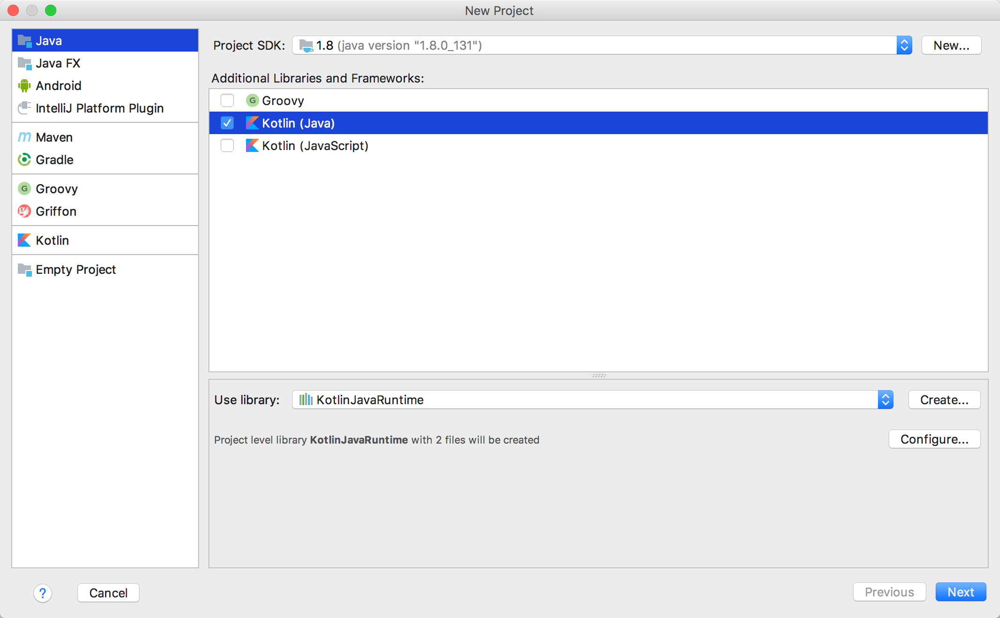
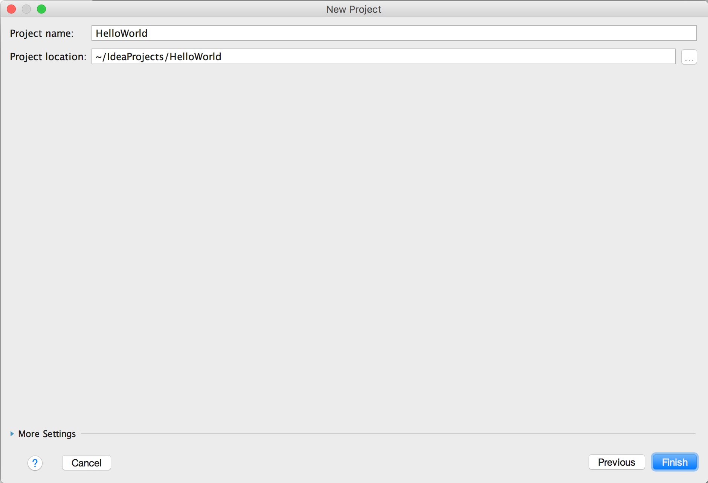
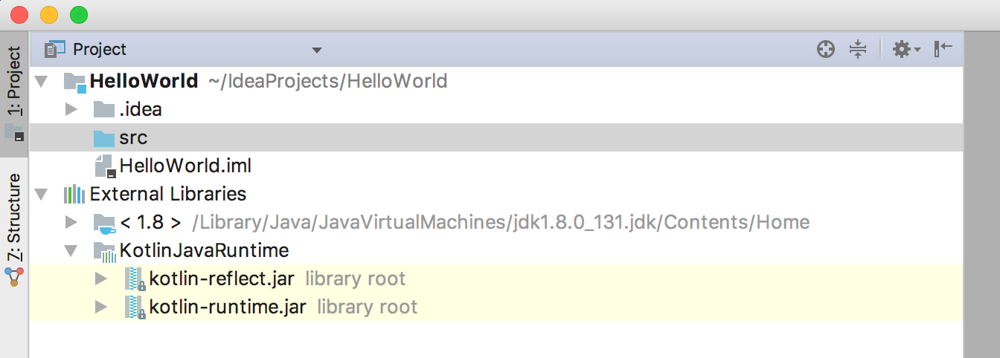
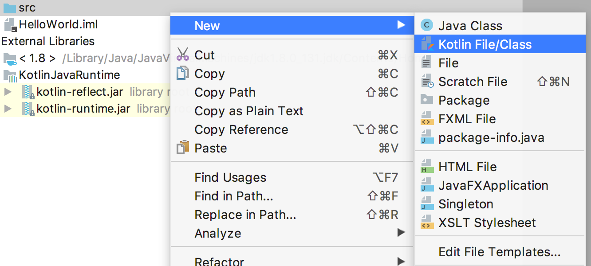
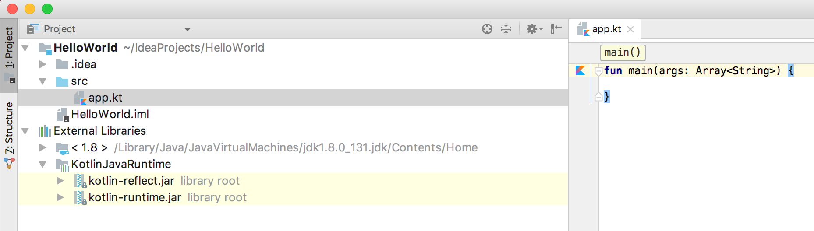
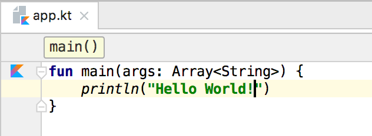
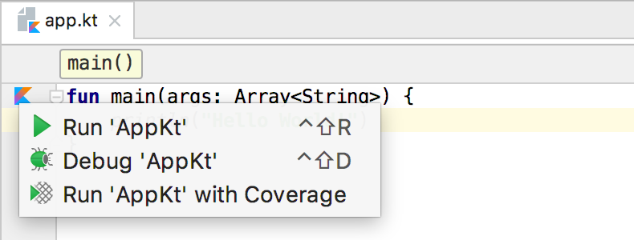
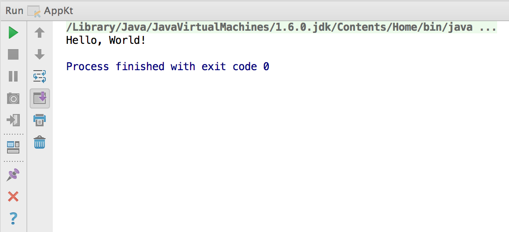

# 入门与环境搭建

> 本章归并自 5 页教程代码块，来源见各节。

## Kotlin 教程

> 来源: https://www.runoob.com/kotlin/kotlin-tutorial.html

```kotlin
package hello                      //  可选的包头

fun main(args: Array<String>) {    // 包级可见的函数，接受一个字符串数组作为参数
   println("Hello World!")         // 分号可以省略
}
```

```kotlin
class Greeter(val name: String) {
   fun greet() {
      println("Hello, $name")
   }
}

fun main(args: Array<String>) {
   Greeter("World!").greet()          // 创建一个对象不用 new 关键字
}
```

## Kotlin 简介

> 来源: https://www.runoob.com/kotlin/kotlin-intro.html

```kotlin
// 文件路径：hello.kt

// 第一个 Kotlin 程序

fun main() {

    println("Hello, Runoob!")            // 打印一行文本并换行

    println("欢迎来到 www.runoob.com")     // 中文同样可以直接输出

}
```

```kotlin
Hello, Runoob!
欢迎来到 www.runoob.com
```

```kotlin
// 文件路径：Site.kt

// 用类描述一个网站，主构造器直接声明属性

class Site(val name: String, val url: String) {


    // 表达式体函数，返回值类型由编译器推断为 String

    fun introduce(): String = "欢迎访问 $name（$url）"

}


fun main() {

    // 创建对象，参数按顺序传入

    val runoob = Site("菜鸟教程", "www.runoob.com")


    println(runoob.introduce())                    // 调用成员函数

    println("站点名称长度：${runoob.name.length}")   // 字符串模板里可以放表达式

}
```

```kotlin
欢迎访问 菜鸟教程（www.runoob.com）
站点名称长度：4
```

## Kotlin 环境搭建

> 来源: https://www.runoob.com/kotlin/kotlin-environment.html

```kotlin
// 在线运行的最小示例

fun main() {

    val siteName = "菜鸟教程"                  // 声明不可变变量

    println("Hello, $siteName!")               // 字符串模板

    println("网址：www.runoob.com")

}
```

```kotlin
Hello, 菜鸟教程!
网址：www.runoob.com
```

```kotlin
// 文件路径：src/main/kotlin/Main.kt

fun main() {

    val url = "www.runoob.com"

    println("项目创建成功，目标站点：$url")

}
```

```kotlin
项目创建成功，目标站点：www.runoob.com
```

```kotlin
// 文件路径：build.gradle.kts

plugins {

    kotlin("jvm") version "2.2.0"      // Kotlin/JVM 插件，版本号需与编译器一致

    application                        // 提供 run 任务，方便直接运行程序

}


group = "com.runoob"                   // 项目组名，通常用反写的域名

version = "1.0.0"                      // 项目版本号


repositories {

    mavenCentral()                     // 从 Maven 中央仓库下载依赖

}


dependencies {

    testImplementation(kotlin("test")) // 引入 Kotlin 官方测试库

}


application {

    // 主类名由「文件名 + Kt」构成，Main.kt 对应 MainKt

    mainClass.set("com.runoob.MainKt")

}


kotlin {

    // 指定编译使用的 JDK 版本，本机没装时 Gradle 会尝试自动下载

    jvmToolchain(17)

}
```

```kotlin
// 文件路径：settings.gradle.kts

rootProject.name = "kotlin-demo"       // 根项目名称
```

```kotlin
kotlin-demo/
├── build.gradle.kts
├── settings.gradle.kts
└── src
    └── main
        └── kotlin
            └── com
                └── runoob
                    └── Main.kt
```

```kotlin
// 文件路径：src/main/kotlin/com/runoob/Main.kt

package com.runoob                    // 包声明，需与目录结构对应


fun main() {

    println("Hello, Runoob!")

    println("教程站点：www.runoob.com")

}
```

```kotlin
$ ./gradlew run

> Task :run
Hello, Runoob!
教程站点：www.runoob.com

BUILD SUCCESSFUL in 3s
```

```xml
<!-- 文件路径：pom.xml -->

<project xmlns="http://maven.apache.org/POM/4.0.0"

         xmlns:xsi="http://www.w3.org/2001/XMLSchema-instance"

         xsi:schemaLocation="http://maven.apache.org/POM/4.0.0

                             http://maven.apache.org/xsd/maven-4.0.0.xsd">


    <modelVersion>4.0.0</modelVersion>

    <groupId>com.runoob</groupId>              <!-- 组织标识 -->

    <artifactId>kotlin-demo</artifactId>       <!-- 项目名 -->

    <version>1.0.0</version>                   <!-- 版本号 -->


    <properties>

        <kotlin.version>2.2.0</kotlin.version>

        <maven.compiler.release>8</maven.compiler.release>   <!-- 目标字节码版本 -->

        <project.build.sourceEncoding>UTF-8</project.build.sourceEncoding>

    </properties>


    <dependencies>

        <!-- Kotlin 标准库，编译和运行都需要 -->

        <dependency>

            <groupId>org.jetbrains.kotlin</groupId>

            <artifactId>kotlin-stdlib</artifactId>

            <version>${kotlin.version}</version>

        </dependency>

    </dependencies>


    <build>

        <!-- Kotlin 源码目录，Maven 默认的 java 目录不适用 -->

        <sourceDirectory>src/main/kotlin</sourceDirectory>

        <plugins>

            <plugin>

                <groupId>org.jetbrains.kotlin</groupId>

                <artifactId>kotlin-maven-plugin</artifactId>

                <version>${kotlin.version}</version>

                <executions>

                    <execution>

                        <id>compile</id>

                        <phase>compile</phase>            <!-- 绑定到 compile 阶段 -->

                        <goals>

                            <goal>compile</goal>

                        </goals>

                    </execution>

                </executions>

            </plugin>

        </plugins>

    </build>

</project>
```

```kotlin
$ mvn compile
$ mvn exec:java -Dexec.mainClass=com.runoob.MainKt

Hello, Runoob!
教程站点：www.runoob.com
```

```kotlin
// 文件路径：app/build.gradle.kts（Android 应用模块）

plugins {

    id("com.android.application")            // Android 应用插件

    id("org.jetbrains.kotlin.android")       // Kotlin 对 Android 的支持

}


android {

    namespace = "com.runoob.demo"            // 包命名空间

    compileSdk = 35                          // 编译时使用的 Android SDK 版本


    defaultConfig {

        applicationId = "com.runoob.demo"    // 应用唯一标识

        minSdk = 21                          // 最低支持的 Android 版本

        targetSdk = 35                       // 目标 Android 版本

        versionCode = 1                      // 内部版本号，只能是整数

        versionName = "1.0"                  // 对外展示的版本名

    }

}
```

```kotlin
// 文件路径：build.gradle.kts（项目根目录）

plugins {

    id("com.android.application") version "8.7.0" apply false          // 仅声明版本，不在根项目应用

    id("org.jetbrains.kotlin.android") version "2.2.0" apply false     // Kotlin 插件版本

}
```

## Kotlin IntelliJ IDEA 环境搭建

> 来源: https://www.runoob.com/kotlin/kotlin-setup.html

IntelliJ IDEA 免费的社区版下载地址：[https://www.jetbrains.com/idea/download/](https://www.jetbrains.com/idea/download/)

下载安装后，我们就可以使用该工具来创建项目，创建过程需要选择 SDK， Kotlin 与 JDK 1.6+ 一起使用。

在右侧的下拉菜单中勾选 Kotlin (Java) 复选框。



接下来我们取一个项目名:HelloWorld



项目创建完后，文件结构如下，跟 Java 的还是很类似的。



接下来 我们点击 src 文件夹，创建一个 Kotlin 文件，它可以任意命名，这里我们创建 app.kt



接下来，我们在 app.kt 文件中写点代码。IntelliJ IDEA 为我们提供了一个快速完成此操作的模板，只需键入 main 然后按 Tab 即可。



现在我们添加一行代码来打印出"Hello, World!"吧。



接下来我们可以鼠标点击编辑器左上角 kotlin图标并选择 Run 'AppKt'来运行代码：



运行成功后就可以在窗口 Run 中看到结果。



这样我们第一个 Kotlin 代码就运行起来了。

### 图片清单

1. 图1 -> images/1495785499-8289-new-project-step1.png （原图：https://www.runoob.com/wp-content/uploads/2017/05/1495785499-8289-new-project-step1.png）
2. 图2 -> images/1495785499-6561-project-name.png （原图：https://www.runoob.com/wp-content/uploads/2017/05/1495785499-6561-project-name.png）
3. 图3 -> images/1495785499-2780-folders.png （原图：https://www.runoob.com/wp-content/uploads/2017/05/1495785499-2780-folders.png）
4. 图4 -> images/1495785499-9965-new-file.png （原图：https://www.runoob.com/wp-content/uploads/2017/05/1495785499-9965-new-file.png）
5. 图5 -> images/1495785499-8021-main.png （原图：https://www.runoob.com/wp-content/uploads/2017/05/1495785499-8021-main.png）
6. 图6 -> images/1495785499-7498-hello-world.png （原图：https://www.runoob.com/wp-content/uploads/2017/05/1495785499-7498-hello-world.png）
7. 图7 -> images/1495785500-5575-run-default.png （原图：https://www.runoob.com/wp-content/uploads/2017/05/1495785500-5575-run-default.png）
8. 图8 -> images/1495785500-2065-run-window.png （原图：https://www.runoob.com/wp-content/uploads/2017/05/1495785500-2065-run-window.png）

## Kotlin 使用命令行编译

> 来源: https://www.runoob.com/kotlin/kotlin-command-line.html

```kotlin
$ curl -s https://get.sdkman.io | bash
$ source "$HOME/.sdkman/bin/sdkman-init.sh"
$ sdk install kotlin

Downloading: kotlin 2.2.0
In progress...
Installing: kotlin 2.2.0
Done installing!

Setting kotlin 2.2.0 as default.
```

```kotlin
$ export PATH="$PATH:/opt/kotlinc/bin"

# 把上面这行写进 ~/.zshrc 或 ~/.bashrc，重启终端后永久生效
```

```kotlin
$ kotlinc -version
info: kotlinc-jvm 2.2.0 (JRE 17.0.11+9)
```

```kotlin
// 文件路径：hello.kt

fun main() {

    println("Hello, Runoob!")            // 输出一行文本

    println("欢迎来到 www.runoob.com")

}
```

```kotlin
$ kotlinc hello.kt -include-runtime -d hello.jar
$ java -jar hello.jar

Hello, Runoob!
欢迎来到 www.runoob.com
```

```kotlin
$ kotlinc hello.kt -d out

$ ls out
HelloKt.class        # 顶层 main 函数所在的类，由文件名加 Kt 构成
```

```kotlin
$ kotlinc hello.kt -include-runtime -d hello.jar
$ java -jar hello.jar

Hello, Runoob!
欢迎来到 www.runoob.com
```

```kotlin
$ java -cp hello.jar:kotlin-stdlib.jar HelloKt
```

```kotlin
// 文件路径：Site.kt

// 一个简单的工具库

package com.runoob


fun buildWelcome(name: String): String = "欢迎访问 $name（www.runoob.com）"


fun main() {

    println(buildWelcome("菜鸟教程"))

}
```

```kotlin
$ kotlinc Site.kt -d site.jar
$ kotlin -classpath site.jar com.runoob.SiteKt

欢迎访问 菜鸟教程（www.runoob.com）
```

```kotlin
$ kotlinc
Welcome to Kotlin version 2.2.0 (JRE 17.0.11+9)
Type :help for help, :quit for quit
>>> val siteName = "菜鸟教程"
>>> println("欢迎访问 $siteName")
欢迎访问 菜鸟教程
>>> println("网址：www.runoob.com".uppercase())
网址：WWW.RUNOOB.COM
>>> :quit
```

```kotlin
// 文件路径：hello.kts

// 脚本模式：不需要 main 函数，顶层代码直接执行

val siteName = "菜鸟教程"

val url = "www.runoob.com"


println("Hello, $siteName!")

println("站点地址：$url")

println("名称长度：${siteName.length}")
```

```kotlin
$ kotlinc -script hello.kts

Hello, 菜鸟教程!
站点地址：www.runoob.com
名称长度：4
```

```kotlin
// 文件路径：greet.kts

// 读取命令行参数并输出

val name = if (args.isNotEmpty()) args[0] else "Runoob"

println("你好，$name！欢迎访问 www.runoob.com")
```

```kotlin
$ kotlinc -script greet.kts 菜鸟教程

你好，菜鸟教程！欢迎访问 www.runoob.com
```
