## 1.本节引言

> 如果你符合下述三种情况的话，你可以考虑安装一个Genymotion Android模拟器:

> - 没有真机调试，只能用模拟器

> - 嫌SDK内置的AVD启动速度，运行速度慢

> - 电脑配置还可以，最好4G内存以上

> 如果你满足上述三种情况的话，那么装个比真机还快的Genymotion吧！
> 官方给出的介绍：
> 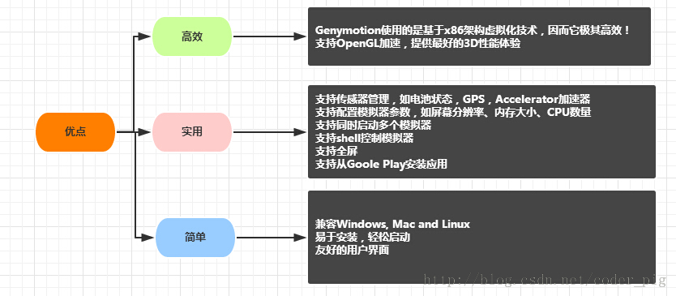

## 2.去哪里下Genymotion

> 百度"Genymotion"第一个就是了：[Genymotion中文官网](http://www.genymotion.net/)

## 3.下载Genymotion

> 点开上述链接后：点击注册
> 
> **来到下述界面，如果已有账号，直接输入后sign in 如果没有的话，**
> 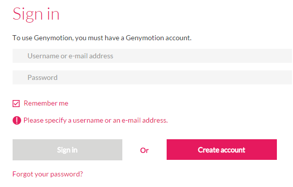
> **点击Create account创建一个新的账户**
> 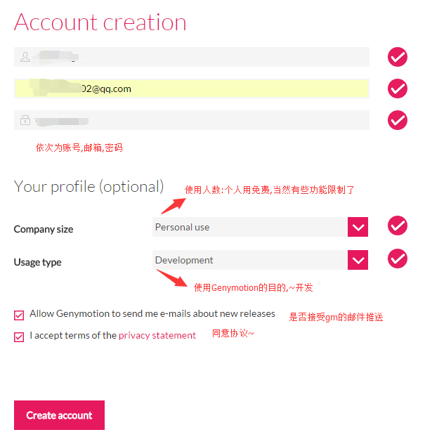
> **然后我们会收到一个激活邮件：**
> 
> **打开邮箱，点击激活账号，然后过一会儿会收到另一封创建成功的邮件**
> 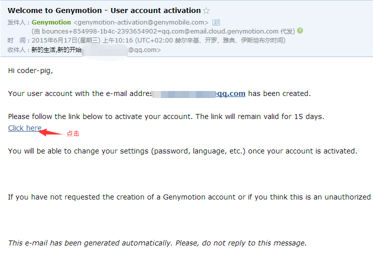
> 
> **登陆账号后，点击Get Genymotion:**
> 
> **选择Free版的下载,然后选择带virtual box虚拟机的下载**
> 
> 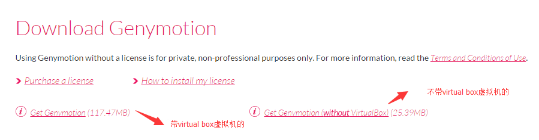

## 4.安装Genymotion

> 都是傻瓜式的下一步
> 选择安装目录：
> 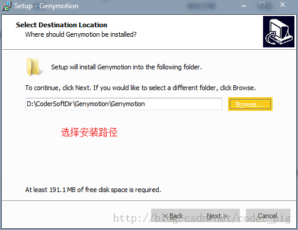
> 安装完后会弹出Oracle VM virtualBox的安装,这里可以选择路径,笔者直接默认安装了
> 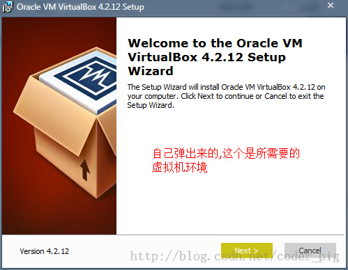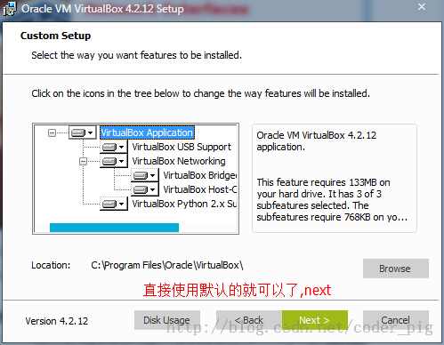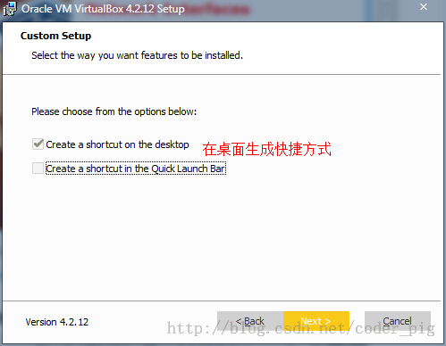
> 安装过程中会时不时弹出安装一些设备的窗口,这是虚拟机在安装东西,不用理,都按安装:
> 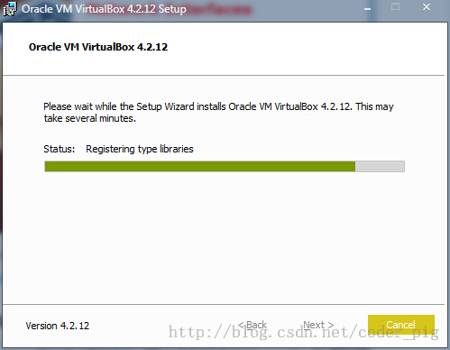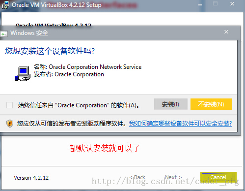
> 好了,安装完成后,确认,将我们的Genymotion运行起来
> 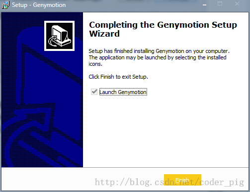

## 5.创建Android模拟器

> ①运行软件后会来到一个界面,因为是第一次使用,所以需要我们新建一个avd:
> 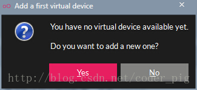
> 点击yes后会来到选择avd版本的界面,因为这上面什么设备都没有,我们需要连接到官网
> 获取各种版本的系统与硬件设备等,点击下方的connect,输入我们已经激活的账号密码:
> 邮箱与密码(笔者可能是网络问题,连续连了几次才成功的)
> 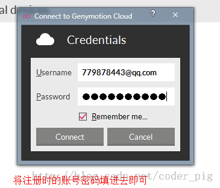
> 登录成功后就可以对对应的系统以及硬件设备进行选择了:
> 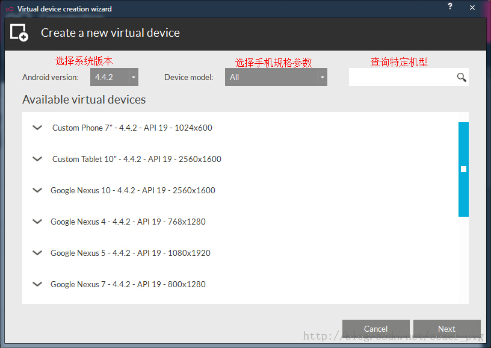
> 这里显示设备的相关信息,可以自定义模拟器的名称
> 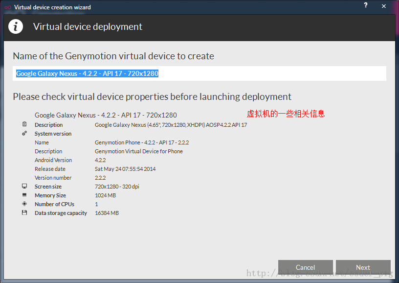
> 设置完名称后,点击next,就会下载虚拟设备的相关程序以及对应官方的sdk
> 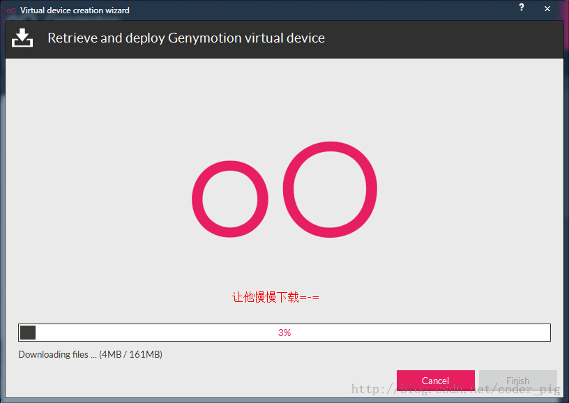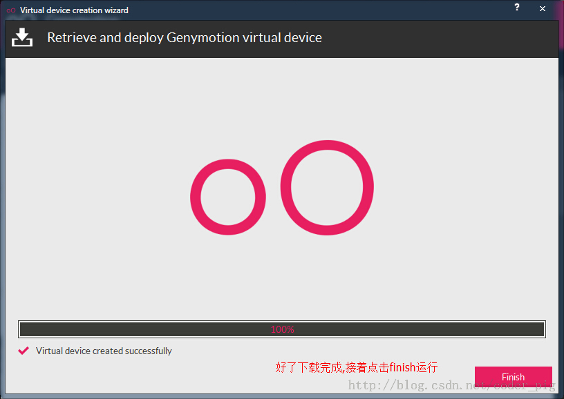
> 好了,avd已经创建完毕,接着把他运行起来,开机也只是十几秒的事,很赞！操作起来超流畅啊,有木有？

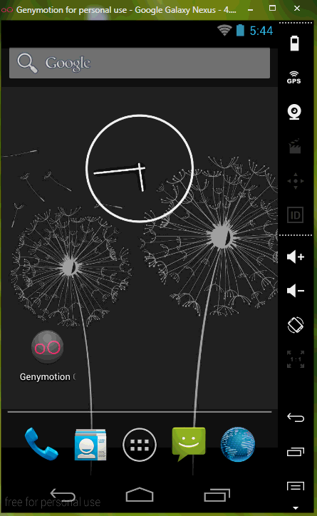

## 6.怎么在模拟器上运行程序

> 其实这个问题是白问的,我们只要在Eclpise上的Device就可以看到当前正在运行的模拟器;
> 感觉其实和真机是差不多的,我们只要运行程序时选择在哪个设备上运行即可！

## 7.可能遇到的问题

**①不喜欢原生的系统,想用标准sdk中的系统版本**

答:在下载设备驱动时其实已经下载好对应的sdk了,但是如果你不喜欢的话可以
打开setting--ADB-->选择Eclpise的sdk路径

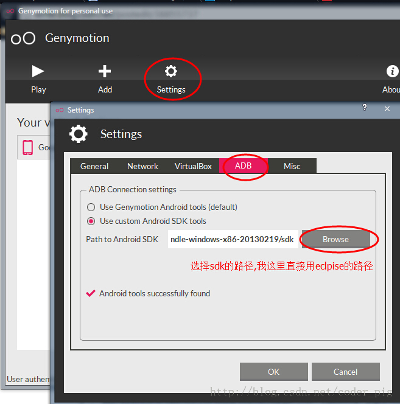

**②老登录不了?或者获取不了手机列表:**
答:这个大部分的原因都是给墙了,所以只能科学上网了;不过貌似白天是可以的,
虽然有点慢,晚上的话笔者试了N次都是下载不了其他版本的设备!另外登录
不了要看下自己账号密码是否有错误哦！

**③觉得模拟器占屏幕太大了**
答:先把模拟器关了,点击扳手的图标

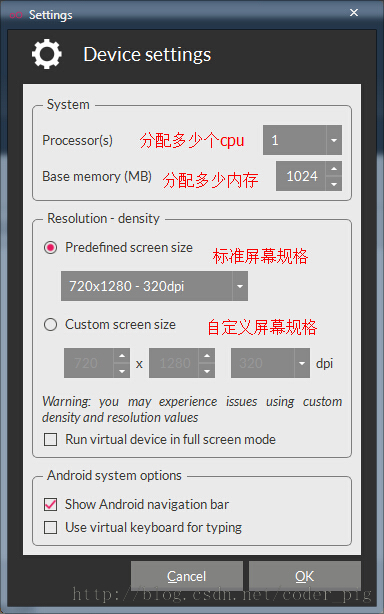

**④运行程序，直接拖拉APK到模拟器上出现下述问题：**

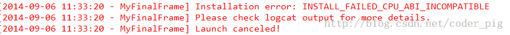

下载下面这个zip包,下载完毕后将它拖拽到模拟器窗口上,弹出对话框点击确定,接着重启下模拟器即可！
[Genymotion-ARM-Translation.zip](http://static.runoob.com/download/Genymotion-ARM-Translation.zip)

**⑤因程序需要，要查看模拟器的sdk目录：**
之前的话我们在Eclipse上是通过mmt/sdcard找到sd卡目录的;
但是genymotion却不是在这个路径下:而是在下面这个路径下:
/mnt/shell/emulated/0/
可以根据后面的Info慢慢找出来

## 8.本节小结

本节介绍了比真机还快的安卓模拟器——Genymotion的安装与使用，相信各位读者会爱上这个模拟器的，
谢谢~

### 图片清单

1. 图1 -> images/4501605.jpg （原图：https://www.runoob.com/wp-content/uploads/2015/06/4501605.jpg）
2. 图2 -> images/74132588.jpg （原图：https://www.runoob.com/wp-content/uploads/2015/06/74132588.jpg）
3. 图3 -> images/96085749.jpg （原图：https://www.runoob.com/wp-content/uploads/2015/06/96085749.jpg）
4. 图4 -> images/62150589.jpg （原图：https://www.runoob.com/wp-content/uploads/2015/06/62150589.jpg）
5. 图5 -> images/67862595.jpg （原图：https://www.runoob.com/wp-content/uploads/2015/06/67862595.jpg）
6. 图6 -> images/95533945.jpg （原图：https://www.runoob.com/wp-content/uploads/2015/06/95533945.jpg）
7. 图7 -> images/52660968.jpg （原图：https://www.runoob.com/wp-content/uploads/2015/06/52660968.jpg）
8. 图8 -> images/86049535.jpg （原图：https://www.runoob.com/wp-content/uploads/2015/06/86049535.jpg）
9. 图9 -> images/92903322.jpg （原图：https://www.runoob.com/wp-content/uploads/2015/06/92903322.jpg）
10. 图10 -> images/43036878.jpg （原图：https://www.runoob.com/wp-content/uploads/2015/06/43036878.jpg）
11. 图11 -> images/59280213.jpg （原图：https://www.runoob.com/wp-content/uploads/2015/06/59280213.jpg）
12. 图12 -> images/59557238.jpg （原图：https://www.runoob.com/wp-content/uploads/2015/06/59557238.jpg）
13. 图13 -> images/79369624.jpg （原图：https://www.runoob.com/wp-content/uploads/2015/06/79369624.jpg）
14. 图14 -> images/52574558.jpg （原图：https://www.runoob.com/wp-content/uploads/2015/06/52574558.jpg）
15. 图15 -> images/24507011.jpg （原图：https://www.runoob.com/wp-content/uploads/2015/06/24507011.jpg）
16. 图16 -> images/66339251.jpg （原图：https://www.runoob.com/wp-content/uploads/2015/06/66339251.jpg）
17. 图17 -> images/95827722.jpg （原图：https://www.runoob.com/wp-content/uploads/2015/06/95827722.jpg）
18. 图18 -> images/74837066.jpg （原图：https://www.runoob.com/wp-content/uploads/2015/06/74837066.jpg）
19. 图19 -> images/86654272.jpg （原图：https://www.runoob.com/wp-content/uploads/2015/06/86654272.jpg）
20. 图20 -> images/66068643.jpg （原图：https://www.runoob.com/wp-content/uploads/2015/06/66068643.jpg）
21. 图21 -> images/6502569.jpg （原图：https://www.runoob.com/wp-content/uploads/2015/06/6502569.jpg）
22. 图22 -> images/24140839.jpg （原图：https://www.runoob.com/wp-content/uploads/2015/06/24140839.jpg）
23. 图23 -> images/5145061.jpg （原图：https://www.runoob.com/wp-content/uploads/2015/06/5145061.jpg）
24. 图24 -> images/62505309.jpg （原图：https://www.runoob.com/wp-content/uploads/2015/06/62505309.jpg）
25. 图25 -> images/20712326.jpg （原图：https://www.runoob.com/wp-content/uploads/2015/06/20712326.jpg）
26. 图26 -> images/91922845.jpg （原图：https://www.runoob.com/wp-content/uploads/2015/06/91922845.jpg）
27. 图27 -> images/41780870.jpg （原图：https://www.runoob.com/wp-content/uploads/2015/06/41780870.jpg）
28. 图28 -> images/10252102.jpg （原图：https://www.runoob.com/wp-content/uploads/2015/06/10252102.jpg）
