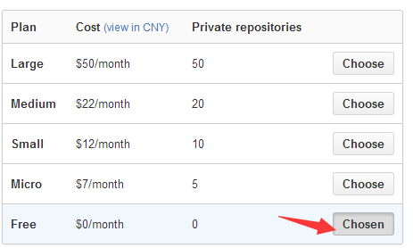
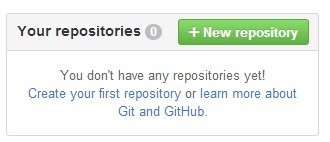
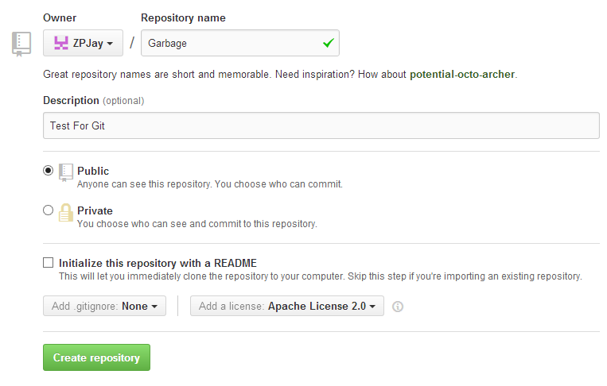
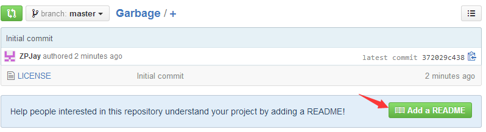
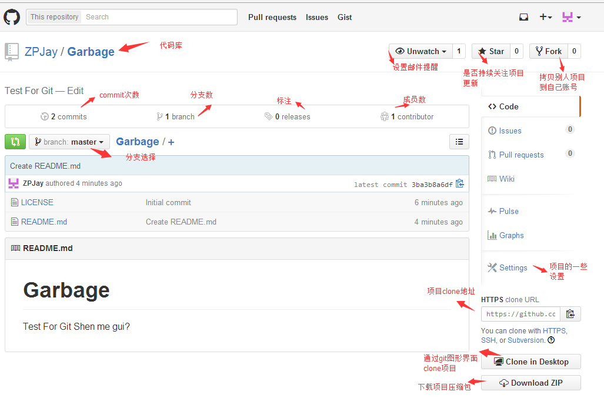
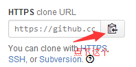
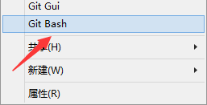
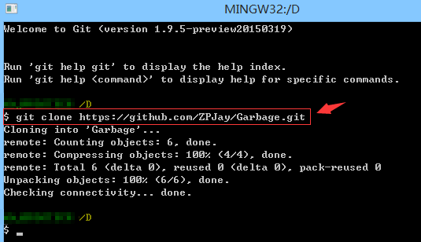
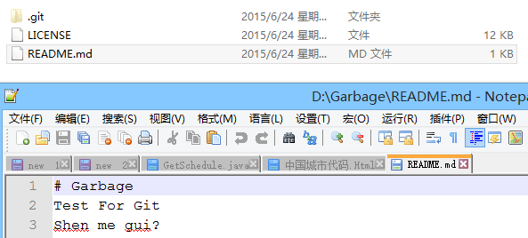

# 1.5.2 Git之使用GitHub搭建远程仓库

> 来源: https://www.runoob.com/w3cnote/android-tutorial-git-repo-create.html

## 本节引言：

> 在上一节中，我们学习了如何使用Git，构建我们的本地仓库，轻松的实现了版本控制以及代码还原，修改日志查看等；读者肯定不满足与本地是吧，假如是多个人一起来开发一个程序呢？我们需要一个作为服务器的远程仓库！当然搭建一个服务器是需要成本的，为什么不把项目托管到Github上呢？作为开源代码库以及版本控制系统，Github拥有140多万开发者用户。随着越来越多的应用程序转移到了云上，Github已经成为了管理软件开发以及发现已有代码的首选方法，不需要任何成本，为何不使用呢？是吧！本节就来学习如何把我们的代码托管到Github上！

## 1.账号注册&仓库创建：

打开Github官网注册：[Github官网](https://github.com/)，填写注册相关信息：用户呢称，邮箱，密码

注册完，跳转到如下页面，选择仓库购买方式(私有仓库,别人不可以访问，要权限)，一般我们自己玩选Free:
PS:对了，这时候你邮箱可能收到一封验证邮件，点下完成验证。

接下来，创建一个我们的代码仓库：

为自己的仓库添加点内容提示，就是项目的一些概述(可写可不写)

简单介绍下主页的一些东西：

---

## 2.Clone代码库到本地

当然，你可以直接用图形化界面克隆，不过我还是喜欢通过命令行来Clone，先复制下Clone的地址

然后在某个地方，有键打开Git Bash：

键入：

然后可以看到我们的代码库就下载完成了：

打开文件夹，可以看到下述内容：

---

## 3.分支管理

> 对于刚接触版本控制工具的朋友来说，分支可能比较陌生，但是他会给我们带来很大的便利！限于篇幅，
> 笔者直接丢个链接，大家看看图就知道了：[廖雪峰的官方网站：创建和合并分支](http://www.liaoxuefeng.com/wiki/0013739516305929606dd18361248578c67b8067c8c017b000/001375840038939c291467cc7c747b1810aab2fb8863508000)！写得真心很赞~建议收藏！

了解概念后,我们来熟悉与分支相关的几个命令：

**①创建分支(后者创建同时会切换分支):**

**②查看版本库中所有分支：**

**③切换到某一分支：**

**④删除某一分支：**

**⑤合并分支**

---

## 4.本地仓库与远程仓库同步问题

前面执行的这些分支操作都是在本地进行的，说了项目托管到GitHub上，我们肯定要跟远程仓库有交流是吧！
我们去年前面已经试过用clone命令把项目下载到本地，那么我们修改后如何把代码同步到Github上呢？我们先对我们的本地仓库做一点点修改，接着git add和git commit本地准备后，然后：

将我们本地的内容提交上去：

然后看下我们的Github,可以看到内容已经发生改变，而且提交者是我的另一个账号！

有同步到服务器，肯定有服务器同步到本地是吧，很简单，就一个

就可以

---

## 5.本节小结

好吧，本节就写那么多，相信你看到上面的Git教程还有一些冲突解决，分支管理，Bug分支等待高级的Git用法，考虑到这是入门教程，就不写那么深入了，有兴趣可以自己了解了解，说下自己公司目前的情况吧：
①使用Github作为我们的项目管理工具：我们都是把项目托管到Github上的，然后有两个分支：开发和测试两个分支，每个版本一个分支，最后发布时才把分支合并到master上！提bug也是在上面提的，还是比较便利的！
②使用Trello来做流程控制，也是比较简洁高效的！有兴趣的可以了解了解！
另外，国内访问Github可能比较缓慢，而且如果是私有仓库是要收费的，如果公司没有使用代理或者是私人开发，可能略显鸡肋，不过可以考虑下使用国产的开源仓库：Git@OSC，由开源中国提供的，提供了1000个私人仓库，好像，感觉还不错，有兴趣的可以考虑将代码托管到这里：[http://git.oschina.net/](http://git.oschina.net/)！
就到这里，如果文中有错误纰漏，欢迎指出，谢谢~

### 图片清单

1. 图1 -> images/3608093.jpg （原图：https://www.runoob.com/wp-content/uploads/2015/06/3608093.jpg）
2. 图2 -> images/43308491.jpg （原图：https://www.runoob.com/wp-content/uploads/2015/06/43308491.jpg）
3. 图3 -> images/87959776.jpg （原图：https://www.runoob.com/wp-content/uploads/2015/06/87959776.jpg）
4. 图4 -> images/86499179.jpg （原图：https://www.runoob.com/wp-content/uploads/2015/06/86499179.jpg）
5. 图5 -> images/18408716.jpg （原图：https://www.runoob.com/wp-content/uploads/2015/06/18408716.jpg）
6. 图6 -> images/17112209.jpg （原图：https://www.runoob.com/wp-content/uploads/2015/06/17112209.jpg）
7. 图7 -> images/5629835.jpg （原图：https://www.runoob.com/wp-content/uploads/2015/06/5629835.jpg）
8. 图8 -> images/72508910.jpg （原图：https://www.runoob.com/wp-content/uploads/2015/06/72508910.jpg）
9. 图9 -> images/56431529.jpg （原图：https://www.runoob.com/wp-content/uploads/2015/06/56431529.jpg）
10. 图10 -> images/61260412.jpg （原图：https://www.runoob.com/wp-content/uploads/2015/06/61260412.jpg）
11. 图11 -> 下载失败：http://7xjqvu.com1.z0.glb.clouddn.com/15-6-25/76246315.jpg
12. 图12 -> 下载失败：http://7xjqvu.com1.z0.glb.clouddn.com/15-6-25/22613033.jpg
13. 图13 -> 下载失败：http://7xjqvu.com1.z0.glb.clouddn.com/15-6-25/12570672.jpg
14. 图14 -> 下载失败：http://7xjqvu.com1.z0.glb.clouddn.com/15-6-25/34077986.jpg
15. 图15 -> 下载失败：http://7xjqvu.com1.z0.glb.clouddn.com/15-6-25/51046469.jpg
16. 图16 -> 下载失败：http://7xjqvu.com1.z0.glb.clouddn.com/15-6-25/2817080.jpg
17. 图17 -> 下载失败：http://7xjqvu.com1.z0.glb.clouddn.com/15-6-25/47456786.jpg
