# 2.2.1 LinearLayout(线性布局)

> 来源: https://www.runoob.com/w3cnote/android-tutorial-linearlayout.html

## 本节引言

本节开始讲Android中的布局，Android中有六大布局,分别是:
LinearLayout(线性布局)，RelativeLayout(相对布局)，TableLayout(表格布局)
FrameLayout(帧布局)，AbsoluteLayout(绝对布局)，GridLayout(网格布局)
而今天我们要讲解的就是第一个布局，LinearLayout(线性布局)，我们屏幕适配的使用
用的比较多的就是LinearLayout的weight(权重属性),在这一节里,我们会详细地解析
LinearLayout,包括一些基本的属性,Weight属性的使用,以及比例如何计算,另外还
会说下一个用的比较少的属性:android:divider绘制下划线！

## 1.本节学习图

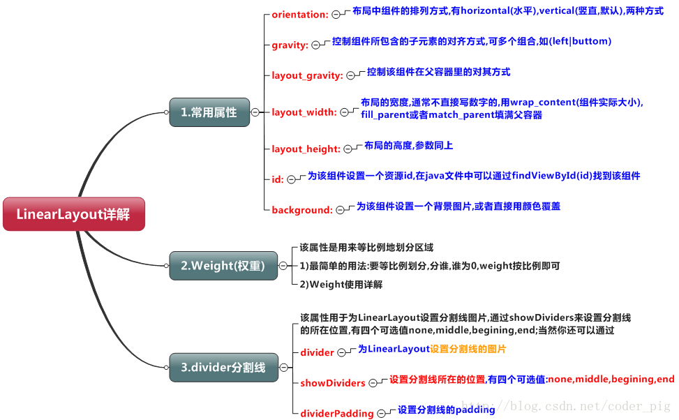

## 2.weight(权重)属性详解：

### ①最简单用法：

如图：

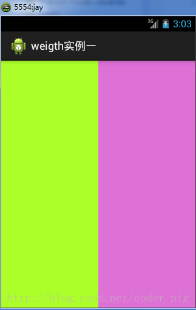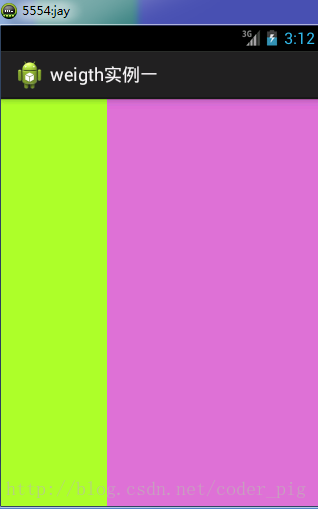

实现代码：

要实现第一个的1:1的效果,只需要分别把两个LinearLayout的weight改成1和1就可以了
用法归纳:
按比例划分水平方向:将涉及到的View的android:width属性设置为0dp,然后设置为android
weight属性设置比例即可;类推,竖直方向,只需设android:height为0dp,然后设weight属性即可！
大家可以自己写个竖直方向的等比例划分的体验下简单用法！

### ②weight属性详解:

当然,如果我们不适用上述那种设置为0dp的方式,直接用wrap_content和match_parent的话,
则要接着解析weight属性了,分为两种情况,wrap_content与match_parent！另外还要看
LinearLayout的orientation是水平还是竖直,这个决定哪个方向等比例划分

**1)wrap_content比较简单,直接就按比例的了**

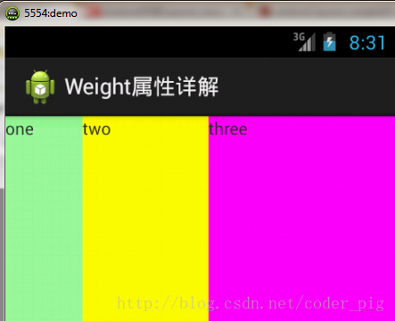

实现代码：

**2)match_parent(fill_parent):这个则需要计算了**

我们写这段简单的代码：

运行效果图：

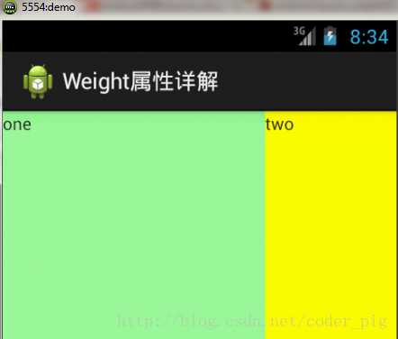

> 这个时候就会有疑问了,怎么会这样,这比例是2:1吧,那么three去哪了？代码里面明明有
> three的啊,还设置了3的,而1和2的比例也不对耶,1:2:3却变成了2:1:0,怎么会这样呢?
> 答:这里其实没那么简单的,还是需要我们计算的,网上给出的算法有几种,这里就给出笔者
> 觉得比较容易理解的一种:
> **step 1：**个个都是fill_parent,但是屏幕只有一个啦,那么1 - 3 = - 2 fill_parent
> **step 2：**依次比例是1/6,2/6,3/6
> **step 3：**先到先得,先分给one,计算: 1 - 2 * (1/6) = 2/3 fill_parent
>  接着到two,计算: 1 - 2 * (2/6) = 1/3 fill_parent
>  最后到three,计算 1 - 2 * (3/6) = 0 fill_parent
> **step 4：**所以最后的结果是:one占了两份,two占了一份,three什么都木有
> 以上就是为什么three没有出现的原因了,或许大家看完还是有点蒙,没事,我们举多几个例子试试就知道了！

**比例为：1：1：1**

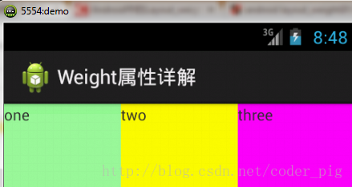

按照上面的计算方法算一次,结果是:1/3 1/3 1/3,没错

**接着我们再试下:2:3:4**

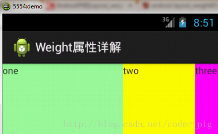

计算结果:5/9 3/9 1/9,对比效果图,5:3:1,也没错,所以这个计算方法你可得mark下了!

### ③Java代码中设置weight属性：

## 3.为LinearLayout设置分割线

很多界面开发中都会设置一些下划线,或者分割线,从而使得界面更加整洁美观,比如下面的酷狗
音乐的注册页面:

对于这种线,我们通常的做法有两种
**①直接在布局中添加一个view**,这个view的作用仅仅是显示出一条线,代码也很简单:

这个是水平方向上的黑线,当然你也可以改成其他颜色,或者使用图片

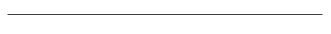

**②第二种则是使用LinearLayout的一个divider属性**,直接为LinearLayout设置分割线
这里就需要你自己准备一张线的图片了
1)android:divider设置作为分割线的图片
2)android:showDividers设置分割线的位置,none(无),beginning(开始),end(结束),middle(每两个组件间)
3)dividerPadding设置分割线的Padding

使用示例：

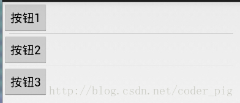

实现代码：

## 4.LinearLayout的简单例子:

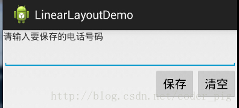

实现代码如下：

## 5.注意事项:

使用Layout_gravity的一个很重要的问题!!!
问题内容:
在一个LinearLayout的水平方向中布置两个TextView,想让一个左,一个右,怎么搞?
或许你会脱口而出:"gravity设置一个left,一个right就可以啦!"
真的这么简单?你试过吗?写个简单的Layout你就会发现,事与愿违了:
代码如下：

运行结果图:

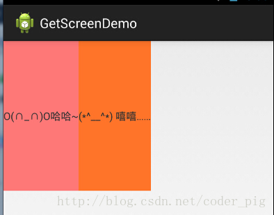

看到这里你会说:哎呀,真的不行耶,要不在外层LinearLayout加个gravity=left的属性,然后设置第二个
TextView的layout_gravity为right,恩,好我们试一下:

结果还是一样：

好吧,没辙了,怎么办好?

> **当 android:orientation="vertical" 时， 只有水平方向的设置才起作用，垂直方向的设置不起作用。
> 即：left，right，center_horizontal 是生效的。
> 当 android:orientation="horizontal" 时， 只有垂直方向的设置才起作用，水平方向的设置不起作用。
> 即：top，bottom，center_vertical 是生效的。**

然而，这方法好像并没有什么卵用。比如：
如果只能竖直方向设置左右对齐的话,就会出现下面的效果:

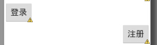

这显然不是我们要的结果把!
综上,要么按照上述给出的规则来布局,不过对于这种情况还是使用相对布局RelativeLayout把！
网上没给出具体的原因,都是说这样改有人说这个和orientation的优先级有关
,暂且先mark下来吧,后续如果知道原因的话再解释!前面屏幕适配也说过了,**布局还是建议使用
RelativeLayout!**

### 图片清单

1. 图1 -> images/15116314.jpg （原图：https://www.runoob.com/wp-content/uploads/2015/07/15116314.jpg）
2. 图2 -> images/89088844.jpg （原图：https://www.runoob.com/wp-content/uploads/2015/07/89088844.jpg）
3. 图3 -> images/54011262.jpg （原图：https://www.runoob.com/wp-content/uploads/2015/07/54011262.jpg）
4. 图4 -> images/2036364.jpg （原图：https://www.runoob.com/wp-content/uploads/2015/07/2036364.jpg）
5. 图5 -> images/6746070.jpg （原图：https://www.runoob.com/wp-content/uploads/2015/07/6746070.jpg）
6. 图6 -> images/77411800.jpg （原图：https://www.runoob.com/wp-content/uploads/2015/07/77411800.jpg）
7. 图7 -> images/81150547.jpg （原图：https://www.runoob.com/wp-content/uploads/2015/07/81150547.jpg）
8. 图8 -> images/91165417.jpg （原图：https://www.runoob.com/wp-content/uploads/2015/07/91165417.jpg）
9. 图9 -> images/20682772.jpg （原图：https://www.runoob.com/wp-content/uploads/2015/07/20682772.jpg）
10. 图10 -> images/36880631.jpg （原图：https://www.runoob.com/wp-content/uploads/2015/07/36880631.jpg）
11. 图11 -> images/20488688.jpg （原图：https://www.runoob.com/wp-content/uploads/2015/07/20488688.jpg）
12. 图12 -> images/85914414.jpg （原图：https://www.runoob.com/wp-content/uploads/2015/07/85914414.jpg）
13. 图13 -> images/29553670.jpg （原图：https://www.runoob.com/wp-content/uploads/2015/07/29553670.jpg）
14. 图14 -> images/71894191.jpg （原图：https://www.runoob.com/wp-content/uploads/2015/07/71894191.jpg）
