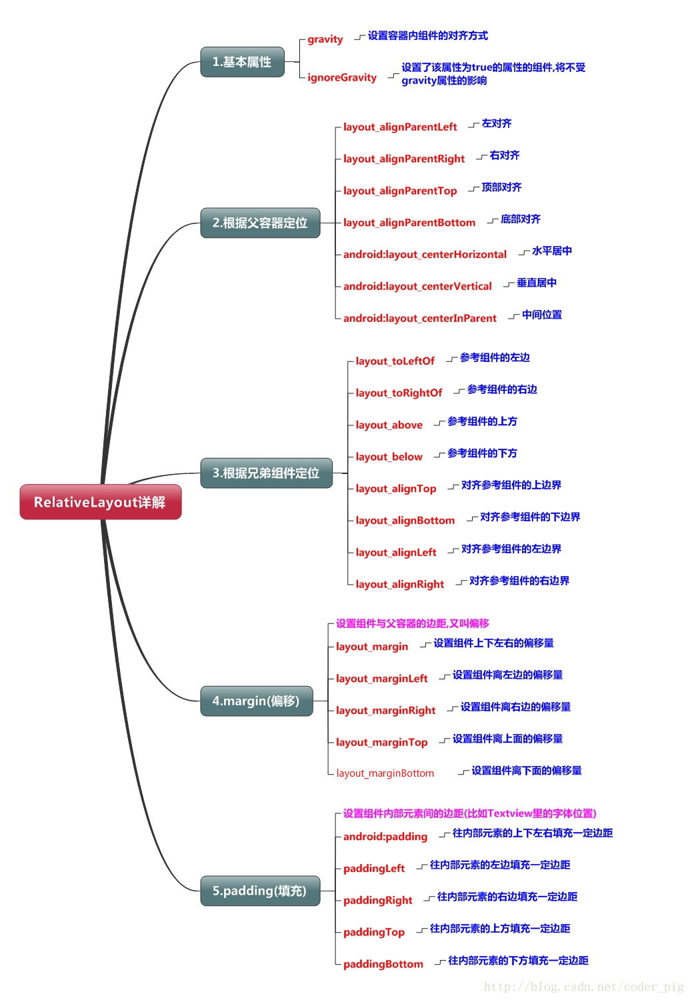
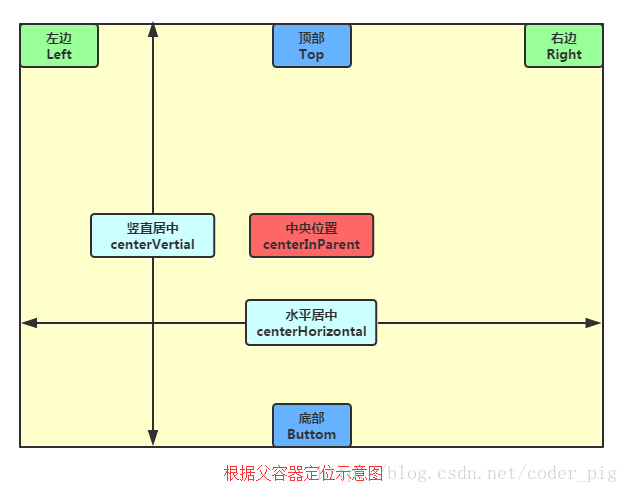
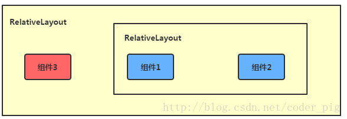
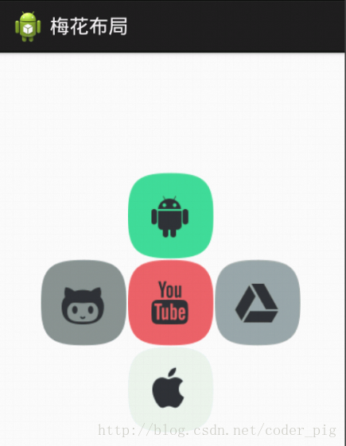
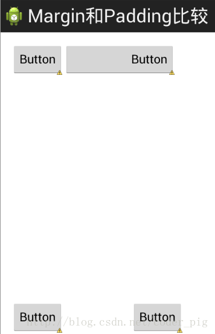

# 2.2.2 RelativeLayout(相对布局)

> 来源: https://www.runoob.com/w3cnote/android-tutorial-relativelayout.html

## 本节引言

在上一节中我们对LinearLayout进行了详细的解析，LinearLayout也是我们
用的比较多的一个布局,我们更多的时候更钟情于他的weight(权重)属性，等比例划分，对屏幕适配还是
帮助蛮大的;但是使用LinearLayout的时候也有一个问题，就是当界面比较复杂的时候，需要嵌套多层的
LinearLayout,这样就会降低UI Render的效率(渲染速度),而且如果是listview或者GridView上的
item,效率会更低,另外太多层LinearLayout嵌套会占用更多的系统资源,还有可能引发stackoverflow;
但是如果我们使用RelativeLayout的话,可能仅仅需要一层就可以完成了,以父容器或者兄弟组件参考+margin
+padding就可以设置组件的显示位置,是比较方便的!当然,也不是绝对的,具体问题具体分析吧!
总结就是:**尽量使用RelativeLayout + LinearLayout的weight属性搭配使用**吧！

## 1.核心属性图

## 2.父容器定位属性示意图

## 3.根据兄弟组件定位

恩,先说下什么是兄弟组件吧,所谓的兄弟组件就是处于同一层次容器的组件,如图

图中的组件1,2就是兄弟组件了,而组件3与组件1或组件2并不是兄弟组件,所以组件3不能通过
组件1或2来进行定位,比如layout_toleftof = "组件1"这样是会报错的！切记！
关于这个兄弟组件定位的最经典例子就是"梅花布局"了,下面代码实现下:

运行效果图：

实现代码：

## 4.margin与padding的区别

初学者对于这两个属性可能会有一点混淆，这里区分下：
首先margin代表的是偏移,比如marginleft = "5dp"表示组件离容器左边缘偏移5dp;
而padding代表的则是填充,而填充的对象针对的是组件中的元素,比如TextView中的文字
比如为TextView设置paddingleft = "5dp",则是在组件里的元素的左边填充5dp的空间！
margin针对的是容器中的组件，而padding针对的是组件中的元素，要区分开来！
下面通过简单的代码演示两者的区别:

比较示例代码如下：

运行效果图比较：

## 5.很常用的一点:margin可以设置为负数

相信很多朋友都不知道一点吧，平时我们设置margin的时候都习惯了是正数的,
其实是可以用负数的,下面写个简单的程序演示下吧,模拟进入软件后,弹出广告
页面的,右上角的cancle按钮的margin则是使用负数的！

效果图如下:

贴出的广告Activity的布局代码吧,当然,如果你对这个有兴趣的话可以下下demo,
因为仅仅是实现效果,所以代码会有些粗糙！

## 本节小结：

关于RelativeLayout的详解就到这里，有什么纰漏，错误，好的建议，欢迎提出~
最后提供下上面的demo代码供大家下载：[RelativeLayoutDemo](//www.runoob.com/wp-content/uploads/2015/07/RelativeLayoutDemo.zip)

### 图片清单

1. 图1 -> images/797932661-1.png （原图：https://www.runoob.com/wp-content/uploads/2015/07/797932661-1.png）
2. 图2 -> images/44967125.jpg （原图：https://www.runoob.com/wp-content/uploads/2015/07/44967125.jpg）
3. 图3 -> images/23853521.jpg （原图：https://www.runoob.com/wp-content/uploads/2015/07/23853521.jpg）
4. 图4 -> images/14556678.jpg （原图：https://www.runoob.com/wp-content/uploads/2015/07/14556678.jpg）
5. 图5 -> images/68121405.jpg （原图：https://www.runoob.com/wp-content/uploads/2015/07/68121405.jpg）
6. 图6 -> images/78965428.jpg （原图：https://www.runoob.com/wp-content/uploads/2015/07/78965428.jpg）
