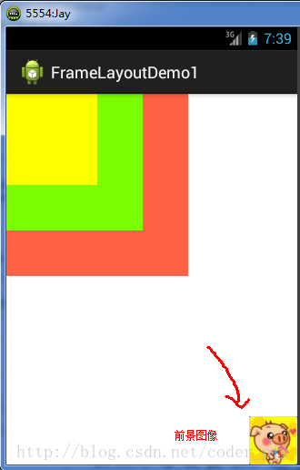
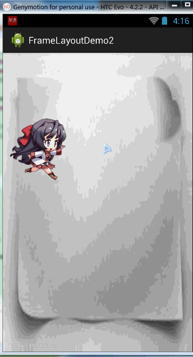
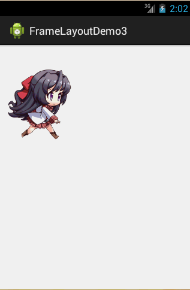

# 2.2.4 FrameLayout(帧布局)

> 来源: https://www.runoob.com/w3cnote/android-tutorial-framelayout.html

## 本节引言

FrameLayout(帧布局)可以说是六大布局中最为简单的一个布局,这个布局直接在屏幕上开辟出一块空白的区域,当我们往里面添加控件的时候,会默认把他们放到这块区域的左上角,而这种布局方式却没有任何的定位方式,所以它应用的场景并不多;帧布局的大小由控件中最大的子控件决定,如果控件的大小一样大的话,那么同一时刻就只能看到最上面的那个组件!后续添加的控件会覆盖前一个!虽然默认会将控件放置在左上角,但是我们也可以通过layout_gravity属性,指定到其他的位置!本节除了给大家演示一个最简单的例子外,还给大家带了两个好玩的例子,有兴趣的可以看看!

## 1.常用属性

FrameLayout的属性很少就两个,但是在说之前我们先介绍一个东西:

前景图像:永远处于帧布局最上面,直接面对用户的图像,就是不会被覆盖的图片。

两个属性:

- **android:foreground:***设置改帧布局容器的前景图像

- **android:foregroundGravity:**设置前景图像显示的位置

## 2.实例演示

### 1)最简单的例子

运行效果图：

实现代码如下：

**代码解析:**
很简单,三个TextView设置不同大小与背景色,依次覆盖,接着右下角的是前景图像,通过
android:foreground="@drawable/logo"设置前景图像的图片，
android:foregroundGravity="right|bottom"设置前景图像的位置在右下角

### 2)随手指移动的萌妹子

效果图如下：

实现流程解析：

- step 1:先将main.xml布局设置为空白的FrameLayout,为其设置一个图片背景

- 
step 2:新建一个继承View类的MeziView自定义组件类,在构造方法中初始化view的初始坐标

- 
step 3:重写onDraw()方法,实例化一个空的画笔类Paint

- 
step 4:调用BitmapFactory.decodeResource()生成位图对象

- 
step 5:调用canvas.drawBitmap()绘制妹子的位图对象

- 
step 6:判断图片上是否回收,否则强制回收图片

- 
step 7:在主Java代码中获取帧布局对象,并且实例化一个MeziView类

- 
step 8:会实例化的mezi对象添加一个触摸事件的监听器,重写onTouch方法,改变mezi的X,Y坐标，调用invalidate()重绘方法

- 
step 9: 将mezi对象添加到帧布局中

布局代码：**main_activity.xml**

自定义的**MeziView.java**

**MainActivity.java:**

**代码解释:**
见步骤,很简单,就是自定义一个View类,重写重绘方法,接着在Activity中为他添加一个触摸时间在触摸时间中重写onTouch方法获取点击焦点,另外还需要-150,不然那个坐标是自定义View的左上角,接着调用invalidate( )重绘方法,最后添加到帧布局中而已!

**
代码下载:**[FrameLayoutDemo2.zip](//www.runoob.com/wp-content/uploads/2015/07/FrameLayoutDemo2.zip)

### 3)跑动的萌妹子

**效果图如下：**

**实现流程:**

- step 1:定义一个空的FrameLayout布局,将前景图像的位置设置为中央位置

- 
step 2:在Activity中获取到该FrameLayout布局,新建一个Handler对象,重写handlerMessage()方法,调用图像- 更新的方法

- 
step 3:自定义一个move()方法,通过switch动态设置前景图片显示的位图

- 
step 4:在onCreate()方法中新建一个计时器对象Timer,重写run方法,每隔170毫秒向handler发送空信息

**实现代码如下:**

**布局文件:main_activity.xml:**

**MainActivity.java:**

**代码解析:**
代码也很简单,就是定义一个handler对象来刷新帧布局的前景图像,定义一个Timer定时器每隔170毫秒发送定时信息,i++;move(i%8);这里是因为我们使用8个图片作为动画素材！

**
代码下载:**[FrameLayoutDemo3.zip](//www.runoob.com/try/download/FrameLayoutDemo3.zip)

## 本节小结

本节介绍了下FrameLayout(帧布局)，主要掌握foreground和foregroundGravity属性的使用即可！帧布局比前面的表格布局用得稍微多一点！有兴趣可以像笔者这样写点小例子试试！

### 图片清单

1. 图1 -> images/23622209.jpg （原图：https://www.runoob.com/wp-content/uploads/2015/07/23622209.jpg）
2. 图2 -> images/18442553.jpg （原图：https://www.runoob.com/wp-content/uploads/2015/07/18442553.jpg）
3. 图3 -> images/3405501.jpg （原图：https://www.runoob.com/wp-content/uploads/2015/07/3405501.jpg）
