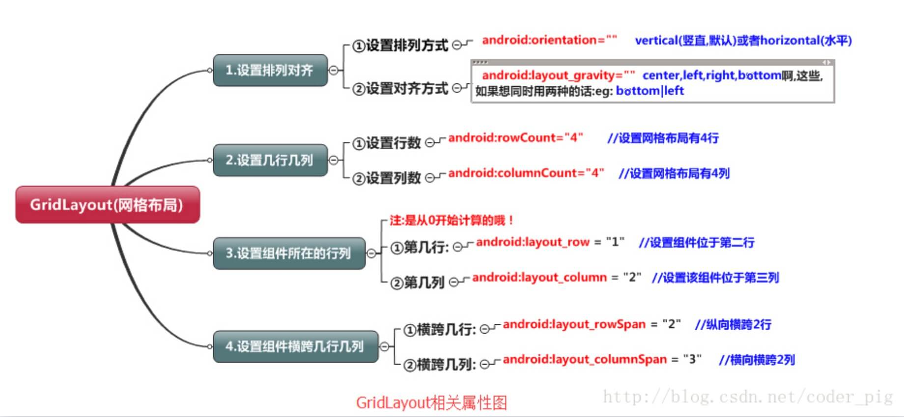
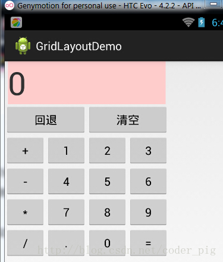

# 2.2.5 GridLayout(网格布局)

> 来源: https://www.runoob.com/w3cnote/android-tutorial-gridlayout.html

## 本节引言

今天要介绍的布局是Android 4.0以后引入的一个新的布局,和前面所学的TableLayout(表格布局)
有点类似,不过他有很多前者没有的东西,也更加好用,

> - 可以自己设置布局中组件的排列方式

> - 可以自定义网格布局有多少行,多少列

> - 可以直接设置组件位于某行某列

> - 可以设置组件横跨几行或者几列

另外,除了上述内容外,本节还会给大家使用gridLayout时会遇到的问题,以及如何解决低版本
sdk如何使用GridLayout的方法！接下来就开始本节的课程吧!

## 1.相关属性总结图

## 2.使用实例:计算器布局的实现:

**运行效果图：**

**实现代码:**

**代码解析:**
代码很简单,只是回退与清楚按钮横跨两列,而其他的都是直接添加的,默认每个组件都是
占一行一列,另外还有一点要注意的:
我们通过:**android:layout_rowSpan**与**android:layout_columnSpan**设置了组件横跨
多行或者多列的话,如果你要让组件填满横越过的行或列的话,需要添加下面这个属性:
**android:layout_gravity = "fill"**！！！就像这个计算机显示数字的部分!

## 3.用法归纳:

①GridLayout使用虚细线将布局划分为行,列和单元格,同时也支持在行,列上进行交错排列
②使用流程:

> - step 1:先定义组件的对其方式 android:orientation 水平或者竖直,设置多少行与多少列

> - step 2:设置组件所在的行或者列,记得是从0开始算的,不设置默认每个组件占一行一列

> - step 3:设置组件横跨几行或者几列;设置完毕后,需要在设置一个填充:android:layout_gravity = "fill"

## 4.使用GridLayout要注意的地方:

因为GirdLayout是4.0后才推出的,所以minSDK版本要改为14或者以上的版本,
不然写布局代码的时候,这玩意就会莫名其妙地出错,说找不到这个GridLayout,
当然,如果你要低版本兼容的话,就要看下面的内容了！

## 5.低版本sdk如何使用GridLayout:

解决方法很简单:只需要导入v7包的gridlayout包即可!
v7包一般在sdk下的:sdk\extras\android\support\v7\gridlayout目录下
如果你没有的话,也可以到这里下载: [gridlayout_v7_jay.rar ](https://www.runoob.com/wp-content/uploads/2015/07/gridlayout_v7_jay.rar)
但是用的时候,标签却是这样写的:

## 本节小结

关于GridLayout的介绍就到这里~

### 图片清单

1. 图1 -> images/D07C612B-0DB8-4775-8045-9318F73C0B13.jpeg （原图：https://www.runoob.com/wp-content/uploads/2015/07/D07C612B-0DB8-4775-8045-9318F73C0B13.jpeg）
2. 图2 -> images/4201451.jpg （原图：https://www.runoob.com/wp-content/uploads/2015/07/4201451.jpg）
