# 2.3.1 TextView(文本框)详解

> 来源: https://www.runoob.com/w3cnote/android-tutorial-textview.html

## 本节引言：

> 学习完Android中的六大布局，从本节开始我们来一个个讲解Android中的UI控件，本节给大家带来的UI控件是：TextView(文本框)，用于显示文本的一个控件，另外声明一点，我不是翻译API文档，不会一个个属性的去扣，只学实际开发中常用的，有用的，大家遇到感觉到陌生的属性可以查询对应的API！当然，每一节开始都会贴这一节对应API文档的链接：[TextView API](https://developer.android.google.cn/reference/android/widget/TextView.html) 好了，在开始本节内容前，先要介绍下几个单位：

> **dp(dip):** device independent pixels(设备独立像素). 不同设备有不同的显示效果,这个和设备硬件有关，一般我们为了支持WVGA、HVGA和QVGA 推荐使用这个，不依赖像素。
> **px: pixels(像素)**. 不同设备显示效果相同，一般我们HVGA代表320x480像素，这个用的比较多。
> **pt: point**，是一个标准的长度单位，1pt＝1/72英寸，用于印刷业，非常简单易用；
> **sp: scaled pixels(放大像素)**. 主要用于字体显示best for textsize。

## 1.基础属性详解：

通过下面这个简单的界面，我们来了解几个最基本的属性：

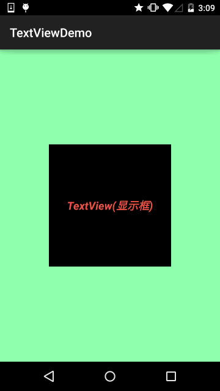

布局代码：

上面的TextView中有下述几个属性:

- **id：**为TextView设置一个组件id，根据id，我们可以在Java代码中通过findViewById()的方法获取到该对象，然后进行相关属性的设置，又或者使用RelativeLayout时，参考组件用的也是id！

- 
**layout_width：**组件的宽度，一般写：**wrap_content**或者**match_parent(fill_parent)**，前者是控件显示的内容多大，控件就多大，而后者会填满该控件所在的父容器；当然也可以设置成特定的大小，比如我这里为了显示效果，设置成了200dp。

- **layout_height：**组件的高度，内容同上。

- **gravity：**设置控件中内容的对齐方向，TextView中是文字，ImageView中是图片等等。

- **text：**设置显示的文本内容，一般我们是把字符串写到string.xml文件中，然后通过@String/xxx取得对应的字符串内容的，这里为了方便我直接就写到""里，不建议这样写！！！

- **textColor：**设置字体颜色，同上，通过colors.xml资源来引用，别直接这样写！

- **textStyle：**设置字体风格，三个可选值：**normal**(无效果)，**bold**(加粗)，**italic**(斜体)

- **textSize：**字体大小，单位一般是用sp！

- **background：**控件的背景颜色，可以理解为填充整个控件的颜色，可以是图片哦！

---

## 2.实际开发例子

### 2.1 带阴影的TextView

涉及到的几个属性：

- **android:shadowColor:**设置阴影颜色,需要与shadowRadius一起使用哦!

- **android:shadowRadius:**设置阴影的模糊程度,设为0.1就变成字体颜色了,建议使用3.0

- **android:shadowDx:**设置阴影在水平方向的偏移,就是水平方向阴影开始的横坐标位置

- **android:shadowDy:**设置阴影在竖直方向的偏移,就是竖直方向阴影开始的纵坐标位置

效果图：

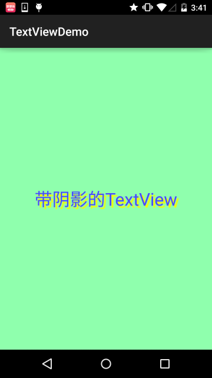

实现代码：

### 2.2 带边框的TextView：

> 如果你想为TextView设置一个边框背景，普通矩形边框或者圆角边框！下面可能帮到你！
> 另外TextView是很多其他控件的父类，比如Button，也可以设置这样的边框！
> 实现原理很简单，自行编写一个ShapeDrawable的资源文件！然后TextView将blackgroung
> 设置为这个drawable资源即可！

简单说下shapeDrawable资源文件的几个节点以及属性：

> - <**solid** android:color = "xxx"> 这个是设置背景颜色的

> - <**stroke** android:width = "xdp" android:color="xxx"> 这个是设置边框的粗细,以及边框颜色的

> - <**padding** androidLbottom = "xdp"...> 这个是设置边距的

> - <**corners** android:topLeftRadius="10px"...> 这个是设置圆角的

> - <**gradient**> 这个是设置渐变色的,可选属性有:
> **startColor**:起始颜色 **endColor**:结束颜色 **centerColor**:中间颜色
> **angle**:方向角度,等于0时,从左到右,然后逆时针方向转,当angle = 90度时从下往上
> **type**:设置渐变的类型

实现效果图：

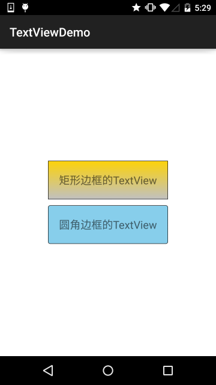

代码实现：

Step 1:编写矩形边框的Drawable：

Step 2:编写圆角矩形边框的Drawable：

Step 3:将TextView的blackground属性设置成上面这两个Drawable：

### 2.3 带图片(drawableXxx)的TextView：

在实际开发中，我们可能会遇到这种需求：

如图，要实现这种效果，可能你的想法是：一个ImageView用于显示图片 + 一个TextView用于显示文字，然后把他们丢到一个LinearLayout中，接着依次创建四个这样的小布局，再另外放到一个大的LinearLayout中，效果是可以实现，但是会不会有点繁琐呢？而且前面我们前面也说过，布局层次越少，性能越好！使用drawableXxx就可以省掉上面的过程，直接设置四个TextView就可以完成我们的需求！

**基本用法：**

设置图片的核心其实就是:**drawableXxx**;可以设置四个方向的图片:
**drawableTop**(上),**drawableButtom**(下),**drawableLeft**(左),**drawableRight**(右)
另外,你也可以使用**drawablePadding**来设置图片与文字间的间距！

**效果图**：(设置四个方向上的图片)

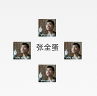

**实现代码：**

**一些问题：**
可能你会发现，我们这样设置的drawable并不能自行设置大小，在XML是无法直接设置的；
所以我们需要在Java代码中来进行一个修改！

示例代码如下：

运行效果图：

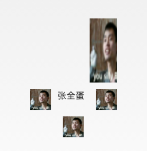

**代码分析：**

> - ①Drawable[] drawable = txtZQD.getCompoundDrawables( );
> 获得四个不同方向上的图片资源,数组元素依次是:左上右下的图片

> - ②drawable[1].setBounds(100, 0, 200, 200);
> 接着获得资源后,可以调用setBounds设置左上右下坐标点,比如这里设置了代表的是:
> 长是:从离文字最左边开始100dp处到200dp处
> 宽是:从文字上方0dp处往上延伸200dp!

> - ③txtZQD.setCompoundDrawables(drawable[0], drawable[1], drawable[2],
> drawable[3]);为TextView重新设置drawable数组!没有图片可以用null代替哦!
> PS：另外，从上面看出我们也可以直接在Java代码中调用setCompoundDrawables为
> TextView设置图片！

### 2.4 使用autoLink属性识别链接类型

当文字中出现了URL，E-Mail，电话号码，地图的时候，我们可以通过设置autoLink属性；当我们点击
文字中对应部分的文字，即可跳转至某默认APP，比如一串号码，点击后跳转至拨号界面！

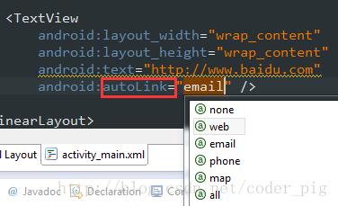

看下效果图：

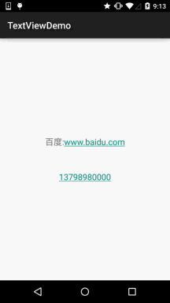

all就是全部都包含,自动识别协议头~
在Java代码中可以调用setAutoLinkMask(Linkify.ALL);
这个时候可以不写协议头,autolink会自动识别，但是还要为这个TextView设置：
setMovementMethod(LinkMovementMethod.getInstance()); 不然点击了是没效果的！

### 2.5 TextView玩转HTML

> 如题，除了显示普通文本外，TextView还预定义了一些类似于HTML的标签，通过这些标签，我们可以使
> TextView显示不同的字体颜色，大小，字体，甚至是显示图片，或者链接等！我们只要使用HTML中的一些
> 标签，加上android.text.HTML类的支持，即可完成上述功能！

PS:当然，并不是支持所有的标签，常用的有下述这些：

> - <**font**>：设置颜色和字体。

> - <**big**>：设置字体大号

> - <**small**>：设置字体小号

> - <**i**><**b**>：斜体粗体

> - <**a**>：连接网址

> - <**img**>：图片

如果直接setText的话是没作用的，我们需要调用Html.fromHtml()方法将字符串转换为CharSequence接口，
然后再进行设置，如果我们需要相应设置，需要为TextView进行设置，调用下述方法：
`Java
setMovementMethod(LinkMovementMethod.getInstance())
`

嗯，接着我们写代码来试试：

**1）测试文本与超链接标签**

运行效果图：

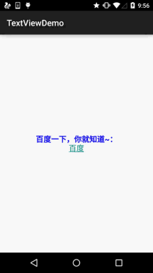

恩呢，测试完毕~

**2）测试src标签，插入图片：**

看下运行效果图：

接下来看下实现代码，实现代码看上去有点复杂，用到了反射(对了，别忘了在drawable目录下放一个icon的图片哦！)：

嘿嘿，你也可以自己试试，比如为图片加上超链接，点击图片跳转这样~

### 2.6 SpannableString&SpannableStringBuilder定制文本

> 除了上面的HTML可以定制我们TextView的样式外，还可以使用SpannableString和SpannableStringBuilder来完成，两者区别：前者针对的是不可变文本，而后者则是针对可变文本，这里只讲解前者，对后者有兴趣可自行查阅文本！

SpannableString可供我们使用的API有下面这些：

> - **BackgroundColorSpan** 背景色

> - **ClickableSpan** 文本可点击，有点击事件

> - **ForegroundColorSpan** 文本颜色（前景色）

> - **MaskFilterSpan** 修饰效果，如模糊(BlurMaskFilter)、浮雕(EmbossMaskFilter)

> - **MetricAffectingSpan** 父类，一般不用

> - **RasterizerSpan** 光栅效果

> - **StrikethroughSpan** 删除线（中划线）

> - **SuggestionSpan** 相当于占位符

> - **UnderlineSpan** 下划线

> - **AbsoluteSizeSpan** 绝对大小（文本字体）

> - **DynamicDrawableSpan** 设置图片，基于文本基线或底部对齐。

> - **ImageSpan** 图片

> - **RelativeSizeSpan** 相对大小（文本字体）

> - **ReplacementSpan** 父类，一般不用

> - **ScaleXSpan** 基于x轴缩放

> - **StyleSpan** 字体样式：粗体、斜体等

> - **SubscriptSpan** 下标（数学公式会用到）

> - **SuperscriptSpan** 上标（数学公式会用到）

> - **TextAppearanceSpan** 文本外貌（包括字体、大小、样式和颜色）

> - **TypefaceSpan** 文本字体

> - **URLSpan** 文本超链接

好吧，还是蛮多的，这里给出个最简单的例子吧，其他的参数调用可自行百度谷歌~
**1）最简单例子：**
运行效果图：

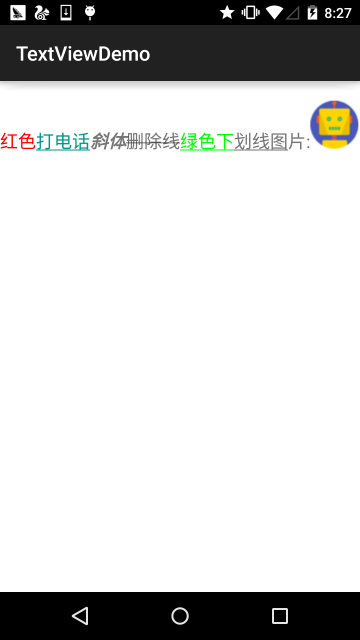

实现代码：

**2）实现部分可点击的TextView**
相信玩过QQ空间和微信朋友圈的朋友对下面的东东并不陌生吧，我们可以点击
对应的用户然后进入查看用户相关的信息是吧！

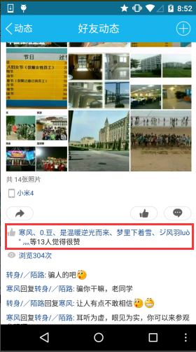

下面我们就来写个简单的例子来实现下效果：

运行效果图：

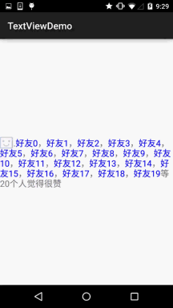

核心其实就是：ClickableSpan的设置而已~你可以自己捣鼓着写下QQ空间评论的那个自己写一个~

### 2.7 实现跑马灯效果的TextView

简单说下什么是跑马灯，就是类似于web一样，有一行字一直循环滚滚动这样，好吧还是看看
实现效果图，一看就懂的了~

实现效果图：

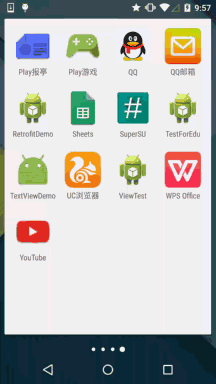

代码实现：

### 2.8 设置TextView字间距和行间距

就像我们平时编写文档的时候，我们需要排版，设置下行或者字之间的间距是吧：
Android中的TextView也可以进行这样的设置：

**字间距：**

**行间距：**
Android系统中TextView默认显示中文时会比较紧凑，为了让每行保持的行间距

> **android:lineSpacingExtra：**设置行间距，如"3dp"
> **android:lineSpacingMultiplier：**设置行间距的倍数，如"1.2"

Java代码中可以通过:
**setLineSpacing**方法来设置

### 2.9 自动换行

自动换行通过 **android:singleLine** 设置，默认为 false。

如需要自动换行，可以用：

如果要在一行显示完，不换行，可以用：

除此之外，可以也设置多行显示不完，添加个maxLines的属性即可！

## 3.本节小结：

本节对Android中的TextView控件进行了详细的解析，提供了开发中常见的一些问题的解决方法，相信
会为你的实际开发带来大大的便利，另外，笔者能力有限，写出来的东西可能有些纰漏，欢迎指出，
不胜感激~另外，转载请注明出处：coder-pig！谢谢~

### 图片清单

1. 图1 -> images/75474010.jpg （原图：https://www.runoob.com/wp-content/uploads/2015/07/75474010.jpg）
2. 图2 -> images/82118375.jpg （原图：https://www.runoob.com/wp-content/uploads/2015/07/82118375.jpg）
3. 图3 -> images/36413391.jpg （原图：https://www.runoob.com/wp-content/uploads/2015/07/36413391.jpg）
4. 图4 -> images/68693829.jpg （原图：https://www.runoob.com/wp-content/uploads/2015/07/68693829.jpg）
5. 图5 -> images/46436386.jpg （原图：https://www.runoob.com/wp-content/uploads/2015/07/46436386.jpg）
6. 图6 -> images/88806164.jpg （原图：https://www.runoob.com/wp-content/uploads/2015/07/88806164.jpg）
7. 图7 -> images/59234627.jpg （原图：https://www.runoob.com/wp-content/uploads/2015/07/59234627.jpg）
8. 图8 -> images/5036910.jpg （原图：https://www.runoob.com/wp-content/uploads/2015/07/5036910.jpg）
9. 图9 -> images/54628343.jpg （原图：https://www.runoob.com/wp-content/uploads/2015/07/54628343.jpg）
10. 图10 -> images/62308635.jpg （原图：https://www.runoob.com/wp-content/uploads/2015/07/62308635.jpg）
11. 图11 -> images/22818005.jpg （原图：https://www.runoob.com/wp-content/uploads/2015/07/22818005.jpg）
12. 图12 -> images/75919458.jpg （原图：https://www.runoob.com/wp-content/uploads/2015/07/75919458.jpg）
13. 图13 -> images/20289188.jpg （原图：https://www.runoob.com/wp-content/uploads/2015/07/20289188.jpg）
14. 图14 -> images/67859995.jpg （原图：https://www.runoob.com/wp-content/uploads/2015/07/67859995.jpg）
