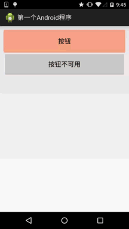
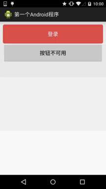
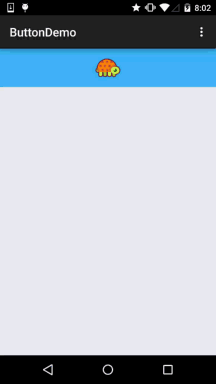

# 2.3.3 Button(按钮)与ImageButton(图像按钮)

> 来源: https://www.runoob.com/w3cnote/android-tutorial-button-imagebutton.html

## 本节引言：

> 今天给大家介绍的Android基本控件中的两个按钮控件，Button普通按钮和ImageButton图像按钮；
> 其实ImageButton和Button的用法基本类似，至于与图片相关的则和后面ImageView相同，所以本节
> 只对Button进行讲解，另外Button是TextView的子类，所以TextView上很多属性也可以应用到Button
> 上！我们实际开发中对于Button的，无非是对按钮的几个状态做相应的操作，比如：按钮按下的时候
> 用一种颜色，弹起又一种颜色，或者按钮不可用的时候一种颜色这样！上述实现无非是通过
> **StateListDrawable**这种Drawable资源来实现，即编写一个drawable的资源文件，就说这么多，
> 直接开始本节内容~

## 1.StateListDrawable简介：

> StateListDrawable是Drawable资源的一种，可以根据不同的状态，设置不同的图片效果，关键节点
> **< selector >**，我们只需要将Button的background属性设置为该drawable资源即可轻松实现，按下
> 按钮时不同的按钮颜色或背景！

我们可以设置的属性：

> - **drawable**:引用的Drawable位图,我们可以把他放到最前面,就表示组件的正常状态~

> - **state_focused**:是否获得焦点

> - **state_window_focused**:是否获得窗口焦点

> - **state_enabled**:控件是否可用

> - **state_checkable**:控件可否被勾选,eg:checkbox

> - **state_checked**:控件是否被勾选

> - **state_selected**:控件是否被选择,针对有滚轮的情况

> - **state_pressed**:控件是否被按下

> - **state_active**:控件是否处于活动状态,eg:slidingTab

> - **state_single**:控件包含多个子控件时,确定是否只显示一个子控件

> - **state_first**:控件包含多个子控件时,确定第一个子控件是否处于显示状态

> - **state_middle**:控件包含多个子控件时,确定中间一个子控件是否处于显示状态

> - **state_last**:控件包含多个子控件时,确定最后一个子控件是否处于显示状态

## 2.实现按钮的按下效果：

好的，先准备三个图片背景，一般我们为了避免按钮拉伸变形都会使用.9.png作为按钮的drawable！
先来看下
**运行效果图：**

**代码实现：**

布局文件:**activity_main.xml**

**MainActivity.java**：

## 3.使用颜色值绘制圆角按钮

> 很多时候我们不一定会有美工是吧，或者我们不会PS或毁图秀秀，又或者我们懒，不想自己去做图，
> 这个时候我们可以自己写代码来作为按钮背景，想要什么颜色就什么颜色，下面我们来定制个圆角的
> 的按钮背景~，这里涉及到另一个drawable资源:ShapeDrawable，这里不详细讲，后面会详细介绍每一个
> drawable~这里会用就好，只是EditText修改下Background属性而已，这里只贴drawable资源！

先看下效果图：

**bbuton_danger_rounded.xml：**

**color.xml:**

**dimens.xml:**

---

## 4.实现Material Design水波效果的Button

如果你的Android手机是5.0以上的系统，相信对下面这种按钮点击效果并不会陌生：

**实现效果图：**

快的那个是按下后的效果，慢的是长按后的效果！

**实现逻辑：**

1.我们继承ImageButton，当然你可以换成Button或者View,这里笔者想把龟放到中间才继承ImageButton

2.首先，创建两个Paint(画笔)对象，一个绘制底部背景颜色，一个绘制波纹扩散的

3.接着计算最大半径，开始半径每隔一段时间递增一次，直到等于最大半径，然后重置状态！

PS:大概的核心，刚学可能对自定义View感到陌生，没事，这里了解下即可，以后我们会讲，当然
你可以自己扣扣，注释还是蛮详细的~

**实现代码：**

自定义ImageButton：**MyButton.java**

**activity_main.xml：**

源码下载(AS工程的哦)：[ButtonDemo.zip](/try/download/ButtonDemo.zip)

## 本节小结：

本节给大家介绍了Button在实际开发中的一些用法，可能有些东西我们还没学，这里
知道下即可，后面学到自然会深入讲解，谢谢~

### 图片清单

1. 图1 -> images/89827371.jpg （原图：https://www.runoob.com/wp-content/uploads/2015/07/89827371.jpg）
2. 图2 -> images/48089981.jpg （原图：https://www.runoob.com/wp-content/uploads/2015/07/48089981.jpg）
3. 图3 -> images/44832111.jpg （原图：https://www.runoob.com/wp-content/uploads/2015/07/44832111.jpg）
