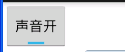
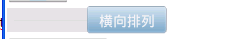
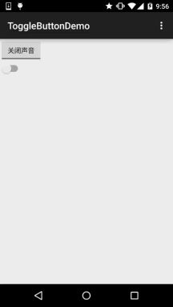
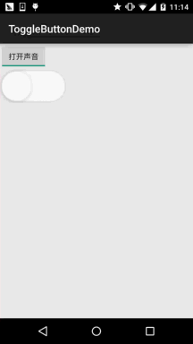

# 2.3.6 开关按钮ToggleButton和开关Switch

> 来源: https://www.runoob.com/w3cnote/android-tutorial-togglebutton-switch.html

## 本节引言：

> 本节给大家介绍的Android基本UI控件是:开关按钮ToggleButton和开关Switch，可能大家对着两个组件
> 并不熟悉，突然想起笔者的第一间外包公司，是否在wifi下联网的开关，竟然用的TextView，然后叫美工
> 且两个切换前后的图，然后代码中进行设置，当然点击TextView的时候判断状态，然后设置对应的背景...

> 好吧，也是醉了，好吧...本节讲解的两个其实都是开关组件，只是后者需要在Android 4.0以后才能使用
> 所以AndroidManifest.xml文件中的minsdk需要 >= 14 否则会报错~，先来看看这两个控件长什么样先，
> Android 5.0后这两个控件相比以前来说好看了许多，先看下5.0前的样子：

> **5.0以前的ToggleButton和Switch：**
> **5.0版本：**

> 好吧，鲜明的对比...接下来我们就来学习者两个控件的使用吧，其实两个的使用几乎是相同的。

> 开始之前贴下官方API先：[Switch](http://androiddoc.qiniudn.com/reference/android/widget/Switch.html)；[ToggleButton](http://androiddoc.qiniudn.com/reference/android/widget/ToggleButton.html)

## 1.核心属性讲解：

### 1）ToggleButton(开关按钮)

可供我们设置的属性：

> - **android:disabledAlpha**：设置按钮在禁用时的透明度

> - **android:textOff：**按钮没有被选中时显示的文字

> - **android:textOn：**按钮被选中时显示的文字
> 另外，除了这个我们还可以自己写个selector，然后设置下Background属性即可~

### 2) Switch(开关)

可供我们设置的属性：

> - **android:showText：**设置on/off的时候是否显示文字,boolean

> - **android:splitTrack：**是否设置一个间隙，让滑块与底部图片分隔,boolean

> - **android:switchMinWidth：**设置开关的最小宽度

> - **android:switchPadding：**设置滑块内文字的间隔

> - **android:switchTextAppearance：**设置开关的文字外观，暂时没发现有什么用...

> - **android:textOff：**按钮没有被选中时显示的文字

> - **android:textOn：**按钮被选中时显示的文字

> - **android:textStyle：**文字风格，粗体，斜体写划线那些

> - **android:track：**底部的图片

> - **android:thumb：**滑块的图片

> - **android:typeface：**设置字体，默认支持这三种:sans, serif, monospace;除此以外还可以使用
> 其他字体文件(***.ttf**)，首先要将字体文件保存在assets/fonts/目录下，不过需要在Java代码中设置：
> **Typeface typeFace =Typeface.createFromAsset(getAssets(),"fonts/HandmadeTypewriter.ttf");
> textView.setTypeface(typeFace);**

## 2.使用示例：

因为比较简单，所以我们把他们写到一起，另外，我们为Switch设置下滑块和底部的图片，实现
一个类似于IOS 7的滑块的效果，但是有个缺点就是不能在XML中对滑块和底部的大小进行设置，
就是素材多大，Switch就会多大，我们可以在Java中获得Drawable对象，然后对大小进行修改，
简单的例子：

**运行效果图：**

**实现代码：**
先是两个drawable的文件：
**thumb_selctor.xml:**

**track_selctor.xml:**

**布局文件:activity_main.xml:**

**MainActivity.java：**

### 图片清单

1. 图1 -> images/41009006.jpg （原图：https://www.runoob.com/wp-content/uploads/2015/10/41009006.jpg）
2. 图2 -> images/49346872.jpg （原图：https://www.runoob.com/wp-content/uploads/2015/10/49346872.jpg）
3. 图3 -> images/70926587.jpg （原图：https://www.runoob.com/wp-content/uploads/2015/10/70926587.jpg）
4. 图4 -> images/44095159.jpg （原图：https://www.runoob.com/wp-content/uploads/2015/10/44095159.jpg）
