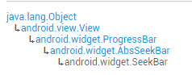
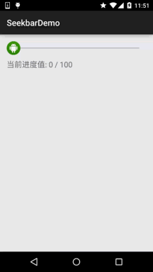
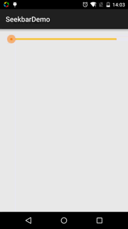

# 2.3.8 SeekBar(拖动条)

> 来源: https://www.runoob.com/w3cnote/android-tutorial-seekbar.html

## 本节引言：

> 本节我们继续来学习Android的基本UI控件中的拖动条——SeekBar，相信大家对他并不陌生，最常见的
> 地方就是音乐播放器或者视频播放器了，音量控制或者播放进度控制，都用到了这个SeekBar，我们
> 先来看看SeekBar的类结构，来到官方文档：[SeekBar](http://androiddoc.qiniudn.com/reference/android/widget/SeekBar.html)

> 

> 嘿嘿，这玩意是ProgressBar的子类耶，也就是ProgressBar的属性都可以用咯！
> 而且他还有一个自己的属性就是：**android:thumb**，就是允许我们自定义滑块~
> 好的，开始本节内容！

## 1.SeekBar基本用法

好吧，基本用法其实很简单，常用的属性无非就下面这几个常用的属性，Java代码里只要setXxx即可：

> **android:max**="100" //滑动条的最大值

> **android:progress**="60" //滑动条的当前值

> **android:secondaryProgress**="70" //二级滑动条的进度

> **android:thumb** = "@mipmap/sb_icon" //滑块的drawable

接着要说下SeekBar的事件了，**SeekBar.OnSeekBarChangeListener**
我们只需重写三个对应的方法：

> **onProgressChanged**：进度发生改变时会触发

> **onStartTrackingTouch**：按住SeekBar时会触发

> **onStopTrackingTouch**：放开SeekBar时触发

**简单的代码示例:**

**效果图:**

**实现代码：**

## 2.简单SeekBar定制：

> 本来还想着自定义下SeekBar的，后来想想，还是算了，涉及到自定义View的一些东西，可能初学者并
> 不了解，看起来也有点难度，关于自定义View的还是放到进阶那里吧，所以这里就只是简单的定制下SeekBar！
> 定制的内容包括滑块，以及轨道！

**代码实例：**

**运行效果图：**

**代码实现：**
**1.滑块状态Drawable：sb_thumb.xml**

**贴下素材：**

**2.条形栏Bar的Drawable：sb_bar.xml**

这里用到一个layer-list的drawable资源！其实就是层叠图片，依次是:背景，二级进度条，当前进度：

**3.然后布局引入SeekBar后，设置下progressDrawable与thumb即可！**

就是这么简单！

## 本节小结：

好的，关于SeekBar就到这里，谢谢大家~

### 图片清单

1. 图1 -> images/45807422.jpg （原图：https://www.runoob.com/wp-content/uploads/2015/08/45807422.jpg）
2. 图2 -> images/22291787.jpg （原图：https://www.runoob.com/wp-content/uploads/2015/08/22291787.jpg）
3. 图3 -> images/34246693.jpg （原图：https://www.runoob.com/wp-content/uploads/2015/08/34246693.jpg）
4. 图4 -> images/71397914.jpg （原图：https://www.runoob.com/wp-content/uploads/2015/08/71397914.jpg）
5. 图5 -> images/25576180.jpg （原图：https://www.runoob.com/wp-content/uploads/2015/08/25576180.jpg）
