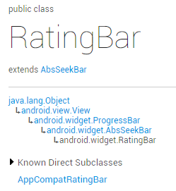
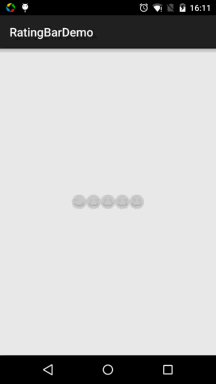

# 2.3.9 RatingBar(星级评分条)

> 来源: https://www.runoob.com/w3cnote/android-tutorial-ratingbar.html

## 本节引言：

> 上一节的SeekBar是不是很轻松咧，本节我们学的这个RatingBar(星级评分条)也非常简单，相信在某宝，
> 买过东西的对这个应该不陌生，收到卖家的包裹，里面很多时候会有个小纸片，五星好评返还多少元这样，
> 而评分的时候就可以用到我们这个星级评分条了~先来瞅瞅官方文档
> 官方文档：[RatingBar](http://androiddoc.qiniudn.com/reference/android/widget/RatingBar.html)
> 我们可以看到，这玩意和SeekBar的类结构是一样的，也是ProgressBar的子类：

> 

> 也就是说他同样有用ProgressBar的相关属性，接下来我们来探究RatingBar特有的属性！

## 1.RatingBar基本使用：

先来看看5.0的原生SeekBar长什么样：

**——相关属性：**

**android:isIndicator**：是否用作指示，用户无法更改，默认false
**android:numStars**：显示多少个星星，必须为整数
**android:rating**：默认评分值，必须为浮点数
**android:stepSize：** 评分每次增加的值，必须为浮点数

除了上面这些，还有两种样式供我们选择咧，但是不建议使用，因为这两种样式都好丑...
他们分别是：
**style="?android:attr/ratingBarStyleSmall"**
**style="?android:attr/ratingBarStyleIndicator"**

**——事件处理：**
只需为RatingBar设置**OnRatingBarChangeListener**事件，然后重写下**onRatingChanged()**方法即可！

**实现代码如下：**

## 2.定制环节：

> 嘿嘿，我们很多时候不会用星星作为评分标准的，我们来改改呗~
> 把星星改成其他的，比如笑脸，两个素材：

 

接下来和前面的SeekBar一样编写一个layer-list的文件：

**ratingbar_full.xml:**

接着在style.xml中自定义下RatingBar Style，在**style.xml**加上这个：

最后在布局中的Ratingbar组件设置下：

**运行效果图：**

好的，效果还可以哈，至于间距问题，就需要对图片坐下处理了，就是需要切图的时候在图片左右预留点空格~!

## 本节小结：

好的，关于RatingBar的使用就到这里，和前面的SeekBar其实大同小异，蛮轻松的~嗯，谢谢~

### 图片清单

1. 图1 -> images/47377091.jpg （原图：https://www.runoob.com/wp-content/uploads/2015/08/47377091.jpg）
2. 图2 -> images/26220128.jpg （原图：https://www.runoob.com/wp-content/uploads/2015/08/26220128.jpg）
3. 图3 -> images/67936784.jpg （原图：https://www.runoob.com/wp-content/uploads/2015/08/67936784.jpg）
4. 图4 -> images/13409619.jpg （原图：https://www.runoob.com/wp-content/uploads/2015/08/13409619.jpg）
5. 图5 -> images/35829066.jpg （原图：https://www.runoob.com/wp-content/uploads/2015/08/35829066.jpg）
