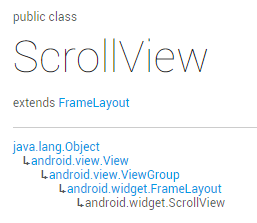
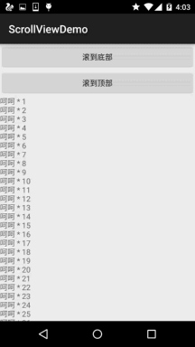

# 2.4.1 ScrollView(滚动条)

> 来源: https://www.runoob.com/w3cnote/android-tutorial-scrollview.html

## 本节引言：

> 本节带来的是Android基本UI控件中的第十个：**ScrollView**(滚动条)，或者我们应该叫他
> 竖直滚动条，对应的另外一个水平方向上的滚动条：**HorizontalScrollView**，先来一发官方文档
> 的链接：[ScrollView](http://androiddoc.qiniudn.com/reference/android/widget/ScrollView.html.com/reference/android/widget/ScrollView.html)，我们可以看到类的结构如下：

> 

> 嘿嘿，原来是一个FrameLayout的容器，不过在他的基础上添加了滚动，允许显示的比实际多的内容！

> 另外，只能够往里面放置**一个子元素**，可以是单一的组件，又或者一个布局包裹着的复杂的层次结构！

> 一般对于可能显示不完的情况，我们可以直接在布局的外层套上一个:
> ScrollView或者HorizontalScrollView！就这么简单~！

## 可能遇到的一些需求

好的，就不一个个扣文档了，直接说实际开发中可能会遇到的一些需求吧：

另外有一个很典型的问题就是:ScrollView和ListView的嵌套问题，这个放到ListView那一章节
再来讲解~

### 1.滚动到底部：

> 我们可以直接利用ScrollView给我们提供的:**fullScroll()方法**：

> scrollView.fullScroll(ScrollView.**FOCUS_DOWN**);滚动到底部

> scrollView.fullScroll(ScrollView.**FOCUS_UP**);滚动到顶部

> 另外用这玩意的时候要小心异步的玩意，就是addView后，有可能还没有显示完，
> 如果这个时候直接调用该方法的话，可能会无效，这就需要自己写handler来更新了~

**代码示例：**

**效果图：**

**实现代码：**

布局比较简单，就不贴了，直接贴MainActivity
**MainActivity.java**

当然除了这种方法还，你还可以使用另一种复杂一点的写法：

**scrollTo**()参数依次为x，y滚到对应的x，y位置！

### 2.设置滚动的滑块图片

> 这个更加简单：
> **垂直**方向滑块：android:**scrollbarThumbVertical**
> **水平**方向滑块：android:**scrollbarThumbHorizontal**

### 3.隐藏滑块

好吧，这个好像没什么卵用：

> 方法有两种：
> 1.android:scrollbars="none"
> 2.Java代码设置：scrollview.setVerticalScrollBarEnabled(false);

### 4.设置滚动速度：

> 这个并没有给我们提供可以直接设置的方法，我们需要自己继承ScrollView，然后重写一个
> public void fling (int velocityY)的方法：

## 本节小结：

好的，能想到的ScrollView的东西就这么多，因为平时这个用得并不多，一般直接套在外面而已，
另外，问题最多的一般是ScrollView和ListView的嵌套问题~如果有什么补充欢迎提出，谢谢~

### 图片清单

1. 图1 -> images/77233830.jpg （原图：https://www.runoob.com/wp-content/uploads/2015/08/77233830.jpg）
2. 图2 -> images/70448464.jpg （原图：https://www.runoob.com/wp-content/uploads/2015/08/70448464.jpg）
