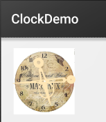

# 2.4.2 Date &#038; Time组件(上)

> 来源: https://www.runoob.com/w3cnote/android-tutorial-date-time-1.html

## 本节引言：

> 本节给大家带来的是Android给我们提供的显示时间的几个控件，他们分别是：
> TextClock，AnalogClock，Chronometer，另外其实还有个过时的DigitalClock就不讲解了！
> 好的，开始本节内容！

## 1.TextClock(文本时钟)

> TextClock是在Android 4.2(API 17)后推出的用来替代DigitalClock的一个控件！
> TextClock可以以字符串格式显示当前的日期和时间，因此推荐在Android 4.2以后使用TextClock。
> 这个控件推荐在24进制的android系统中使用，TextClock提供了两种不同的格式，
> 一种是在24进制中显示时间和日期，另一种是在12进制中显示时间和日期。大部分人喜欢默认的设置。

可以通过调用：TextClock提供的is24HourModeEnabled()方法来查看，系统是否在使用24进制时间显示!
在24进制模式中：

- 如果没获取时间，首先通过getFormat24Hour()返回值；

- 获取失败则通过getFormat12Hour()获取返回值；

- 以上都获取失败则使用默认；

另外他给我们提供了下面这些方法，对应的还有get方法：

| Attribute Name
 | Related Method
 | Description

| **android:format12Hour**
 | **setFormat12Hour(CharSequence)** 
 | **设置12时制的格式**

| **android:format24Hour**
 | **setFormat24Hour(CharSequence)** 
 | **设置24时制的格式**

| **android:timeZone**
 | **setTimeZone(String)**
 | **设置时区**

其实更多的时间我们是花在时间形式定义上，就是里面这个CharSequence！
这里提供下常用的写法以及结果：

**运行结果：**

**PS:**另外minsdk 要大于或者等于17哦！

## 2.AnalogClock(模拟时钟)

就是下图这种：

官网中我们可以看到这样三个属性：

依次是：表背景，表时针，分时针的图片，我们可以自行定制：

**示例代码如下：**

**运行结果：**

## 3.Chronometer(计时器)

如题，就是一个简单的计时器，我们直接上使用示例吧：

**使用示例：**

**实现代码：**

**布局代码：**

**MainActivity.java**

**运行截图：**

## 本节小结：

本节跟大家简单的介绍了TextClock，AnalogClock，Chronometer这三个组件，从篇幅就可以看出
其实这几个东西用得并不多，几乎是没用过...知道下就好，用法也超简单...
就这样吧，本节就到这里~谢谢

### 图片清单

1. 图1 -> images/95697229.jpg （原图：https://www.runoob.com/wp-content/uploads/2015/08/95697229.jpg）
2. 图2 -> images/41370313.jpg （原图：https://www.runoob.com/wp-content/uploads/2015/08/41370313.jpg）
3. 图3 -> images/77796004.jpg （原图：https://www.runoob.com/wp-content/uploads/2015/08/77796004.jpg）
4. 图4 -> images/22214754.jpg （原图：https://www.runoob.com/wp-content/uploads/2015/08/22214754.jpg）
5. 图5 -> images/80544150.jpg （原图：https://www.runoob.com/wp-content/uploads/2015/08/80544150.jpg）
