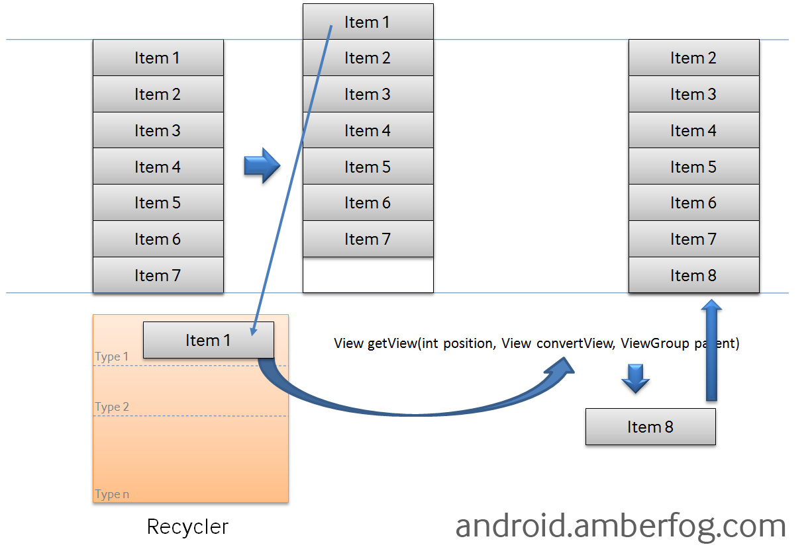
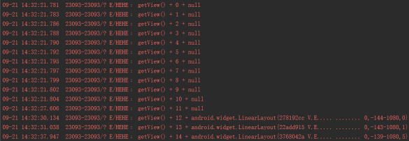

# 2.4.8 ListView之checkbox错位问题解决

> 来源: https://www.runoob.com/w3cnote/android-tutorial-listview-checkbox.html

## 本节引言：

> 作为ListView经典问题之一，如果你尝试过自定义ListView的item，在上面带有一个checkbox的话，那么
> 当你的item数超过了一页的话，就会出现这个问题，下面我们来分析下出现这种问题的原因，以及如何来
> 解决这个问题！

## 1.问题发生的原因：

这是网上找来的一幅关于ListView getView方法调用机制的一个图

上图中有一个**Recycler**的东东，平时我们ListView上可见的Item处于内存中，而且他的Item则放在
这个Recycler中，第一次加载item时，当前页面中的convertView都为NULL，当滚出屏幕，这是时候
**ConvertView**不为空，所以新的一项会复用这个ConvertView！
我们可以写个简单的例子，跟下log，下面是运行后的一些Log图！

从图中看出，Postion从12开始，ConvertView就不为空了，具体这里代表的是什么，
我也不知道，目测要走源码...我们知道这里ConvertView会缓存就好，就是因为这个原因
造成的checkbox错位，所以第一个解决方式就是，不重用这个ConvertView，或者
说每次getView都将这个ConvertView设置为null，但是如果需要显示的Item数目巨大的话，
这种方法就会显得非常臃肿，一般实际开发我们使用的是下面的解决方法：
**找个东东来保存当前Item CheckBox的状态，初始化的时候进行判断，设置是否选中！**

## 2.解决方法示例：

> 好的存储这个Checkbox的方法有很多，你可以放到一个HashMap<Integer, Boolean>中，
> 每次初始化的时候根据postion取出对应的boolean值，然后再进行checkbox的状态设置；
> 而笔者的做法则是在entity类中加入了一个boolean值用于判断，下面是笔者一个项目中
> 抽取出来的代码，代码比较简单，相信你看完会秒懂的~

Entity类：**Person.java**：

实现的Adapter类：**ContactListAdapter.java：

嘿嘿，非常简单，另外别忘了一点：
**checkbox监听器的方法要添加在初始化Checkbox状态的代码之前哦~**

## 本节引言：

> 好的，本节给大家讲解了ListView的一个经典问题，ListView中checkbox错位的
> 问题解决，只需简单的添加一个记录checkbox选择状态的值，然后重写checkbox
> 点击事件的时候，先做判断~谢谢~

### 图片清单

1. 图1 -> images/23101560K-0.jpg （原图：https://www.runoob.com/wp-content/uploads/2015/09/23101560K-0.jpg）
2. 图2 -> images/64217183.jpg （原图：https://www.runoob.com/wp-content/uploads/2015/09/64217183.jpg）
