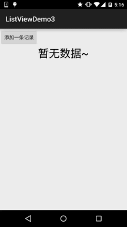
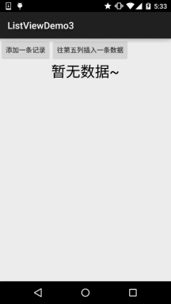
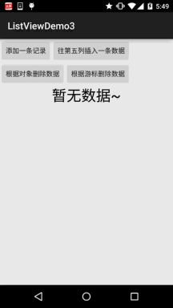

# 2.4.9 ListView的数据更新问题

> 来源: https://www.runoob.com/w3cnote/android-tutorial-listview-update.html

## 本节引言：

> 我们前面已经学习了ListView的一些基本用法咧，但是细心的你可能发现了，我们的数据
> 一开始定义好的，都是静态的，但是实际开发中，我们的数据往往都是动态变化的，比如
> 我增删该了某一列，那么列表显示的数据也应该进行同步的更新，那么本节我们就来探讨
> 下ListView数据更新的问题，包括全部更新，以及更新其中的一项，那么开始本节内容！~
> 

## 1.先写个正常的demo先

> 好的，先写个正常的Demo先，等下我们再慢慢调：

entity类：**Data.java**：

**Activity布局以及列表项布局**：

**activity_main.xml**：

**item_list.xml：**

自定义BaseAdapter的实现：**MyAdapter.java**：

**MainActivity.java**的编写：

可以运行，运行后发现我们的页面并没有任何的数据，白茫茫的一片，这样的用户体验并不好，
我们可以通过调用ListView的一个**setEmptyView(View)**的方法，当ListView数据为空的时候，
显示一个对应的View，另外发现这个方法很奇葩，动态添加的View，竟然无效，只能在ListView
所在的布局文件中添加当ListView无数据时，想显示的View，另外用这个setEmptyView设置后的
View，加载的时候竟然不会显示出来，好灵异....比如这里的是没有数据时显示一个没有数据
的TextView，部分代码如下：

当然除了这种方法外我们还可以定义一个与ListView一样大小位置的布局，然后设置，
android:visibility="gone"，在Java代码中对mData集合的size进行判断，如果==0，
说明没数据，让这个布局显示出来，当有数据的时候让这个布局隐藏~

---

## 2.添加一条记录

好的，我们弄个添加按钮，没按一次添加一条记录哈~

**运行效果图:**

**代码实现**

在我们自定义的BaseAdapter中定义一个方法，方法内容如下：

然后布局自己加个按钮，然后设置下事件，代码如下：

嘿嘿，成了，添加数据就这么简单~，如果你想插入到特定位置，也行，我们Adapter类里，再另外
写一个方法：

然后加个按钮，写个事件：

**运行效果图：**

可以看到我们的第九项插入到了第五个位置~

---

## 3.删除某一项

同样的，我们写两个方法，一个直接删对象，一个根据游标来删：

然后加两个Button，调用下这两个方法：

**运行效果图**：

从图中我们可以看到，第五项被移除了，然后点击游标删除数据，一直删的是第三项！

## 4.移除所有的记录：

> 这个更加简单，直接调用clear方法即可！方法代码如下：

## 5.更新某一个记录

细心的你应该发现了，进行了数据修改操作后，都会调用一个notifyDataSetChanged();
**一开始我以为：**

> notifyDataSetChanged()会把界面上现实的的item都重绘一次，这样会影响ui性能吧，如果数据量
> 很大，但是我改变一项就要重新绘制所有的item，这肯定不合理是吧！于是乎，我用了一个傻办法
> 来修改某个Item中控件的值，我在Java代码中写了这样一段代码：

**后来和群里的朋友讨论了下，发现自己错了**：

> notifyDataSetChanged()方法会判断是否需要重新渲染，如果当前item没有必要重新渲染
> 是不会重新渲染的，如果某个Item的状态发生改变，都会导致View的重绘，而重绘的并不是
> 所有的Item，而是View状态发生变化的那个Item！所以我们直接notifyDataSetChange()方法
> 即可，当然知道多一个上面的方法也没什么~

## 代码下载：

[ListViewDemo3.zip](/try/download/ListViewDemo3.zip)

## 本节小结：

> 好的，本节跟大家讲述了ListView中数据更新的实现，当然不止ListView，其他的Adapter
> 类控件都可以调用这些方法来完成数据更新~就说这么多吧~谢谢

### 图片清单

1. 图1 -> images/19131609.jpg （原图：https://www.runoob.com/wp-content/uploads/2015/09/19131609.jpg）
2. 图2 -> images/59628605.jpg （原图：https://www.runoob.com/wp-content/uploads/2015/09/59628605.jpg）
3. 图3 -> images/57408628.jpg （原图：https://www.runoob.com/wp-content/uploads/2015/09/57408628.jpg）
4. 图4 -> images/76238334.jpg （原图：https://www.runoob.com/wp-content/uploads/2015/09/76238334.jpg）
