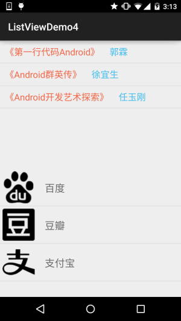

# 2.5.0 构建一个可复用的自定义BaseAdapter

> 来源: https://www.runoob.com/w3cnote/android-tutorial-customer-baseadapter.html

## 本节引言：

> 如题，本节给大家带来的是构建一个可复用的自定义BaseAdapter，我们每每涉及到ListView
> GridView等其他的Adapter控件，都需要自己另外写一个BaseAdapter类，这样显得非常麻烦，
> 又比如，我们想在一个界面显示两个ListView的话，我们也是需要些两个BaseAdapter...
> 这，程序员都是喜欢偷懒的哈，这节我们就来写一个可复用的自定义BaseAdapter类~

## 1.我们一点点开始改：

首先我们把上节写的自定义BaseAdapter贴下，等下我们就要对他进行升级改造

---

## 升级1：将Entity设置成泛型

好的，毕竟我们传递过来的Entitiy实体类可能千奇百怪，比如有Person，Book，Wether等，所以我们
将Entity设置成泛型，修改后的代码如下：

好的，上面我们做的事仅仅是将Data类型换成了泛型T！

## 升级2：ViewHolder类的升级改造：

> 我们先来看看前面我们的ViewHolder干了什么？
> 答：findViewById，设置控件状态；
> 下面我们想在完成这个基础上，将getView()方法大部分的逻辑写到ViewHolder类里，
> 这个ViewHolder要做的事：

> - 定义一个查找控件的方法，我们的思路是通过暴露公共的方法，调用方法时传递过来
> 控件id，以及设置的内容，比如TextView设置文本：
> public ViewHolder setText(int id, CharSequence text){文本设置}

> - 将convertView复用部分搬到这里，那就需要传递一个context对象了，我们把需要获取
> 的部分都写到构造方法中！

> - 写一堆设置方法(public)，比如设置文字大小颜色，图片背景等！

好的，接下来我们就来一步步改造我们的ViewHolder类

### 1）相关参数与构造方法：

---

### 2）绑定ViewHolder与Item

在上面的基础上我们再添加一个绑定的方法

### 3）根据id获取集合中保存的控件

### 4) 接着我们再定义一堆暴露出来的方法

好的，ViewHolder的改造升级完成~

---

## 升级3：定义一个抽象方法，完成ViewHolder与Data数据集的绑定

我们创建新的BaseAdapter的时候，实现这个方法就好，另外，别忘了把我们自定义
的BaseAdapter改成abstact抽象的！

## 升级4：修改getView()部分的内容

## 2.升级完毕，我们写代码来体验下：

我们要实现的效果图：

就是上面有两个列表，布局不一样，但是我只使用一个BaseAdapter类来完成上述效果！

关键代码如下：

**MainActivity.java**：

我们写的可复用的BaseAdapter的使用就如上面所述~

## 3.代码示例下载：

[ListViewDemo4.zip](/try/download/ListViewDemo4.zip)

贴下最后写好的MyAdapter类吧，可根据自己的需求进行扩展：

**MyAdapter.java**：

## 本节小结：

> 本节给大家介绍了如何来实现一个可供复用的BaseAdapter，当然大家可以在这个的基础上根据
> 自己的需求进行修改，比如通过异步设置网络图片等~改代码是参考鸿洋大神的视频写的：
> 视频链接：[Android-打造万能适配器](http://www.imooc.com/view/372)
> 另外，实际编写中遇到一些问题，非常感谢**Berial(B神)**的耐心点拨~
> ありがとうございます~

### 图片清单

1. 图1 -> images/93544748.png （原图：https://www.runoob.com/wp-content/uploads/2015/09/93544748.png）
2. 图2 -> images/19131609.jpg （原图：https://www.runoob.com/wp-content/uploads/2015/09/19131609.jpg）
