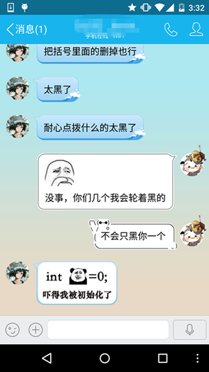
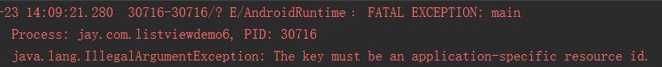
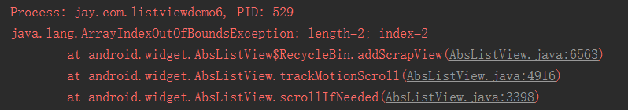

# 2.5.1 ListView Item多布局的实现

> 来源: https://www.runoob.com/w3cnote/android-tutorial-listview-item.html

## 本节引言：

> 本节是ListView这个小节的最后一节，给大家带来的是ListView多布局Item的实现，
> 何为ListView Item多布局，打个比方，QQ这种聊天列表：

> 

> 假如他是用一个ListView做的，那么一个ListView上不就有两种不同的Item咯！
> 一左一右，嘿嘿，本节就来教大家如何实现ListView的多布局！

## 1.要点讲解：

> 重写getItemViewType()方法对应View是哪个类别，以及getViewTypeCount()方法iew返回
> 总共多少个类别！然后再getView那里调用getItemViewType获得对应类别，再加载对应的View！

## 2.代码实现：

> 这里的话直接用上一节的两个布局，然后另外写一个Adapter重写要点中的几个几个地方：

**MutiLayoutAdapter.java**：

> 这里有个地方要注意的，convertView.setTag(R.id.Tag_APP,holder1);我们平时都直接
> setTag(Object)的，这个是setTag的重载方法，参数是一个唯一的key以及后面的一个对象！
> 唯一！！！我一开始直接把TYPE_BOOK作为第一个参数，然后就报下面这个错误：

> 

> **The key must be an application-specific resource id**
> 就是前面这个要唯一，定义一个final类型的int变量和硬编码一个值的方式都是行不通的
> 这里的做法是直接在strings.xml中添加：

> 当然你也可以在res/values/下另外创建一个ids.xml文件，把上面这段代码贴上去！
> 除了这个还有一个要注意的地方，就是这个区分类别的标志要从0开始算，不然会报下面
> 这样的错误：

> 

**MainActivity.java**：

上面随机生成0和1，0就往集合中添加一个Book的对象，1的话就添加一个App的对象！

## 3.代码下载：

[ListViewDemo6.zip](/try/download/ListViewDemo6.zip)

## 本节小结：

> 好的，本节给大家讲解了ListView Item多布局的实现，就是两个方法的重写，
> 然后getView()做下判断，设置不同的布局而已~代码非常简单~

> 关于ListView的知识就告一段落吧，当然ListView的知识并不止这些，
> 异步加载，优化等等，这些我们都会在进阶部分进行学习~就说这么多，谢谢~

### 图片清单

1. 图1 -> images/66837206.png （原图：https://www.runoob.com/wp-content/uploads/2015/09/66837206.png）
2. 图2 -> images/20351722.png （原图：https://www.runoob.com/wp-content/uploads/2015/09/20351722.png）
3. 图3 -> images/84591198.jpg （原图：https://www.runoob.com/wp-content/uploads/2015/09/84591198.jpg）
