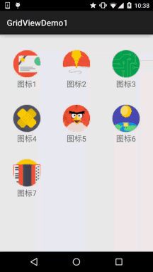

# 2.5.2 GridView(网格视图)的基本使用

> 来源: https://www.runoob.com/w3cnote/android-tutorial-gridview.html

## 本节引言：

> 本节给大家介绍的是第二个Adapter类的控件——GridView(网格视图)，见名知义，ListView是列表，
> GridView就是显示网格！他和ListView一样是AbsListView的子类！很多东西和ListView都是相通的，
> 本节我们就来学习他的基本用法~

## 1.相关属性：

下面是GridView中的一些属性：

> - **android:columnWidth**：设置列的宽度

> - **android:gravity**：组件对其方式

> - **android:horizontalSpacing**：水平方向每个单元格的间距

> - **android:verticalSpacing**：垂直方向每个单元格的间距

> - **android:numColumns**：设置列数

> - **android:stretchMode**：设置拉伸模式，可选值如下：
> **none**：不拉伸；**spacingWidth**：拉伸元素间的间隔空隙
> **columnWidth**：仅仅拉伸表格元素自身
> **spacingWidthUniform**：既拉元素间距又拉伸他们之间的间隔空袭

## 2.使用示例：

> 下面通过一个简单的例子来熟悉这个控件的使用：
> (这里用的Adapter我们直接用之2.5.0中教大家写的可复用的BaseAdapter~)

**实现的效果图**：

**代码实现**：

首先是GridView 的 Item的布局：**item_grid_icon.xml**:

接着我们写个entity实体类：**Icon.java**：

最后是MainActivity的布局以及Java代码

**activity_main.xml**：

**MainActivity.java**：

嗯，代码非常简单~

## 3.示例代码下载：

[GridViewDemo1.zip](//www.runoob.com/wp-content/uploads/2015/09/GridViewDemo1.zip)

## 本节小结：

> 本节给大家介绍了第二个需要使用Adapter的UI控件——网格视图GridView，用法很简单~
> 大家可以根据自己的需求进行扩展，比如用GridView显示手机相册~嗯，就说这么多，
> 谢谢~

### 图片清单

1. 图1 -> images/84467202.gif （原图：https://www.runoob.com/wp-content/uploads/2015/09/84467202.gif）
