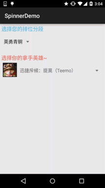

# 2.5.3 Spinner(列表选项框)的基本使用

> 来源: https://www.runoob.com/w3cnote/android-tutorial-spinner.html

## 本节引言：

> 本来本节是想给大家介绍一个Gallery(画廊)的一个控件的，后来想想还是算了，因为
> 在Android 4.1后就已经被弃用了，尽管我们可以通过兼容不来使用Gallery，不过想想
> 还是算了，因为Gallery在每次切换图片的时候，都需要重新创建视图，这样无疑会造成
> 很大资源浪费！我们可以通过其他方法来实现Gallery效果，比如通过HorizontalScrollView
> 来实现水平滚动效果，或者编写一个水平方向的ListView~有兴趣自己谷歌！

> 本节学习的是一个叫做Spinner的Adapter控件！
> 应用场景：当我们的app需要用户输入数据时，除了让用户自己打字以外，还有一种比较贴心的设计:
> 列出一组选项让用户从中挑选，从而方便了我们的用户！
> 话不多说，开始学习Spinner的基本用法~

## 1.相关属性

> - **android:dropDownHorizontalOffset**：设置列表框的水平偏移距离

> - **android:dropDownVerticalOffset**：设置列表框的水平竖直距离

> - **android:dropDownSelector**：列表框被选中时的背景

> - **android:dropDownWidth**：设置下拉列表框的宽度

> - **android:gravity**：设置里面组件的对其方式

> - **android:popupBackground**：设置列表框的背景

> - **android:prompt**：设置对话框模式的列表框的提示信息(标题)，只能够引用string.xml
> 中的资源id,而不能直接写字符串

> - **android:spinnerMode**：列表框的模式，有两个可选值：
> **dialog**：对话框风格的窗口 **dropdown**：下拉菜单风格的窗口(默认)

> - 可选属性：**android:entries**：使用数组资源设置下拉列表框的列表项目

## 2.使用示例：

> 对了，Spinner会默认选中第一个值，就是默认调用spinner.setSection(0),
> 你可以通过这个设置默认的选中值，另外，会触发一次OnItemSelectedListener
> 事件，暂时没找到解决方法，下面折衷的处理是：添加一个boolean值，然后设置
> 为false，在onItemSelected时进行判断，false说明是默认触发的，不做任何操作
> 将boolean值设置为true；true的话则正常触发事件！
> 示例中写了两个不同的Spinner，从数据源，列表框风格等进行对比~
> 接下来我们来看下

**效果图**：

**代码实现**：

这里依然使用的我们前面的可复用BaseAdapter：

第一个Spinner的数据源编写：

在**res/values**下编写一个：**myarrays.xml**的文件，内容如下：

接着是第二个Spinner的布局：**item_spin_hero.xml**：

再接着编写一个Entitiy实体类：**Hero.java**：

最后是MainActivity的布局与Java代码部分：

布局文件：**activity_main.xml**：

**MainActivity.java**：

另外关于Spinner的OnItemSelectedListener，以及如何获得选中项的值，就自己看上面的
代码啦~

## 3.代码示例下载：

[SpinnerDemo.zip](//www.runoob.com/wp-content/uploads/2015/09/SpinnerDemo.zip)

## 本节小结

> 好的，本节给大家介绍了Spinner(下拉选项框)的使用，例子还是蛮有趣的，哈哈~！
> 别问我哪个区什么段位，我可是人机小王子，可惜一直在青铜分段苦苦挣扎~
> 你知道为什么的，好吧，本节就到这里~

### 图片清单

1. 图1 -> images/58954250.gif （原图：https://www.runoob.com/wp-content/uploads/2015/09/58954250.gif）
2. 图2 -> images/18346945.gif （原图：https://www.runoob.com/wp-content/uploads/2015/09/18346945.gif）
