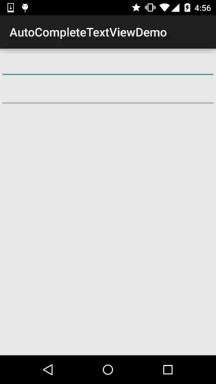

# 2.5.4 AutoCompleteTextView(自动完成文本框)的基本使用

> 来源: https://www.runoob.com/w3cnote/android-tutorial-autocompletetextview.html

## 本节引言：

> 本节继续来学习Adapter类的控件，这次带来的是AutoCompleteTextView(自动完成文本框)，
> 相信细心的你发现了，和Adapter搭边的控件，都可以自己定义item的样式，是吧！
> 或者说每个Item的布局~想怎么玩就怎么玩~嗯，话不多说，开始本节内容~
> 对了贴下官方API：[AutoCompleteTextView](http://androiddoc.qiniudn.com/reference/android/widget/AutoCompleteTextView.html)

## 1.相关属性：

> - **android:completionHint**：设置下拉菜单中的提示标题

> - **android:completionHintView**：定义提示视图中显示下拉菜单

> - **android:completionThreshold**：指定用户至少输入多少个字符才会显示提示

> - **android:dropDownAnchor**：设置下拉菜单的定位"锚点"组件，如果没有指定改属性，
> 将使用该TextView作为定位"锚点"组件

> - **android:dropDownHeight**：设置下拉菜单的高度

> - **android:dropDownWidth**：设置下拉菜单的宽度

> - **android:dropDownHorizontalOffset**：指定下拉菜单与文本之间的水平间距

> - **android:dropDownVerticalOffset**：指定下拉菜单与文本之间的竖直间距

> - **android:dropDownSelector**：设置下拉菜单点击效果

> - **android:popupBackground**：设置下拉菜单的背景

另外其实还有个**MultiAutoCompleteTextView**(多提示项的自动完成文本框)
和这个AutoCompleteTextView作用差不多，属性也一样，具体区别在哪里，
我们在下面的代码中来体验~另外这两个都是全词匹配的，比如，小猪猪：
你输入小->会提示小猪猪，但是输入猪猪->却不会提示小猪猪！

## 2.代码示例：

**运行效果图**：

**实现代码**：

这里的话就不自定义布局了，直接用ArrayAdapter来实现吧！

布局文件：**activity_main.xml**：

**MainActivity.java**：

**部分代码分析**：

> - android:completionThreshold="1"：这里我们设置了输入一个字就显示提示

> - android:completionHint="请输入搜索内容"：这是框框底部显示的文字，如果觉得丑
> 可以android:completionHintView设置一个View!

> - android:dropDownHorizontalOffset="5dp"：设置了水平边距为5dp

> - matv_content.setTokenizer(new MultiAutoCompleteTextView.CommaTokenizer());
> setTokenizer是为其设置分隔符

## 3.示例代码下载：

[AutoCompleteTextViewDemo.zip](//www.runoob.com/wp-content/uploads/2015/09/AutoCompleteTextViewDemo.zip)

## 本节小结：

> 本节给大家介绍了AutoCompleteTextView(自动完成文本框)，非常简单~
> 大家可根据实际开发需求自行拓展~好的，就说这么多，谢谢~

### 图片清单

1. 图1 -> images/89716801.jpg （原图：https://www.runoob.com/wp-content/uploads/2015/09/89716801.jpg）
