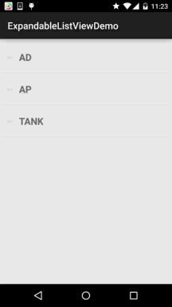

# 2.5.5 ExpandableListView(可折叠列表)的基本使用

> 来源: https://www.runoob.com/w3cnote/android-tutorial-expandablelistview.html

## 本节引言：

> 本节要讲解的Adapter类控件是ExpandableListView，就是可折叠的列表，它是ListView的子类，
> 在ListView的基础上它把应用中的列表项分为几组，每组里又可包含多个列表项。至于样子，
> 类似于QQ联系人列表，他的用法与ListView非常相似，只是ExpandableListVivew显示的列表项
> 需由ExpandableAdapter提供。 下面我们来学习这个控件的基本使用！
> 官方API：[ExpandableListView](http://androiddoc.qiniudn.com/reference/android/widget/ExpandableListView.html)

## 1.相关属性

> - **android:childDivider**：指定各组内子类表项之间的分隔条，图片不会完全显示，
> 分离子列表项的是一条直线

> - **android:childIndicator**：显示在子列表旁边的Drawable对象，可以是一个图像

> - **android:childIndicatorEnd**：子列表项指示符的结束约束位置

> - **android:childIndicatorLeft**：子列表项指示符的左边约束位置

> - **android:childIndicatorRight**：子列表项指示符的右边约束位置

> - **android:childIndicatorStart**：子列表项指示符的开始约束位置

> - **android:groupIndicator**：显示在组列表旁边的Drawable对象，可以是一个图像

> - **android:indicatorEnd**：组列表项指示器的结束约束位置

> - **android:indicatorLeft**：组列表项指示器的左边约束位置

> - **android:indicatorRight**：组列表项指示器的右边约束位置

> - **android:indicatorStart**：组列表项指示器的开始约束位置

## 2.实现ExpandableAdapter的三种方式

> **1.** 扩展**BaseExpandableListAdpter**实现ExpandableAdapter。

> **2.** 使用**SimpleExpandableListAdpater**将两个List集合包装成ExpandableAdapter

> **3.** 使用**simpleCursorTreeAdapter**将Cursor中的数据包装成SimpleCuroTreeAdapter
> 本节示例使用的是第一个，扩展BaseExpandableListAdpter，我们需要重写该类中的相关方法，
> 下面我们通过一个代码示例来体验下！

## 3.代码示例

我们来看下实现的**效果图**：

下面我们就来实现上图的这个效果：

核心是重写**BaseExpandableListAdpter**，其实和之前写的普通的BaseAdapter是类似的，
但是BaseExpandableListAdpter则分成了两部分：组和子列表，具体看代码你就知道了！

另外，有一点要注意的是，重写**isChildSelectable()**方法需要返回true，不然不会触发
子Item的点击事件！下面我们来写写：

首先是组和子列表的布局：

**item_exlist_group.xml**：

**item_exlist_item.xml**：

然后是自定义的Adapter类：

**MyBaseExpandableListAdapter.java**：

PS：存储子列表的数据不一定要用ArrayList<ArrayList>这种，根据自己的需求
定义~

最后是MainActivity的布局以及Java代码：

布局文件:**activity_main.xml**：

**MainActivity.java**：

## 4.代码下载：

[ExpandableListViewDemo.zip](//www.runoob.com/wp-content/uploads/2015/09/ExpandableListViewDemo.zip)

## 本节小结：

> 好的，本节给大家介绍了ExpandableListView的基本使用，嘿嘿，有点意思~
> 这里只是一个示例，其他的根据自己的需求自行扩展~谢谢

### 图片清单

1. 图1 -> images/25017651.jpg （原图：https://www.runoob.com/wp-content/uploads/2015/09/25017651.jpg）
