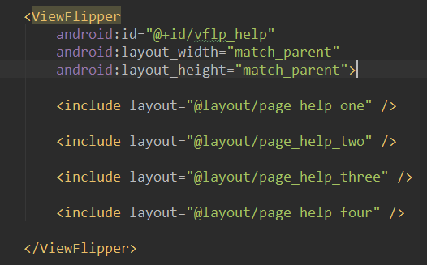
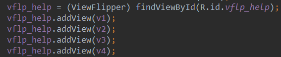
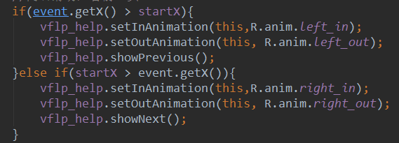
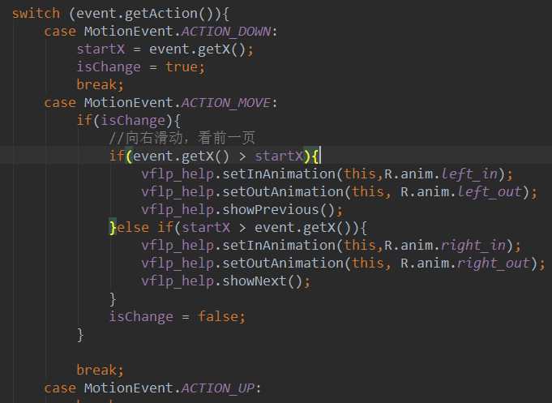

# 2.5.6 ViewFlipper(翻转视图)的基本使用

> 来源: https://www.runoob.com/w3cnote/android-tutorial-viewflipper.html

## 本节引言：

> 本节给大家带了的是ViewFlipper，它是Android自带的一个多页面管理控件，且可以自动播放！
> 和ViewPager不同，ViewPager是一页页的，而ViewFlipper则是一层层的，和ViewPager一样，很多时候，
> 用来实现进入应用后的引导页，或者用于图片轮播，本节我们就使用ViewFlipper写一个简单的图片
> 轮播的例子吧~官方API：[ViewFlipper](http://androiddoc.qiniudn.com/reference/android/widget/ViewFlipper.html)

## 1.为ViewFlipper加入View的两种方法

### 1）静态导入

> 所谓的静态导入就是像图中这样，把个个页面添加到ViewFlipper的中间！

### 2）动态导入

> 通过addView方法填充View

## 2.常用的一些方法

> - **setInAnimation**：设置View进入屏幕时使用的动画

> - **setOutAnimation**：设置View退出屏幕时使用的动画

> - **showNext**：调用该方法来显示ViewFlipper里的下一个View

> - **showPrevious**：调用该方法来显示ViewFlipper的上一个View

> - **setFilpInterval**：设置View之间切换的时间间隔

> - **setFlipping**：使用上面设置的时间间隔来开始切换所有的View，切换会循环进行

> - **stopFlipping**：停止View切换

## 3.使用实例

### 1）示例1：使用ViewFlipper实现图片轮播(静态导入)

**实现效果图**：

**实现代码**：

每个页面的布局都是一个简单的ImageView，这里就不贴了~先贴下两个进入以及
离开的动画：

**right_in.xml**：

**right_out.xml**：

然后是**activity_main.xml**布局文件：

这里我们设置了flipInterval = 3000，即每隔3000ms切还一个~
最后我们只需在MainActivity.java中调用ViewFlipper的startFlipping()方法开始滑动！

**MainActivity.java：**

### 2）示例2：支持手势滑动的ViewFlipper(动态导入)

**实现效果图**：

**代码实现**：

因为我们分为进入上一页，进入下一页，所以除了上面的两个动画外，我们再添加两个动画：

**left_in.xml**：

**left_out.xml**：

**MainActivity.java**：

**代码要点解析**：

> 1.这里我们通过动态的方法添加View，这里只是简单的ImageView，可根据自己需求进行扩展！
> 2.相信细心的你发现了，这里我们的手势用的不是通过onTouchEvent直接判断的，然后重写
> onTouch事件，对Action进行判断，然后如果是MotionEvent.ACTION_MOVE的话，就执行下述代码：

> 

> 后来发现，模拟器上因为是鼠标的关系，并不会频繁的抖动，而真机上，因为手指一直是颤抖的
> 所以ACTION_MOVE会一直触发，然后View一直切换，后来考虑了**Berial(B神)**的建议，加入了
> 一个值来进行判断，就是添加一个标志：

> 

> 可以是可以，不过感觉还是有点不流畅，怪怪的，后来想想还是用手势类，直接在onFling处理
> 就好，于是就有了上面的代码，运行起来杠杠滴~
> 当然，如果你对Gesture手势不熟悉的话，可以参见之前写过的一篇文章：
> [Android基础入门教程——3.8 Gesture(手势)](/w3cnote/android-tutorial-gestures.html)

## 4.代码示例下载

[ViewFlipperDemo.zip](//www.runoob.com/wp-content/uploads/2015/09/ViewFlipperDemo.zip)

[ViewFlipperDemo2.zip](//www.runoob.com/wp-content/uploads/2015/09/ViewFlipperDemo2.zip)

## 本节小结：

> 好的，本节给大家讲解了ViewFlipper(翻转视图)的基本使用，以后做图片轮播和引导页，
> 你就多了一个选择了~嗯，就说这么多，谢谢~

### 图片清单

1. 图1 -> images/34232946.jpg （原图：https://www.runoob.com/wp-content/uploads/2015/09/34232946.jpg）
2. 图2 -> images/13235519.jpg （原图：https://www.runoob.com/wp-content/uploads/2015/09/13235519.jpg）
3. 图3 -> images/9413188.jpg （原图：https://www.runoob.com/wp-content/uploads/2015/09/9413188.jpg）
4. 图4 -> images/36561030.jpg （原图：https://www.runoob.com/wp-content/uploads/2015/09/36561030.jpg）
5. 图5 -> images/17714212.jpg （原图：https://www.runoob.com/wp-content/uploads/2015/09/17714212.jpg）
6. 图6 -> images/10967568.jpg （原图：https://www.runoob.com/wp-content/uploads/2015/09/10967568.jpg）
