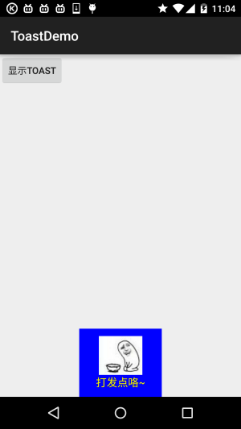
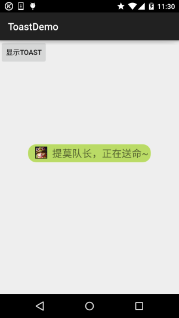

# 2.5.7 Toast(吐司)的基本使用

> 来源: https://www.runoob.com/w3cnote/android-tutorial-toast.html

## 本节引言：

> 好的，终于学习完Adapter类相关的一些控件，当然除了讲解的那几个，还有其他很多的
> 相关的控件，就不慢慢讲解了~有需要的自行查阅文档，查看相关的用法，本节带来的是：
> Android用于提示信息的一个控件——Toast(吐司)！Toast是一种很方便的消息提示框,会在
> 屏幕中显示一个消息提示框,没任何按钮,也不会获得焦点一段时间过后自动消失！
> 非常常用！本节我们就来学习Toast的使用！

## 1.直接调用Toast类的makeText()方法创建

这是我们用的最多的一种形式了！比如点击一个按钮，然后弹出Toast，用法：
 **Toast.makeText(MainActivity.this, "提示的内容", Toast.LENGTH_LONG).show();**
第一个是上下文对象！对二个是显示的内容！第三个是显示的时间，只有LONG和SHORT两种
会生效，即时你定义了其他的值，最后调用的还是这两个！

另外Toast是非常常用的，我们可以把这些公共的部分抽取出来，写到一个方法里！
需要显示Toast的时候直接调用这个方法就可以显示Toast，这样方便很多！
示例如下：

>

上面这个抽取出来的方法，我们发现我们可以调用setGravity设置Toast显示的位置以及获得
通过findViewById(android.R.id.message)获得显示的文本，然后进行设置颜色，或者大小等！
这就是第二种通过构造方法来定制Toast!

## 2.通过构造方法来定制Toast：

上面定制了文本，以及显示位置，下面我们写两个简单的例子：

### 1.定义一个带有图片的Toast

**效果图**：

**关键代码**：

### 2.Toast完全自定义

> 如果上面的那种还满足不了你的话，那么你完全可以自己写一个Toast的布局，然后显示出来；
> 但是时间我们依旧控制不了！

**运行效果图**：

**关键代码**：

还有自定义Toast的布局以及圆角背景：

圆角背景：**bg_toast.xml**：

布局文件：**view_toast_custom.xml**：

非常简单，嘿嘿~

## 3.示例代码下载

[ToastDemo.zip](//www.runoob.com/wp-content/uploads/2015/09/ToastDemo.zip)

## 本节小结：

好的，本节给大家讲解了Toast的基本使用，以及如何自定义Toast，非常简单，大家可以在实际开发中对自己的Toast进行定制~

### 图片清单

1. 图1 -> images/99355199.jpg （原图：https://www.runoob.com/wp-content/uploads/2015/09/99355199.jpg）
2. 图2 -> images/50636680.jpg （原图：https://www.runoob.com/wp-content/uploads/2015/09/50636680.jpg）
