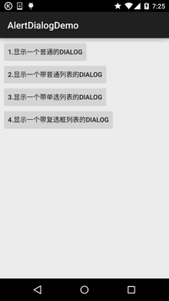
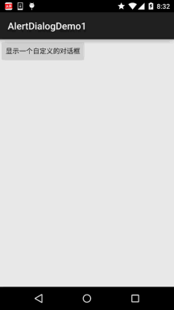

# 2.5.9 AlertDialog(对话框)详解

> 来源: https://www.runoob.com/w3cnote/android-tutorial-alertdialog.html

## 本节引言：

> 本节继续给大家带来是显示提示信息的第三个控件AlertDialog(对话框)，同时它也是其他
> Dialog的的父类！比如ProgressDialog，TimePickerDialog等，而AlertDialog的父类是：Dialog！
> 另外，不像前面学习的Toast和Notification，AlertDialog并不能直接new出来，如果你打开
> AlertDialog的源码，会发现构造方法是protected的，如果我们要创建AlertDialog的话，我们
> 需要使用到该类中的一个静态内部类：public static class **Builder**，然后来调用AlertDialog
> 里的相关方法，来对AlertDialog进行定制，最后调用show()方法来显示我们的AlertDialog对话框！
> 好的，下面我们就来学习AlertDialog的基本用法，以及定制我们的AlertDialog！
> 官方文档：[AlertDialog](http://androiddoc.qiniudn.com/reference/android/app/AlertDialog.html)

## 1.基本使用流程

> - **Step 1**：创建**AlertDialog.Builder**对象；

> - **Step 2**：调用**setIcon()**设置图标，**setTitle()**或**setCustomTitle()**设置标题；

> - **Step 3**：设置对话框的内容：**setMessage()**还有其他方法来指定显示的内容；

> - **Step 4**：调用**setPositive/Negative/NeutralButton()**设置：确定，取消，中立按钮；

> - **Step 5**：调用**create()**方法创建这个对象，再调用**show()**方法将对话框显示出来；

## 2.几种常用的对话框使用示例

**运行效果图：**

**核心代码**：

**MainActivity.java**：

布局就是四个简单的按钮，这里就不贴出来了，用法非常简单~无非就是创建一个Builder对象后，
进行相关设置，然后create()生成一个AlertDialog对象，最后调用show()方法将AlertDialog
显示出来而已！另外，细心的你可能发现我们点击对话框的外部区域，对话框就会消失，我们
可以为builder设置**setCancelable(false)**即可解决这个问题！

## 3.通过Builder的setView()定制显示的AlertDialog

> 我们可以自定义一个与系统对话框不同的布局，然后调用setView()将我们的布局加载到
> AlertDialog上，上面我们来实现这个效果：

**运行效果图**：

**关键代码**：

首先是两种不同按钮的selctor的drawable文件：

**btn_selctor_exit.xml**：

**btn_selctor_choose.xml**：

接着是自定义的Dialog布局：**view_dialog_custom.xml**：

最后是**MainActivity.java**：

## 4.示例代码下载

[AlertDialogDemo.zip](//www.runoob.com/wp-content/uploads/2015/09/AlertDialogDemo.zip)

[AlertDialogDemo1.zip](//www.runoob.com/wp-content/uploads/2015/09/AlertDialogDemo1.zip)

## 本节小结：

好的，本节给大家介绍了一下AlertDialog的基本使用，写了几个调用AlertDialog的例子，
最后还通过setView方法自定义了一下我们的AlertDialog！是不是还意犹未尽呢？但这说不上
真正的自定义控件，我们把自定义控件放到进阶系列，到时后会有个专题来和大家探讨
下自定义控件~敬请期待~就说这么多，谢谢~

### 图片清单

1. 图1 -> images/79141888.jpg （原图：https://www.runoob.com/wp-content/uploads/2015/09/79141888.jpg）
2. 图2 -> images/15294953.jpg （原图：https://www.runoob.com/wp-content/uploads/2015/09/15294953.jpg）
