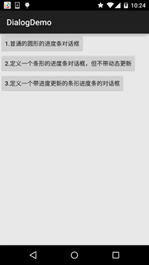
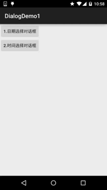

# 2.6.0 其他几种常用对话框基本使用

> 来源: https://www.runoob.com/w3cnote/android-tutorial-dialog.html

## 本节引言：

> 上节我们对Dialog的父类：AlertDialog进行了学习，而本节我们来学习下几个常用的
> Dialog的基本使用，他们分别是：ProgressDialog(进度条对话框)，DatePickerDialog
> (日期选择对话框)和TimePickerDialog(时间选择对话框)~，话不多说，开始本节内容~

## 1.ProgressDialog(进度条对话框)的基本使用

> 我们创建进度条对话框的方式有两种：

> - **1**.直接调用ProgressDialog提供的静态方法show()显示

> - **2**.创建ProgressDialog,再设置对话框的参数,最后show()出来

**代码示例**：

**运行效果图**：

**关键实现代码**：

**MainActivity.java**：

代码比较简单，而关于Progress的东西我们已经在前面学习过了，这里就不啰嗦了~

## 2.DatePickerDialog(日期选择对话框)与TimePickerDialog(时间选择对话框)

> 先要说明一点：
> Date/TimePickerDialog只是供用户来选择日期时间,对于android系统的系统时间,
> 日期没有任何影响,google暂时没有公布系统日期时间设置的API,
> 如果要在app中设置的话,要重新编译android的系统源码，非常麻烦！

> 他们两个的构造方法非常相似：
> **DatePickerDialog**(上下文；DatePickerDialog.OnDateSetListener()监听器；年；月；日)
> **TimePickerDialog**(上下文；TimePickerDialog.OnTimeSetListener()监听器；小时，分钟，是否采用24小时制)

**代码示例**：

**运行效果图**：

**关键实现代码**：

**MainActivity.java**：

代码同样很简单，就不解释了~

## 3.代码下载：

[DialogDemo.zip](//www.runoob.com/wp-content/uploads/2015/10/DialogDemo.zip)

[DialogDemo1.zip](//www.runoob.com/wp-content/uploads/2015/10/DialogDemo1.zip)

## 本节小结：

> 好的，本节介绍了三个常用的Dialog，相比起以前的4.x的版本，5.0的这些原生控件，
> 显然要好看得多~就说这么多，谢谢~

### 图片清单

1. 图1 -> images/1735732.jpg （原图：https://www.runoob.com/wp-content/uploads/2015/10/1735732.jpg）
2. 图2 -> images/47542561.jpg （原图：https://www.runoob.com/wp-content/uploads/2015/10/47542561.jpg）
