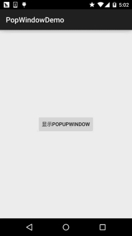

# 2.6.1 PopupWindow(悬浮框)的基本使用

> 来源: https://www.runoob.com/w3cnote/android-tutorial-popupwindow.html

## 本节引言：

> 本节给大家带来的是最后一个用于显示信息的UI控件——PopupWindow(悬浮框)，如果你想知道
> 他长什么样子，你可以打开你手机的QQ，长按列表中的某项，这个时候后弹出一个黑色的小
> 对话框，这种就是PopupWindow了，和AlertDialog对话框不同的是，他的位置可以是随意的；

> 另外AlertDialog是非堵塞线程的，而PopupWindow则是堵塞线程的！而官方有这样一句话来介绍
> PopupWindow：

> **A popup window that can be used to display an arbitrary view. The popup window is**

> **a floating container that appears on top of the current activity.**

> 大概意思是：一个弹出窗口控件，可以用来显示任意View，而且会浮动在当前activity的顶部

> 下面我们就来对这个控件进行学习~

> 官方文档：[PopupWindow](http://androiddoc.qiniudn.com/reference/android/widget/PopupWindow.html)

## 1.相关方法解读

### 1）几个常用的构造方法

> 我们在文档中可以看到，提供给我们的PopupWindow的构造方法有九种之多，这里只贴实际
> 开发中用得较多的几个构造方法：

> - **public PopupWindow (Context context)**

> - **public PopupWindow(View contentView, int width, int height)**

> - **public PopupWindow(View contentView)**

> - **public PopupWindow(View contentView, int width, int height, boolean focusable)**

> 参数就不用多解释了吧，contentView是PopupWindow显示的View，focusable是否显示焦点

### 2）常用的一些方法

> 下面介绍几个用得较多的一些方法，其他的可自行查阅文档：

> - **setContentView**(View contentView)：设置PopupWindow显示的View

> - **getContentView**()：获得PopupWindow显示的View

> - **showAsDropDown(View anchor)**：相对某个控件的位置（正左下方），无偏移

> - **showAsDropDown(View anchor, int xoff, int yoff)**：相对某个控件的位置，有偏移

> - **showAtLocation(View parent, int gravity, int x, int y)**：
> 相对于父控件的位置（例如正中央Gravity.CENTER，下方Gravity.BOTTOM等），可以设置偏移或无偏移
> PS:parent这个参数只要是activity中的view就可以了！

> - **setWidth/setHeight**：设置宽高，也可以在构造方法那里指定好宽高，
> 除了可以写具体的值，还可以用WRAP_CONTENT或MATCH_PARENT，
> popupWindow的width和height属性直接和第一层View相对应。

> - **setFocusable(true)**：设置焦点，PopupWindow弹出后，所有的触屏和物理按键都由PopupWindows
> 处理。其他任何事件的响应都必须发生在PopupWindow消失之后，（home 等系统层面的事件除外）。
> 比如这样一个PopupWindow出现的时候，按back键首先是让PopupWindow消失，第二次按才是退出
> activity，准确的说是想退出activity你得首先让PopupWindow消失，因为不并是任何情况下按back PopupWindow都会消失，必须在PopupWindow设置了背景的情况下 。

> - **setAnimationStyle(int)：**设置动画效果

## 2.使用代码示例

**运行效果图**：

**实现关键代码**：

先贴下动画文件：**anim_pop.xml**：

接着是popupWindow的布局：**item_popip.xml**：

**MainActivity.java**：

## 3.示例代码下载

[PopWindowDemo.zip](//www.runoob.com/wp-content/uploads/2015/10/PopWindowDemo.zip)

## 本节小结：

> 时间关系，并没有想到好一点的示例，就写了一个简单的demo，应该能满足简单的需要，另外
> 如果想深入研究下PopupWindow的话可看下述的参考文献：
> [Android PopupWindow的使用和分析](http://www.cnblogs.com/mengdd/p/3569127.html)
> [Android PopupWindow详解](http://www.jcodecraeer.com/a/anzhuokaifa/androidkaifa/2014/0702/1627.html)
> 嗯，就说这么多，谢谢~

### 图片清单

1. 图1 -> images/43925301.jpg （原图：https://www.runoob.com/wp-content/uploads/2015/10/43925301.jpg）
