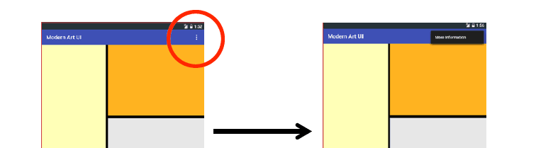

# 2.6.2 菜单(Menu)

> 来源: https://www.runoob.com/w3cnote/android-tutorial-menu.html

## 本节引言：

> 本章给大家带来的是Android中的Menu(菜单)，而在Android中的菜单有如下几种：

> - **OptionMenu**：选项菜单，android中最常见的菜单，通过Menu键来调用

> - **SubMenu**：子菜单，android中点击子菜单将弹出一个显示子菜单项的悬浮框，
> 子菜单不支持嵌套，即不能包括其他子菜单

> - **ContextMenu**：上下文菜单，通过长按某个视图组件后出现的菜单，该组件需注册上下文菜单
> 本节我们来依依学习这几种菜单的用法~
> PS：官方文档：[menus](http://androiddoc.qiniudn.com/guide/topics/ui/menus.html)

## 1.OptionMenu(选项菜单)

### 1）如何使用OptionMenu？

> 答：非常简单，重写两个方法就好，其实这两个方法我们在创建项目的时候就会自动生成~
> 他们分别是：

> - public boolean **onCreateOptionsMenu**(Menu menu)：调用OptionMenu，在这里完成菜单初始化

> - public boolean **onOptionsItemSelected**(MenuItem item)：菜单项被选中时触发，这里完成事件处理

> 当然除了上面这两个方法我们可以重写外我们还可以重写这三个方法：

> - public void **onOptionsMenuClosed**(Menu menu)：菜单关闭会调用该方法

> - public boolean **onPrepareOptionsMenu**(Menu menu)：选项菜单显示前会调用该方法，
> 可在这里进行菜单的调整(动态加载菜单列表)

> - public boolean **onMenuOpened**(int featureId, Menu menu)：选项菜单打开以后会调用这个方法

而加载菜单的方式有两种，一种是直接通过编写菜单XML文件，然后调用：
**getMenuInflater().inflate(R.menu.menu_main, menu);**加载菜单
或者通过代码动态添加，onCreateOptionsMenu的参数menu，调用add方法添加
菜单，add(菜单项的组号，ID，排序号，标题)，另外如果排序号是按添加顺序排序的话都填0即可！

### 2）使用示例：

**运行效果图**：

**代码实现**：

**MainActivity.java**：

**代码分析**：

上述的代码非常简单，给大家演示了Android 5.0的中OptionMenu(选项菜单)中动态添加菜单，
以及事件处理，根据id判断用户点击的是哪一项，然后执行对应的操作！
另外，有一点要注意的是，选项菜单经过了三个阶段的过渡：
在Android 2.3.x或者更低版本，因为该阶段大部分的机型都是带有Menu键的，
此阶段通过点击Menu键弹出菜单：

而在Android 3.0或者更高的版本，则是通过3.0引入的ActionBar中的setting菜单：

而在5.0以上的版本则是在ToolBar中的，点击后出一个溢出式的菜单样式

另外通过XML方式定义Menu的方式，我们贴个简单的参考代码：

其他的自行查阅文档哈~

## 2.ContextMenu(上下文菜单)

> 一开始我们就说了，长按某个View后出现的菜单，我们需要为这个View注册上下文菜单！

### 1）如何使用ContextMenu？

> 答：使用的流程如下：

> - **Step 1**：重写onCreateContextMenu()方法

> - **Step 2**：为view组件注册上下文菜单，使用registerForContextMenu()方法,参数是View

> - **Step 3**：重写onContextItemSelected()方法为菜单项指定事件监听器

上面的OptionMenu我们使用了Java代码的方法来完成菜单项的添加，这里我们就用XML文件的
方式来生成我们的CotnextMenu吧，另外关于使用Java代码来生成菜单还是使用XML来生成菜单，
建议使用后者来定义菜单，这样可以减少Java代码的代码臃肿，而且不用每次都用代码分配
id，只需修改XML文件即可修改菜单的内容，这样在一定程度上位程序提供的了更好的解耦，
低耦合，高内聚，是吧~

### 2）使用示例：

**运行效果图**：

**实现代码**：

我们先来编写选项菜单的菜单XML文件：

**menu_context.xml**：

接着我们在选项菜单的那个基础上，添加一个TextView，然后加上下面一些东西：

好的，就是那么简单~可以为多个View设置上下文，switch(v.getId)你懂的~
另外，和等下要讲的子菜单一样，上下文菜单都无法显示图标！

---

## 3.SubMenu(子菜单)

所谓的子菜单只是在<**item**>中又嵌套了一层<**menu**>而已

### 代码示例：

**运行效果图**

：

**实现代码:**

编写子菜单的Menu文件：menu_sub.xml：

接着我们改下上面上下文菜单的两个方法的内容，换上下面的代码：

好的，灰常简单是吧，另外，如果你想在Java代码中添加子菜单的话，可以调用addSubMenu()

比如：SubMenu file = menu.addSubMenu("文件");file还需要addItem添加菜单项哦！

---

## 4.PopupMenu(弹出式菜单)

一个类似于PopupWindow的东东，他可以很方便的在指定View下显示一个弹出菜单，而且
他的菜单选项可以来自于Menu资源，下面我们写个简单的例子来使用下这个东东~

### 使用示例：

**运行效果图：**

**实现代码：**

菜单资源文件：menu_pop.xml：

在布局中添加一个按钮，然后添加点击事件：

**MainActivity.java**:

非常简单，新技能get了没？

## 5.示例代码下载

[MenuDemo1.zip](//www.runoob.com/wp-content/uploads/2015/10/MenuDemo1.zip)

## 本节小结：

> 好的，本节给大家介绍了Android中的三种菜单，选项菜单，上下文菜单以及子菜单，最后
> 还讲解了一个PopupMenu的控件，这里只演示了基本的用法，其他属性可自行查阅文档，
> 文档才是最好的老师~嗯，就说这么多，谢谢，对了今天国庆，祝大家国庆玩得开心！

### 图片清单

1. 图1 -> images/34719444.jpg （原图：https://www.runoob.com/wp-content/uploads/2015/10/34719444.jpg）
2. 图2 -> images/27063010.jpg （原图：https://www.runoob.com/wp-content/uploads/2015/10/27063010.jpg）
3. 图3 -> images/50909125.jpg （原图：https://www.runoob.com/wp-content/uploads/2015/10/50909125.jpg）
4. 图4 -> images/56154456.jpg （原图：https://www.runoob.com/wp-content/uploads/2015/10/56154456.jpg）
5. 图5 -> images/13834579.jpg （原图：https://www.runoob.com/wp-content/uploads/2015/10/13834579.jpg）
6. 图6 -> images/84191606.jpg （原图：https://www.runoob.com/wp-content/uploads/2015/10/84191606.jpg）
7. 图7 -> images/25073198.jpg （原图：https://www.runoob.com/wp-content/uploads/2015/10/25073198.jpg）
