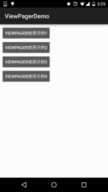
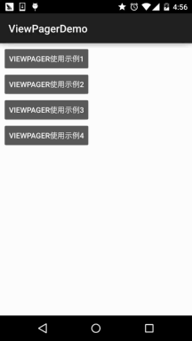
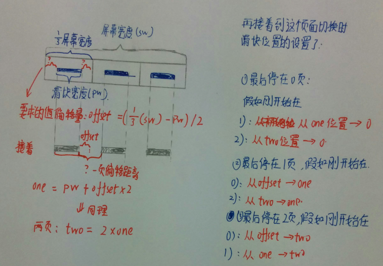

# 2.6.3 ViewPager的简单使用

> 来源: https://www.runoob.com/w3cnote/android-tutorial-viewpager.html

## 本节引言：

> 本节带来的是Android 3.0后引入的一个UI控件——ViewPager(视图滑动切换工具)，实在想不到
> 如何来称呼这个控件，他的大概功能：通过手势滑动可以完成View的切换，一般是用来做APP
> 的引导页或者实现图片轮播，因为是3.0后引入的，如果想在低版本下使用，就需要引入v4
> 兼容包哦~，我们也可以看到，ViewPager在：android.support.v4.view.ViewPager目录下~
> 下面我们就来学习一下这个控件的基本用法~
> 官方API文档：[ViewPager](http://androiddoc.qiniudn.com/reference/android/support/v4/view/ViewPager.html)

## 1.ViewPager的简单介绍

> ViewPager就是一个简单的页面切换组件，我们可以往里面填充多个View，然后我们可以左
> 右滑动，从而切换不同的View，我们可以通过setPageTransformer()方法为我们的ViewPager
> 设置切换时的动画效果，当然，动画我们还没学到，所以我们把为ViewPager设置动画
> 放到下一章绘图与动画来讲解！和前面学的ListView，GridView一样，我们也需要一个Adapter
> (适配器)将我们的View和ViewPager进行绑定，而ViewPager则有一个特定的Adapter——
> **PagerAdapter**！另外，Google官方是建议我们使用Fragment来填充ViewPager的，这样
> 可以更加方便的生成每个Page，以及管理每个Page的生命周期！给我们提供了两个Fragment
> 专用的Adapter：**FragmentPageAdapter**和**FragmentStatePagerAdapter**
> 我们简要的来分析下这两个Adapter的区别：

> - **FragmentPageAdapter**：和PagerAdapter一样，只会缓存当前的Fragment以及左边一个，右边
> 一个，即总共会缓存3个Fragment而已，假如有1，2，3，4四个页面：
> 处于1页面：缓存1，2
> 处于2页面：缓存1，2，3
> 处于3页面：销毁1页面，缓存2，3，4
> 处于4页面：销毁2页面，缓存3，4
> 更多页面的情况，依次类推~

> - **FragmentStatePagerAdapter**：当Fragment对用户不
> 见得时，整个Fragment会被销毁，
> 只会保存Fragment的状态！而在页面需要重新显示的时候，会生成新的页面！

> 综上，FragmentPageAdapter适合固定的页面较少的场合；而FragmentStatePagerAdapter则适合
> 于页面较多或者页面内容非常复杂(需占用大量内存)的情况！

## 2.PagerAdapter的使用

> 我们先来介绍最普通的PagerAdapter，如果想使用这个PagerAdapter需要重写下面的四个方法：
> 当然，这只是官方建议，实际上我们只需重写getCount()和isViewFromObject()就可以了~

> - **getCount()**:获得viewpager中有多少个view

> - **destroyItem()**:移除一个给定位置的页面。适配器有责任从容器中删除这个视图。
> 这是为了确保在finishUpdate(viewGroup)返回时视图能够被移除。

> 而另外两个方法则是涉及到一个key的东东：

> - **instantiateItem()**:
> ①将给定位置的view添加到ViewGroup(容器)中,创建并显示出来
> ②返回一个代表新增页面的Object(key),通常都是直接返回view本身就可以了,当然你也可以
> 自定义自己的key,但是key和每个view要一一对应的关系

> - **isViewFromObject()**:
> 判断instantiateItem(ViewGroup, int)函数所返回来的Key与一个页面视图是否是
> 代表的同一个视图(即它俩是否是对应的，对应的表示同一个View),通常我们直接写
> return view == object!

### 使用示例1：最简单用法

**运行效果图**：

**关键部分代码**：

好的，代码写起来也是非常简单的：首先是每个View的布局，一式三份，另外两个View一样：

**view_one.xml**：

然后编写一个自定义个的PagerAdapter：

**MyPagerAdapter.java**：

接着到Activity了，和以前学的ListView非常类似：

**OneActivity.java**：

好的，关键代码就上述部分，非常容易理解~

### 使用示例2：标题栏——PagerTitleStrip与PagerTabStrip

> 就是跟随着ViewPager滑动而滑动的标题咯，这两个是官方提供的，一个是普通文字，
> 一个是带有下划线，以及可以点击文字可切换页面，下面我们来写个简单的例子~

**运行效果图**：

**关键代码实现**：

这里两者的区别仅仅是布局不一样而已，其他的都一样：

**PagerTitleStrip**所在Activtiy的布局：
**activity_two.xml**：

而PagerTabStrip所在的布局：

**activity_three.xml**：

接下来的两者都一样了，我们先来编写一个自定义的PagerAdapter，除了前面重写的
四个方法外，我们需要另外重写一个方法：**getPageTitle**()，这个设置标题的~
代码如下：

**MyPagerAdapter2.java**：

最后是Activity部分，两个都是一样的：

**TwoActivity.java**：

好了，非常简单，有疑问的话，自己下demo看看就懂了~

### 使用示例3：ViewPager实现TabHost的效果：

> 当然，示例2很多时候，只是中看不中用，实际开发中我们可能需要自行定制这个标题栏，
> 下面我们就来写个简单的例子来实现TabHost的效果，如果你不知道TabHost是什么鬼的
> 话，那么，请看效果图！

**运行效果图**：

**实现逻辑解析**：

下面我们来讲解下实现上述效果的逻辑，然后贴代码：

> 首先是布局：顶部一个LinearLayout，包着三个TextView，weight属性都为1，然后下面跟着
> 一个滑块的ImageView，我们设置宽度为match_parent；最底下是我们的ViewPager，这里可能
> 有两个属性你并不认识，一个是：flipInterval：这个是指定View动画间的时间间隔的！
> 而persistentDrawingCache：则是设置控件的绘制缓存策略，可选值有四个：

> - 
> none：不在内存中保存绘图缓存；

> - animation:只保存动画绘图缓存；

> - 
> scrolling：只保存滚动效果绘图缓存；

> - all：所有的绘图缓存都应该保存在内存中；

> 可以同时用2个，animation|scrolling这样~

布局代码：**activity_four.xml**：

> 接着到我们的Activity了，我们来捋下思路：

> -

> **Step 1**：我们需要让我们的移动块在第一个文字下居中，那这里就要算一下偏移量：
> 先获得图片宽度pw，然后获取屏幕宽度sw，计算方法很简单：
> **offset(偏移量) = ((sw / 3)-pw) / 2** //屏幕宽/3 - 图片宽度，然后再除以2，左右嘛！
> 然后我么你调用setImageMatrix设置滑块当前的位置：
> 同时我们也把切换一页和两页，滑块的移动距离也算出来，很简单：
> **one = offset * 2 + pw;**
> **two = one * 2;**

> -

> **Step 2**：当我们滑动页面时，我们的滑块要进行移动，我们要为ViewPager添加一个
> OnPageChangeListener事件，我们需要对滑动后的页面来做一个判断，同时记录滑动前处于
> 哪个页面，下面自己画了个图，可能更容易理解吧！

PS:太久没写字，字很丑，能看清就好，字丑人美，哈哈~

嗯，如果还是不能理解的话，自己动手画画图就知道了，下面上代码：

**FourActvitiy.java**：

嗯，关于动画可能你并不熟悉，没事，下一章我们带大家一起扣~

## 3.ViewPager结合Fragment示例

> 嗯，在前面讲解Fragment的时候我们就讲解了一个使用示例：
> [Android基础入门教程——5.2.4 Fragment实例精讲——底部导航栏+ViewPager滑动切换页面](//www.runoob.com/w3cnote/android-tutorial-fragment-demo4.html)
> 这里就不再详述了，有兴趣的点下链接看看即可~

## 4.代码示例下载

[ViewPagerDemo.zip](//www.runoob.com/wp-content/uploads/2015/10/ViewPagerDemo.zip)

## 本节小结：

> 关于ViewPager，限于篇幅，有些地方并没有讲到，其他的大家需要自己查阅文档了~

> 另外，上面也说了，ViewPager的动画我们会在下一章讲解！好的，就说这么多~

> 嗯，国庆前曾说会在国庆假期里完成整个系列，结果一篇都没写，实在抱歉...
> 因为妹子过来玩了，So，你懂的~，会加快进度~，争取早日进阶！

### 图片清单

1. 图1 -> images/68392114.jpg （原图：https://www.runoob.com/wp-content/uploads/2015/10/68392114.jpg）
2. 图2 -> images/51098800.jpg （原图：https://www.runoob.com/wp-content/uploads/2015/10/51098800.jpg）
3. 图3 -> images/30797649.jpg （原图：https://www.runoob.com/wp-content/uploads/2015/10/30797649.jpg）
4. 图4 -> images/4848410.jpg （原图：https://www.runoob.com/wp-content/uploads/2015/10/4848410.jpg）
5. 图5 -> images/68984233.jpg （原图：https://www.runoob.com/wp-content/uploads/2015/10/68984233.jpg）
6. 图6 -> images/36983422.jpg （原图：https://www.runoob.com/wp-content/uploads/2015/10/36983422.jpg）
