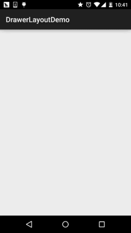
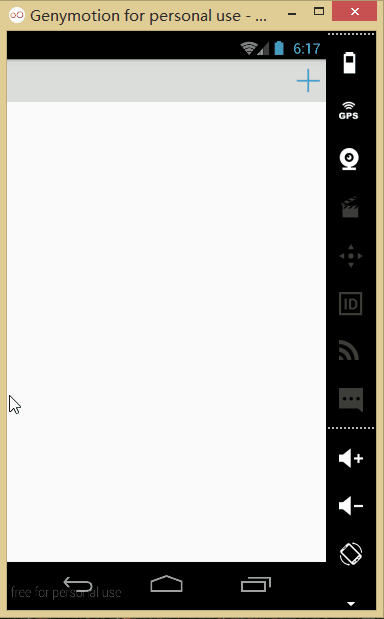

# 2.6.4 DrawerLayout(官方侧滑菜单)的简单使用

> 来源: https://www.runoob.com/w3cnote/android-tutorial-drawerlayout.html

## 本节引言：

> 本节给大家带来基础UI控件部分的最后一个控件：**DrawerLayout**，官方给我们提供的一个侧滑菜单
> 控件，和上一节的ViewPager一样，3.0以后引入，低版本使用它，需要v4兼容包，说到侧滑，相信
> 很多人都用过github上的SlidingMenu，不过好像有两个版本，一个是单独的，另一个需要依赖另一
> 个开源项目：ActionBarSherlock；既然Google为我们提供了这个控件，为何不用咧，而且在
> Material Design设计规范中，随处可见的很多侧滑菜单的动画效果，大都可以通过Toolbar +
> DrawerLayout来实现~，本节我们就来探究下这个DrawerLayout的一个基本用法~还有人喜欢把他
> 称为抽屉控件~官方文档：[DrawerLayout](http://androiddoc.qiniudn.com/reference/android/support/v4/widget/DrawerLayout.html)

## 1.使用的注意事项

> - **1**.主内容视图一定要是DrawerLayout的第一个子视图

> - **2**.主内容视图宽度和高度需要match_parent

> - **3**.必须显示指定侧滑视图的android:**layout_gravity属性**
> android:layout_gravity = "start"时，从左向右滑出菜单
> android:layout_gravity = "end"时，从右向左滑出菜单
> 不推荐使用left和right!!!

> - 侧滑视图的宽度以dp为单位，不建议超过**320dp**(为了总能看到一些主内容视图)

> - 设置侧滑事件：mDrawerLayout.setDrawerListener(DrawerLayout.DrawerListener);

> - 要说一点：可以结合Actionbar使用当用户点击Actionbar上的应用图标，弹出侧滑菜单！
> 这里就要通过**ActionBarDrawerToggle**，它是DrawerLayout.DrawerListener的具体实现类，
> 我们可以重写ActionBarDrawerToggle的onDrawerOpened()和onDrawerClosed()以监听抽屉拉出
> 或隐藏事件！但是这里我们不讲，因为5.0后我们使用的是Toolbar！有兴趣的可以自行查阅相关
> 文档！

## 2.使用代码示例

### 示例1：单个侧滑菜单的实现

**运行效果图**：

**实现关键代码**：

首先是我们的主布局，注意：最外层要是DrawerLayout哦！！！！

**activity_main.xml**：

接着ListView的布局代码和domain类：Item比较简单，就不给出了，直接上中间Fragment的
布局以及代码吧！另外Adapter直接复用我们之前写的那个可复用的MyAdapter！

**fg_content.xml**：

**ContentFragment.java**：

最后是我们的Activity类

**MainActivity.java**：

代码很简单，就不多说了~

### 示例2.左右两个侧滑菜单的实现

> 嗯，不知道你有没有发现，从上面的DrawerLayout的布局，我们大概可以猜到，DrawerLayout
> 最多由三个部分组成，中间的内容部分，左边的侧滑菜单部分，右边的侧滑菜单部分组成！
> 下面我们来写一个带有两个侧滑菜单的示例！

**运行效果图**：

**代码实现**：

首先我们创建两个Fragment以及对应的布局，他们分别是左右侧滑菜单！

**左边Fragment**：

布局：**fg_left.xml**，这里就用了一个图片而以，点击后弹出一个新的Activity；
当然你可以根据自己的需求进行扩展！

对应的**LeftFragment.java**：

**右面的Fragment**：

布局就三个按钮，点击后替换中间部分的Fragment，布局**fg_right.xml**代码如下：

然后对应的是**RightFragment.java**：

另外还有一个中间部分填充的ContentFragment，布局：**fg_content.xml**如下：

**ContentFragment.java**：

编写好以后，就到我们的Activity的布局了以及Activity的代码了：
在此之前我们还需要些一个顶部条形栏的布局：

**view_topbar.xml**：

然后是**activity_main.xml**：

最后是**MainActivity.java**：

好的，至此就大功告成了~，呼呼，下面说下看代码时可能会有的疑惑：

> - **1**. drawer_layout.**openDrawer**(Gravity.END);
> 这句是设置打开的哪个菜单START代表左边，END代表右边

> - **2**. drawer_layout.setDrawerLockMode(DrawerLayout.LOCK_MODE_LOCKED_CLOSED,Gravity.END);
> 锁定右面的侧滑菜单，不能通过手势关闭或者打开，只能通过代码打开！即调用openDrawer方法！
> 接着 drawer_layout.setDrawerLockMode(DrawerLayout.LOCK_MODE_UNLOCKED,Gravity.END);
> 解除锁定状态，即可以通过手势关闭侧滑菜单
> 最后在drawer关闭的时候调用：
> drawer_layout.setDrawerLockMode(DrawerLayout.LOCK_MODE_LOCKED_CLOSED, Gravity.END);
> 再次锁定右边的侧滑菜单！

> - **3**. 布局代码中的Tag属性的作用？
> 答：这里没用到，在重写DrawerListener的onDrawerSlide方法时，我们可以通过他的第一个
> 参数drawerView，调用drawerView.getTag().equals("START")判断触发菜单事件的是哪个
> 菜单！然后可以进行对应的操作！

## 3.代码示例下载

[DrawerLayoutDemo.zip](//www.runoob.com/wp-content/uploads/2015/10/DrawerLayoutDemo.zip)

[DrawerLayoutDemo2.zip](//www.runoob.com/wp-content/uploads/2015/10/DrawerLayoutDemo2.zip)

## 本节小结：

> 好的，本节给大家介绍了官方的侧滑控件DrawerLayout的基本用法，使用起来非常的方便！
> 当然这里仅仅是简单的使用演示，另外看到弘扬大神写过一篇：
> [Android DrawerLayout 高仿QQ5.2双向侧滑菜单](http://blog.csdn.net/lmj623565791/article/details/41531475)
> 有兴趣可以看看，如果看完本节的内容，相信你看起来不会怎么吃力~好的！

> 本节就到这里，跟UI控件这一章说拜拜了~下一章我们开始绘图与动画了，
> 为我们进阶部分的自定义控件系列打基础！

### 图片清单

1. 图1 -> images/1320603.jpg （原图：https://www.runoob.com/wp-content/uploads/2015/10/1320603.jpg）
2. 图2 -> images/81185966.jpg （原图：https://www.runoob.com/wp-content/uploads/2015/10/81185966.jpg）
3. 图3 -> images/92539020.jpg （原图：https://www.runoob.com/wp-content/uploads/2015/10/92539020.jpg）
