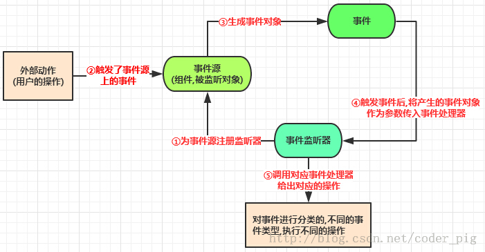
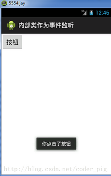
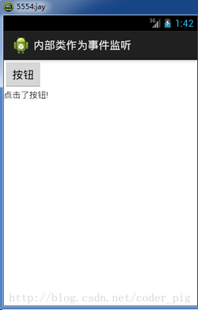

# 3.1.1 基于监听的事件处理机制

> 来源: https://www.runoob.com/w3cnote/android-tutorial-listen-event-handle.html

## 本节引言：

> 第二章我们学习的是Android的UI控件，我们可以利用这些控件构成一个精美的界面，但是仅仅是界面而已；下一步就要开始学习逻辑与业务实现了，本章节讲解的是Android的事件处理机制！何为事件处理机制？举个
> 简单的例子，比如点击一个按钮，我们向服务器发送登陆请求！当然，Android中的事件处理机制不止这一种，
> 比如屏幕发生选择，我们点击了屏幕上某个区域...简单点说，事件处理机制就是我们和UI发生交互时，我们在背后添加一些小动作而已！本节我们来介绍使用的最频繁的一种：基于监听的事件处理机制！

## 1.基于监听的时间处理机制模型:

**流程模型图：**

**文字表述：**

> 事件监听机制中由**事件源**，**事件**，**事件监听器**三类对象组成
> 处理流程如下:
> **Step 1:**为某个事件源(组件)设置一个监听器,用于监听用户操作
> **Step 2:**用户的操作,触发了事件源的监听器
> **Step 3:**生成了对应的事件对象
> **Step 4:**将这个事件源对象作为参数传给事件监听器
> **step 5:**事件监听器对事件对象进行判断,执行对应的事件处理器(对应事件的处理方法)

**归纳：**

> 事件监听机制是一种委派式的事件处理机制,事件源(组件)事件处理委托给事件监听器
> 当事件源发生指定事件时,就通知指定事件监听器,执行相应的操作

## 2.五种不同的使用形式：

我们以下面这个：
**简单的按钮点击,提示Toast信息的程序；**使用五种不同的形式来实现！

**效果图：**

### 1）直接用匿名内部类

> 平时最常用的一种:直接setXxxListener后,重写里面的方法即可;
> 通常是临时使用一次,复用性不高！

实现代码如下：**MainAcivity.java:**

### 2）使用内部类

> 和上面的匿名内部类不同哦！
> 使用优点:可以在该类中进行复用,可直接访问外部类的所有界面组件！

实现代码如下：**MainAcivity.java:**

### 3）使用外部类：

> 就是另外创建一个处理事件的Java文件,这种形式用的比较少！因为外部类不能直接访问用户界面
> 类中的组件,要通过构造方法将组件传入使用;这样导致的结果就是代码不够简洁！

ps:为了演示传参,这里用TextView代替Toast提示！

实现代码如下：**MyClick.java:**

**MainActivity.java**

### 4）直接使用Activity作为事件监听器

> 只需要让Activity类实现XxxListener事件监听接口,在Activity中定义重写对应的事件处理器方法
> eg:Actitity实现了OnClickListener接口,重写了onClick(view)方法在为某些组建添加该事件监听对象
> 时,直接setXxx.Listener(this)即可

实现代码如下：**MainAcivity.java:**

### 5）直接绑定到标签:

> 就是直接在xml布局文件中对应得Activity中定义一个事件处理方法
> eg:public void myClick(View source) source对应事件源(组件)
> 接着布局文件中对应要触发事件的组建,设置一个属性:onclick = "myclick"即可

实现代码如下：**MainAcivity.java:**

**main.xml布局文件:**

## 本节小结

> 本节给大家介绍了Android中的事件处理机制，例子中的是onClickListener点击事件，当然除了这个以外还有其他的事件，比如onItemClickListener，凡是需要通过setXxxListener这些，基本上都是基于事件监听的！
> 另外这五种方式用的比较多的是：1，2，3，5几种，看具体情况而定~

### 图片清单

1. 图1 -> images/4109430.jpg （原图：https://www.runoob.com/wp-content/uploads/2015/07/4109430.jpg）
2. 图2 -> images/61197180.jpg （原图：https://www.runoob.com/wp-content/uploads/2015/07/61197180.jpg）
3. 图3 -> images/72939526.jpg （原图：https://www.runoob.com/wp-content/uploads/2015/07/72939526.jpg）
