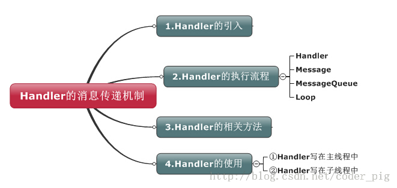
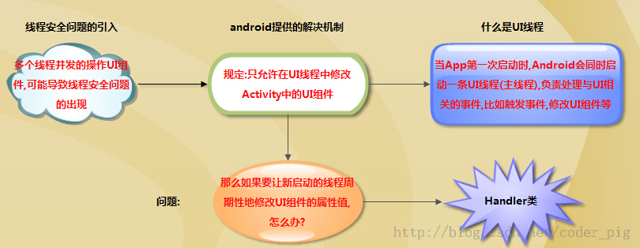
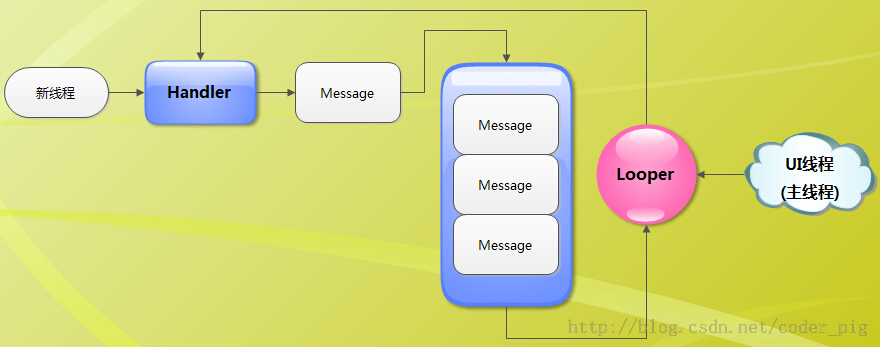

# 3.3 Handler消息传递机制浅析

> 来源: https://www.runoob.com/w3cnote/android-tutorial-handler-message.html

## 本节引言

前两节中我们对Android中的两种事件处理机制进行了学习，关于响应的事件响应就这两种；本节给大家讲解的
是Activity中UI组件中的信息传递Handler，相信很多朋友都知道，Android为了线程安全，并不允许我们在UI线程外操作UI；很多时候我们做界面刷新都需要通过Handler来通知UI组件更新！除了用Handler完成界面更新外，还可以使用runOnUiThread()来更新，甚至更高级的事务总线，当然，这里我们只讲解Handler，什么是Handler，执行流程，相关方法，子线程与主线程中中使用Handler的区别等！

## 1.学习路线图：

## 2.Handler类的引入:

## 3.Handler的执行流程图：

**流程图解析:**
**相关名词**

> - **UI线程**:就是我们的主线程,系统在创建UI线程的时候会初始化一个Looper对象,同时也会创建一个与其关联的MessageQueue;

> - **Handler**:作用就是发送与处理信息,如果希望Handler正常工作,在当前线程中要有一个Looper对象

> - **Message**:Handler接收与处理的消息对象

> - **MessageQueue**:消息队列,先进先出管理Message,在初始化Looper对象时会创建一个与之关联的MessageQueue;

> - **Looper**:每个线程只能够有一个Looper,管理MessageQueue,不断地从中取出Message分发给对应的Handler处理！

**简单点说：**

> 当我们的子线程想修改Activity中的UI组件时,我们可以新建一个Handler对象,通过这个对象向主线程发送信息;而我们发送的信息会先到主线程的MessageQueue进行等待,由Looper按先入先出顺序取出,再根据message对象的what属性分发给对应的Handler进行处理！

## 4.Handler的相关方法:

> - void **handleMessage**(Message msg):处理消息的方法,通常是用于被重写!

> - **sendEmptyMessage**(int what):发送空消息

> - **sendEmptyMessageDelayed**(int what,long delayMillis):指定延时多少毫秒后发送空信息

> - **sendMessage**(Message msg):立即发送信息

> - **sendMessageDelayed**(Message msg):指定延时多少毫秒后发送信息

> - final boolean **hasMessage**(int what):检查消息队列中是否包含what属性为指定值的消息
> 如果是参数为(int what,Object object):除了判断what属性,还需要判断Object属性是否为指定对象的消息

## 5.Handler的使用示例：

### 1）Handler写在主线程中

> 在主线程中,因为系统已经初始化了一个Looper对象,所以我们直接创建Handler对象,就可以进行信息的发送与处理了！

**代码示例：**
简单的一个定时切换图片的程序,通过Timer定时器,定时修改ImageView显示的内容,从而形成帧动画

**运行效果图：**

**实现代码：**

**MainActivity.java：**

### 2）Handler写在子线程中

如果是Handler写在了子线程中的话,我们就需要自己创建一个Looper对象了!创建的流程如下:

> **1 )**直接调用Looper.prepare()方法即可为当前线程创建Looper对象,而它的构造器会创建配套的MessageQueue;
> **2 )**创建Handler对象,重写handleMessage( )方法就可以处理来自于其他线程的信息了!
> **3 )**调用Looper.loop()方法启动Looper

使用示例：
输入一个数，计算后通过Toast输出在这个范围内的所有质数

实现代码：
**main.xml：**

**MainActivity.java:**

PS:本例子来自于《Android疯狂讲义》~

## 本节小结

本节对Android中的Handler事件传递进行了简单的分析，要分清楚Handler，Message，MessageQueue，
Loop的概念，以及Handler写在主线程中以及子线程中的区别！

### 图片清单

1. 图1 -> images/70402782.jpg （原图：https://www.runoob.com/wp-content/uploads/2015/07/70402782.jpg）
2. 图2 -> images/90456225.jpg （原图：https://www.runoob.com/wp-content/uploads/2015/07/90456225.jpg）
3. 图3 -> images/25345060.jpg （原图：https://www.runoob.com/wp-content/uploads/2015/07/25345060.jpg）
4. 图4 -> images/40239012.jpg （原图：https://www.runoob.com/wp-content/uploads/2015/07/40239012.jpg）
