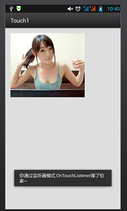
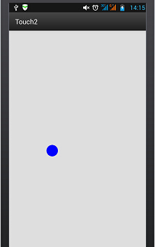

# 3.4 TouchListener PK OnTouchEvent + 多点触碰

> 来源: https://www.runoob.com/w3cnote/android-tutorial-touchlistener-ontouchevent.html

## 本节引言：

> 如题，本节给大家带来的是**TouchListener**与**OnTouchEvent**的比较，以及多点触碰的知识点！
> TouchListener是基于监听的，而OnTouchEvent则是基于回调的！下面通过两个简单的例子来加深
> 大家的理解！

## 1.基于监听的TouchListener

### 代码示例：

**实现效果图：**

**实现代码：**
**main.xml**

**MainAcitivity.java**

**代码解析：**

> 就是简单的设置一个ImageView,然后setOnTouchListener,重写onTouch方法即可!很简单,其实这个在帧布局那一节已经有个例子了，还记得那个随手指移动的萌妹子吗？

### OnTouchListener相关方法与属性:

> **onTouch**(View v, MotionEvent event):这里面的参数依次是触发触摸事件的组件,触碰事件event
> 封装了触发事件的详细信息，同样包括事件的类型、触发时间等信息。比如event.getX(),event.getY()
> 我们也可以对触摸的动作类型进行判断,使用event.getAction( )再进行判断;如:
> event.getAction == MotionEvent.**ACTION_DOWN**：按下事件
> event.getAction == MotionEvent.**ACTION_MOVE**:移动事件
> event.getAction == MotionEvent.**ACTION_UP**:弹起事件

## 2.基于回调的onTouchEvent( )方法

> 同样是触碰事件,但是onTouchEvent更多的是用于自定义的view,所有的view类中都重写了该方法,而这种触摸事件是基于回调的,也就是说:如果我们返回的值是false的话,那么事件会继续向外传播,由外面的容器或者Activity进行处理!当然还涉及到了手势(Gesture),这个我们会在后面进行详细的讲解!onTouchEvent其实和onTouchListener是类似的,只是处理机制不用,前者是回调,后者是监听模式！

**代码示例：**
定义一个简单的view，绘制一个蓝色的小圆，可以跟随手指进行移动

**实现代码：**
MyView.java

**main.xml:**

**实现效果图：**

 用手指触摸进行移动~

## 3.多点触碰

### 原理类的东西：

所谓的多点触碰就是多个手指在屏幕上进行操作，用的最多的估计是放大缩功能吧，比如很多的图片浏览器都支持缩放！理论上Android系统本身可以处理多达256个手指的触摸，当然这取决于手机硬件的支持；不过支持多点触摸的手机一般支持2-4个点，当然有些更多！我们发现前面两点都有用到MotionEvent，MotionEvent代表的是一个触摸事件；前我们可以根据**event.getAction() & MotionEvent.ACTION_MASK**来判断是哪种操作，除了上面介绍的三种单点操作外，还有两个多点专用的操作：

- MotionEvent.**ACTION_POINTER_DOWN**:当屏幕上已经有一个点被按住，此时再按下其他点时触发。

- MotionEvent.**ACTION_POINTER_UP**:当屏幕上有多个点被按住，松开其中一个点时触发（即非最后一个点被放开时）。

**简单的流程大概是这样：**

- 当我们一个手指触摸屏幕 ——> 触发ACTION_DOWN事件

- 接着有另一个手指也触摸屏幕 ——> 触发ACTION_POINTER_DOWN事件,如果还有其他手指触摸，继续触发

- 有一个手指离开屏幕 ——> 触发ACTION_POINTER_UP事件，继续有手指离开，继续触发

- 当最后一个手指离开屏幕 ——> 触发ACTION_UP事件

- 而且在整个过程中，ACTION_MOVE事件会一直不停地被触发

我们可以通过event.**getX**(int)或者event.**getY**(int)来获得不同触摸点的位置：
比如event.getX(0)可以获得第一个接触点的X坐标，event.getX(1)获得第二个接触点的X坐标这样...
另外，我们还可以在调用MotionEvent对象的**getPointerCount()**方法判断当前有多少个手指在触摸~

### 代码示例：

好吧，我们来写个最常见的单指拖动图片，双指缩放图片的示例吧：

**实现效果图：**

**实现代码：**

**MainActivity.java**

## 本节小结：

好的，**关于TouchListener****和OnTouchEvent**以及多点触碰就到这里~

### 图片清单

1. 图1 -> images/84375929.jpg （原图：https://www.runoob.com/wp-content/uploads/2015/07/84375929.jpg）
2. 图2 -> images/13829356.jpg （原图：https://www.runoob.com/wp-content/uploads/2015/07/13829356.jpg）
3. 图3 -> images/30061207.jpg （原图：https://www.runoob.com/wp-content/uploads/2015/07/30061207.jpg）
