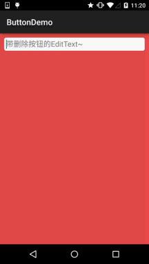
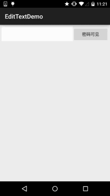

# 3.5 监听EditText的内容变化

> 来源: https://www.runoob.com/w3cnote/android-tutorial-listener-edittext-change.html

## 本节引言：

在前面我们已经学过EditText控件了，本节来说下如何监听输入框的内容变化！
这个再实际开发中非常实用，另外，附带着说下如何实现EditText的密码可见
与不可见！好了，开始本节内容！

## 1.监听EditText的内容变化

> 由题可知，是基于监听的事件处理机制，好像前面的点击事件是OnClickListener，文本内容
> 变化的监听器则是：TextWatcher，我们可以调用EditText.addTextChangedListener(mTextWatcher);
> 为EditText设置内容变化监听！

简单说下TextWatcher，实现该类需实现三个方法：

依次会在下述情况中触发：

- 
1.内容变化前

- 2.内容变化中

- 3.内容变化后

我们可以根据实际的需求重写相关方法，一般重写得较多的是第三个方法！

监听EditText内容变化的场合有很多：
限制字数输入，限制输入内容等等~

这里给大家实现一个简单的自定义EditText，输入内容后，有面会显示一个叉叉的圆圈，用户点击后
可以清空文本框~，当然你也可以不自定义，直接为EditText添加TextWatcher然后设置下删除按钮~

**实现效果图：**

自定义EditText：**DelEditText.java**

EditText的背景drawable：**bg_frame_search.xml**

颜色资源:color.xml

布局文件：**activity_main.xml**

PS:代码是非常简单的，就不解释了~

---

## 2.实现EditText的密码可见与不可见

这个也是一个很实用的需求，就是用户点击按钮后可让EditText中的密码可见或者不可见~

**实现效果图：**

实现代码：
**activity_main.xml**

**MainActivity.java**

**editborder.xml**

## 本节小结：

本节就到这里，谢谢~

### 图片清单

1. 图1 -> images/77103245.jpg （原图：https://www.runoob.com/wp-content/uploads/2015/07/77103245.jpg）
2. 图2 -> images/12964887.jpg （原图：https://www.runoob.com/wp-content/uploads/2015/07/12964887.jpg）
