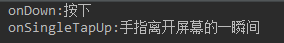
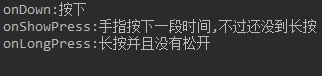
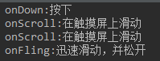
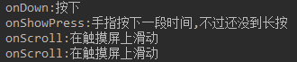
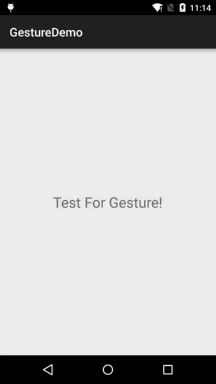
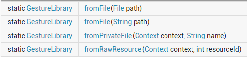
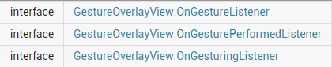
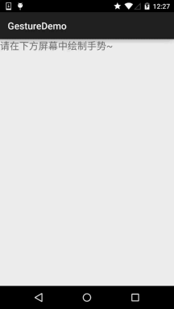

# 3.8 Gestures(手势)

> 来源: https://www.runoob.com/w3cnote/android-tutorial-gestures.html

## 本节引言：

周六不休息，刚剪完了个大平头回来，继续码字~

好的，本节给大家带来点的是第三章的最后一节——Gestures(手势)，
用过魅族手机的朋友相信对手势肯定是不陌生的，在home键两侧像屏幕内滑动，
可以打开后台任务列表等等~在应用中通过手势来操作会大大提升用户体验，
比如Scroll手势在浏览器中个滚屏，Fling在浏览器中的换页等！

当然，有利也有弊，比如不当的手势操作引起APP Carsh，经常这样可是会引起用户不满的！
所以是否要为你的应用增加手势，可要考虑清楚哦！另外手势要和前面学的单指/多指触碰相区分哦！

手势是:连续触碰的行为，比如左右上下滑动屏幕，又或者画一些不规则的几何图形！
Android对上述两种手势行为都提供了支持：

- Android提供手势检测，并为手势识别提供了相应的监听器！

- Android运行开发者自行添加手势，并且提供了相应的API识别用户手势！

如果你的手机是Android 4.x的原生Android系统的话，你可能可以在你的手机或者平板上看到谷歌
提供的一个Gesture Builder的APP，该应用允许用户以类似于涂鸦的方式绘制一个手写符号，使之
对应一个字符串名称！当然，没有这样的手机也没关系，我们有模拟器嘛，自己开个4.0的系统试试
就知道了，另外，我们可以到\mmt\sdcard\gestures获取到保存手势的文件！
好了，唠唠叨叨那么多，开始讲正题吧！

对了，贴下官方API文档先:[GestureDetector](http://androiddoc.qiniudn.com/reference/android/view/GestureDetector.html)

## 1.Android中手势交互的执行顺序

> - 1.手指触碰屏幕时，触发MotionEvent事件！

> - 2.该事件被OnTouchListener监听，可在它的onTouch()方法中获得该MotionEvent对象！

> - 3.通过GestureDetector转发MotionEvent对象给OnGestureListener

> - 4.我们可以通过OnGestureListener获得该对象，然后获取相关信息，以及做相关处理！

我们来看下上述的三个类都是干嘛的:
**MotionEvent**: 这个类用于封装手势、触摸笔、轨迹球等等的动作事件。
其内部封装了两个重要的属性X和Y，这两个属性分别用于记录横轴和纵轴的坐标。
**GestureDetector**: 识别各种手势。
**OnGestureListener**: 这是一个手势交互的监听接口，其中提供了多个抽象方法，
并根据GestureDetector的手势识别结果调用相对应的方法。

——上述资料摘自:[http://www.jcodecraeer.com/a/anzhuokaifa/androidkaifa/2012/1020/448.html](http://www.jcodecraeer.com/a/anzhuokaifa/androidkaifa/2012/1020/448.html)

## 2.GestureListener详解：

从1中我们知道了监听手势的关键是:GestureListener
他给我们提供了下述的回调方法：

> - 按下（onDown）： 刚刚手指接触到触摸屏的那一刹那，就是触的那一下。

> - 抛掷（onFling）： 手指在触摸屏上迅速移动，并松开的动作。

> - 长按（onLongPress）： 手指按在持续一段时间，并且没有松开。

> - 滚动（onScroll）： 手指在触摸屏上滑动。

> - 按住（onShowPress）： 手指按在触摸屏上，它的时间范围在按下起效，在长按之前。

> - 抬起（onSingleTapUp）：手指离开触摸屏的那一刹那。

知道了GestureListener的相关方法后，实现手势检测也很简单，步骤如下：

> - Step 1: 创建GestureDetector对象，创建时需实现GestureListener传入

> - Step 2: 将Activity或者特定组件上的TouchEvent的事件交给GestureDetector处理即可！
> 我们写个简单的代码来验证这个流程，即重写对应的方法：

代码如下：

对应操作截图：

- 
1.按下后立即松开:

- 
2.长按后松开：

- 
3.轻轻一滑，同时松开：

- 
4.按住后不放持续做滑动操作：

PS:从上述结果来看，我们发现了一个问题：
我们实现OnGestureListener需要实现所有的手势，可能我针对的仅仅是滑动，但是你还是要去重载，
这显得很逗逼，是吧，官方肯定会给出解决方法滴，官方另外给我们提供了一个SimpleOnGestureListener类
只需把上述的OnGestureListener替换成SimpleOnGestureListener即可！

## 3.简单的例子:下滑关闭Activity，上滑启动新的Activity

这里就用上述的SimpleOnGestureListener来实现吧:

**运行效果图：**

**实现代码：**

**结果分析：**
从上面的对比就可以知道，相比起SimpleOnGestureListener使用SimpleOnGestureListener
显得更加的简单，想重写什么方法就重写什么方法，另外例子比较简单，大家可以自己试试
其他玩法，比如通过手势缩放图片~

## 4.手势添加与识别：

> 除了上面讲解的手势检测外，Android还运行我们将手势进行添加，然后提供了相关的识别API；
> Android中使用GestureLibrary来代表手势库，提供了GestureLibraries工具类来创建手势库！

**四个加载手势库的静态方法：**

获得GestureLibraries对象后，就可以使用该对象提供的下述方法来做相应操作了：

**相关方法：**

- public void **addGesture** (String entryName, Gesture gesture)：添加一个名为entryName的手势

- public Set<String> **getGestureEntries** ()：获得手势库中所有手势的名称

- public ArrayList<Gesture> **getGestures** (String entryName)：获得entryName名称对应的全部手势

- public ArrayList<Prediction> **recognize** (Gesture gesture): 从当前手势库中识别与gesture匹配的全部手势

- public void **removeEntry** (String entryName)：删除手势库中entryName名称对应的手势

- public void **removeGesture** (String entryName, Gesture gesture)：删除手势库中entryName和gesture都匹配的手势

- public abstract boolean **save** ()：想手势库中添加手势或从中删除手势后调用该方法保存手势库

**GestureOverlayView手势编辑组件：**

Android为GestureOverlayView提供了三种监听器接口，如下，一般常用的是:**OnGesturePerformedListener**;用于手势完成时提供响应！

## 5.手势添加示例：

PS：例子引用的是——李刚《Android疯狂讲义》的代码

**运行效果图：**

好吧，下面贴下实现代码：

两个布局文件：activity_main.xml和dialog_save.xml

activity_main.xml

dialog_save.xml

**MainActivity.java:**

最后还需要在AndroidManifest.xml中添加写入SD卡的权限：

---

## 6.手势识别示例

实现代码：

另外别忘了在AndroidManifest.xml文件中加入读SD卡的权限：

## 本节小结：

好的，本节介绍了Android中的Gesture手势，讲解了手势判断，手势添加，手势识别三个内容
，大部分例子来自于李刚老师的Android疯狂讲义，有兴趣的可以看看该书~谢谢

### 图片清单

1. 图1 -> images/80514897.jpg （原图：https://www.runoob.com/wp-content/uploads/2015/07/80514897.jpg）
2. 图2 -> images/22745782.jpg （原图：https://www.runoob.com/wp-content/uploads/2015/07/22745782.jpg）
3. 图3 -> images/36633841.jpg （原图：https://www.runoob.com/wp-content/uploads/2015/07/36633841.jpg）
4. 图4 -> images/45064641.jpg （原图：https://www.runoob.com/wp-content/uploads/2015/07/45064641.jpg）
5. 图5 -> images/80504226.jpg （原图：https://www.runoob.com/wp-content/uploads/2015/07/80504226.jpg）
6. 图6 -> images/51353345.jpg （原图：https://www.runoob.com/wp-content/uploads/2015/07/51353345.jpg）
7. 图7 -> images/55343440.jpg （原图：https://www.runoob.com/wp-content/uploads/2015/07/55343440.jpg）
8. 图8 -> images/45588649.jpg （原图：https://www.runoob.com/wp-content/uploads/2015/07/45588649.jpg）
