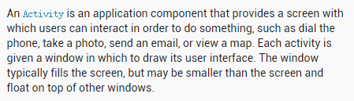
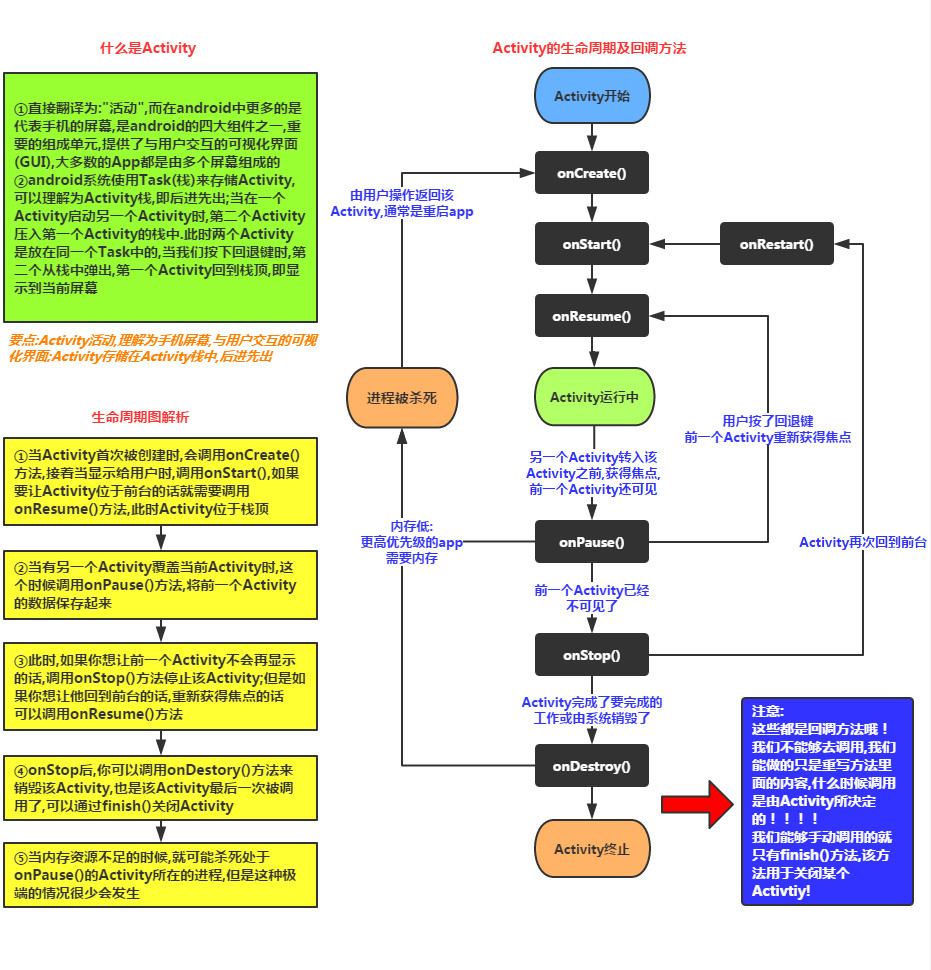
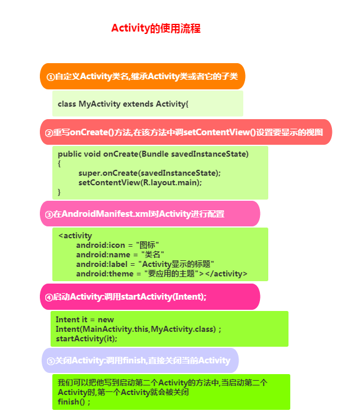
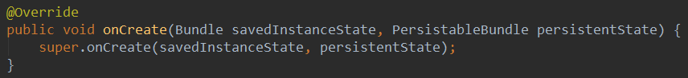
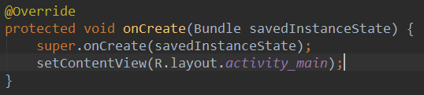
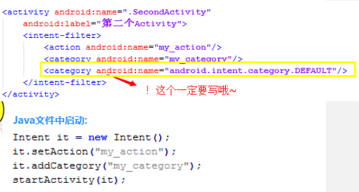

# 4.1.1 Activity初学乍练

> 来源: https://www.runoob.com/w3cnote/android-tutorial-activity.html

## 本节引言：

本节开始讲解Android的四大组件之一的Activity(活动)，先来看下官方对于Activity的介绍：
PS:官网文档：[Activity](http://androiddoc.qiniudn.com/guide/components/activities.html)

**介绍如下：**

**大概意思：**

> Activity是一个应用程序的组件，他在屏幕上提供了一个区域，允许用户在上面做一些交互性的操作，
> 比如打电话，照相，发送邮件，或者显示一个地图！Activity可以理解成一个绘制用户界面的窗口，
> 而这个窗口可以填满整个屏幕，也可能比屏幕小或者浮动在其他窗口的上方！

从上面这段话，我们可以得到以下信息：

> **1.** Activity用于显示用户界面，用户通过Activity交互完成相关操作
> **2.** 一个App允许有多个Activity

好了，大概的引言就介绍到这里，想深入了解可以继续看API，开始本节内容~

## 1.Activity的概念与Activity的生命周期图：

**注意事项：**

> **1.** **onPause()和onStop()被调用的前提是**：
> 打开了一个新的Activity！而前者是旧Activity还可见的状态；后者是旧Activity已经不可见！
> 2. 另外，亲测：AlertDialog和PopWindow是不会触发上述两个回调方法的~

## 2.Activity/ActionBarActivity/AppCompatActivity的区别：

> 在开始讲解创建Activity之前要说下这三个的一个区别：
> Activity就不用说啦，后面这两个都是为了低版本兼容而提出的提出来的，他们都在v7包下，
> ActionBarActivity已被废弃，从名字就知道，ActionBar~，而在5.0后，被Google弃用了，现在用
> ToolBar...而我们现在在Android Studio创建一个Activity默认继承的会是：AppCompatActivity!
> 当然你也可以只写Activity，不过AppCompatActivity给我们提供了一些新的东西而已！
> 两个选一个，Just you like~

## 3.Activity的创建流程

**PS:**

> 好了，上面也说过，可以继承Activity和AppCompatActivity，只不过后者提供了一些新的东西而已！
> 另外，切记，Android中的四大组件，只要你定义了，无论你用没用，都要在AndroidManifest.xml对
> 这个组件进行声明，不然运行时程序会直接退出，报ClassNotFindException...

## 4.onCreate()一个参数和两个参数的区别：

相信用as的朋友在重写Act的onCreate()方法时会发现，这玩意有两个参数：

可是正常的才只有一个参数啊：

恩呢，这就是5.0给我们提供的新的方法，要用它，先要在配置文件中为我们的Activity设置一个属性：

然后我们的Activity就拥有了持久化的能力了，一般我们会搭配另外两个方法来使用：

相信有些朋友对这两个方法名不陌生吧，前一个方法会在下述情形中被调用：

> - 点击home键回到主页或长按后选择运行其他程序

> - 按下电源键关闭屏幕

> - 启动新的Activity

> - 横竖屏切换时，肯定会执行，因为横竖屏切换的时候会先销毁Act，然后再重新创建
> 重要原则：当系统"未经你许可"时销毁了你的activity，则onSaveInstanceState会被系统调用，
> 这是系统的责任，因为它必须要提供一个机会让你保存你的数据（你可以保存也可以不保存）。

而后一个方法，和onCreate同样可以从取出前者保存的数据：
一般是在onStart()和onResume()之间执行！
之所以有两个可以获取到保存数据的方法，是为了避免Act跳转而没有关闭，
然后不走onCreate()方法，而你又想取出保存数据~

**说回来：**
说回这个Activity拥有了持久化的能力，增加的这个PersistableBundle参数令这些方法
拥有了系统**关机后重启**的数据恢复能力！！而且不影响我们其他的序列化操作，卧槽，
具体怎么实现的，暂时还不了解，可能是另外弄了个文件保存吧~！后面知道原理的话会告知下大家！
另外，API版本需要>=21，就是要5.0以上的版本才有效~

## 4.启动一个Activity的几种方式

> 在Android中我们可以通过下面两种方式来启动一个新的Activity,注意这里是怎么启动，而非
> 启动模式！！分为显示启动和隐式启动！

**1. 显式启动：通过包名来启动，写法如下：**

> **①最常见的：**
> **②通过Intent的ComponentName：**
> ③**初始化Intent时指定包名：**

**2.隐式启动：通过Intent-filter的Action,Category或data来实现
这个是通过Intent的 ** intent-filter**来实现的，这个Intent那章会详细讲解！
这里知道个大概就可以了！

**3. 另外还有一个直接通过包名启动apk的：**

## 5.横竖屏切换与状态保存的问题

> 前面也也说到了App横竖屏切换的时候会销毁当前的Activity然后重新创建一个，你可以自行在生命周期
> 的每个方法里都添加打印Log的语句，来进行判断，又或者设一个按钮一个TextView点击按钮后，修改TextView
> 文本，然后横竖屏切换，会神奇的发现TextView文本变回之前的内容了！
> 横竖屏切换时Act走下述生命周期：
> **onPause-> onStop-> onDestory-> onCreate->onStart->onResume**
> 关于横竖屏切换可能遇到下述问题：

1.先说下如何**禁止屏幕横竖屏自动切换**吧，很简单，在AndroidManifest.xml中为Act添加一个属性：
**android:screenOrientation**，
有下述可选值：

- 
**unspecified**:默认值 由系统来判断显示方向.判定的策略是和设备相关的，所以不同的设备会有不同的显示方向。

- 
**landscape**:横屏显示（宽比高要长）

- 
**portrait**:竖屏显示(高比宽要长)

- 
**user**:用户当前首选的方向

- 
**behind**:和该Activity下面的那个Activity的方向一致(在Activity堆栈中的)

- 
**sensor**:有物理的感应器来决定。如果用户旋转设备这屏幕会横竖屏切换。

- 
**nosensor**:忽略物理感应器，这样就不会随着用户旋转设备而更改了（"unspecified"设置除外）。

2.**横竖屏时想加载不同的布局**：

1）准备两套不同的布局，Android会自己根据横竖屏加载不同布局：
创建两个布局文件夹：**layout-land**横屏,**layout-port**竖屏
然后把这两套布局文件丢这两文件夹里，文件名一样，Android就会自行判断，然后加载相应布局了！

2 )自己在代码中进行判断，自己想加载什么就加载什么：

我们一般是在onCreate()方法中加载布局文件的，我们可以在这里对横竖屏的状态做下判断，关键代码如下：

**3. 如何让模拟器横竖屏切换**

如果你的模拟器是GM的话。直接按模拟器上的切换按钮即可，原生模拟器可按ctrl + f11/f12切换！

**4. 状态保存问题：**

这个上面也说过了，通过一个Bundle savedInstanceState参数即可完成！
三个核心方法：

你只重写onSaveInstanceState()方法，往这个bundle中写入数据，比如：

> outState.putInt("num",1);

这样，然后你在onCreate或者onRestoreInstanceState中就可以拿出里面存储的数据，不过拿之前要判断下是否为null哦！

> savedInstanceState.getInt("num");

然后想干嘛就干嘛~

## 6.系统给我们提供的常见的Activity

好的，最后给大家附上一些系统给我们提供的一些常见的Activtiy吧！

## 本节小结：

> 好吧，写着写着就不像入门教程了，哈哈，不过学多点没事的，本节初窥门径就到这里吧~下节我们会继续来研究这个Activity，比如数据传递，启动模式等~敬请期待~

### 图片清单

1. 图1 -> images/48284031.jpg （原图：https://www.runoob.com/wp-content/uploads/2015/08/48284031.jpg）
2. 图2 -> images/18364230.jpg （原图：https://www.runoob.com/wp-content/uploads/2015/08/18364230.jpg）
3. 图3 -> images/48768883.jpg （原图：https://www.runoob.com/wp-content/uploads/2015/08/48768883.jpg）
4. 图4 -> images/18677320.jpg （原图：https://www.runoob.com/wp-content/uploads/2015/08/18677320.jpg）
5. 图5 -> images/28609433.jpg （原图：https://www.runoob.com/wp-content/uploads/2015/08/28609433.jpg）
6. 图6 -> images/291262381.jpg （原图：https://www.runoob.com/wp-content/uploads/2015/08/291262381.jpg）
