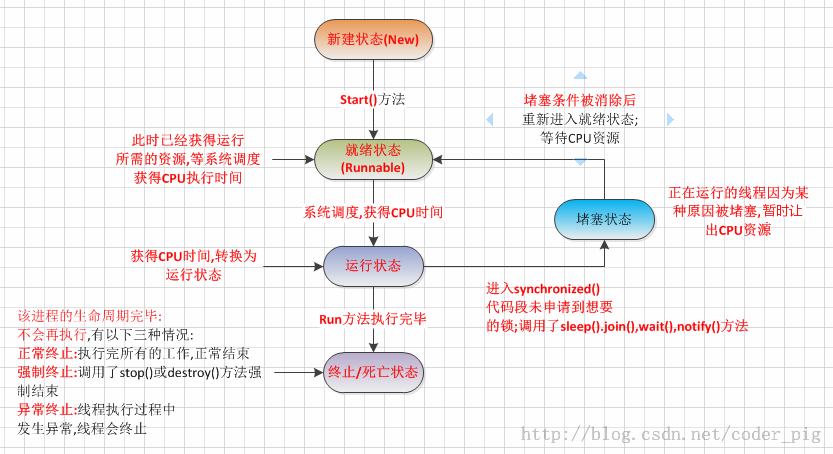
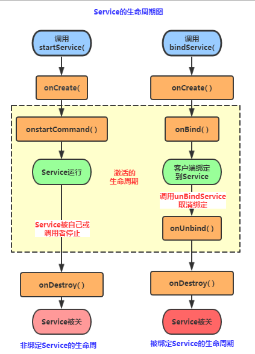
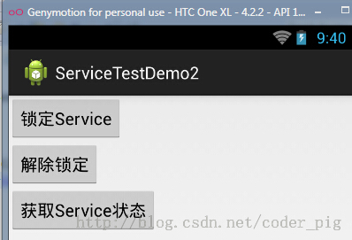
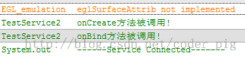
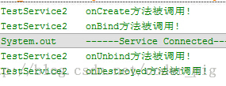
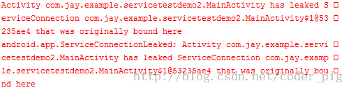
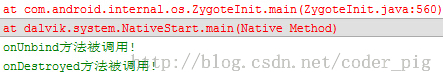

# 4.2.1 Service初涉

> 来源: https://www.runoob.com/w3cnote/android-tutorial-service-1.html

## 本节引言

> 好的，我们在前三节中对Android中的Activity进行了研究学习，相信大家获益良多吧！
> 本节开始我们继续来学习Android中的第二个组件：Service(服务)，
> 好，废话不多说，开始本节内容！

## 1.线程的相关概念

> 在开始学习Service之前我们先来了解下线程的一些概念！

**1）相关概念：**

> - **程序**：为了完成特定任务，用某种语言编写的一组指令集合(一组**静态代码**)

> - **进程**：**运行中的程序**，系统调度与资源分配的一个**独立单位**，操作系统会
> 为每个进程分配一段内存空间！程序的依次动态执行，经历代码的加载，执行，
> 执行完毕的完整过程！

> - **线程**：比进程更小的执行单元，每个进程可能有多条线程，**线程**需要放在一个
> **进程**中才能执行，**线程由程序**负责管理，而**进程则由系统**进行调度！

> - **多线程的理解**：**并行**执行多个条指令，将**CPU时间片**按照调度算法分配给各个
> 线程，实际上是**分时**执行的，只是这个切换的时间很短，用户感觉到"同时"而已！

**2）线程的生命周期：**

**3）创建线程的三种方式：**

> - **继承Thread类**

> - **实现Runnable接口**

> - **实现Callable接口**
> 如果：使用的是2创建的线程的话，可以直接这样启动：
> 当更多的时候我们喜欢使用匿名类，即下面这种写法：

## 2.Service与Thread线程的区别

> 其实他们两者并没有太大的关系，不过有很多朋友经常把这两个混淆了！
> Thread是线程，程序执行的最小单元，分配CPU的基本单位！
> 而Service则是Android提供一个允许长时间留驻后台的一个组件，最常见的
> 用法就是做轮询操作！或者想在后台做一些事情，比如后台下载更新！
> 记得别把这两个概念混淆！

## 3.Service的生命周期图

## 4.生命周期解析

好的，从上图的生命周期，我们可以知道，Android中使用Service的方式有两种：

> 1）**StartService()启动Service**
> 2）**BindService()启动Service**
> PS:还有一种，就是启动Service后，绑定Service！

### 1）相关方法详解：

> - **onCreate()**：当Service第一次被创建后立即回调该方法，该方法在整个生命周期
> 中只会调用一次！

> - **onDestory()**：当Service被关闭时会回调该方法，该方法只会回调一次！

> - **onStartCommand(intent,flag,startId)**：早期版本是onStart(intent,startId),
> 当客户端调用startService(Intent)方法时会回调，可多次调用StartService方法，
> 但不会再创建新的Service对象，而是继续复用前面产生的Service对象，但会继续回调
> onStartCommand()方法！

> - **IBinder onOnbind(intent)**：该方法是Service都必须实现的方法，该方法会返回一个
> IBinder对象，app通过该对象与Service组件进行通信！

> - **onUnbind(intent)**：当该Service上绑定的所有客户端都断开时会回调该方法！

### 2）StartService启动Service

> **①**首次启动会创建一个Service实例,依次调用onCreate()和onStartCommand()方法,此时Service
> 进入运行状态,如果再次调用StartService启动Service,将不会再创建新的Service对象,
> 系统会直接复用前面创建的Service对象,调用它的onStartCommand()方法！
> **②**但这样的Service与它的调用者无必然的联系,就是说当调用者结束了自己的生命周期,
> 但是只要不调用stopService,那么Service还是会继续运行的!
> **③**无论启动了多少次Service,只需调用一次StopService即可停掉Service

### 3）BindService启动Service

> **①**当首次使用bindService绑定一个Service时,系统会实例化一个Service实例,并调用其onCreate()和onBind()方法,然后调用者就可以通过IBinder和Service进行交互了,此后如果再次使用bindService绑定Service,系统不会创建新的Sevice实例,也不会再调用onBind()方法,只会直接把IBinder对象传递给其他后来增加的客户端!
> **②**如果我们解除与服务的绑定,只需调用unbindService(),此时onUnbind和onDestory方法将会被调用!这是一个客户端的情况,假如是多个客户端绑定同一个Service的话,情况如下
> 当一个客户完成和service之间的互动后，它调用 unbindService() 方法来解除绑定。当所有的客户端都和service解除绑定后，系统会销毁service。（除非service也被startService()方法开启）
> **③**另外,和上面那张情况不同,bindService模式下的Service是与调用者相互关联的,可以理解为
> "一条绳子上的蚂蚱",要死一起死,在bindService后,一旦调用者销毁,那么Service也立即终止!
> 通过BindService调用Service时调用的Context的bindService的解析
> **bindService**(Intent Service,ServiceConnection conn,int flags)
> **service**:通过该intent指定要启动的Service
> **conn**:ServiceConnection对象,用户监听访问者与Service间的连接情况,
> 连接成功回调该对象中的onServiceConnected(ComponentName,IBinder)方法;
> 如果Service所在的宿主由于异常终止或者其他原因终止,导致Service与访问者间断开
> 连接时调用**onServiceDisconnected**(CompanentName)方法,主动通过**unBindService()**
> 方法断开并不会调用上述方法!
> **flags**:**指定绑定时是否自动创建Service**(如果Service还未创建),
> 参数可以是0(不自动创建),BIND_AUTO_CREATE(自动创建)

### 4）StartService启动Service后bindService绑定

> 如果Service已经由某个客户端通过StartService()启动,接下来由其他客户端
> 再调用bindService(）绑定到该Service后调用unbindService()解除绑定最后在
> 调用bindService()绑定到Service的话,此时所触发的生命周期方法如下:
> **onCreate( )->onStartCommand( )->onBind( )->onUnbind( )->onRebind( )**
> **PS:**前提是:onUnbind()方法返回true!!!
> 这里或许部分读者有疑惑了,调用了unbindService后Service不是应该调用
> onDistory()方法么!其实这是因为这个Service是由我们的StartService来启动的
> ,所以你调用onUnbind()方法取消绑定,Service也是不会终止的!
> **得出的结论:**
> 假如我们使用bindService来绑定一个启动的Service,注意是已经启动的Service!!!
> 系统只是将Service的内部IBinder对象传递给Activity,并不会将Service的生命周期
> 与Activity绑定,因此调用unBindService( )方法取消绑定时,Service也不会被销毁！

## 5.生命周期验证

接下来我们写代码来验证下生命周期：

### 1）验证StartService启动Service的调用顺序

首先我们自定义一个Service,重写相关的方法,用户在logcat上打印验证:

**TestService1.java**

**AndroidManifest.xml完成Service注册**

再接着是简单的布局文件,两个按钮,再最后是MainActivity的编写,在按钮的点击事件中分别
调用startService( )和stopService( )!

**运行截图：**

**点击开始服务:**

**吃饱饭没事做,点多几下:**

**最后点击停止服务:**

**结果分析：**

从上面的运行结果我们可以验证我们生命周期图中解释的内容:
我们发现onBind()方法并没有被调用,另外多次点击启动Service,只会重复地调用onStartCommand
方法!无论我们启动多少次Service,一个stopService就会停止Service!

### 2）验证BindService启动Service的顺序:

在开始讲写代码之前,我们先要来了解一些东西先:
首先是第一个大图下面给出的Context的bindService方法：

> - ServiceConnection对象:监听访问者与Service间的连接情况,如果成功连接,回调
> onServiceConnected(),如果异常终止或者其他原因终止导致Service与访问者断开
> 连接则回调onServiceDisconnected方法,调用unBindService()不会调用该方法!

> - onServiceConnected方法中有一个IBinder对象,该对象即可实现与被绑定Service
> 之间的通信!我们再开发Service类时,默认需要实现IBinder onBind()方法,该方法返回的
> IBinder对象会传到ServiceConnection对象中的onServiceConnected的参数,我们就可以
> 在这里通过这个IBinder与Service进行通信!

**总结：**
**Step 1:**在自定义的Service中继承Binder,实现自己的IBinder对象
**Step 2:**通过onBind( )方法返回自己的IBinder对象
**Step 3:**在绑定该Service的类中定义一个ServiceConnection对象,重写两个方法,
onServiceConnected和onDisconnected！然后直接读取IBinder传递过来的参数即可!

那么好了,接下来就是写代码验证了,这里的话我们定义一个用来计时的Service,
然后来演示BindService的用法以及方法调用流程!代码比较简单,不解释了!

**TestService2.java:**

**在AndroidManifest.xml中对Service组件进行注册:**

**MainActivity.java:**

**运行截图：**

**点击锁定Service:**

**继续点击锁定:没任何变化**

**获取当前Service的状态:**

**解除绑定:**

如果我们再绑定后直接关掉Activity的话会报错,
然后会自动调用onUnbind和onDestory方法！

。。。

**从上面的运行结果验证了生命周期图中的:**

> 使用BindService绑定Service,依次调用onCreate(),onBind()方法,
> 我们可以在onBind()方法中返回自定义的IBinder对象;再接着调用的是
> ServiceConnection的onServiceConnected()方法该方法中可以获得
> IBinder对象,从而进行相关操作;当Service解除绑定后会自动调用
> onUnbind和onDestroyed方法,当然绑定多客户端情况需要解除所有
> 的绑定才会调用onDestoryed方法进行销毁哦！

### 图片清单

1. 图1 -> images/21242330.png （原图：https://www.runoob.com/wp-content/uploads/2015/08/21242330.png）
2. 图2 -> images/11165797.jpg （原图：https://www.runoob.com/wp-content/uploads/2015/08/11165797.jpg）
3. 图3 -> images/63254164.jpg （原图：https://www.runoob.com/wp-content/uploads/2015/08/63254164.jpg）
4. 图4 -> images/79753583.jpg （原图：https://www.runoob.com/wp-content/uploads/2015/08/79753583.jpg）
5. 图5 -> images/58639132.jpg （原图：https://www.runoob.com/wp-content/uploads/2015/08/58639132.jpg）
6. 图6 -> images/34862559.jpg （原图：https://www.runoob.com/wp-content/uploads/2015/08/34862559.jpg）
7. 图7 -> images/56836717.jpg （原图：https://www.runoob.com/wp-content/uploads/2015/08/56836717.jpg）
8. 图8 -> images/4843415.jpg （原图：https://www.runoob.com/wp-content/uploads/2015/08/4843415.jpg）
9. 图9 -> images/22079659.jpg （原图：https://www.runoob.com/wp-content/uploads/2015/08/22079659.jpg）
10. 图10 -> images/17940698.jpg （原图：https://www.runoob.com/wp-content/uploads/2015/08/17940698.jpg）
11. 图11 -> images/80687078.jpg （原图：https://www.runoob.com/wp-content/uploads/2015/08/80687078.jpg）
12. 图12 -> images/58211834.jpg （原图：https://www.runoob.com/wp-content/uploads/2015/08/58211834.jpg）
13. 图13 -> images/95470674.jpg （原图：https://www.runoob.com/wp-content/uploads/2015/08/95470674.jpg）
