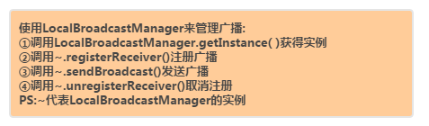
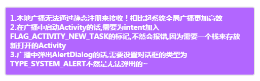
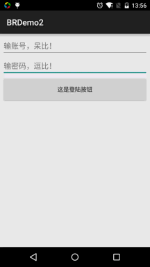

# 4.3.2 BroadcastReceiver庖丁解牛

> 来源: https://www.runoob.com/w3cnote/android-tutorial-broadcastreceiver-2.html

## 本节引言：

> 上节我们对BroadcastReceiver已经有了一个初步的了解了，知道两种广播类型：标准与有序，
> 动态或静态注册广播接收者，监听系统广播，自己发送广播！已经满足我们的基本需求了~
> 但是前面写的广播都是全局广播！这同样意味着我们APP发出的广播，其他APP都会接收到，
> 或者其他APP发送的广播，我们的APP也同样会接收到，这样容易引起一些安全性的问题！而
> Android中给我们提供了本地广播的机制，使用该机制发出的广播只会在APP内部传播，而且
> 广播接收者也只能收到本应用发出的广播！

## 1.本地广播

### 1）核心用法：

**PS：本地广播无法通过静态注册方式来接受,相比起系统全局广播更加高效**

### 2）注意事项：

### 3）代码示例(别处登陆踢用户下线)：

> 像微信一样，正在运行的微信，如果我们用别的手机再次登陆自己的账号，前面这个是会提醒账户
> 在别的终端登录这样，然后把我们打开的所有Activity都关掉，然后回到登陆页面这样~
> 下面我们就来写个简单的例子：

**运行效果图：**

**代码实现：**

**Step 1**：准备一个关闭所有Activity的ActivityCollector ，这里之前用前面Activity提供的那个!

**ActivityCollector.java**

**Step 2**：先写要给简单的BaseActivity，用来继承，接着写下登陆界面！

**LoginActivity.java:**

**Step 3**：自定义一个BroadcastReceiver，在onReceive里完成弹出对话框操作，以及启动登陆页面：
**MyBcReceiver.java**

别忘了AndroidManifest.xml中加上系统对话框权限：
**< uses-permission android:name="android.permission.SYSTEM_ALERT_WINDOW" />**

**Step 4：**在MainActivity中，实例化localBroadcastManager，拿他完成相关操作，另外销毁时
注意unregisterReceiver！

**MainActivity.java**

好的，就是这么简单，别忘记注册Activity哦~

## 2.Android 4.3以上版本监听开机启动广播的问题解决：

在Android 4.3以上的版本，允许我们将应用安装在SD上，我们都知道是系统开机
间隔一小段时间后，才装载SD卡的，这样我们的应用就可能监听不到这个广播了！
所以我们需要既监听开机广播又监听SD卡挂载广播！

另外，有些手机可能并没有SD卡，所以这两个广播监听我们不能写到同一个Intetn-filter里
而是应该写成两个，配置代码如下：

## 3.常用的系统广播总结：

最后给大家提供下我们平常可能会用到的一些系统广播吧：

## 4.本节小结：

好的，关于BroadcastReceiver的学习就到这里，如果你有什么补充或者建议，欢迎提出~
万分感激~

### 图片清单

1. 图1 -> images/96168525.jpg （原图：https://www.runoob.com/wp-content/uploads/2015/08/96168525.jpg）
2. 图2 -> images/59582423.jpg （原图：https://www.runoob.com/wp-content/uploads/2015/08/59582423.jpg）
3. 图3 -> images/53729773.jpg （原图：https://www.runoob.com/wp-content/uploads/2015/08/53729773.jpg）
