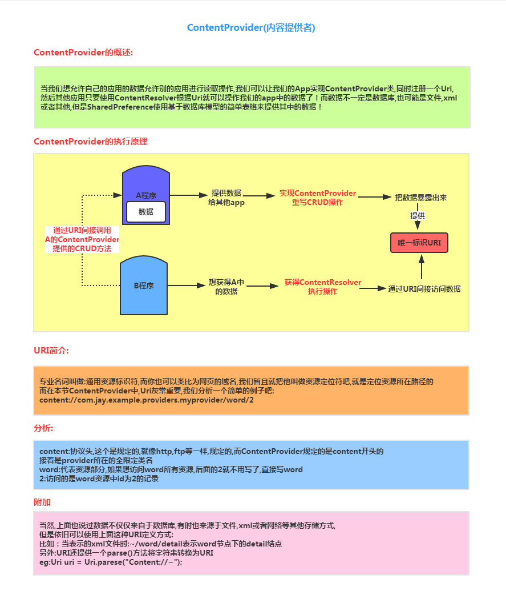
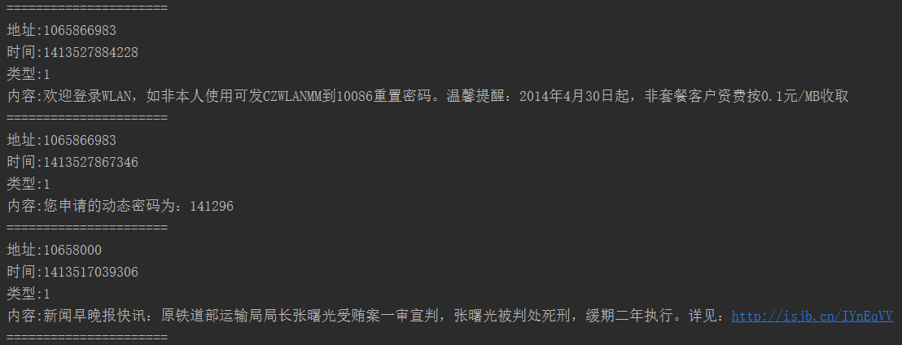
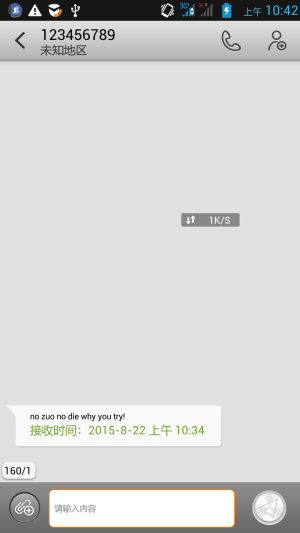
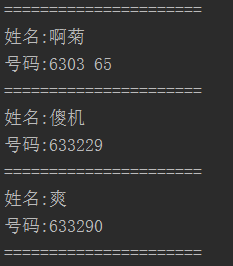
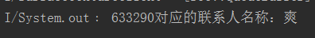
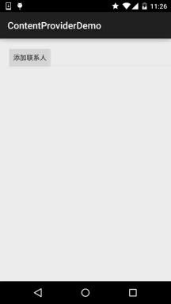
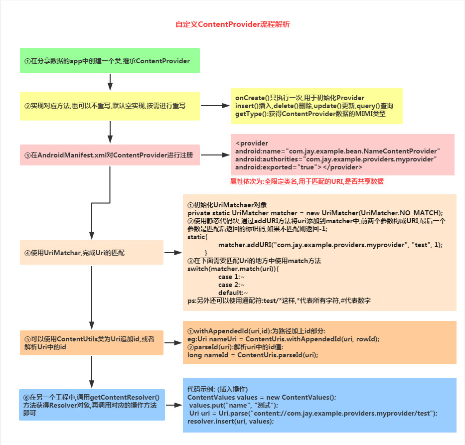
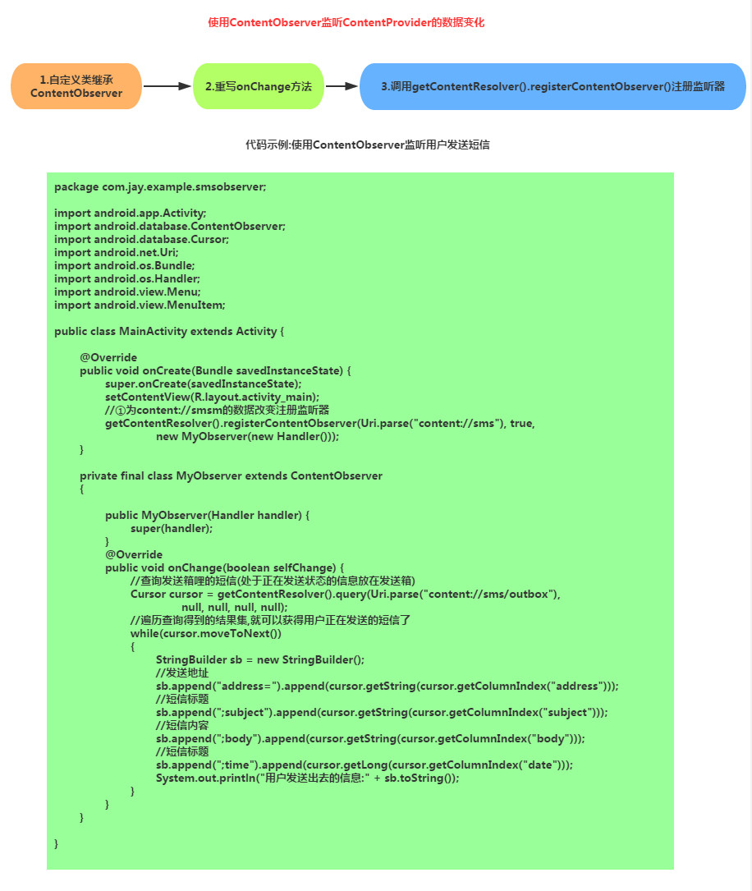

# 4.4.1 ContentProvider初探

> 来源: https://www.runoob.com/w3cnote/android-tutorial-contentprovider.html

## 本节引言：

> 本节给大家带来的是Android四大组件中的最后一个——ContentProvider(内容提供者)，可能部分读者
> 有疑问了，"Android不是有五大组件的吗？还有个Intent呢？"对的，Intent也是很重要的，但是他
> 只是维系这几个组件间的纽带！Intent我们下一章会讲解！说会这个ContentProvider，我们什么时候
> 会用到他呢？有下面这两种：

> - **1.**我们想在自己的应用中访问别的应用，或者说一些ContentProvider暴露给我们的一些数据，
> 比如手机联系人，短信等！我们想对这些数据进行读取或者修改，这就需要用到ContentProvider了！

> - **2.**我们自己的应用，想把自己的一些数据暴露出来，给其他的应用进行读取或操作，我们也可以用
> 到ContentProvider，另外我们可以选择要暴露的数据，就避免了我们隐私数据的的泄露！

> 好像好流弊的样子，其实用起来也很简单，下面我们来对ContentProvider进行学习~
> **官方文档**：[ContentProvider](http://androiddoc.qiniudn.com/guide/topics/providers/content-providers.html)
> 本节我们来讲解下ContentProvder的概念，给大家写几个常用的使用系统ContentProvider的示例，
> 以及自定义ContentProvider！

## 1.ContentProvider概念讲解：

## 2.使用系统提供的ContentProvider

> 其实很多时候我们用到ContentProvider并不是自己暴露自己的数据，更多的时候通过
> **ContentResolver**来读取其他应用的信息，最常用的莫过于读取系统APP，信息，联系人，
> 多媒体信息等！如果你想来调用这些ContentProvider就需要自行查阅相关的API资料了！
> 另外，不同的版本，可能对应着不同的URL！这里给出如何获取URL与对应的数据库表的字段，
> 这里以最常用的联系人为例，其他自行google~
> ①来到系统源码文件下:all-src.rar -> TeleponeProvider -> AndroidManifest.xml查找对应API
> ②打开模拟器的file exploer/data/data/com.android.providers.contacts/databases/contact2.db
> 导出后使用SQLite图形工具查看，三个核心的表:**raw_contact表**，**data表**，**mimetypes表**！
> 下面演示一些基本的操作示例：

### 1）简单的读取收件箱信息：

**核心代码：**

别忘了，往AndroidManifest.xml加入读取收件箱的权限：

**运行结果：**

部分运行结果如下：

### 2）简单的往收件箱里插入一条信息

**核心代码：**

**运行结果：**

**注意事项：**

上述代码在4.4以下都可以实现写入短信的功能，而5.0上就无法写入，原因是：
从5.0开始，默认短信应用外的软件不能以写入短信数据库的形式发短信！

### 3）简单的读取手机联系人

**核心代码：**

别忘了加读联系人的权限：

**运行结果：**

部分运行结果如下：

### 4）查询指定电话的联系人信息

**核心代码：**

**运行结果：**

### 5）添加一个新的联系人

**核心代码：**

**运行结果:**

**别忘了权限：**

## 3.自定义ContentProvider

> 我们很少会自己来定义ContentProvider，因为我们很多时候都不希望自己应用的数据暴露给
> 其他应用，虽然这样，学习如何ContentProvider还是有必要的，多一种数据传输的方式，是吧~
> 这是之前画的一个流程图：

接下来我们就来一步步实现：

在开始之前我们先要创建一个数据库创建类(数据库内容后面会讲~)：

**DBOpenHelper.java**

**
Step 1**：自定义ContentProvider类，实现onCreate()，getType()，根据需求重写对应的增删改查方法：

**NameContentProvider.java**

**Step 2**：AndroidManifest.xml中为ContentProvider进行注册：

好的，作为ContentProvider的部分就完成了！

接下来，创建一个新的项目，我们来实现ContentResolver的部分，我们直接通过按钮点击插入一条数据：

**MainActivity.java**

**如何使用？**
好吧，代码还是蛮简单的，先运行作为ContentProvider的项目，接着再运行ContentResolver的项目，
点击按钮插入一条数据，然后打开file exploer将ContentProvider的db数据库取出，用图形查看工具
查看即可发现插入数据，时间关系，就不演示结果了~

## 4.通过ContentObserver监听ContentProvider的数据变化

**使用指南**：

> 运行程序后，晾一边，收到短信后，可以在logcat上看到该条信息的内容，可以根据自己的需求
> 将Activtiy改做Service，而在后台做这种事情~

## 本节小结：

> 好的，关于ContentProvider的初探就到这里，本节我们学习了：
> ContentProvider的概念以及流程，使用系统提供的一些ContentProvider，以及定制自己的ContentProvider，
> 最后还讲解了通过ContentObserver监听ContentProvider的数据变化，ContentProvider的内容就掌握得差不多
> 了，下一节我们来走走文档看下有什么不知道的~谢谢

### 图片清单

1. 图1 -> images/58811327.jpg （原图：https://www.runoob.com/wp-content/uploads/2015/08/58811327.jpg）
2. 图2 -> images/29832196.jpg （原图：https://www.runoob.com/wp-content/uploads/2015/08/29832196.jpg）
3. 图3 -> images/9682931.jpg （原图：https://www.runoob.com/wp-content/uploads/2015/08/9682931.jpg）
4. 图4 -> images/5962720.jpg （原图：https://www.runoob.com/wp-content/uploads/2015/08/5962720.jpg）
5. 图5 -> images/80060941.jpg （原图：https://www.runoob.com/wp-content/uploads/2015/08/80060941.jpg）
6. 图6 -> images/41407183.jpg （原图：https://www.runoob.com/wp-content/uploads/2015/08/41407183.jpg）
7. 图7 -> images/40787698.jpg （原图：https://www.runoob.com/wp-content/uploads/2015/08/40787698.jpg）
8. 图8 -> images/34168859.jpg （原图：https://www.runoob.com/wp-content/uploads/2015/08/34168859.jpg）
