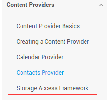
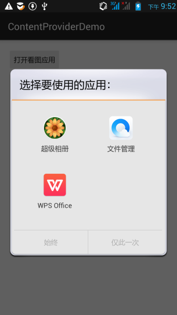
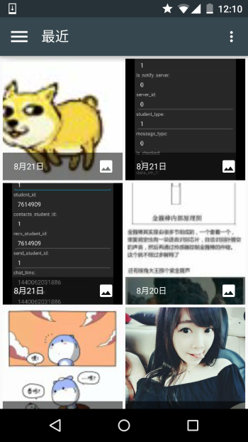
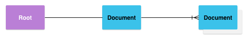
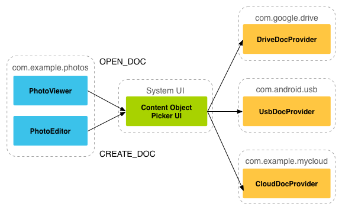
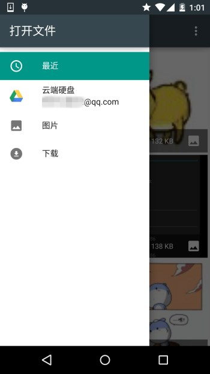
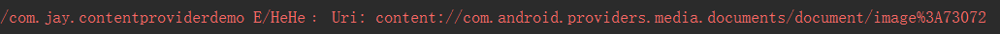
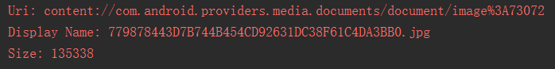
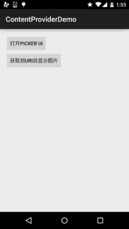

# 4.4.2 ContentProvider再探——Document Provider

> 来源: https://www.runoob.com/w3cnote/android-tutorial-contentprovider-2.html

## 本节引言：

> 学完上一节，相信你已经知道如何去使用系统提供的ContentProvider或者自定义ContentProvider了，
> 已经基本满足日常开发的需求了，有趣的是，我在官方文档上看到了另外这几个Provider：

> 

> **Calendar Provider**：日历提供者，就是针对针对日历相关事件的一个资源库，通过他提供的API，我们
> 可以对日历，时间，会议，提醒等内容做一些增删改查！
> **Contacts Provider**：联系人提供者，这个就不用说了，这个用得最多~后面有时间再回头翻译下这篇文章吧！
> **Storage Access Framework(SAF)**：存储访问框架，4.4以后引入的一个新玩意，为用户浏览手机中的
> 存储内容提供了便利，可供访问的内容不仅包括：文档，图片，视频，音频，下载，而且包含所有由
> 由特定ContentProvider（须具有约定的API）提供的内容。不管这些内容来自于哪里，不管是哪个应
> 用调用浏览系统文件内容的命令，系统都会用一个统一的界面让你去浏览。
> 其实就是一个内置的应用程序，叫做DocumentsUI，因为它的IntentFilter不带有LAUNCHER，所以我们并没有
> 在桌面上找到这个东东！嘿嘿，试下下面的代码，这里我们选了两个手机来对比：
> 分别是4.2的Lenovo S898T 和 5.0.1的Nexus 5做对比，执行下述代码：

下面是运行结果：

 

右面这个就是4.4给我们带来的新玩意了，一般我们获取文件Url的时候就可以用到它~
接下来简单的走下文档吧~

## 2.简单走下文档：

### 1）SAF框架的组成：

> - **Document provider**：一个特殊的ContentProvider，让一个存储服务(比如Google Drive)可以
> 对外展示自己所管理的文件。它是**DocumentsProvider**的子类，另外，document-provider的存储格式
> 和传统的文件存储格式一致，至于你的内容如何存储，则完全决定于你自己，Android系统已经内置了几个
> 这样的Document provider，比如关于下载，图片以及视频的Document provider！

> - **Client app**：一个普通的客户端软件，通过触发**ACTION_OPEN_DOCUMENT** 和/或
> **ACTION_CREATE_DOCUMENT**就可以接收到来自于Document provider返回的内容，比如选择一个图片，
> 然后返回一个Uri。

> - **Picker**：类似于文件管理器的界面，而且是系统级的界面，提供额访问客户端过滤条件的
> Document provider内容的通道，就是起说的那个DocumentsUI程序！

**一些特性：**

> - 用户可以浏览所有document provider提供的内容，而不仅仅是单一的应用程序

> - 提供了长期、持续的访问document provider中文件的能力以及数据的持久化，
> 用户可以实现添加、删除、编辑、保存document provider所维护的内容

> - 支持多用户以及临时性的内容服务，比如USB storage providers只有当驱动安装成功才会出现

### 2）概述：

SAF的核心是实现了DocumentsProvider的子类，还是一个ContentProvider。在一个document provider
中是以传统的文件目录树组织起来的：

### 3）流程图：

如上面所述，document provider data是基于传统的文件层次结构的，不过那只是对外的表现形式，
如何存储你的数据，取决于你自己，只要你对海外的接口能够通过DocumentsProvider的api访问就可以。
下面的流程图展示了一个photo应用使用SAF可能的结构：

分析：

> 从上图，我们可以看出Picker是链接调用者和内容提供者的一个桥梁！他提供并告诉调用者，可以选择
> 哪些内容提供者，比如这里的DriveDocProvider，UsbDocProvider，CloundDocProvider。
> 当客户端触发了**ACTION_OPEN_DOCUMENT**或**ACTION_CREATE_DOCUMENT**的Intent，就会发生上述交互。
> 当然我们还可以在Intent中增加过滤条件，比如限制MIME type的类型为"image"!

就是上面这些东西，如果你还安装了其他看图的软件的话，也会在这里看到！
简单点说就是：客户端发送了上面两种Action的Intent后，会打开Picker UI，在这里会显示相关可用的
Document Provider，供用户选择，用户选择后可以获得文件的相关信息！

### 4）客户端调用，并获取返回的Uri

**实现代码如下：**

**运行结果：**
比如我们选中那只狗，然后Picker UI自己会关掉，然后Logcat上可以看到这样一个uri:

### 5）根据uri获取文件参数

**核心代码如下：**

**运行结果：**
还是那只狗，调用方法后会输入文件名以及文件大小，以byte为单位

### 6）根据Uri获得Bitmap

**核心代码如下：**

**运行结果**：

### 7）根据Uri获取输入流

**核心代码如下：**

上述的内容只告诉你通过一个Uri你可以知道什么，而Uri的获取则是通过SAF得到的！

### 8） 创建新文件以及删除文件：

**创建文件：**

可在onActivityResult()中获取被创建文件的uri

**删除文件：**

前提是Document.COLUMN_FLAGS包含**SUPPORTS_DELETE**

### 9）编写一个自定义的Document Provider

如果你希望自己应用的数据也能在documentsui中打开，你就需要写一个自己的document provider。
下面介绍自定义DocumentsProvider的步骤：

> - API版本为19或者更高

> - 在manifest.xml中注册该Provider

> - Provider的name为类名加包名，比如：
> **com.example.android.storageprovider.MyCloudProvider**

> - Authority为包名+provider的类型名，如：
> **com.example.android.storageprovider.documents**

> - **android:exported属性的值为ture**

下面是Provider的例子写法：

### 10 )DocumentsProvider的子类

至少实现如下几个方法：

> - queryRoots()

> - queryChildDocuments()

> - queryDocument()

> - openDocument()

还有些其他的方法，但并不是必须的。下面演示一个实现访问文件（file）系统的
DocumentsProvider的大致写法。

**Implement queryRoots**

**Implement queryChildDocuments**

**Implement queryDocument**

好吧，文档中的内容大概就是这些了：
一开始是想自己翻译的，后来在泡在网上的日子上找到了这一篇文档的中文翻译，就偷下懒了~

中文翻译链接：[android存储访问框架Storage Access Framework](http://www.jcodecraeer.com/a/anzhuokaifa/androidkaifa/2014/1026/1845.html727.jpg)

## 3.Android 4.4 获取资源路径问题：

其实这个SAF我们用得较多的地方无非是获取图片的Uri而已，而从上面的例子我们也发现了：
我们这样获取的链接是这样的：

这样的链接，我们直接通过上面的方法获得uri即可！

当然，这个是4.4 或者以上版本的~！

如果是以前的版本：uri可能是这样的：

这里贴下在别的地方看到的一个全面的方案，原文链接：[Android4.4中获取资源路径问题](http://blog.csdn.net/huangyanan1989/article/details/17263203)

## 本节小结：

> 好的，关于本节android存储访问框架SAF就到这里吧，没什么例子，后面用到再深入研究吧，
> 知道下就好，4.4后获取文件路径就简单多了~

### 图片清单

1. 图1 -> images/1767920.jpg （原图：https://www.runoob.com/wp-content/uploads/2015/08/1767920.jpg）
2. 图2 -> images/91634215.jpg （原图：https://www.runoob.com/wp-content/uploads/2015/08/91634215.jpg）
3. 图3 -> images/11961991.jpg （原图：https://www.runoob.com/wp-content/uploads/2015/08/11961991.jpg）
4. 图4 -> images/35707570.jpg （原图：https://www.runoob.com/wp-content/uploads/2015/08/35707570.jpg）
5. 图5 -> images/27402348.jpg （原图：https://www.runoob.com/wp-content/uploads/2015/08/27402348.jpg）
6. 图6 -> images/76715949.jpg （原图：https://www.runoob.com/wp-content/uploads/2015/08/76715949.jpg）
7. 图7 -> images/44905390.jpg （原图：https://www.runoob.com/wp-content/uploads/2015/08/44905390.jpg）
8. 图8 -> images/17471727.jpg （原图：https://www.runoob.com/wp-content/uploads/2015/08/17471727.jpg）
9. 图9 -> images/19942554.jpg （原图：https://www.runoob.com/wp-content/uploads/2015/08/19942554.jpg）
