# 4.5.1 Intent的基本使用

> 来源: https://www.runoob.com/w3cnote/android-tutorial-intent-base.html

## 本节引言：

在上一节结束后意味着Android的四大组件我们都已经学习完毕了~，而本节我们要学习的是四大组件间的
枢纽——Intent(意图)，Android通信的桥梁，比如我们可以通过:

> - **startActivity**(Intent)/**startActivityForResult**(Intent)：来启动一个Activity

> - **startService**(Intent)/**bindService**(Intent)：来启动一个Service

> - **sendBroadcast**：发送广播到指定BroadcastReceiver

> - 另外别忘了我们在注册四大组件时，写得很多的**Intent-Filter**哦~

好吧，话不多说，开始本节内容！另外前面我们已经用过Intent了，就不在讲述概念性的东西了~
老规矩，官方API：[Intent](http://androiddoc.qiniudn.com/guide/components/intents-filters.html)

## 1.显式Intent与隐式Intent的区别

> - **显式Intent**：通过组件名指定启动的目标组件,比如startActivity(new Intent(A.this,B.class));
> 每次启动的组件只有一个~

> - **隐式Intent**:不指定组件名,而指定Intent的Action,Data,或Category,当我们启动组件时,
> 会去匹配AndroidManifest.xml相关组件的Intent-filter,逐一匹配出满足属性的组件,当不止一个满足时,
> 会弹出一个让我们选择启动哪个的对话框~

## 2.Intent的七个属性：

### 1）ComponentName(组件名称)

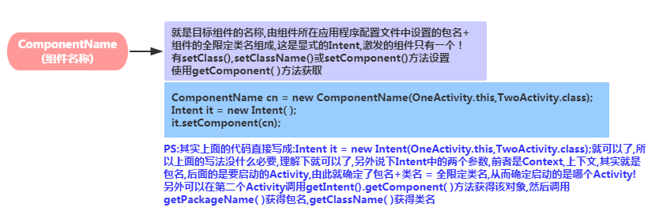

### 2）Action(动作)

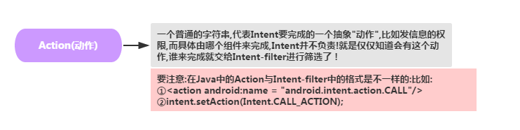

### 3）Category(类别)

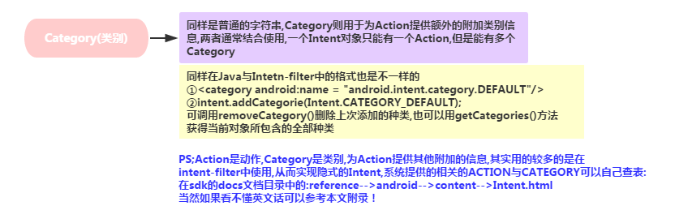

### 4）Data(数据)，Type(MIME类型)

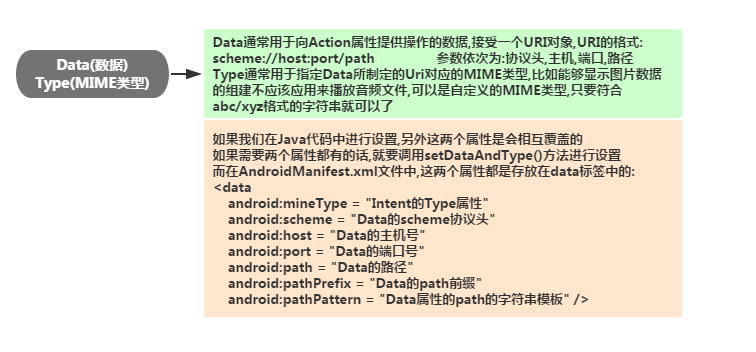

### 5）Extras(额外)

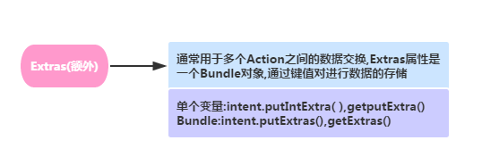

### 6）Flags(标记)

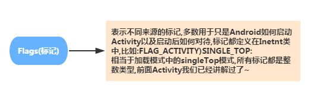

## 3.显式Intent使用示例：

这个用得很多，直接就上例子了：

**例子1：**点击按钮返回Home界面：
**运行效果图：**

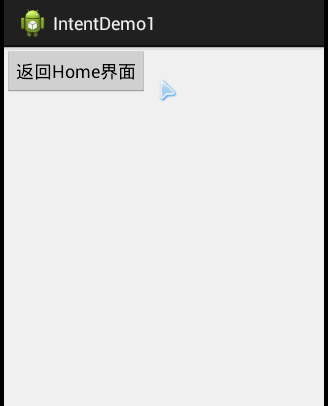

**核心代码：**

**例子2：**点击按钮打开百度页面：
**运行效果图：**

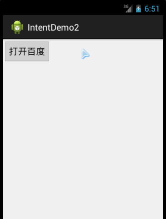

**核心代码：**

## 4.隐式Intent详解

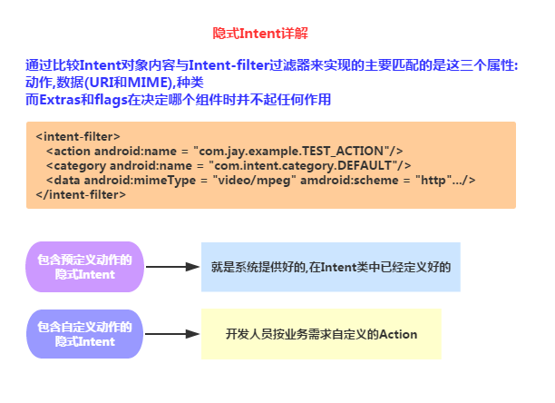

### 1）预定义动作的隐式Intent示例：

**代码示例:**点击按钮后,所有Action为VIEW的Activity被筛选出来,由用户进一步选择:

**核心代码：**

建立第二个Activity的布局,与对应的Activity,在第一个Activity的按钮点击事件中添加一下代码:

最后在第二个Activity的Intent中添加以下代码:

**运行效果图：**

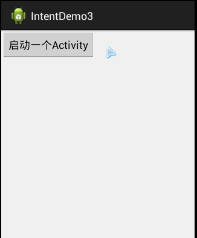

### 2）自定义动作的隐式Intent示例：

**代码示例：**使用自定义的Action与category来激活另一个Activity

**核心代码：**
建立第二个Activity的布局,与对应的Activity,在第一个Activity的按钮点击事件中添加一下代码:

最后在第二个Activity的Intent中添加以下代码:

注意虽然我们自定义了一个category,但是还是要把这个默认的加上,不然会报错的：

## 5.常用系统Intent合集

大家贴下常用的系统Intent的合集吧，上面没有的欢迎提出~

## 6.Action在哪里查？

本来想直接贴以前收集到的Intent Action的，后来想想还是算了，授之以鱼，还不如授之以渔，
如果你下载了Android的文档的话，可以在下述路径：

sdk-->docs-->reference-->android--->content--->Intent.html

找到这个玩意，然后从这个Constants开始就是了：

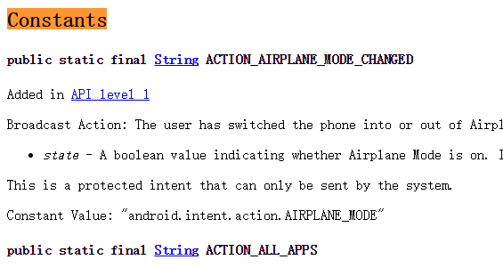

遇到陌生的自己来这里查即可~

## 本节小结：

> 好的，关于Intent的基本使用就到这里，下一节我们会来继续学习在日常开发中使用Intent可能会遇到
> 的一些问题或者说需求吧，敬请期待，谢谢~

### 图片清单

1. 图1 -> images/93994466.jpg （原图：https://www.runoob.com/wp-content/uploads/2015/08/93994466.jpg）
2. 图2 -> images/10976710.jpg （原图：https://www.runoob.com/wp-content/uploads/2015/08/10976710.jpg）
3. 图3 -> images/97975471.jpg （原图：https://www.runoob.com/wp-content/uploads/2015/08/97975471.jpg）
4. 图4 -> images/13299674.jpg （原图：https://www.runoob.com/wp-content/uploads/2015/08/13299674.jpg）
5. 图5 -> images/19949418.jpg （原图：https://www.runoob.com/wp-content/uploads/2015/08/19949418.jpg）
6. 图6 -> images/65852896.jpg （原图：https://www.runoob.com/wp-content/uploads/2015/08/65852896.jpg）
7. 图7 -> images/23711299.jpg （原图：https://www.runoob.com/wp-content/uploads/2015/08/23711299.jpg）
8. 图8 -> images/79502258.jpg （原图：https://www.runoob.com/wp-content/uploads/2015/08/79502258.jpg）
9. 图9 -> images/96004503.jpg （原图：https://www.runoob.com/wp-content/uploads/2015/08/96004503.jpg）
10. 图10 -> images/42535454.jpg （原图：https://www.runoob.com/wp-content/uploads/2015/08/42535454.jpg）
11. 图11 -> images/46599517.jpg （原图：https://www.runoob.com/wp-content/uploads/2015/08/46599517.jpg）
