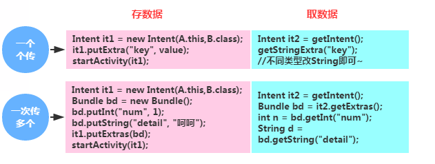

# 4.5.2 Intent之复杂数据的传递

> 来源: https://www.runoob.com/w3cnote/android-tutorial-intent-pass-data.html

## 本节引言：

> 上一节中我们学习了Intent的一些基本使用，知道了Intent的七个属性，显式Intent以及
> 隐式Intent，以及如何自定义隐式Intent，最后还给大家提供了一些常用的系统Intent！
> 而本节跟大家讲解的是Intent传递数据的问题~好的，开始本节内容~

## 1.Intent传递简单数据

> 还记得我们在Activity那里学过如何在两个Activity中互相传递简单数据的方法吗？

> 

> 就是可以直接通过调用Intent的putExtra()方法存入数据，然后在获得Intent后调用getXxxExtra获得
> 对应类型的数据；传递多个的话，可以使用Bundle对象作为容器，通过调用Bundle的putXxx先将数据
> 存储到Bundle中，然后调用Intent的putExtras()方法将Bundle存入Intent中，然后获得Intent以后，
> 调用getExtras()获得Bundle容器，然后调用其getXXX获取对应的数据！
> 另外数据存储有点类似于Map的<键，值>！

## 2.Intent传递数组

> 嘿嘿，普通类型倒没问题，但是如果是数组咧？解决方法如下：

**写入数组**：

**读取数组**：

## 3.Intent传递集合

> 嗯，数组很简单吧，那我们再来传下集合~这个就稍微复杂点了，分情况处理：

### 1）List<基本数据类型或String>

**写入集合：**

**读取集合：**

### 2）List< Object>

将list强转成Serializable类型,然后传入(可用Bundle做媒介)

**写入集合：**

**读取集合：**

**PS:Object类需要实现Serializable接口**

### 3）Map<String, Object>,或更复杂的

解决方法是：**外层套个List**

---

## 4.Intent传递对象

传递对象的方式有两种：将对象转换为Json字符串或者通过Serializable,Parcelable序列化
不建议使用Android内置的抠脚Json解析器，可使用fastjson或者Gson第三方库！

---

### 1）将对象转换为Json字符串

**Gson解析的例子：**

**Model:**

**写入数据：**

**读取数据：**

### 2）使用Serializable,Parcelable序列化对象

**1.Serializable实现:**

> ①业务Bean实现：Serializable接口,写上getter和setter方法
> ②Intent通过调用putExtra(String name, Serializable value)传入对象实例
> 当然对象有多个的话多个的话,我们也可以先Bundle.putSerializable(x,x);
> ③新Activity调用getSerializableExtra()方法获得对象实例:
> eg:Product pd = (Product) getIntent().getSerializableExtra("Product");
> ④调用对象get方法获得相应参数

**2.Parcelable实现:**

**一般流程:**

> ①业务Bean继承Parcelable接口,重写writeToParcel方法,将你的对象序列化为一个Parcel对象;
> ②重写describeContents方法，内容接口描述，默认返回0就可以
> ③实例化静态内部对象CREATOR实现接口Parcelable.Creator
> ④同样式通过Intent的putExtra()方法传入对象实例,当然多个对象的话,我们可以先
> 放到Bundle里Bundle.putParcelable(x,x),再Intent.putExtras()即可

**一些解释:**

> 通过writeToParcel将你的对象映射成Parcel对象，再通过createFromParcel将Parcel对象映射
> 成你的对象。也可以将Parcel看成是一个流，通过writeToParcel把对象写到流里面，
> 在通过createFromParcel从流里读取对象，只不过这个过程需要你来实现，因此写的
> 顺序和读的顺序必须一致。

**实现Parcelable接口的代码示例:**

**Android Studio生成Parcleable插件：**

Intellij/Andriod Studio插件android-parcelable-intellij-plugin 
只要ALT+Insert，即可直接生成Parcleable接口代码。

另外：Android中大量用到Parcelable对象，实现Parcable接口又是非常繁琐的,可以用到
第三方的开源框架:Parceler,因为Maven的问题,暂时还没试。

参考地址:[[Android的Parcelable自动生成]](http://www.race604.com/auto-parcelable-object/)

**3.两种序列化方式的比较：**

两者的比较:

- 
1）在使用内存的时候，Parcelable比Serializable性能高，所以推荐使用Parcelable。

- 
2）Serializable在序列化的时候会产生大量的临时变量，从而引起频繁的GC。

- 
3）Parcelable不能使用在要将数据存储在磁盘上的情况，因为Parcelable不能很好的保证数据的
持续性在外界有变化的情况下。尽管Serializable效率低点，但此时还是建议使用Serializable。

---

## 5.Intent传递Bitmap

bitmap默认实现Parcelable接口,直接传递即可

**
实现代码：**

## 6.传来传去不方便，直接定义全局数据

> 如果是传递简单的数据，有这样的需求，Activity1 -> Activity2 -> Activity3 -> Activity4，
> 你想在Activity中传递某个数据到Activity4中，怎么破，一个个页面传么？

> 显然不科学是吧，如果你想某个数据可以在任何地方都能获取到，你就可以考虑使用
> **Application全局对象**了！

> Android系统在每个程序运行的时候创建一个Application对象，而且只会创建一个，所以Application
> 是单例(singleton)模式的一个类，而且Application对象的生命周期是整个程序中最长的，他的生命
> 周期等于这个程序的生命周期。如果想存储一些比静态的值(固定不改变的，也可以变)，如果你想使用
> Application就需要自定义类实现Application类，并且告诉系统实例化的是我们自定义的Application
> 而非系统默认的，而这一步，就是在AndroidManifest.xml中卫我们的application标签添加:**name属性**！

**关键部分代码：**

**1）自定义Application类：**

**2）AndroidManifest.xml中声明：**

**3）在需要的地方调用：**

**高逼格写法**

：在任何位置都能获取到Application全局对象。

Applicaiton是系统的一个组件，他也有自己的一个生命周期，我们可以在onCraete里获得这个
Application对象。贴下修改后的代码吧！

然后在任意地方我们就可以直接调用：MyApp.getInstance（）来获得Application的全局对象！

**注意事项：**

> Application对象是存在于内存中的，也就有它可能会被系统杀死，比如这样的场景：

> 我们在Activity1中往application中存储了用户账号，然后在Activity2中获取到用户账号，并且显示！

> 如果我们点击home键，然后过了N久候，系统为了回收内存kill掉了我们的app。这个时候，我们重新
> 打开这个app，这个时候很神奇的，回到了Activity2的页面，但是如果这个时候你再去获取Application
> 里的用户账号，程序就会报NullPointerException，然后crash掉~

> 之所以会发生上述crash，是因为这个Application对象是全新创建的，可能你以为App是重新启动的，
> 其实并不是，仅仅是创建一个新的Application，然后启动上次用户离开时的Activity，从而创造App
> 并没有被杀死的假象！所以如果是比较重要的数据的话，建议你还是进行本地化，另外在使用数据的时候
> 要对变量的值进行非空检查！还有一点就是：不止是Application变量会这样，单例对象以及公共静态变量
> 也会这样~

## 7.单例模式传参

> 上面的Application就是基于单例的，单例模式的特点就是可以保证系统中一个类有且只有一个实例。
> 这样很容易就能实现，在A中设置参数，在B中直接访问了。这是几种方法中效率最高的。

**范例代码：(代码来自于网上~)**

①定义一个**单例类**：

**②设置参数:**

## 本节小结：

> 好的，关于Intent复杂数据传输就到这里，本节除了讲述使用Intent来传递复杂数据外，还教了大家
> 使用Application和单例模式来传递参数！相信会对大家在数据传递方面带来方便，谢谢~

### 图片清单

1. 图1 -> images/71858311.jpg （原图：https://www.runoob.com/wp-content/uploads/2015/08/71858311.jpg）
