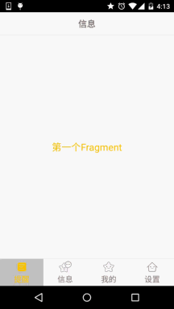
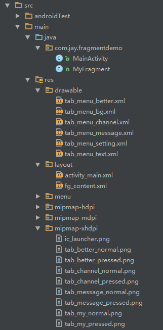

# 5.2.1 Fragment实例精讲——底部导航栏的实现(方法1)

> 来源: https://www.runoob.com/w3cnote/android-tutorial-fragment-demo1.html

## 本节引言：

> 在上一节中我们对Fragment进行了一个初步的了解，学习了概念，生命周期，Fragment管理与
> Fragment事务，以及动态与静态加载Fragment。从本节开始我们会讲解一些Fragment在实际开发
> 中的一些实例！而本节给大家讲解的是底部导航栏的实现！而基本的底部导航栏方法有很多种，
> 比如全用TextView做，或者用RadioButton，又或者使用TabLayout + RadioButton，当然复杂
> 的情况还是得走外层套布局的方法！本节我们用TextView来做一个底部导航栏的效果，也熟悉
> 下Fragment的使用！好的，开始本节内容！

## 1.要实现的效果图以及工程目录结构：

**先看看效果图吧：**

接着看看我们的**工程的目录结构**：

## 2.实现流程：

### Step 1：写下底部选项的一些资源文件

> 我们从图上可以看到，我们底部的每一项点击的时候都有不同的效果是吧！
> 我们是通过是否selected来判定的！我们要写的资源文件有：首先是图片，然后是文字，接着是背景！

图片Drawable资源：**tab_menu_channel.xml**

其他三个照葫芦画瓢！

文字资源：**tab_menu_text.xml**

背景资源：**tab_menu_bg.xml**

### Step 2：编写我们的Activity布局

**activity_main.xml:**

**代码解析：**

> 首先定义顶部标题栏的样式，48dp的LinearLayout中间加上一个TextView作为标题！
> 接着定义一个大小为56dp的LinerLayout对其底部，在这个里面加入四个TextView，比例1:1:1:1，
> 并且设置相关属性，接着在这个LinearLayout上加一条线段！
> 最后以标题栏和底部导航栏为边界，写一个FrameLayout，宽高match_parent，用做Fragment的容器！

**PS：**这里四个TextView属性是重复的，你也可以自行抽取出来，编写一个style，设置下~

---

### Step 3：隐藏顶部导航栏

意外发现以前的在Activity中调用**requestWindowFeature(Window.FEATURE_NO_TITLE)**;可以隐藏手机
自带顶部导航栏，但是写demo时候发现会报错，即使这句话写在了setContentView()之前！可能是因为
继承的是AppCompatActivity而非Activity类！
当然以前的getSupportActionbar().hide()隐藏掉Actionbar，但是他还是会在界面上！
最后还有一种方法就是自己编写一个style，然后在AndroidManifest.xml中为Application设置这个Theme：

> **注：**
> 把 requestWindowFeature(Window.FEATURE_NO_TITLE);放在super.onCreate(savedInstanceState);前面就可以隐藏ActionBar而不报错。

接着**AndroidManifest.xml**设置下theme属性：

**PS：**上述"良心代码"由好程序员曹神赞助~

### Step 4：创建一个Fragment的简单布局与类：

**fg_content.xml:**

**MyFragment.java:**

**代码解析：**

就是简单的重写了一个onCreateView()方法，其他方法可以按需重写!

### Step 5：编写MainActivity.java

先说说我们要考虑的一些关键问题：

> - Fragment什么时候初始化和add到容器中？什么时候hide和show？

> - 如何让TextView被选中？选中一个TextView后，要做一些什么操作？

> - 刚进入MainActivity怎么样让一个TextView处于Selected的状态？

嗯，接下来一一解答上面这些问题：

> - 我们选中TextView后对对应的Fragment进行判空，如果为空，初始化，并添加到容器中；
> 而hide的话，我们定义一个方法hide所有的Fragment，每次触发点击事件就先调用这个hideAll方法，
> 讲所有Fragment隐藏起来，然后如果TextView对应的Fragment不为空，我们就将这个Fragment显示出来；

> - 这个我们通过点击事件来实现，点击TextView后先重置所有TextView的选中状态为false，然后设置点击的
> TextView的选中状态为true；

> - 这个更简单，我们是通过点击事件来设置选中的，那么在onCreate()方法里加个触发点击事件的
> 方法不就可以了嘛~ **txt_channel.performClick();**

逻辑都弄懂了，直接上代码咯：

**MainActivity.java**:

## 3.代码下载：

**FragmentDemo.zip**：[FragmentDemo.zip 下载](/try/download/FragmentDemo.zip)
**声明**：图片素材来自App：**better**，本代码只做演示，并无用于商业用途！

## 4.本节小结

> 本节给大家讲解了如何使用一个LinarLayout + 四个TextView 实现一个底部导航栏以及
> Fragment add，hide，show的逻辑~还是蛮简单的，最后要感谢小猪秘密基地的基神，B神，
> 还有好程序员曹神给我的一些指点！万分感谢，仅以此篇纪念小猪重返装逼界，嗯，重
> 返应用层，嘿嘿，本节就到这里，谢谢~

### 图片清单

1. 图1 -> images/53574832.jpg （原图：https://www.runoob.com/wp-content/uploads/2015/08/53574832.jpg）
2. 图2 -> images/56213130.jpg （原图：https://www.runoob.com/wp-content/uploads/2015/08/56213130.jpg）
