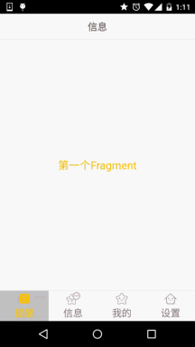

# 5.2.2 Fragment实例精讲——底部导航栏的实现(方法2)

> 来源: https://www.runoob.com/w3cnote/android-tutorial-fragment-demo2.html

## 本节引言：

> 上一节中我们使用LinearLayout + TextView实现了底部导航栏的效果，每次点击我们都要重置
> 所有TextView的状态，然后选中点击的TextView，有点麻烦是吧，接下来我们用另一种方法：
> RadioGroup + RadioButton来实现我们上一节的效果！

## 1.一些碎碎念

本节用到的是实现单选效果的RadioButton，如果你不熟悉，或者没用过，可先移步到：[RadioButton](http://blog.csdn.net/coder_pig/article/details/47035625)
简单点说就是我们就是一个RadioGroup包着四个RadioButton，和前面一样用比例来划分:1:1:1:1；
另外我们只需重写RadioGroup的onCheckedChange，判断checkid即可知道点击的是哪个RadioButton！
好的，下面开始堆码！

## 2.实现流程

**PS:**这里的素材什么的，直接使用的是上一节中的素材！另外drawable类的资源都是将selected
状态修改成checked！

### Step 1：写底部选项的一些资源文件

图片Drawable资源：**tab_menu_channel.xml**

其他三个照葫芦画瓢！

文字资源：**tab_menu_text.xml**

背景资源：**tab_menu_bg.xml**

### Step 2：编写我们的Activity布局

> 在前面用TextView实现底部导航栏我们就发现了一个问题，每个TextView的属性都几乎是差不多
> 的，而在建议那里我们也说让大家把相同的属性抽取出来写到Style中，可能部分朋友懒或者不知道
> 如何抽取出来，以及用，这里就给大家示范下：

首先我们取出其中一个RadioGroup的标签：

我们可以把每个RadioButton都相同的属性抽取出来，写到**style.xml**文件中：

然后我们的activity_main.xml中的RadioButton就用不着次次都写相同的代码了，
只需让RadioButton的**style="@style/tab_menu_item"**就可以了！

**activity_main.xml:**

---

### Step 3：隐藏顶部导航栏

**AndroidManifest.xml设置下theme属性**

### Step 4：创建一个Fragment的简单布局与类：

直接照搬上一节的布局跟Fragment：

**fg_content.xml:**

**MyFragment.java:**

### Step 5：编写MainActivity.java

这个比起TextView实现简单多了，就不详细讲解了，很简单，直接上代码：

**MainActivity.java**

**PS:**在上一节忘记讲一点了，FragmentTransaction只能使用一次，每次使用都要调用FragmentManager
的beginTransaction()方法获得FragmentTransaction事务对象哦！

## 3.运行效果图

其实和上一节实现的效果是一样的：

## 4.代码下载：

**FragmentDemo2.zip**：[FragmentDemo2.zip 下载](/try/download/FragmentDemo2.zip)

## 5.本节小结：

> 本节讲解的是实现底部导航栏的第二种方法:RadioGroup + RadioButton，有了单选，我们
> 就不用像TextView一样，每次点击后先重置所有TextView的Selected状态，再让点击的TextView
> 的Selected为true，这样就可以写少一点代码了~本节就到这里~谢谢

### 图片清单

1. 图1 -> images/39832463.jpg （原图：https://www.runoob.com/wp-content/uploads/2015/08/39832463.jpg）
