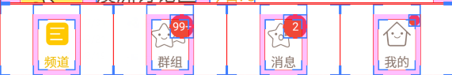
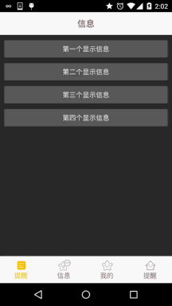

# 5.2.3 Fragment实例精讲——底部导航栏的实现(方法3)

> 来源: https://www.runoob.com/w3cnote/android-tutorial-fragment-demo3.html

## 本节引言

> 前面我们已经跟大家讲解了实现底部导航栏的两种方案，但是这两种方案只适合普通的情况，如果
> 是像新浪微博那样的，想在底部导航栏上的item带有一个红色的小点，然后加上一个消息数目这样，
> 前面两种方案就显得无力了，我们来看看别人的APP是怎么做的，打开手机的开发者选项，勾选里面的：
> **显示布局边界**，然后打开我们参考的那个App，可以看到底部导航栏是这样的：

> 
> 从上面这个图我们就可以看出，这种底部导航栏不是简单的TextView或者RadioGroup构成的，
> 大概布局方案可能是：外层一个LinearLayout，中间一个RelativeLayout，而在中间有一个TextView，
> 然后再在TextView的右上角有一个红色圆圈背景的TextView或者一个红色的小点；
> 大概就这样，而这些小点平时的时候应该设置的不可见，当收到信息推送，即有相关类别信息的
> 时候再可见，并且显示对应的信息数目！那么下面我们就来实现下这种底部导航栏的效果，
> 另外，为了方便演示，这里就不演示Fragment的切换效果了！另外顺道复习下Fragment获得Activity
> 中的组件的知识点！

## 1.实现效果图：

为了方便理解，这里通过点击按钮的形式，模拟收到推送信息，然后显示红色点！

**运行效果图：**

## 2.实现流程：

好的，接下来我们就来实现上面这个效果~

### Step 1：相关资源文件的准备：

和前面一样，准备好drawable系列的资源：

文字资源：**tab_menu_text.xml**

图标资源：**tab_menu_better.xml**

照着把其他三个也撸出来~！

### Step 2：编写activity的布局代码：

因为四个选项的TextView以及右上角的红点数字属性都差不多，如下：

我们将他们抽取出来，写到style.xml里：

然后开始编写我们的activity.xml布局：

### Step 3：编写Fragment界面布局以及类

Fragment布局由四个普通按钮构成：

**fg_my.xml**:

接着是自定义的Fragment类，这里的话我们通过getActivity.findViewById()来获得Activity
中的小红点，这里仅仅是简单的控制显示而已！
**MyFragment.java**:

### Step 4：编写MainActivity

我们在这里完成主要的逻辑实现，有些部分和前面TextView实现底部导航栏的效果类似，
就不具体讲解了，代码如下：

**MainActivity.java**：

好的，至此，就大功告成了~

## 3.代码下载：

**FragmentDemo3.zip**：[FragmentDemo3.zip下载](/try/download/FragmentDemo3.zip)

## 4.本节小结：

> 好的，本节相比前面两节稍微复杂了一点，不过还是比较容易弄懂的！
> 另外，关于实现普通底部导航栏的实现例子就写这么多吧，下一节开始我们来写下
> 在此基础上的根据手势操作切换页面的例子，嗯，就说这么多，谢谢~

### 图片清单

1. 图1 -> images/97942998.jpg （原图：https://www.runoob.com/wp-content/uploads/2015/08/97942998.jpg）
2. 图2 -> images/28511973.jpg （原图：https://www.runoob.com/wp-content/uploads/2015/08/28511973.jpg）
